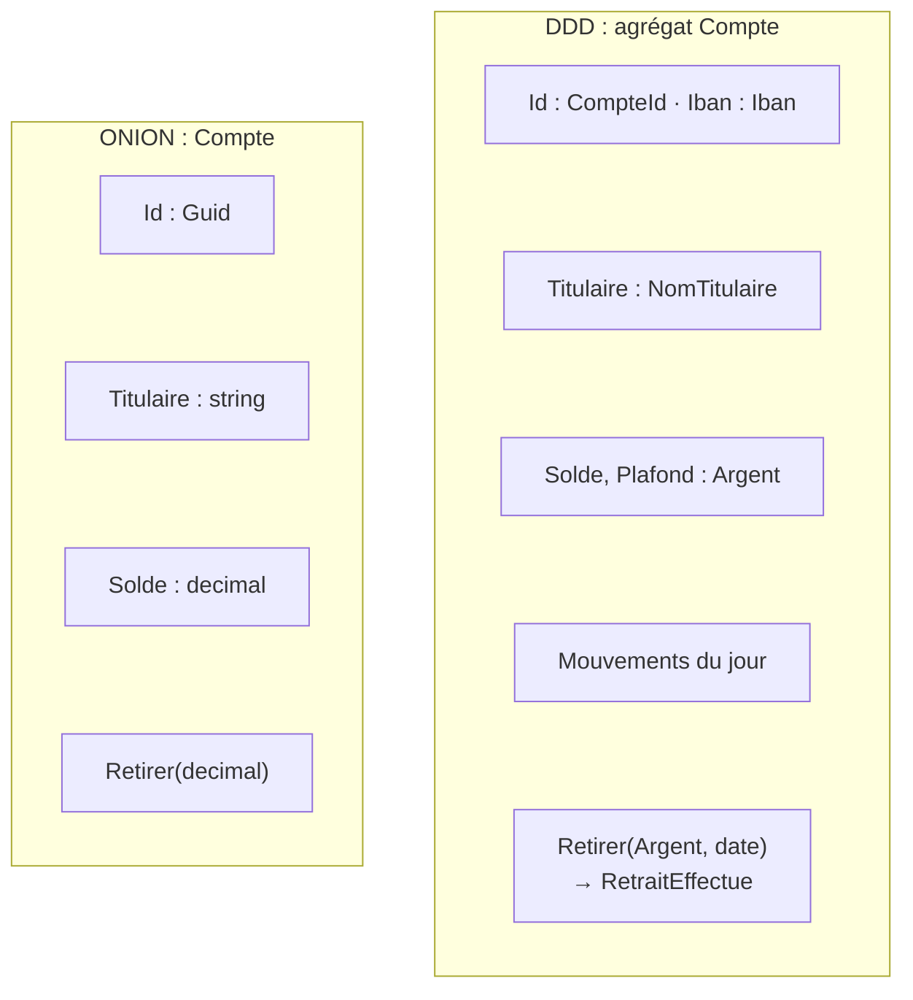

# DDD ou Hexagonale / Onion ?

**En anglais** : *Domain-Driven Design or Hexagonal / Onion Architecture?*

> **La différence en une phrase** : l'hexagonale et l'Onion disent **comment ranger** le code et dans quel sens vont
> les dépendances ; le DDD dit **quoi modéliser** et **où couper**. Ce ne sont pas des concurrents : le DDD remplit le
> centre que les deux autres protègent.

📁 Démos : [`02-Onion`](../../02-Onion) · [`11-DDD`](../../11-DDD) (sur une base Onion) ·
📖 Pages : [Hexagonale](../01-hexagonale.md) · [Onion](../02-onion.md) · [DDD](../11-ddd.md) ·
🗂️ Fiches : [1](../fiches/01-hexagonale.md) · [2](../fiches/02-onion.md) · [11](../fiches/11-ddd.md)

⬅️ [Hexagonale ou Cœur fonctionnel ?](05-hexagonale-vs-coeur-fonctionnel.md) · ➡️ [CQRS ou Event Sourcing ?](07-cqrs-vs-event-sourcing.md)

---

## Ce qu'ils partagent

Le métier au centre, isolé de l'infrastructure ; des dépôts déclarés à l'intérieur et implémentés à l'extérieur ; des
entités qui protègent leurs règles. La démo DDD reprend d'ailleurs l'organisation Onion
(`Domaine`, `Application`, `Infrastructure`, `Api`).

## Les différences point par point

| | Hexagonale / Onion | DDD |
|---|---|---|
| Nature | une **structure** : projets, interfaces, sens des références | une **démarche de conception** : langage, modèle, découpage |
| Question | où mettre ce code, qui dépend de qui ? | qu'est-ce qu'un « compte » ici, et où s'arrête ce modèle ? |
| Le centre | vide : « mettez-y le domaine » | rempli : objets-valeurs, agrégats, fabriques, services de domaine, événements |
| Types du domaine | `decimal`, `string`, `Guid` | `Argent` (montant + devise), `Iban`, `NomTitulaire`, `CompteId` |
| Les noms | ceux des développeurs | ceux des experts, consignés dans un glossaire (`LANGAGE.md`) |
| Échelle | une application | aussi **tout le système** : contextes délimités et carte des contextes |
| Relations avec l'extérieur | adapters | **couche anti-corruption**, langage publié, service hôte ouvert |
| Ce qu'il exige | de la discipline technique | des **experts métier disponibles** |

## Côte à côte : le même compte



## Dans le code des démos

**Onion** : une entité correcte, mais faite de types primitifs
([Compte.cs](../../02-Onion/Onion.Domain/Model/Compte.cs)) :

```csharp
public class Compte
{
    public Guid Id { get; private set; }
    public string Titulaire { get; private set; }
    public decimal Solde { get; private set; }
```

Rien n'empêche d'additionner des euros et des dollars, ni de passer un IBAN mal formé dans un `string`.

**DDD** : les erreurs deviennent impossibles par construction. Un `Argent` refuse de mélanger les devises
([Argent.cs](../../11-DDD/Ddd.TenueDeCompte.Domaine/ObjetsValeurs/Argent.cs)) :

```csharp
// Les opérations refusent de mélanger les devises : c'est une règle du domaine, portée par le type lui-même.
public static Argent operator +(Argent a, Argent b) => new(a.Montant + b.Montant, MemeDevise(a, b));
```

Et la **frontière de l'agrégat** est dictée par un invariant : pour vérifier le plafond **journalier**, le compte
contient ses mouvements du jour ([Compte.cs](../../11-DDD/Ddd.TenueDeCompte.Domaine/Comptes/Compte.cs)) :

```csharp
public void Retirer(Argent montant, DateTime date)
{
    VerifierDebitPossible(montant);

    var dejaRetire = RetraitsDuJour(date);
    if (dejaRetire + montant > PlafondRetraitJournalier)
        throw new RegleMetierException(
            $"Plafond de retrait journalier de {PlafondRetraitJournalier} dépassé (déjà retiré aujourd'hui : {dejaRetire}).");

    Solde -= montant;
    _mouvements.Add(new Mouvement(date, TypeMouvement.Retrait, montant, "Retrait"));
    Lever(new RetraitEffectue(Id, montant, date));
}
```

**Ce que ni l'hexagonale ni l'Onion ne disent** : qu'un « compte » n'est pas la même chose pour la Tenue de compte
(un solde, un plafond) et pour la Conformité (un dossier de vigilance, toujours en euros). Le DDD en fait **deux
contextes**, chacun avec son modèle, reliés par un événement publié (`VirementEmis`) et une demande explicite
(`BloquerCompte`). Devant le système de change hérité, une **couche anti-corruption**
([CoucheAntiCorruption.cs](../../11-DDD/Ddd.TenueDeCompte.Infrastructure/CoucheAntiCorruption.cs)) traduit son format
dans notre langage. Côté code, c'est un adapter hexagonal ; ce que le DDD ajoute, c'est la raison : ne pas laisser
le modèle d'un autre polluer le nôtre.

## Comment choisir

On ne choisit pas l'un **à la place** de l'autre :

- une structure (Hexagonale, Onion ou Clean) est utile dès que le métier a des règles ;
- le **DDD tactique** (objets-valeurs, agrégats) vaut l'effort quand le métier est riche et que des erreurs de types
  (devises, identifiants, unités) coûtent cher ;
- le **DDD stratégique** (contextes délimités) devient indispensable quand plusieurs équipes ou sous-domaines
  partagent le même système : il dit où couper les [modules](../07-monolithe-modulaire.md) et les
  [services](../08-microservices.md).

## Idées reçues

- *« Faire du DDD = avoir des dossiers Entities, ValueObjects, Repositories »* : c'est la boîte à outils tactique, la
  partie la moins importante. Sans langage partagé ni contextes, ce n'est pas du DDD.
- *« DDD = microservices »* : les contextes délimités donnent des frontières ; elles peuvent rester des modules d'un
  seul déploiement.
- *« Le DDD s'applique partout »* : pour un CRUD, c'est beaucoup de cérémonie pour rien.
