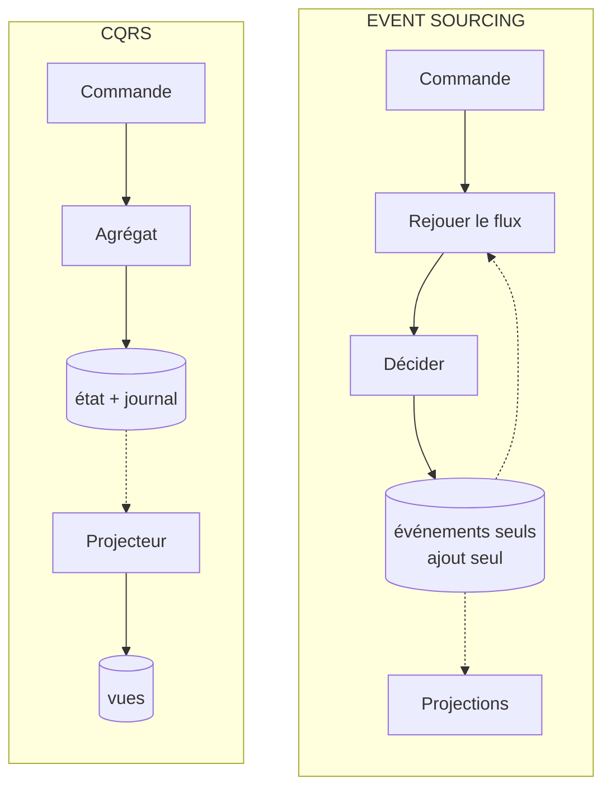

# CQRS ou Event Sourcing ?

**En anglais** : *Command Query Responsibility Segregation or Event Sourcing?*

> **La différence en une phrase** : CQRS **sépare la lecture de l'écriture** ; l'Event Sourcing **change ce qu'on
> stocke** (les faits, pas l'état). L'un ne suppose pas l'autre, même s'ils vont souvent ensemble.

📁 Démos : [`09-CQRS`](../../09-CQRS) · [`10-EventSourcing`](../../10-EventSourcing) ·
📖 Pages : [CQRS](../09-cqrs.md) · [Event Sourcing](../10-event-sourcing.md) · 🗂️ Fiches : [9](../fiches/09-cqrs.md) · [10](../fiches/10-event-sourcing.md)

⬅️ [DDD ou Hexagonale / Onion ?](06-ddd-vs-hexagonale-onion.md) · ➡️ [Composants ou Monolithe modulaire ?](08-composants-vs-monolithe-modulaire.md)

---

## Ce qu'ils partagent

Des **événements** (`CompteOuvert`, `ArgentRetire`…), des **projections** qui construisent des vues de lecture, et la
**cohérence à terme** entre ce qu'on écrit et ce qu'on lit. D'où la confusion.

## Les différences point par point

| | CQRS | Event Sourcing |
|---|---|---|
| Ce qu'il sépare / change | deux **modèles** : écrire (règles) et lire (vues) | la **persistance** : un journal d'événements en ajout seul |
| Ce qui est stocké côté écriture | l'**état** du compte (solde) **et** un journal d'événements | **uniquement les événements** ; le solde est recalculé |
| Rôle des événements | **alimenter** les vues de lecture | **être la vérité** : l'état n'existe qu'en les rejouant |
| Si on perd les événements… | l'état reste ; on ne peut plus reconstruire les vues | on perd tout |
| Charger un compte | lire une ligne | rejouer son flux (depuis un instantané) |
| Corriger une erreur | une mise à jour | un **événement compensatoire** ; rien ne s'efface |
| Concurrence | celle de la base | **numéro de version** : 409 si le flux a bougé |
| Historique, voyage dans le temps | non (seul l'état final est sûr) | **oui**, par construction |
| Faire évoluer un événement | facile (il ne sert qu'aux vues) | **upcasting** à vie : les anciens restent dans le magasin |
| Deux bases ? | pas obligatoire (deux modèles sur une base suffisent) | un magasin + les vues |

## Côte à côte



## Dans le code des démos

**CQRS** : l'écriture enregistre l'**état** (les entités suivies par EF Core) **et** ajoute les événements au journal,
dans la même transaction ([EcritureDb.cs](../../09-CQRS/Cqrs.Ecriture/Persistance/EcritureDb.cs)) :

```csharp
public async Task Enregistrer(params IEvenementDomaine[] evenementsSupplementaires)
{
    var evenements = ChangeTracker.Entries<Compte>()
        .SelectMany(entree => entree.Entity.ExtraireEvenements())
        .Concat(evenementsSupplementaires)
        .ToList();
    // … chaque événement ajouté à la table Evenements …
    await SaveChangesAsync();
}
```

**Event Sourcing** : il n'y a pas de colonne « solde ». L'agrégat **décide** (et produit un événement), puis
**applique** l'événement pour faire évoluer son état en mémoire
([Compte.cs](../../10-EventSourcing/Es.Domaine/Compte.cs)) :

```csharp
// ─── Décisions ───
// …
public void Retirer(decimal montant, string motif, DateTime date)
{
    VerifierOuvert();
    VerifierMontant(montant);
    if (montant > Solde)
        throw new RegleMetierException("Solde insuffisant.");
    Enregistrer(new ArgentRetire(Id, montant, motif, date));
}
```

```csharp
public static Compte Reconstituer(IEnumerable<IEvenement> historique) =>
    DepuisInstantane(null, historique);
```

Et le magasin refuse d'écrire si le flux a bougé depuis son chargement
([MagasinEvenements.cs](../../10-EventSourcing/Es.Stockage/MagasinEvenements.cs)) :

```csharp
var actuelle = _evenements.Count(e => e.Flux == ecriture.Flux);
if (actuelle != ecriture.VersionAttendue)
    throw new ConflitDeConcurrenceException(ecriture.Flux, ecriture.VersionAttendue, actuelle);
```

**Ce qui est possible d'un côté seulement** : les deux démos savent jeter leurs vues et les reconstruire en rejouant
leurs événements. Mais seule l'Event Sourcing peut **retrouver l'état d'écriture à une version passée**
(`GET /comptes/{id}/etat?version=2`) : en CQRS, l'état est écrasé à chaque modification, et le journal n'est qu'un
complément, qui ne garantit pas de pouvoir reconstituer un agrégat. En Event Sourcing, le journal **est** l'agrégat,
et une projection ajoutée après coup (« plus gros retraits ») connaît d'emblée tout le passé.

## Le même retrait

| Étape | CQRS | Event Sourcing |
|---|---|---|
| Charger | lire la ligne du compte | lire le flux (après le dernier instantané), rejouer |
| Décider | méthode de l'agrégat | méthode de l'agrégat (décider / appliquer) |
| Écrire | état modifié + événement au journal, une transaction | **un événement ajouté**, si la version n'a pas changé |
| Réponse | 202 : la lecture suivra | 200 avec le solde et la version ; 409 si `If-Match` ne correspond plus |
| Lecture | vue projetée (2 s de retard volontaire dans la démo) | vues projetées, ou état recalculé à la demande |

## Comment choisir

- **CQRS seul** quand les lectures sont bien plus nombreuses ou très différentes des écritures (tableaux de bord,
  relevés, recherches) : on optimise chaque côté. La variante la plus simple (deux modèles, une base, lecture
  synchrone) suffit souvent.
- **Event Sourcing** quand **l'historique est une donnée métier** : banque, comptabilité, assurance, audit
  réglementaire. Et seulement dans ces modules.
- **Les deux** : c'est le cas le plus courant pour l'Event Sourcing, qui a besoin de vues pour lire efficacement.

## Idées reçues

- *« CQRS impose deux bases et de la cohérence à terme »* : non, séparer les modèles sur une même base, avec une
  lecture synchrone, est déjà du CQRS.
- *« Event Sourcing = un bus d'événements »* : le magasin d'événements est une **base de données** ; publier des
  messages vers d'autres services est un autre sujet.
- *« Avec l'Event Sourcing, on ne peut rien effacer, donc pas de RGPD »* : on chiffre les données personnelles et on
  détruit la clé.
