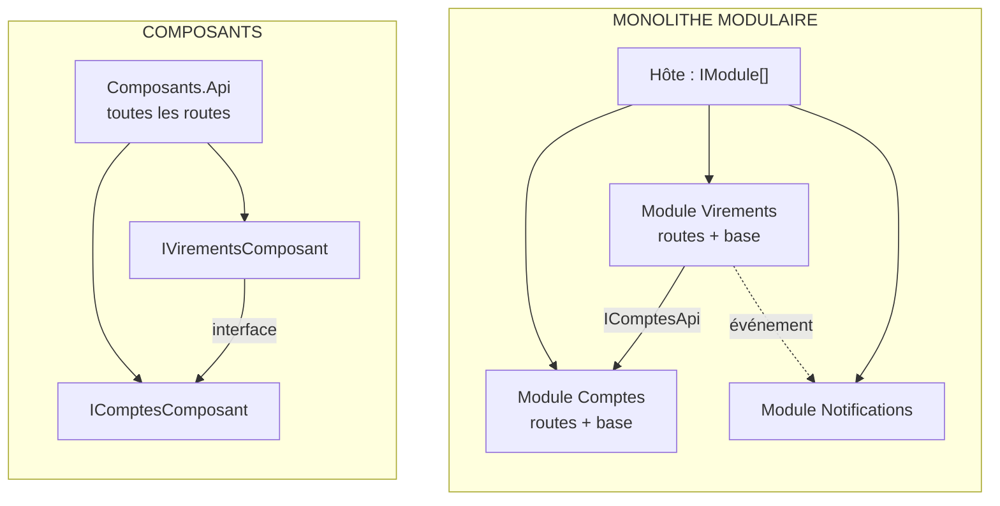

# Composants ou Monolithe modulaire ?

> **La différence en une phrase** : un composant, c'est **du métier et sa base derrière une interface** ; un module,
> c'est **une mini-application** : il possède en plus ses routes HTTP et ses abonnements aux événements, et se branche
> d'une ligne.

📁 Démos : [`06-Composants`](../../06-Composants) · [`07-MonolitheModulaire`](../../07-MonolitheModulaire) ·
📖 Pages : [Composants](../06-composants.md) · [Monolithe modulaire](../07-monolithe-modulaire.md) ·
🗂️ Fiches : [6](../fiches/06-composants.md) · [7](../fiches/07-monolithe-modulaire.md)

⬅️ [CQRS ou Event Sourcing ?](07-cqrs-vs-event-sourcing.md) · ➡️ [Monolithe modulaire ou Microservices ?](09-monolithe-modulaire-vs-microservices.md)

---

## Ce qu'ils partagent

Un seul déploiement ; **une base par unité** (Virements ne lit jamais les tables de Comptes) ; tout ce qui n'est pas
le contrat est `internal`, donc le compilateur empêche les raccourcis ; un virement entre deux unités se fait **sans
transaction commune**, avec une compensation si le crédit échoue.

## Les différences point par point

| | Composants | Monolithe modulaire |
|---|---|---|
| Surface publique | une interface (`IComptesComposant`) + DTO + `AddComposantComptes()` | une classe `IModule` ; le contrat vit dans un **projet séparé** (`Modulaire.Comptes.Contrats`) |
| Routes HTTP | dans la **couche web commune** (`Composants.Api`), qui appelle les composants | dans **chaque module** (`MapEndpoints`) |
| Communication | appels d'interface, synchrones | appels de contrat **et événements** publiés sur un bus |
| Ajouter une réaction (notifier…) | modifier l'appelant | ajouter un module abonné, sans toucher aux autres |
| Ajouter / retirer une fonctionnalité | modifier l'API et l'injection | une ligne dans `IModule[] modules = [...]` |
| Qui référence qui | Virements référence le **projet** Comptes (pour l'interface) | Virements ne référence que **Comptes.Contrats** |
| Garde-fou | `internal` + un test qui fige la liste des types publics | `internal` + projet Contrats + tests d'architecture (aucun module ne référence l'implémentation d'un autre) |
| Pas suivant | regrouper un composant avec son API et ses événements | un module devient un service |

## Côte à côte



## Dans le code des démos

**Composants** : la couche web déclare les routes et appelle le composant par son interface
([Program.cs](../../06-Composants/Composants.Api/Program.cs)) :

```csharp
// Essayez d'écrire « new ComptesDbContext(...) » ou « new Compte(...) » ici : ça ne compile pas.
app.MapPost("/comptes/{id:guid}/retrait", async (Guid id, RetraitRequete requete, IComptesComposant comptes) =>
    EnHttp(await comptes.Retirer(id, requete.Montant)));
```

**Monolithe modulaire** : l'hôte ne connaît que des modules, chacun apporte ses routes, sa base, ses abonnements
([Program.cs](../../07-MonolitheModulaire/Modulaire.Hote/Program.cs)) :

```csharp
// La liste des modules : retirer une ligne retire une fonctionnalité entière (routes, base, abonnements).
IModule[] modules = [new ComptesModule(), new VirementsModule(), new NotificationsModule()];
```

Le contrat d'un module contient aussi **ses événements**
([Contrats.cs](../../07-MonolitheModulaire/Modulaire.Comptes.Contrats/Contrats.cs)) :

```csharp
// ─── Communication asynchrone : les événements que le module publie ───
public record RetraitEffectue(Guid CompteId, decimal Montant, decimal NouveauSolde) : IEvenementIntegration;
```

Et un module peut être **ajouté sans toucher aux autres** : Notifications ne fait que s'abonner
([NotificationsModule.cs](../../07-MonolitheModulaire/Modulaire.Notifications/NotificationsModule.cs)) :

```csharp
// Abonnements aux événements des autres modules.
services.AddScoped<IGestionnaireEvenement<RetraitEffectue>, SurRetraitEffectue>();
services.AddScoped<IGestionnaireEvenement<VirementEffectue>, SurVirementEffectue>();
```

Dans la démo Composants, prévenir Bob d'un virement obligerait à modifier `VirementsComposant` (ou la couche web)
pour appeler un composant de notifications.

**Le virement, lui, est presque identique** : débiter, créditer, compenser si le crédit échoue
([VirementsComposant.cs](../../06-Composants/Composants.Virements/Interne/VirementsComposant.cs),
[VirementsEndpoints.cs](../../07-MonolitheModulaire/Modulaire.Virements/Interne/VirementsEndpoints.cs)). La différence
est **après** : le module publie `VirementEffectue` sur le bus.

## Comment choisir

- **Composants** pour une application de taille moyenne qu'on veut protéger des raccourcis, avec une seule équipe et
  une API unique.
- **Monolithe modulaire** dès qu'il y a plusieurs sous-domaines, que des fonctionnalités réagissent aux autres, ou
  que des équipes différentes possèdent des parties : chaque module évolue avec ses routes et sa base.

## Passer des composants aux modules

1. Sortir l'interface et les DTO dans un projet `*.Contrats`.
2. Déplacer les routes de la couche web dans le composant (`MapEndpoints`), qui devient un `IModule`.
3. Remplacer les appels « pour prévenir » par des événements publiés.
4. Ajouter les tests d'architecture : aucun module ne référence l'implémentation d'un autre.

## Idées reçues

- *« Un module = un dossier »* : sans `internal`, contrats séparés et tests, un dossier n'empêche rien.
- *« Une base par unité, c'est forcément plusieurs serveurs de base »* : dans les démos, ce sont des bases logiques
  distinctes ; en production, des schémas séparés sur un même serveur suffisent souvent.
