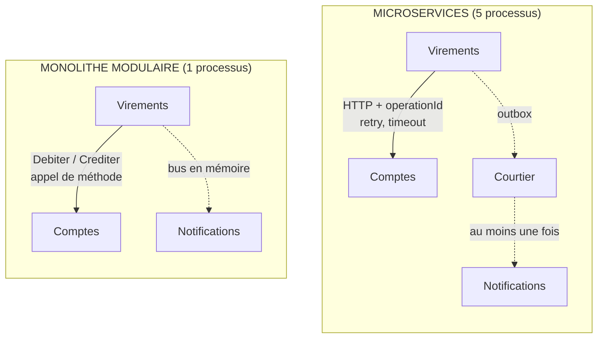

# Monolithe modulaire ou Microservices ?

**En anglais** : *Modular Monolith or Microservices?*

> **La différence en une phrase** : entre deux parties du système, un **appel de méthode** ou **le réseau**. Tout ce
> qui était gratuit dans le monolithe (un appel qui aboutit, un événement qui ne se perd pas) devient du code dans les
> microservices.

📁 Démos : [`07-MonolitheModulaire`](../../07-MonolitheModulaire) · [`08-Microservices`](../../08-Microservices) · · 🌐 [English](../en/differences/09-monolithe-modulaire-vs-microservices.md)
📖 Pages : [Monolithe modulaire](../07-monolithe-modulaire.md) · [Microservices](../08-microservices.md) ·
🗂️ Fiches : [7](../fiches/07-monolithe-modulaire.md) · [8](../fiches/08-microservices.md)

⬅️ [Composants ou Monolithe modulaire ?](08-composants-vs-monolithe-modulaire.md) · ➡️ [Microservices ou Serverless ?](10-microservices-vs-serverless.md)

---

## Ce qu'ils partagent

La **même découpe** : Comptes, Virements, Notifications. La démo 8 est littéralement la démo 7 coupée en processus.
Une base par partie, des contrats entre parties, des événements pour notifier, une compensation si le crédit échoue.

## Les différences point par point

| | Monolithe modulaire | Microservices |
|---|---|---|
| Déploiements | **1** processus | **5** (passerelle, 3 services, courtier) |
| Le contrat | un projet C# (`Modulaire.Comptes.Contrats`) | **le JSON échangé** : aucun code partagé, chaque client a sa copie du modèle distant |
| Appel entre parties | `IComptesApi.Debiter(...)` : aboutit ou lève une exception | HTTP : **retry, timeout, circuit breaker** |
| Un appel rejoué | impossible | courant (réponse perdue) → **idempotence** par `operationId` |
| Événements | bus **en mémoire** : perdus si le processus tombe | **outbox** (même transaction) + courtier « au moins une fois » |
| Un message reçu deux fois | impossible | courant → l'abonné ignore les **doublons** (`Message-Id`) |
| État d'un virement | réussi ou compensé, dans la requête | une **saga à statut** : `EnCours`, `Effectue`, `Annule`, `AReprendre` |
| Une partie en panne | tout le processus est en panne | les autres continuent ; **cohérence à terme** |
| Mise à l'échelle | le tout | **par service** |
| Garde-fou | `internal` + tests d'architecture | **le réseau** : impossible de tricher |
| Exploitation | un journal, un débogueur | traces distribuées, supervision, déploiements multiples |

## Côte à côte : le même virement



## Dans le code des démos

**L'appel.** Monolithe : une méthode du contrat
([VirementsEndpoints.cs](../../07-MonolitheModulaire/Modulaire.Virements/Interne/VirementsEndpoints.cs)) :

```csharp
// Synchronous call to another module, only through its public contract.
var debit = await accounts.Debit(source.Id, request.Amount);
```

Microservices : un client HTTP armé contre les pannes
([Micro.Virements/Program.cs](../../08-Microservices/Micro.Virements/Program.cs)) :

```csharp
// Calls to the Accounts service: the network can fail, so we protect ourselves.
// Retry (including on POST: safe, because the calls carry an idempotent operationId),
// timeout per attempt and circuit breaker so as not to insist on a service that is down.
builder.Services.AddHttpClient("accounts", (sp, client) =>
        client.BaseAddress = new Uri(sp.GetRequiredService<IConfiguration>()["Services:Accounts"]!))
    .AddStandardResilienceHandler(options =>
    {
        options.Retry.MaxRetryAttempts = 3;
        options.Retry.Delay = TimeSpan.FromMilliseconds(200);
    });
```

**Le retry impose l'idempotence** côté Comptes ([Micro.Comptes/Endpoints.cs](../../08-Microservices/Micro.Comptes/Endpoints.cs)) :

```csharp
if (await db.ProcessedOperations.FindAsync(request.OperationId) is { } alreadyProcessed)
    return Respond(alreadyProcessed);
```

**L'événement.** Monolithe : publié sur le bus après l'enregistrement ; si le processus tombe entre les deux,
l'événement est perdu. Microservices : écrit **dans la même transaction** que la donnée, puis relayé :

```csharp
// Change AND event saved together: either both, or neither.
db.Outbox.Add(OutboxMessage.Create("withdrawal-made",
    new { accountId = id, amount = request.Amount, newBalance = account.Balance }));
await db.SaveChangesAsync();
```

**La compensation.** Monolithe : si le crédit échoue, on recrédite la source, et cet appel aboutit forcément.
Microservices : la compensation elle-même peut échouer (Comptes injoignable) ; le virement passe alors à
`AReprendre`, un état qui n'existe pas dans le monolithe.

Résultat : à fonctionnalités égales, l'essentiel du code supplémentaire de la démo 8 sert à **gérer les échecs du
réseau**.

## Comment choisir

- **Monolithe modulaire d'abord** : il apporte l'essentiel des bénéfices (frontières nettes, équipes par module) à une
  fraction du coût.
- **Microservices** quand au moins l'un de ces besoins est réel : déployer une partie sans les autres, la dimensionner
  à part, l'écrire dans une autre technologie, laisser des équipes avancer sans se coordonner. **Et** quand
  l'organisation sait exploiter un système distribué.

## Passer de l'un à l'autre

Grâce aux frontières du monolithe modulaire, on extrait **un module à la fois** :

1. son contrat C# devient une API HTTP (et son client, une copie du JSON) ;
2. son bus en mémoire devient un courtier, avec outbox côté émetteur et dédoublonnage côté abonné ;
3. ses appelants gagnent retry, timeout, idempotence ;
4. une passerelle masque le découpage aux clients.

C'est exactement le passage de la démo 7 à la démo 8. Pour le faire **en production, sans arrêt**, voir le
[Strangler Fig](../22-strangler-fig.md).

## Idées reçues

- *« Les microservices, c'est pour la performance »* : un appel réseau est des milliers de fois plus lent qu'un appel
  de méthode ; on y gagne en indépendance, pas en vitesse.
- *« Un monolithe est forcément un plat de spaghettis »* : c'est le monolithe **non modulaire** qui l'est.
- *« Partager une bibliothèque de modèles entre services fait gagner du temps »* : elle recrée le couplage du
  monolithe, sans ses avantages.
