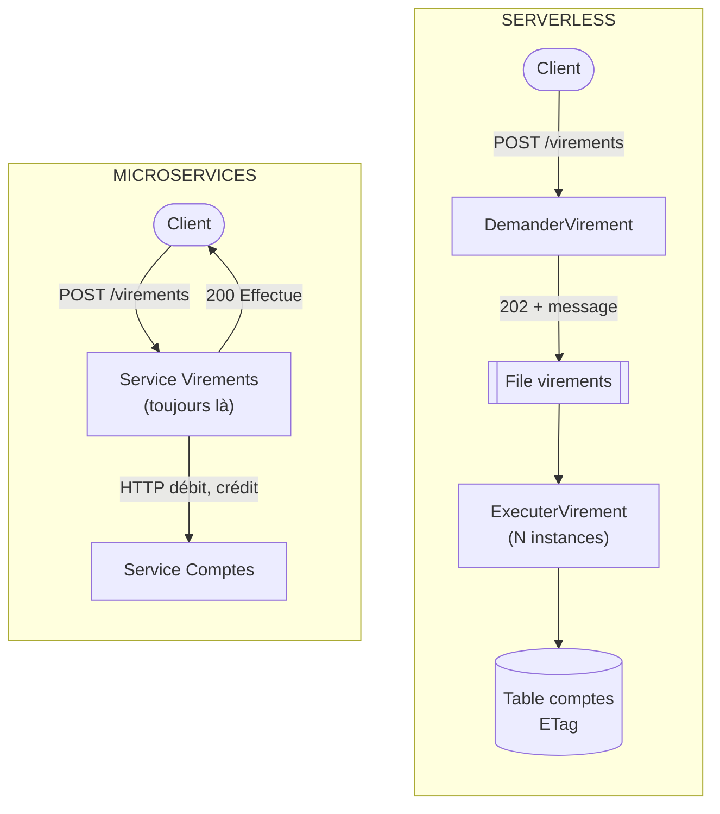

# Microservices ou Serverless ?

**En anglais** : *Microservices or Serverless?*

> **La différence en une phrase** : un microservice est un **processus qui tourne en continu**, que vous exploitez ;
> une fonction serverless **n'existe que le temps d'un événement**, sur des serveurs que gère le fournisseur.

📁 Démos : [`08-Microservices`](../../08-Microservices) · [`12-Serverless`](../../12-Serverless) (plateforme simulée) · · 🌐 [English](../en/differences/10-microservices-vs-serverless.md)
📖 Pages : [Microservices](../08-microservices.md) · [Serverless](../12-serverless.md) ·
🗂️ Fiches : [8](../fiches/08-microservices.md) · [12](../fiches/12-serverless.md)

⬅️ [Monolithe modulaire ou Microservices ?](09-monolithe-modulaire-vs-microservices.md) · ➡️ [Microkernel ou Microservices ?](11-microkernel-vs-microservices.md)

---

## Ce qu'ils partagent

Des unités déployées séparément, qui communiquent par HTTP et par messages ; donc les mêmes obligations : **livraisons
multiples → idempotence**, cohérence à terme, nouveaux essais, messages en échec mis de côté (lettres mortes d'un côté,
file *poison* de l'autre).

## Les différences point par point

| | Microservices | Serverless |
|---|---|---|
| Unité | un **service** (plusieurs routes, un processus) | une **fonction** (une méthode statique, un déclencheur) |
| Durée de vie | en continu | le temps d'un appel ; l'instance est recyclée après 20 s d'inactivité (démo) |
| État en mémoire | possible (caches, connexions) | **trompeur** : propre à une instance, perdu au démarrage à froid |
| Données | la base **du service** | des **services gérés** (tables à ETag, files, stockage d'objets) |
| Concurrence | celle de la base | écritures **conditionnelles** (ETag), relire et recommencer |
| Déclencheurs | HTTP, abonnements au courtier | HTTP, **file**, **fichier déposé**, **minuterie**, déclarés dans un manifeste |
| Mise à l'échelle | vous ajoutez des instances | automatique, **une instance par appel simultané** (10 au plus par fonction dans la démo), jusqu'à zéro |
| Latence | stable | **démarrage à froid** (≈ 600 ms dans la démo) |
| Coût | les serveurs, même au repos | **à l'usage** ; cher à forte charge constante |
| Exploitation | à vous (conteneurs, orchestrateur) | au fournisseur ; **dépendance** à celui-ci, limites de durée et de mémoire |

## Côte à côte : le même virement



## Dans le code des démos

**Microservices** : le service Virements fait le virement **dans la requête**, en appelant Comptes par HTTP, et répond
avec le statut final ([Micro.Virements/Endpoints.cs](../../08-Microservices/Micro.Virements/Endpoints.cs)).

**Serverless** : la fonction HTTP **ne fait pas** le virement ; elle l'accepte et le confie à une file
([Fonctions.cs](../../12-Serverless/Sls.Fonctions/Fonctions.cs)) :

```csharp
/// <summary>HTTP: the transfer is NOT made here. It is accepted (202) and handed to a queue: immediate response.</summary>
public static async Task<HttpResponseData> Request(HttpRequestData request, FunctionContext context)
```

Il n'y a ni contrôleur ni `Program.cs` de service : un **manifeste** déclare qui réagit à quoi
([Deploiement.cs](../../12-Serverless/Sls.Fonctions/Deploiement.cs)) :

```csharp
.Http("RequestTransfer", "POST", "/transfers", TransfersFunctions.Request)
// …
.Queue("ExecuteTransfer", Queues.Transfers, TransfersFunctions.Execute, memoryMb: 256)
.Storage("ProcessImport", "imports/", ImportsFunctions.Process, memoryMb: 512)
.Timer("ProduceReport", TimeSpan.FromSeconds(30), ReportsFunctions.Produce);
```

**L'état** : un microservice peut garder ce qu'il veut en mémoire tant qu'il tourne. Une fonction non, et la démo le
montre côte à côte ([Fonctions.cs](../../12-Serverless/Sls.Fonctions/Fonctions.cs)) :

```csharp
// ✗ Instance memory: specific to THIS instance, reset at each cold start.
var instanceCounter = (context.InstanceMemory.TryGetValue("visits", out var v) ? (long)v : 0) + 1;
context.InstanceMemory["visits"] = instanceCounter;

// ✓ Managed service: shared by all the instances, durable.
var global = await Concurrency.ModifyOrCreate(context.Table(Tables.Counters), "visits",
    new Counter(0), c => c with { Value = c.Value + 1 });
```

**La concurrence** : dans les microservices, chaque service a sa base et ses transactions. En serverless, des dizaines
d'instances écrivent dans la même table gérée : on écrit **seulement si personne n'a écrit entre-temps** (ETag), sinon
on relit et on recommence ([Modele.cs](../../12-Serverless/Sls.Fonctions/Modele.cs)).

**L'échelle** : un import de 8 lignes produit 8 messages, donc **8 instances** d'`ExecuterVirement` en même temps
(mesuré : `picInstances = 8`), sans rien configurer. Côté microservices, il faudrait lancer plus d'instances du
service Virements soi-même.

## Comment choisir

- **Serverless** pour les traitements **événementiels** et **irréguliers** : fichiers déposés, webhooks, files,
  tâches planifiées, « colle » entre services cloud. La démo complète coûte 0,000054 $.
- **Microservices** pour un trafic soutenu, des latences stables, des traitements longs, des états en mémoire
  (caches, connexions), ou une indépendance vis-à-vis d'un fournisseur.
- **Les deux ensemble**, très souvent : des services pour le cœur, des fonctions pour les traitements périphériques.

## Idées reçues

- *« Serverless = sans serveur »* : sans serveur **à gérer**.
- *« Serverless = toujours moins cher »* : à charge constante et élevée, un serveur dédié coûte moins.
- *« Une fonction = un microservice »* : une fonction n'a ni état, ni base propre, ni durée de vie ; un microservice
  regroupe souvent plusieurs fonctions et leurs données.
