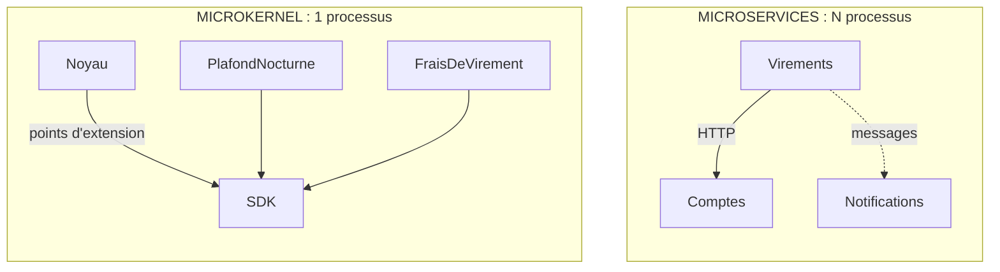

# Microkernel ou Microservices ?

**En anglais** : *Microkernel or Microservices?*

> **La différence en une phrase** : malgré le préfixe commun, le microkernel **étend** une application (des plugins
> chargés dans son processus), les microservices la **découpent** (des processus séparés). L'un répond à « comment
> ajouter des variantes ? », l'autre à « comment déployer des parties séparément ? ».

📁 Démos : [`13-Microkernel`](../../13-Microkernel) · [`08-Microservices`](../../08-Microservices) · · 🌐 [English](../en/differences/11-microkernel-vs-microservices.md)
📖 Pages : [Microkernel](../13-microkernel.md) · [Microservices](../08-microservices.md) ·
🗂️ Fiches : [13](../fiches/13-microkernel.md) · [8](../fiches/08-microservices.md)

⬅️ [Microservices ou Serverless ?](10-microservices-vs-serverless.md) · ➡️ [Saga orchestrée ou Chorégraphie ?](12-saga-orchestree-vs-choregraphie.md)

---

## Ce qu'ils partagent

Des morceaux qui **ne se référencent pas** et ne se rencontrent qu'à l'exécution, à travers un contrat ; la
possibilité d'ajouter, retirer ou mettre à jour un morceau **sans recompiler les autres**.

## Les différences point par point

| | Microkernel | Microservices |
|---|---|---|
| Question | ajouter des **variantes** (par client, pays, offre) sans toucher au cœur | **déployer et dimensionner** des parties indépendamment |
| Processus | **un seul** : les plugins tournent dans celui du noyau | un par service |
| Le contrat | un **SDK** : des interfaces .NET (`IControleOperation`, `IRegleFrais`…) | du **JSON** sur le réseau |
| Qui appelle qui | le **noyau** appelle les plugins, aux points d'extension qu'il a prévus | chaque service appelle qui il veut, par HTTP ou messages |
| Coût d'un appel | un appel de méthode | un aller-retour réseau, qui peut échouer |
| Mettre à jour un morceau | déposer une DLL : rechargée **à chaud** | redéployer un service |
| Un morceau défaillant | le plugin est écarté (« en erreur ») ; l'opération est refusée par sécurité | le service est injoignable ; les autres réessaient, compensent |
| Isolation | **aucune isolation de sécurité** : un plugin peut tout faire | forte : processus, réseau, base séparés |
| Données | celles du noyau ; les plugins reçoivent des **valeurs** | une base par service |
| Piège principal | changer un point d'extension casse tous les plugins ; SDK à versionner | pannes partielles, idempotence, exploitation |

## Côte à côte



## Dans le code des démos

**Microkernel** : c'est le noyau qui décide où les extensions interviennent, et dans quel ordre
([NoyauBancaire.cs](../../13-Microkernel/Mk.Noyau/NoyauBancaire.cs)) :

```csharp
// 1. Point d'extension « contrôle » : un seul refus suffit.
foreach (var controle in plugins.Actifs<IControleOperation>())
{
    string? refus = null;
    if (!Proteger(controle, () => refus = controle.Verifier(operation)))
        return Resultat.Refus($"Le plugin {controle.Nom} est en erreur : opération refusée par sécurité.");
    if (refus is not null)
        return Resultat.Refus($"[{controle.Nom}] {refus}");
}
```

Un plugin est une classe chargée depuis une DLL, dans son propre contexte, mais **dans le même processus**
([ChargeurPlugins.cs](../../13-Microkernel/Mk.Noyau/ChargeurPlugins.cs)) :

```csharp
internal sealed class ContexteChargement(string cheminDll)
    : AssemblyLoadContext(Path.GetFileNameWithoutExtension(cheminDll), isCollectible: true)
```

**Microservices** : Virements appelle Comptes **à travers le réseau**, avec tout ce qu'il faut pour survivre à ses
pannes ([Micro.Virements/Program.cs](../../08-Microservices/Micro.Virements/Program.cs)) :

```csharp
builder.Services.AddHttpClient("comptes", (sp, client) =>
        client.BaseAddress = new Uri(sp.GetRequiredService<IConfiguration>()["Services:Comptes"]!))
    .AddStandardResilienceHandler(options =>
    {
        options.Retry.MaxRetryAttempts = 3;
        options.Retry.Delay = TimeSpan.FromMilliseconds(200);
    });
```

Ce qui en découle :

- un plugin `FraisDeVirement` s'exécute **dans** l'opération du noyau ; pas de réseau, pas d'idempotence à prévoir ;
- un plugin qui boucle ou lit le disque peut nuire à tout le processus ; un service fautif ne nuit qu'à lui-même ;
- ajouter une règle de frais à un microservice demande de le **redéployer** ; au microkernel, de **déposer** une DLL.

## Comment choisir

- **Microkernel** pour un produit au cœur stable et aux variantes nombreuses : logiciel configurable par client,
  moteur de règles, outil extensible par des tiers (VS Code, navigateurs, paie).
- **Microservices** pour des équipes indépendantes, des besoins de mise à l'échelle différents, des cycles de
  déploiement séparés.
- **Plugins non fiables** (écrits par des inconnus) : ni l'un ni l'autre tel quel ; il faut un processus séparé par
  plugin, ce qui rapproche le microkernel… des microservices.

## Les combiner

Un microservice peut très bien être organisé en microkernel : le service « Frais » a un noyau stable et charge les
grilles tarifaires de chaque client comme des plugins.

## Idées reçues

- *« Microkernel = petits services »* : c'est une seule application, dont le cœur est petit.
- *« Les plugins sont isolés »* : leur **chargement** est isolé (contextes séparés, déchargeables), pas leur exécution.
