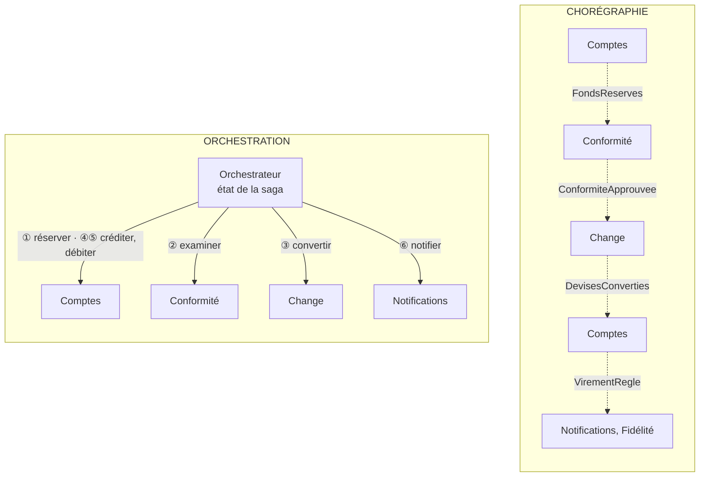

# Saga orchestrée ou Chorégraphie ?

**En anglais** : *Orchestrated Saga or Event-Driven Choreography?*

> **La différence en une phrase** : le **même virement en plusieurs étapes**, écrit **en un seul endroit** (un
> orchestrateur qui appelle chaque service) ou **nulle part** (chaque service réagit aux événements des autres).

📁 Démos : [`14-SagaOrchestree`](../../14-SagaOrchestree) · [`21-Choregraphie`](../../21-Choregraphie) (mêmes données, · 🌐 [English](../en/differences/12-saga-orchestree-vs-choregraphie.md)
mêmes règles, pour comparer sur pièces) · 📖 Pages : [Saga orchestrée](../14-saga-orchestree.md) ·
[Chorégraphie](../21-choregraphie.md) · 🗂️ Fiches : [14](../fiches/14-saga-orchestree.md) · [21](../fiches/21-choregraphie.md)

⬅️ [Microkernel ou Microservices ?](11-microkernel-vs-microservices.md) · ➡️ [Pipeline ou Chorégraphie ?](13-pipeline-vs-choregraphie.md)

---

## Ce qu'elles partagent

Un processus réparti sur plusieurs services, donc **pas de transaction unique** : des étapes locales, des
**compensations** en cas d'échec. Dans les deux démos : les fonds sont d'abord **réservés**, un analyste humain décide
au-delà de 10 000 €, le change convertit, le **débit définitif est le point de non-retour** (après lui, on réessaie,
on ne défait plus), les participants sont idempotents.

## Les différences point par point

| | Saga orchestrée | Chorégraphie |
|---|---|---|
| Le processus est écrit… | **en un seul fichier** (`DefinitionVirement.cs`) | **nulle part** : il émerge des abonnements |
| Un service connaît… | l'orchestrateur connaît **tous** les participants | **personne** : seulement des contrats d'événements (test d'architecture) |
| « Où en est le virement 42 ? » | l'**état de la saga**, enregistré après chaque pas | une **projection** à construire (le service Suivi, qui écoute les 13 types d'événements) |
| Compensation | **ordre inverse**, par le moteur, réessayée jusqu'à réussir | **dispersée** : Comptes libère les fonds sur `ConformiteRefusee` **et** sur `ChangeEchoue` |
| Un participant en panne | le moteur réessaie (4 fois), puis compense ou passe « à traiter manuellement » | **silence** : le courtier réessaie, met aux lettres mortes ; la réservation **expire** au bout de 30 s |
| Attente humaine | une étape « en attente », avec une **échéance** gérée par le moteur | la Conformité attend ; elle doit aussi écouter `ReservationExpiree` |
| Ajouter une réaction (fidélité…) | modifier la définition | **s'abonner**, sans toucher aux autres |
| Point unique de défaillance | l'orchestrateur | le courtier |
| La carte du système | la définition | la liste des abonnements, **à l'exécution** (`GET /bus`) |

## Côte à côte



## Dans le code des démos

**Orchestration** : le processus se lit de haut en bas, avec ses compensations à côté de chaque étape
([DefinitionVirement.cs](../../14-SagaOrchestree/Saga.Orchestrateur/DefinitionVirement.cs)) :

```csharp
new("ReserverFonds",
    async s => { await comptes.Reserver(s.Id, s.Source, s.Montant); return Issue.Succes; },
    Compenser: s => comptes.Liberer(s.Id, s.Source)),
// …
new("DebiterDefinitivement",
    async s => { await comptes.Capturer(s.Id, s.Source); return Issue.Succes; },
    PointDeNonRetour: true),
```

Et c'est le moteur qui décide quoi faire d'un échec
([MoteurSaga.cs](../../14-SagaOrchestree/Saga.Orchestrateur/MoteurSaga.cs)) :

```csharp
else if (PointDeNonRetourPasse(saga))
{
    // On ne peut plus défaire : l'argent a déjà été débité définitivement.
    ATraiterManuellement(saga, $"{etape.Nom} impossible après {options.TentativesMax} tentatives : {message}");
}
else
{
    DemarrerCompensation(saga, $"{etape.Nom} impossible après {options.TentativesMax} tentatives : {message}");
}
```

**Chorégraphie** : aucun fichier ne décrit le processus. Le seul fil est la **corrélation** et la **cause** portées
par chaque événement, qui permettent de le raconter après coup
([Bus.cs](../../21-Choregraphie/Choreo.Bus/Bus.cs)) :

```csharp
/// <summary>Un nouvel événement, en réaction à celui-ci : même corrélation, et celui-ci pour cause.</summary>
public T Suite<T>(T suivant, string emetteur) where T : Evenement =>
    suivant with { Correlation = Correlation, Cause = Id, Emetteur = emetteur };
```

Quand le change tombe en panne, personne n'attend sa réponse. Le filet de sécurité est **local** : Comptes donne une
durée de vie à ses réservations et émet `ReservationExpiree`. Chaque cas tardif (analyste qui décide trop tard,
règlement qui arrive après l'expiration) a demandé une ligne de code dans **un service différent**.

En revanche, ajouter le service Fidélité n'a demandé **aucune** modification ailleurs : il s'abonne à
`VirementRegle`, et le test `Ajouter_un_abonne_ne_change_rien_pour_les_autres` le prouve. Côté orchestration, il
aurait fallu ajouter une étape à la définition.

## Le même incident : le change est en panne

| | Saga orchestrée | Chorégraphie |
|---|---|---|
| Qui s'en aperçoit | le moteur (exception à l'étape ③) | le courtier (livraison en échec) |
| Ce qui se passe | nouveaux essais, puis compensation : fonds libérés, saga « Annulée » | 4 essais, lettres mortes ; le virement reste « EnCours », 200 € réservés |
| Comment ça finit | immédiatement, par le moteur | 30 s plus tard, par l'expiration de la réservation : « Abandonné » |
| Où le voir | `GET /sagas/{id}` : l'historique complet | `GET /bus/lettres-mortes`, `GET /virements/bloques` |

## Comment choisir

- **Orchestration** pour **conduire** un processus métier à plusieurs étapes, avec attentes, délais et règles d'échec
  précises (commande, virement international, souscription). En production : Temporal, Durable Functions, Step
  Functions, sagas MassTransit / NServiceBus.
- **Chorégraphie** pour les **réactions** à un fait (notifier, facturer, archiver, alimenter un tableau de bord) et les
  processus courts, stables, à peu de participants.

## Les combiner

Le plus courant : un orchestrateur conduit le processus, puis publie `VirementEffectue` ; notifications, fidélité,
comptabilité **chorégraphient** autour, sans que l'orchestrateur les connaisse.

## Idées reçues

- *« La chorégraphie est plus découplée, donc meilleure »* : le couplage n'a pas disparu, il est devenu **implicite**
  (qui doit écouter quoi pour que le processus se termine).
- *« L'orchestrateur est un point de défaillance unique »* : le courtier l'est tout autant en chorégraphie ; et
  l'état de la saga, enregistré à chaque pas, permet de reprendre après un plantage.
