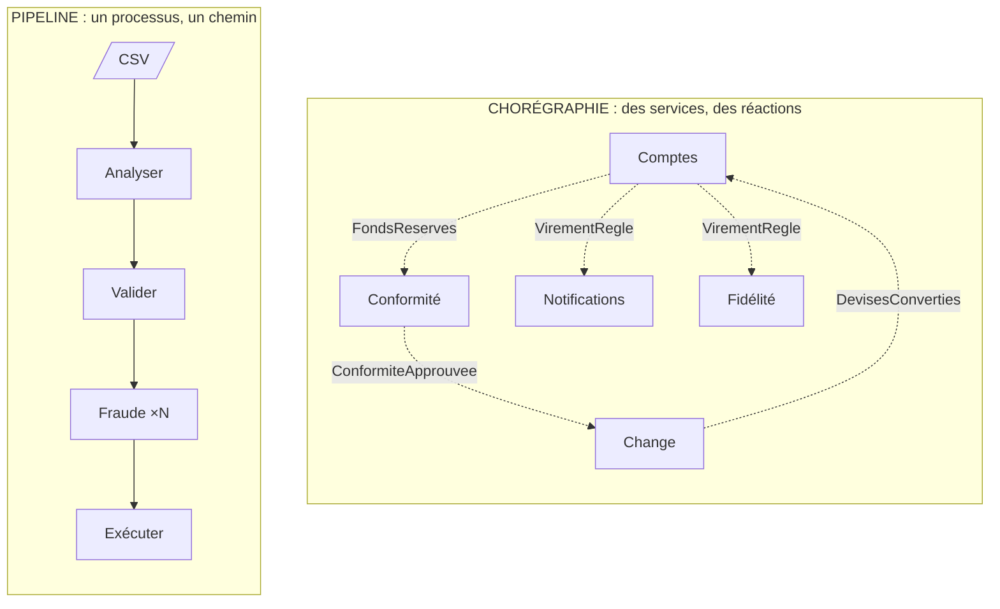

# Pipeline ou Chorégraphie ?

**En anglais** : *Pipes and Filters or Event-Driven Choreography?*

> **La différence en une phrase** : dans un pipeline, des **données** traversent une suite d'étapes **fixée à
> l'assemblage**, dans un même processus ; dans une chorégraphie, des **faits** circulent entre services, et le chemin
> **émerge** des abonnements.

📁 Démos : [`20-Pipeline`](../../20-Pipeline) · [`21-Choregraphie`](../../21-Choregraphie) · · 🌐 [English](../en/differences/13-pipeline-vs-choregraphie.md)
📖 Pages : [Pipeline](../20-pipeline.md) · [Chorégraphie](../21-choregraphie.md) ·
🗂️ Fiches : [20](../fiches/20-pipeline.md) · [21](../fiches/21-choregraphie.md)

⬅️ [Saga orchestrée ou Chorégraphie ?](12-saga-orchestree-vs-choregraphie.md) · ➡️ [Multi-tenant ou Cellules ?](14-multi-tenant-vs-cellules.md)

---

## Ce qu'elles partagent

Des étapes **indépendantes** qui ne se connaissent pas, reliées par un intermédiaire (tuyau ou courtier) ; une étape
qui écarte un élément sans arrêter le reste ; des **reprises idempotentes** ; un ordre logique entre étapes que
personne n'appelle explicitement.

## Les différences point par point

| | Pipeline | Chorégraphie |
|---|---|---|
| Ce qui circule | des **données à transformer** : les lignes d'un fichier CSV | des **faits** : « fonds réservés », « devises converties » |
| Le chemin | **linéaire, fixé à l'assemblage** : Analyser → Valider → … → Exécuter | **émerge** des abonnements ; un fait peut déclencher plusieurs réactions |
| Portée | **un traitement**, dans un processus | **un processus métier**, entre services |
| L'intermédiaire | un tuyau **borné** (64 éléments) : plein, il fait attendre l'étage d'avant | un courtier qui **stocke** : pas de contre-pression |
| Débit | celui de l'étage le plus lent ; on **parallélise le goulot** (8 copies du contrôle de fraude) | chaque service à son rythme |
| Ordre | **préservé** (l'étage parallèle ré-ordonne) : la ligne 2 peut dépendre de la ligne 1 | aucune garantie entre virements différents |
| Un élément refusé | **rejeté avec un motif**, compté au bilan | un événement de refus (`ConformiteRefusee`), auquel d'autres réagissent |
| Une panne | une exception **arrête tout** le pipeline ; on rejoue le fichier | **silence** : lettres mortes, puis expiration |
| Ajouter une étape | réassembler le pipeline | s'abonner |
| Vue d'ensemble | le code d'assemblage | les abonnements, à l'exécution |

## Côte à côte



## Dans le code des démos

**Pipeline** : un tuyau plein **bloque** l'étage qui écrit ; c'est ce qui borne la mémoire, quelle que soit la taille
du fichier ([Etage.cs](../../20-Pipeline/Pipeline.Noyau/Etage.cs)) :

```csharp
/// <summary>Écrire dans un tuyau plein BLOQUE : l'étage attend que le suivant ait de la place. C'est la contre-pression.</summary>
private async Task Ecrire(ChannelWriter<Element<TSortie>> sortie, Element<TSortie> element, ContexteExecution contexte)
```

Et le premier étage en échec arrête tous les autres
([Pipeline.cs](../../20-Pipeline/Pipeline.Noyau/Pipeline.cs)) :

```csharp
// Le premier étage qui échoue arrête tous les autres.
foreach (var tache in taches)
    _ = tache.ContinueWith(_ => arret.Cancel(), TaskContinuationOptions.OnlyOnFaulted);
```

**Chorégraphie** : chaque service garde les identifiants déjà traités, et réagit en publiant la suite ; rien ne le
ralentit si le suivant est lent, rien ne l'arrête si le suivant tombe
([Autres.cs](../../21-Choregraphie/Choreo.Services/Autres.cs)) :

```csharp
lock (Verrou)
{
    if (_traites.Contains(recu.Id))
        return;
    if (reagir() is { } suite)
        Bus.Publier(suite);
    _traites.Add(recu.Id);
}
```

## Comment choisir

- **Pipeline** quand des données passent par une suite d'étapes indépendantes **à l'intérieur d'un traitement** :
  imports, exports, ETL, lots (paie, facturation), flux de journaux ou de médias, compilateurs.
- **Chorégraphie** quand des **services** doivent réagir à ce qui arrive ailleurs, sans se connaître.

## Les combiner

Un import de virements peut être un pipeline **dans** le service Comptes, et chaque virement exécuté publier un
événement que d'autres services chorégraphient. Les deux démos ne se font pas concurrence : elles vivent à deux
échelles différentes.

## Idées reçues

- *« Un pipeline, c'est séquentiel »* : tous les étages travaillent **en même temps**, chacun sur un élément différent.
- *« Mettre une file entre chaque étape, c'est un pipeline »* : sans tuyaux bornés, on perd la contre-pression, donc la
  mémoire bornée.
