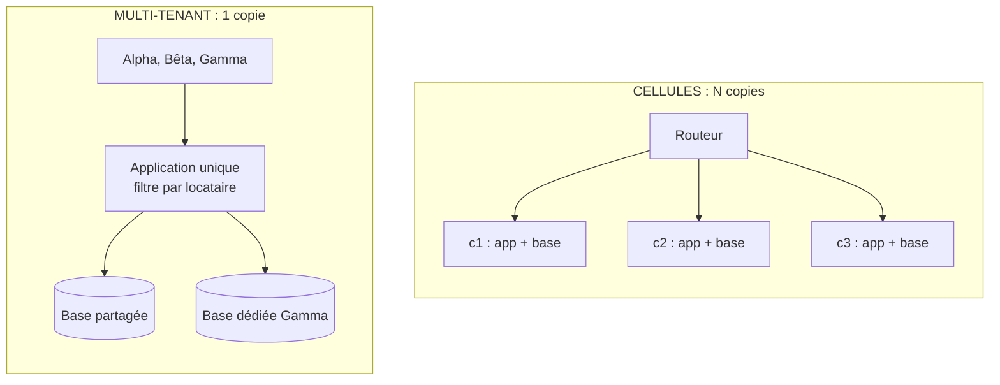

# Multi-tenant ou Cellules ?

**En anglais** : *Multi-tenant Architecture or Cell-Based Architecture?*

> **La différence en une phrase** : le multi-tenant fait tourner **une seule copie** du système pour tous les clients,
> afin de **mutualiser** ; les cellules en font tourner **plusieurs copies complètes**, chacune pour un groupe de
> clients, afin de **borner le rayon d'impact**.

📁 Démos : [`15-MultiTenant`](../../15-MultiTenant) · [`17-CellBased`](../../17-CellBased) · · 🌐 [English](../en/differences/14-multi-tenant-vs-cellules.md)
📖 Pages : [Multi-tenant](../15-multi-tenant.md) · [Cellules](../17-cell-based.md) ·
🗂️ Fiches : [15](../fiches/15-multi-tenant.md) · [17](../fiches/17-cell-based.md)

⬅️ [Pipeline ou Chorégraphie ?](13-pipeline-vs-choregraphie.md) · ➡️ [Cellules ou Microservices ?](15-cellules-vs-microservices.md)

---

## Ce qu'ils partagent

Les deux répartissent **des clients** sur une infrastructure : chaque requête porte l'identité du client, qui décide
où (et avec quelles règles) elle est traitée. Les deux savent placer un client dans une base à part (base dédiée d'un
côté, cellule de l'autre) et se heurtent au même voisin gênant : le client qui consomme trop.

## Les différences point par point

| | Multi-tenant | Cellules |
|---|---|---|
| Objectif | **mutualiser** : un déploiement, une version, des coûts partagés | **cloisonner** : une panne, un bogue, un client gourmand restent dans une cellule |
| Copies de l'application | **une** | **N** cellules complètes (API, règles, données), + un routeur |
| Qui est « le client » | une **organisation** (une banque cliente du SaaS) | un **client final** (alice, bob…) ou un groupe |
| Données | base partagée (filtre par locataire) **ou** base dédiée | une base **par cellule**, avec plusieurs clients dedans |
| Isolation | **logique**, construite dans le code : filtre global, estampillage, clé composite | **physique** : processus et données séparés |
| Une panne touche… | potentiellement **tous** les clients | les clients **d'une cellule** (2 sur 5 dans la démo) |
| Un mauvais déploiement | tout le monde en même temps | une cellule **canari**, puis par vagues |
| Le voisin bruyant | **quotas** par locataire (60 ou 600 requêtes/min) | il reste dans sa cellule ; au besoin, on le **migre** |
| Grandir | ajouter des serveurs à l'instance unique | **ajouter des cellules** de taille connue et testée |
| Risque principal | **fuite de données** entre clients au moindre oubli | opérations **entre cellules** (lentes, compensées) ; N fois l'infrastructure |

## Côte à côte



## Dans le code des démos

**Multi-tenant** : l'isolation est une affaire de **code**, concentrée dans le `DbContext`
([BankDbContext.cs](../../15-MultiTenant/Mt.Bank/BankDbContext.cs)) :

```csharp
private void Isolate<T>(ModelBuilder model) where T : class, IBelongsToTenant
{
    // Composite key: two tenants can have an account with the same identifier (here, Alice and Bob exist everywhere)
    // without conflict in the shared database.
    model.Entity<T>().HasKey(nameof(IBelongsToTenant.TenantId), "Id");
    model.Entity<T>().HasQueryFilter(e => e.TenantId == CurrentTenant);
}
```

Oublier ce filtre, c'est exposer une banque à une autre. Les cellules n'ont pas ce risque : une cellule ne contient que
ses clients, et n'a aucun moyen de lire ceux d'une autre.

**Cellules** : l'isolation est une affaire de **topologie**. Quand une cellule tombe, le routeur ne renvoie l'erreur
qu'à ses clients ([Relay.cs](../../17-CellBased/Cell.Router/Relay.cs)) :

```csharp
catch (HttpRequestException)
{
    // Blast radius: only the customers of THIS cell get this error.
```

**Le client gourmand** : le multi-tenant le **bride** par un quota propre à sa formule
([Setup.cs](../../15-MultiTenant/Mt.Tenants/Setup.cs)) ; les cellules le **déplacent** dans une autre
cellule (copie, bascule du routage, nettoyage) sans que les autres clients le remarquent.

**Grandir** : le multi-tenant ajoute un client en quelques secondes (une ligne dans le catalogue). Les cellules aussi,
tant qu'il reste de la place ; quand toutes sont pleines, on n'agrandit pas une cellule, on en ajoute une
([ControlPlane.cs](../../17-CellBased/Cell.Router/ControlPlane.cs)) :

```csharp
/// <summary>The least loaded open cell that still has room.</summary>
public CellInfo? ChooseCell() => registry.All()
    .Where(c => c.Open && placement.Count(c.Id) < c.Capacity)
    .OrderBy(c => placement.Count(c.Id)).ThenBy(c => c.Id)
    .FirstOrDefault();
```

## Comment choisir

- **Multi-tenant** dès qu'on vend **le même logiciel à plusieurs organisations** : c'est le modèle économique du SaaS.
  Commencer par la base partagée avec un filtre global, proposer la base dédiée à qui la paie.
- **Cellules** à **très grande échelle**, quand une panne générale coûte plus cher que N copies de l'infrastructure,
  et qu'une clé de partition naturelle (le client) fait tenir presque toutes les opérations dans une cellule.

## Les combiner

C'est le cas le plus fréquent chez les grands SaaS : **des cellules, chacune multi-tenant à l'intérieur**. Un client
est d'abord routé vers sa cellule, puis isolé des autres locataires de la même cellule par le filtre. La base dédiée
du multi-tenant devient, à l'extrême, une cellule dédiée.

## Idées reçues

- *« Une base dédiée par client = des cellules »* : la base est séparée, mais l'application, son déploiement et ses
  bogues restent partagés.
- *« Les cellules remplacent l'isolation par locataire »* : une cellule contient plusieurs clients ; il faut toujours
  les isoler entre eux.
