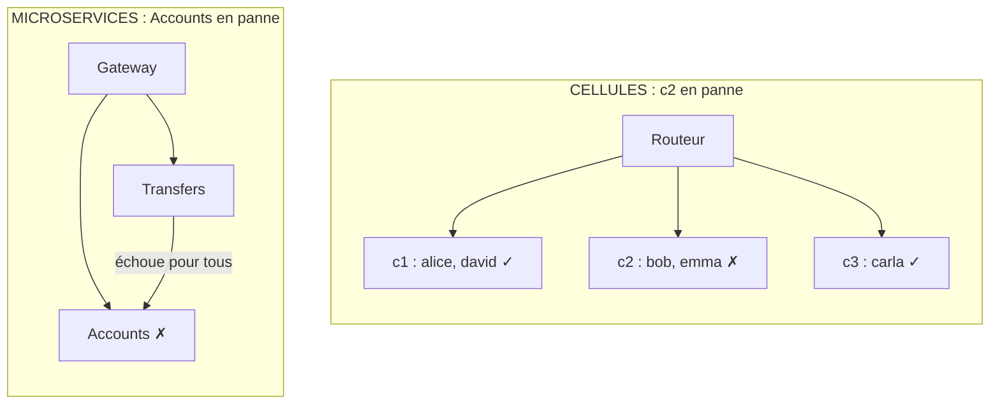

# Cellules ou Microservices ?

**En anglais** : *Cell-Based Architecture or Microservices?*

> **La différence en une phrase** : les deux découpent le système en morceaux qui tournent séparément, mais **pas sur
> le même axe** : les microservices découpent **par fonction** (comptes, virements), les cellules **par groupe de
> clients** (chaque cellule a toutes les fonctions).

📁 Démos : [`08-Microservices`](../../08-Microservices) · [`17-CellBased`](../../17-CellBased) · · 🌐 [English](../en/differences/15-cellules-vs-microservices.md)
📖 Pages : [Microservices](../08-microservices.md) · [Cellules](../17-cell-based.md) ·
🗂️ Fiches : [8](../fiches/08-microservices.md) · [17](../fiches/17-cell-based.md)

⬅️ [Multi-tenant ou Cellules ?](14-multi-tenant-vs-cellules.md) · ➡️ [Acteurs ou Spatiale ?](16-acteurs-vs-spatiale.md)

---

## Ce qu'ils partagent

Plusieurs processus, un point d'entrée qui aiguille (passerelle ou routeur), une base par morceau, et pour tout ce qui
traverse deux morceaux : **idempotence** (identifiant d'opération) et **compensation** si le second ne répond pas.

## Les différences point par point

| | Microservices | Cellules |
|---|---|---|
| Axe de découpe | **fonctionnel** : un service par sous-domaine | **par clients** : une copie complète par groupe |
| Morceaux différents ? | **oui** : chaque service a son propre code | **non** : toutes les cellules font tourner le même code |
| Un virement Alice → Bob | traverse **toujours** plusieurs services (Virements → Comptes) | reste **local** si Alice et Bob sont dans la même cellule |
| Échanges entre morceaux | constants, au cœur du fonctionnement | **rares** : à éviter par le choix de la clé de partition |
| Le point d'entrée | passerelle : aiguille **par route** (`/accounts`, `/transfers`) | routeur : aiguille **par client** (alice → c1) |
| Une panne touche… | **une fonction, pour tous** les clients | **toutes les fonctions, pour un groupe** de clients |
| Déployer | **service par service**, chacun à son rythme | la même version, **cellule par cellule** (canari, vagues) |
| Grandir | ajouter des instances du service le plus chargé | ajouter des cellules de taille connue |
| Équipes | une équipe par service | une équipe pour le produit, une pour la plateforme de cellules |

## Côte à côte : où tombe une panne



## Dans le code des démos

**Microservices** : Virements appelle **toujours** Comptes par le réseau, avec retry et idempotence, pour n'importe
quel virement ([Micro.Transfers/Program.cs](../../08-Microservices/Micro.Transfers/Program.cs),
[Micro.Accounts/Endpoints.cs](../../08-Microservices/Micro.Accounts/Endpoints.cs)).

**Cellules** : un virement entre deux clients de la même cellule est une **transaction locale**. Seul un virement entre
cellules passe par le routeur, avec un identifiant d'opération et une compensation, exactement comme en
microservices (test `A_transfer_within_the_same_cell_stays_local`, et
`If_the_beneficiary_s_cell_is_down_the_transfer_is_compensated`).

**Le relevé réel après l'arrêt d'une cellule** : alice, carla et david répondent 200 ; bob et emma reçoivent
« Cellule c2 injoignable : seuls ses clients sont touchés » ([Relay.cs](../../17-CellBased/Cell.Router/Relay.cs)).
L'arrêt du service Comptes, lui, empêche **tous** les clients de consulter leur compte et de virer.

**Déployer** : dans les cellules, une version défectueuse s'arrête à la cellule canari ; sa sonde de santé rejoue un
retrait de contrôle ([Version.cs](../../17-CellBased/Cell.App/Version.cs)) :

```csharp
public (bool Healthy, string Detail) Probe()
{
    var result = Withdraw(100m, 10m);
    return result == 90m
        ? (true, "check withdrawal correct")
        : (false, $"check withdrawal incorrect: 100 - 10 = {result}");
}
```

En microservices, une version défectueuse de Comptes touche immédiatement tous les clients, sauf à ajouter soi-même un
déploiement progressif.

## Comment choisir

- **Microservices** pour l'**indépendance des équipes et des déploiements** par sous-domaine.
- **Cellules** pour la **résilience** à très grande échelle, quand une panne générale est inacceptable.

## Les combiner

Ils sont orthogonaux : **une cellule peut contenir des microservices**. Le routeur aiguille d'abord le client vers sa
cellule, puis la passerelle de la cellule aiguille la route vers le bon service. On cumule alors les deux coûts : N
cellules × M services à exploiter.

## Idées reçues

- *« Plusieurs instances d'un microservice = des cellules »* : les instances partagent la même base et la même
  version ; une cellule a ses propres données et peut avoir sa propre version.
- *« Les cellules évitent les problèmes du distribué »* : seulement si la clé de partition fait tenir presque toutes
  les opérations dans une cellule ; sinon, on cumule les inconvénients des deux.
