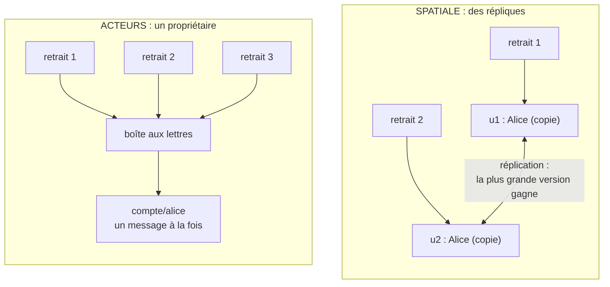

# Acteurs ou Spatiale ?

**En anglais** : *Actor Model or Space-Based Architecture?*

> **La différence en une phrase** : les deux gardent l'état **en mémoire**, mais les acteurs donnent à chaque donnée
> **un seul propriétaire** (aucune écriture ne se perd), quand l'architecture spatiale la **réplique** dans chaque
> unité (des écritures simultanées peuvent se perdre).

📁 Démos : [`18-ModeleActeurs`](../../18-ModeleActeurs) · [`19-SpaceBased`](../../19-SpaceBased) · · 🌐 [English](../en/differences/16-acteurs-vs-spatiale.md)
📖 Pages : [Acteurs](../18-modele-acteurs.md) · [Spatiale](../19-space-based.md) ·
🗂️ Fiches : [18](../fiches/18-modele-acteurs.md) · [19](../fiches/19-space-based.md)

⬅️ [Cellules ou Microservices ?](15-cellules-vs-microservices.md) · ➡️ [Ce qu'on place devant les services](17-passerelle-bff-graphql-strangler.md)

---

## Ce qu'elles partagent

L'état est en mémoire, la base sert à **recharger** après une panne ; une requête n'attend pas un aller-retour vers la
base pour lire ; on passe à l'échelle en ajoutant des unités de calcul. Et dans les deux démos, une même expérience
(des centaines de retraits simultanés sur le compte d'Alice) révèle tout.

## Les différences point par point

| | Acteurs | Spatiale |
|---|---|---|
| Problème visé | la **concurrence** : plusieurs requêtes sur la même donnée | la **base qui sature** : trop de requêtes pour elle |
| Une donnée vit… | dans **un seul** acteur (`compte/alice`) | **répliquée** dans chaque unité de traitement |
| Écritures simultanées | **mises en file** dans la boîte aux lettres, traitées une par une | appliquées **en parallèle** dans plusieurs répliques |
| Écriture perdue ? | **jamais** | **possible** (collision : la plus grande version gagne) |
| Parade | structurelle : un propriétaire, un message à la fois | le **routage par affinité** (même clé → même unité), imparfait |
| La base | état durable écrit par l'acteur ; relu par une nouvelle incarnation | sauvegarde **en différé** (pompe) ; peut tomber sans arrêter le service |
| Passer à l'échelle | des millions d'acteurs, **activés à la demande**, répartis | 2 à 6 unités, ajoutées selon la charge, chacune avec **toutes** les données |
| Une panne | l'acteur fautif est **remplacé** (supervision) ; les autres ne voient rien | une unité tombe : ses requêtes vont ailleurs ; toutes tombent : démarrage à froid depuis la base |
| Opération sur deux données | une conversation (acteur `virement/…`), avec compensation | sans transaction ; risque de collision sur chaque clé |
| Limite | lectures transversales, cycles de demandes (interblocages) | tout en mémoire, base en retard, collisions |

## Côte à côte : 3 requêtes sur le compte d'Alice



## Dans le code des démos

**Acteurs** : un seul lecteur par boîte aux lettres, qui attend la fin de chaque message avant le suivant
([SystemeActeurs.cs](../../18-ModeleActeurs/Acteurs.Noyau/SystemeActeurs.cs)) :

```csharp
// LE point clé du modèle : un seul message à la fois, chacun traité jusqu'au bout avant le suivant.
reponse = await activation.Instance!.Recevoir(enveloppe.Message);
```

Le compte peut donc écrire le code le plus naïf : lire, vérifier, modifier, sans verrou
([CompteActeur.cs](../../18-ModeleActeurs/Acteurs.Banque/CompteActeur.cs)) :

```csharp
if (debit && montant > etat.Solde)
    return new Refus($"Solde insuffisant ({etat.Solde:0.00} €).");
```

**Spatiale** : l'écriture est appliquée dans la réplique locale, puis **publiée** vers les autres répliques et la
pompe, sans les attendre ([GrilleDeDonnees.cs](../../19-SpaceBased/Espace.Grille/GrilleDeDonnees.cs)) :

```csharp
// La base n'est pas sur le chemin de la requête : l'écriture part dans la pompe, on n'attend pas.
_versLaPompe(modification);
```

À la réception, une réplique détecte qu'une modification ne part pas de la version qu'elle connaît : c'est une
collision, et la plus grande version gagne ([Replique.cs](../../19-SpaceBased/Espace.Grille/Replique.cs)) :

```csharp
var concurrente = locale != m.Precedente && locale.Unite != "" && locale.Unite != m.Version.Unite;
```

La parade est de router une même clé toujours vers la même unité
([GrilleDeMessages.cs](../../19-SpaceBased/Espace.Grille/GrilleDeMessages.cs)) :

```csharp
: _unites.MaxBy(u => Hachage($"{cle}/{u.Id}"))!;
```

## La même expérience, deux résultats

| Essai réel | Acteurs | Spatiale |
|---|---|---|
| Requêtes | 1 000 retraits de 3 € simultanés (Alice : 1 000 €) | 200 retraits de 1 € simultanés (Alice : 1 000 €) |
| Résultat | 333 acceptés, solde final 1 € : **exact** | **affinité** : 200 acceptés, 800 € : exact |
| | | **tourniquet** : 200 acceptés, 700 € : **100 € perdus**, 199 mises à jour écrasées |

En spatiale, même l'affinité n'est pas une garantie : pendant qu'une unité arrive ou part, une clé peut changer de
propriétaire et une écriture se perdre (test `En_affinite_un_changement_d_unites_ouvre_une_fenetre_de_collision`).
Les acteurs n'ont pas ce problème, car **le propriétaire est la donnée elle-même**.

## Comment choisir

- **Acteurs** pour beaucoup d'entités indépendantes, à l'état **très disputé** et souvent modifié : comptes, paniers,
  joueurs, objets connectés, sessions.
- **Spatiale** pour des **pics de charge énormes** que la base ne suit pas, sur des données qui tiennent en mémoire et
  sont **lues souvent, écrites rarement** ou bien partitionnées : billetterie, enchères, réservations. Mauvais choix
  pour de vrais soldes, et la démo s'en sert justement pour **montrer** les collisions.

## Les combiner

Les deux se rejoignent quand on passe d'un cache **répliqué** à un cache **distribué** : chaque donnée a alors une seule
copie maîtresse, sur une seule unité. C'est déjà presque un acteur (Orleans en est l'exemple : des acteurs répartis,
dont l'annuaire dit quel serveur héberge lequel).

## Idées reçues

- *« En mémoire = plus de base »* : les deux démos écrivent l'état durable ; seule la place de la base sur le chemin
  de la requête change.
- *« Les acteurs suppriment les problèmes du distribué »* : pas de transaction entre acteurs, et un cycle de demandes
  (A attend B qui attend A) les bloque jusqu'au délai.
