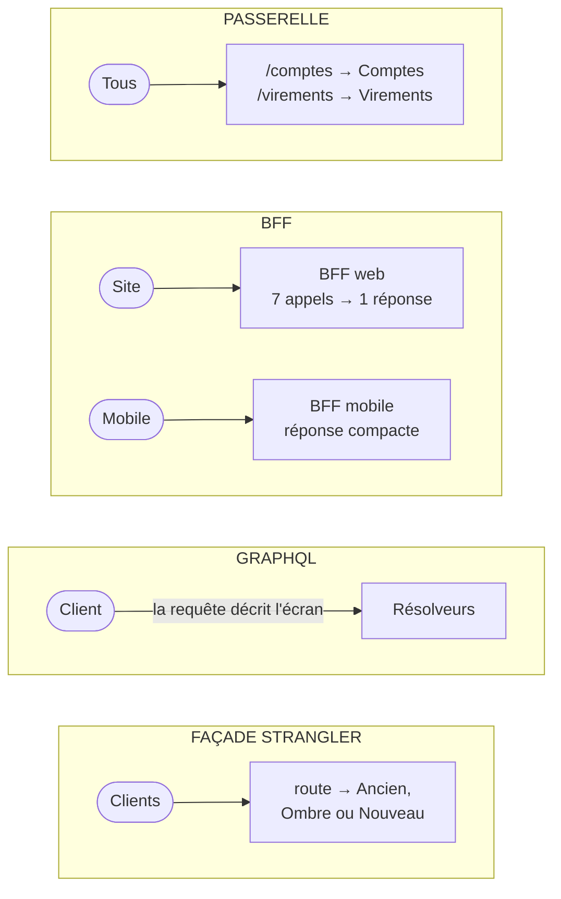

# Passerelle, BFF, GraphQL ou façade Strangler ?

> **La différence en une phrase** : quatre composants placés **devant** les services, qu'on confond parce qu'ils
> relaient tous des requêtes ; mais la passerelle **aiguille** (pour tous), le BFF **adapte** (pour une application),
> GraphQL **laisse le client décrire** sa réponse, et la façade du Strangler Fig **migre** (le temps de remplacer un
> système).

📁 Démos : [`08-Microservices`](../../08-Microservices) (passerelle) · [`16-BFF`](../../16-BFF) ·
[`23-RestGrpcGraphQL`](../../23-RestGrpcGraphQL) · [`22-StranglerFig`](../../22-StranglerFig) ·
📖 Pages : [Microservices](../08-microservices.md) · [BFF](../16-bff.md) · [REST, gRPC, GraphQL](../23-rest-grpc-graphql.md) ·
[Strangler Fig](../22-strangler-fig.md)

⬅️ [Acteurs ou Spatiale ?](16-acteurs-vs-spatiale.md) · ➡️ [Sommaire](README.md)

---

## Ce qu'ils partagent

Un point d'entrée unique pour le client, qui ne voit pas ce qu'il y a derrière ; des routes internes jamais exposées ;
aucune règle métier (elles restent dans les services). Et ils se combinent : on les trouve souvent **empilés**.

## Les différences point par point

| | Passerelle d'API | BFF | GraphQL | Façade Strangler Fig |
|---|---|---|---|---|
| Rôle | **aiguiller** une route vers un service | **adapter** les services à **une** application | laisser **le client** décrire la forme de la réponse | **migrer** une route de l'ancien système vers le nouveau |
| Combien ? | une, pour tous les clients | **une par type d'application** (web, mobile) | un schéma pour tous | une, devant l'ancien système |
| Qui l'écrit | l'équipe plateforme | l'équipe de l'application | l'équipe API (schéma), le client (requêtes) | l'équipe de migration |
| Contient | une table de routage, la santé agrégée | agrégation, mise en forme, session, versions de l'application | des résolveurs par champ | une table de routage **avec modes** (Ancien, Ombre, Nouveau) |
| Requêtes vers l'aval | une par requête reçue | **plusieurs, en parallèle** (7 pour le tableau de bord) | autant que de champs demandés (attention au N+1) | une (deux en mode ombre) |
| Forme de la réponse | celle du service | **taillée pour l'écran** | **celle demandée** | **identique** à l'ancien contrat |
| Sécurité | authentification, quotas | **le jeton reste sur le serveur** (cookie HttpOnly) | à borner : profondeur, coût | celle de l'ancien |
| Durée de vie | permanente | permanente | permanente | **temporaire** : devient une simple passerelle |

## Côte à côte



## Dans le code des démos

**Passerelle** : une table « préfixe → service » ; ce qui n'y est pas reste invisible
([Micro.Passerelle/Program.cs](../../08-Microservices/Micro.Passerelle/Program.cs)) :

```csharp
// Table de routage : préfixe public → service. Tout ce qui n'y figure pas (ex. /interne/…) reste invisible.
var routes = app.Configuration.GetSection("Routes").Get<Dictionary<string, string>>() ?? [];
```

**BFF** : un écran, une requête du navigateur, et derrière, des appels en parallèle
([TableauDeBord.cs](../../16-BFF/Bff.Web/TableauDeBord.cs)) :

```csharp
// ② Puis tout le reste EN PARALLÈLE : la durée totale est celle de l'appel le plus lent, pas la somme.
var conseiller = services.Conseiller(profil.ConseillerId, jeton);
var offres = Facultatif(annulation => services.Offres(profil.Segment, jeton, annulation), BudgetOffres);
var comptes = profil.Comptes.Select(id => CompteAvecOperations(id, jeton)).ToList();
Task[] appels = [conseiller, offres, .. comptes];
await Task.WhenAll(appels);
```

Mesuré : 7 appels aux services, ≈ 300 ms au lieu de ≈ 900 ms s'ils étaient enchaînés.

**GraphQL** : pas de route par écran ; le client envoie la description de ce qu'il affiche, et la réponse a
exactement cette forme ([démo 23](../23-rest-grpc-graphql.md)) :

```graphql
query EcranAccueil($id: ID!, $n: Int) {
  client(id: $id) {
    nom
    comptes { numero libelle solde operations(derniers: $n) { date libelle montant } }
  }
}
```

Résultat mesuré pour l'écran d'accueil mobile : **1 requête** en GraphQL, contre 5 en REST. Le BFF obtient le même
gain, mais avec **une route écrite pour cet écran** ; GraphQL l'obtient sans route dédiée.

**Façade Strangler** : même mécanique qu'une passerelle, plus un **mode** par route, modifiable à chaud ; ce qui n'est
pas déclaré reste à l'ancien ([Relais.cs](../../22-StranglerFig/Fig.Facade/Relais.cs)) :

```csharp
var route = table.Trouver(http.Request.Method, chemin);
var mode = route?.Mode ?? Mode.Ancien;   // ce que personne n'a repris reste à l'ancien : c'est le point de départ
```

## Comment choisir

- Une **passerelle** dès qu'il y a plusieurs services derrière un point d'entrée public.
- Un **BFF** quand plusieurs applications clientes aux besoins différents utilisent les mêmes services, ou qu'une
  application web ne doit pas manipuler de jeton.
- **GraphQL** quand les écrans sont nombreux, riches et changeants, et qu'écrire un BFF (ou une route) par écran
  devient le goulot.
- Une **façade Strangler** le temps de remplacer un système en production.

## Les combiner

L'empilement le plus courant : **passerelle** en entrée (sécurité, quotas), **BFF** derrière elle pour chaque
application, et un BFF peut exposer **du GraphQL** à son application. Pendant une migration, la façade Strangler
**est** la passerelle ; à la fin, elle le reste, avec toutes ses routes en `Nouveau`.

## Idées reçues

- *« GraphQL remplace le BFF »* : il remplace l'agrégation par écran, pas la gestion de session ni la sécurité propre
  à une application.
- *« La passerelle peut tout faire »* : y mettre de l'agrégation par écran la transforme en BFF partagé, que toutes
  les équipes doivent modifier.
