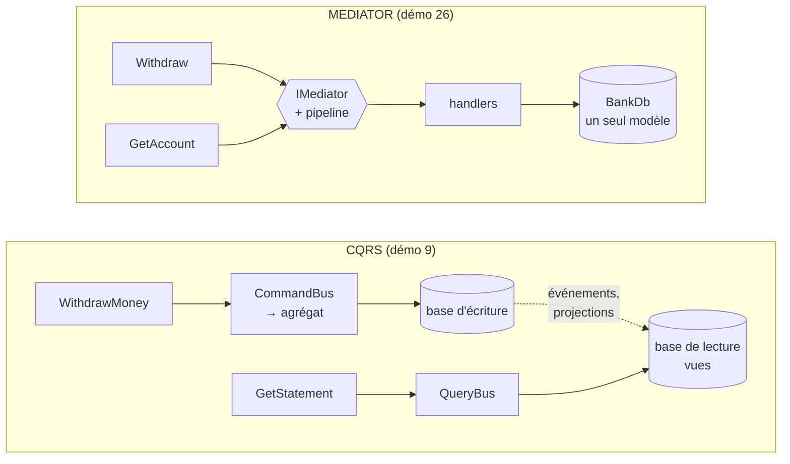

# Mediator ou CQRS ?

**En anglais** : *Mediator or Command Query Responsibility Segregation?*

> **La différence en une phrase** : le médiateur sépare **celui qui appelle du code appelé** (un message, un handler,
> un pipeline) ; le CQRS sépare **le modèle qui écrit du modèle qui lit**. On les confond parce que MediatR a popularisé
> le vocabulaire « commande » et « requête » ; mais un médiateur ne fait pas un CQRS, et un CQRS se passe très bien
> d'un médiateur.

📁 Démos : [`09-CQRS`](../../09-CQRS) · [`26-Mediator`](../../26-Mediator) · 🌐 [English](../en/differences/18-mediator-vs-cqrs.md)
📖 Pages : [CQRS](../09-cqrs.md) · [Mediator](../26-mediator.md) · 🗂️ Fiches : [9](../fiches/09-cqrs.md) · [26](../fiches/26-mediator.md)

⬅️ [Passerelle, BFF, GraphQL ou façade Strangler ?](17-passerelle-bff-graphql-strangler.md) · ➡️ [Sommaire](README.md)

---

## Ce qu'ils partagent

Des messages nommés à l'impératif (`Withdraw`, `MakeTransfer`), **un handler par message**, un point d'entrée unique
qui fait passer chaque message par des étapes communes (validation, journal). Les deux démos ont même chacune un
validateur appelé avant le handler. D'où la confusion, entretenue par des milliers de tutoriels « CQRS avec MediatR »
qui ne séparent rien d'autre que des classes.

## Les différences point par point

| | Mediator | CQRS |
|---|---|---|
| Ce qu'il sépare | l'**appelant** et le **code appelé** | le **modèle d'écriture** et le **modèle de lecture** |
| Question à laquelle il répond | comment appeler, et que faire autour de chaque appel ? | comment représenter les données pour écrire, et pour lire ? |
| Point d'entrée | **un** médiateur pour tout (`IMediator.Send`) | souvent **deux** : `CommandBus` et `QueryBus` dans la démo 9 ; ou de simples services |
| Modèle de données | **un seul** : la lecture interroge les tables des commandes | **deux** : agrégats pour écrire, vues dénormalisées pour lire |
| Bases | une | une ou deux ; deux dans la démo 9, reliées par des événements |
| Cohérence | immédiate (même base, même transaction) | souvent à terme : la lecture suit l'écriture avec un retard |
| Événements | notifications **en processus**, dans la transaction de l'émetteur | événements qui **alimentent** les vues de lecture (projections) |
| Réponse d'une commande | n'importe laquelle (ici, le nouveau solde) | rien, ou un identifiant ; on lit ensuite la vue (202 dans la démo 9) |
| Ce qu'il coûte | l'indirection : le compilateur ne voit plus le chemin | deux modèles à maintenir, données dupliquées, retard de lecture |
| Sans l'autre ? | oui : la démo 26 est un médiateur **sans** CQRS | oui : rien n'oblige à passer par un médiateur |

## Côte à côte



## Dans le code des démos

**Mediator** : la lecture et l'écriture passent par le même médiateur, et la lecture interroge **les mêmes tables**
que les commandes ([GetAccount.cs](../../26-Mediator/Med.Bank/Features/Accounts/GetAccount.cs)) :

```csharp
/// <summary>A query reads the same tables as the commands: the mediator does not separate the models.</summary>
internal class GetAccountHandler(BankDb db) : IRequestHandler<GetAccount, AccountView>
```

`ICommand` et `IQuery` n'y sont que des étiquettes, que le pipeline utilise pour savoir quand enregistrer
([Behaviors.cs](../../26-Mediator/Med.Bank/Pipeline/Behaviors.cs)) :

```csharp
if (request is not ICommand<TResponse>)
    return await next();
```

**CQRS** : un bus pour les commandes, qui valide avant le handler, exactement le rôle d'un médiateur, écrit en
quelques lignes, et que la démo 9 a toujours eu ([CommandBus.cs](../../09-CQRS/Cqrs.Write/Commands/CommandBus.cs)) :

```csharp
/// <summary>
/// Single entry point for the commands: a shared "pipeline" (validation, logging)
/// before the handler. It is the role MediatR often plays, written here in a few lines.
/// </summary>
public class CommandBus(IServiceProvider services, ILogger<CommandBus> logger)
```

Ce qui fait le CQRS de la démo 9 n'est pas ce bus : c'est que ses commandes et ses requêtes vivent dans **deux projets
qui ne se connaissent pas** (`Cqrs.Write`, `Cqrs.Read`), sur **deux bases**, reliées par des événements que des
projections transforment en vues. Remplacer les deux bus par MediatR ne changerait rien au CQRS ; les supprimer non
plus.

## Le même retrait

| Étape | Mediator (démo 26) | CQRS (démo 9) |
|---|---|---|
| Entrée | `mediator.Send(new Withdraw(…))` | `commandBus.Send(new WithdrawMoney(…))` |
| Avant le handler | journal, validation (comportements du pipeline) | validation, journal (dans le bus) |
| Écriture | entité modifiée, `SaveChanges` par le pipeline | agrégat modifié + événement au journal, une transaction |
| Réponse | 200 avec le nouveau solde | 202 : la lecture suivra |
| Lecture suivante | les mêmes tables, aussitôt à jour | la vue projetée, quand la projection est passée |

## Comment choisir

- **Un médiateur** quand beaucoup de cas d'utilisation partagent les mêmes préoccupations (validation, transaction,
  audit, droits) et qu'on veut les écrire une fois ; il va bien avec les [tranches verticales](../05-vertical-slice.md).
- **Le CQRS** quand les lectures sont bien plus nombreuses, ou d'une autre forme, que les écritures (tableaux de bord,
  relevés, recherche) : on optimise chaque côté séparément.
- **Les deux** : courant, et légitime ; mais le CQRS commence quand les **modèles** se séparent, pas quand les classes
  s'appellent `…Command` et `…Query`.

## Idées reçues

- *« Nous faisons du CQRS : nous avons des commandes et des requêtes MediatR »* : si les requêtes lisent les mêmes
  entités que les commandes, c'est un médiateur, pas un CQRS (c'est exactement la démo 26).
- *« Le CQRS exige un médiateur »* : non ; la démo 9 a deux bus de quelques lignes, et de simples services
  conviendraient aussi.
- *« Les notifications du médiateur sont des événements, comme en CQRS »* : elles tournent dans le même processus et
  la même transaction ; les événements du CQRS alimentent un autre modèle, souvent ailleurs et plus tard.
