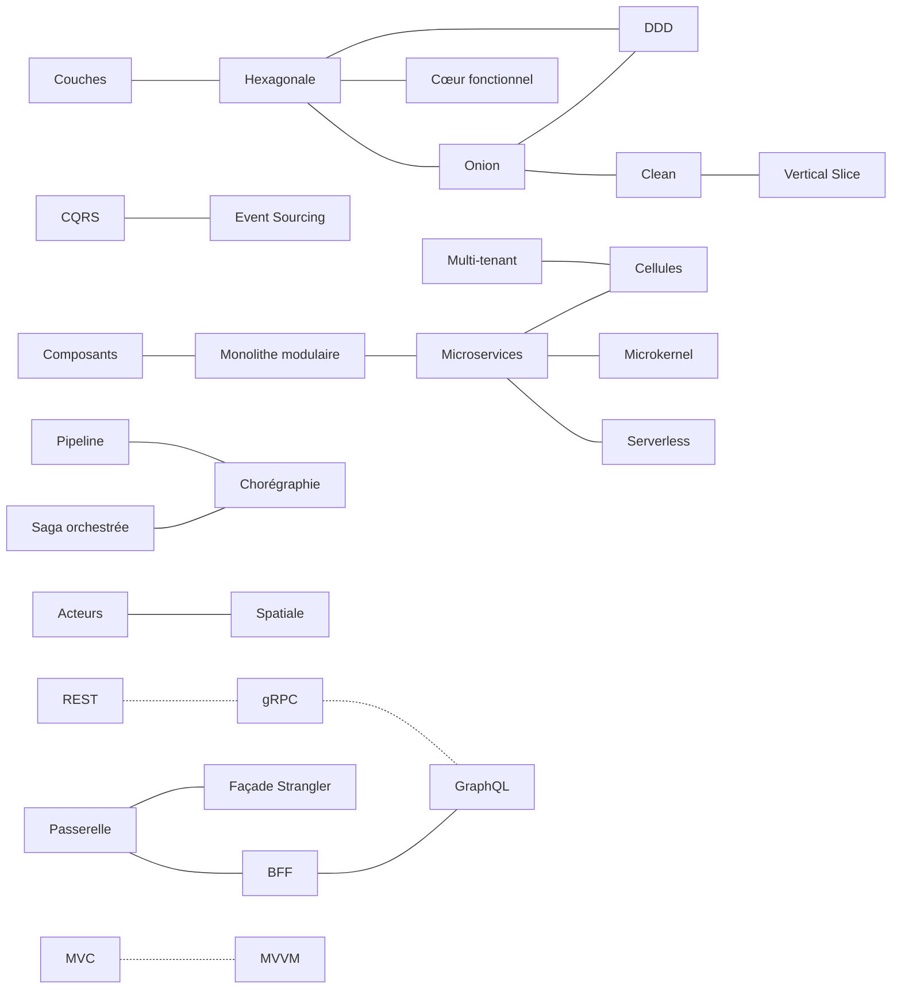

# Les différences entre architectures

🌐 [English](../en/differences/README.md)

Hexagonale ou Onion ? CQRS ou Event Sourcing ? Saga ou chorégraphie ? Ces pages comparent, **deux à deux**, les
architectures qu'on confond le plus, et seulement sur ce qui les **distingue**. Chacune s'appuie sur le code des démos :
le même métier bancaire, le même virement, écrit dans les deux architectures.

📖 Documentation complète : [Docs](../README.md) · 🗂️ [Fiches mémo](../fiches/README.md) ·
📗 [Version sans code](../pour-tous/README.md) · ★ [Concepts transverses](../concepts-transverses.md)

## Comment lire une page

| Section | Ce qu'on y trouve |
|---|---|
| **La différence en une phrase** | ce qu'il faut retenir si on ne lit rien d'autre |
| **Ce qu'elles partagent** | pourquoi on les confond |
| **Les différences point par point** | un tableau, critère par critère |
| **Côte à côte** | un schéma des deux |
| **Dans le code des démos** | des extraits réels, avec le lien vers chaque fichier |
| **Comment choisir · Les combiner · Idées reçues** | les signaux de décision, les combinaisons courantes, les malentendus |

---

## ① Organisation du code

| # | Comparaison | La différence en un mot |
|---|---|---|
| 1 | [Couches ou Hexagonale ?](01-couches-vs-hexagonale.md) | le **sens** de la dépendance entre métier et base |
| 2 | [Hexagonale ou Onion ?](02-hexagonale-vs-onion.md) | la même règle ; l'une dessine le **pourtour**, l'autre le **centre** |
| 3 | [Onion ou Clean ?](03-onion-vs-clean.md) | Clean **formalise** le cas d'utilisation et **inverse la sortie** (presenter) |
| 4 | [Clean ou Vertical Slice ?](04-clean-vs-vertical-slice.md) | découper **par couche** ou **par fonctionnalité** |
| 5 | [Hexagonale ou Cœur fonctionnel ?](05-hexagonale-vs-coeur-fonctionnel.md) | le centre fait **encore** des entrées/sorties, ou **plus du tout** |

## ② Modélisation

| # | Comparaison | La différence en un mot |
|---|---|---|
| 6 | [DDD ou Hexagonale / Onion ?](06-ddd-vs-hexagonale-onion.md) | **quoi** modéliser et où couper, contre **comment** ranger |
| 7 | [CQRS ou Event Sourcing ?](07-cqrs-vs-event-sourcing.md) | séparer **lecture et écriture**, contre changer **ce qu'on stocke** |

## ③ Découpage du système

| # | Comparaison | La différence en un mot |
|---|---|---|
| 8 | [Composants ou Monolithe modulaire ?](08-composants-vs-monolithe-modulaire.md) | un module possède **en plus** ses routes et ses événements |
| 9 | [Monolithe modulaire ou Microservices ?](09-monolithe-modulaire-vs-microservices.md) | un **appel de méthode** ou **le réseau** |
| 10 | [Microservices ou Serverless ?](10-microservices-vs-serverless.md) | un processus **permanent** ou une fonction **le temps d'un événement** |
| 11 | [Microkernel ou Microservices ?](11-microkernel-vs-microservices.md) | **étendre** une application ou la **découper** |
| 12 | [Saga orchestrée ou Chorégraphie ?](12-saga-orchestree-vs-choregraphie.md) | le processus écrit **en un endroit** ou **nulle part** |
| 13 | [Pipeline ou Chorégraphie ?](13-pipeline-vs-choregraphie.md) | des **données** sur un chemin fixe, ou des **faits** entre services |
| 14 | [Multi-tenant ou Cellules ?](14-multi-tenant-vs-cellules.md) | **une** copie pour mutualiser, **N** copies pour cloisonner |
| 15 | [Cellules ou Microservices ?](15-cellules-vs-microservices.md) | découper **par clients** ou **par fonction** |
| 16 | [Acteurs ou Spatiale ?](16-acteurs-vs-spatiale.md) | en mémoire, avec **un propriétaire** ou **des répliques** |
| 17 | [Passerelle, BFF, GraphQL ou façade Strangler ?](17-passerelle-bff-graphql-strangler.md) | **aiguiller**, **adapter**, **laisser décrire** ou **migrer** |

## ④ Déjà des comparaisons

Deux démos sont, par construction, des comparaisons détaillées : le même métier y est exposé ou présenté de plusieurs
façons, mesures à l'appui.

| Comparaison | Où |
|---|---|
| **REST, gRPC ou GraphQL ?** Qui choisit la forme de la réponse, ce qui circule, les erreurs, les flux, l'évolution du contrat | [démo 23](../23-rest-grpc-graphql.md) |
| **MVC ou MVVM ?** Qui reçoit l'action de l'utilisateur, combien de temps vit l'écran, ce qu'on teste sans écran | [démo 24](../24-mvc-mvvm.md) |

---

## La carte des confusions

Chaque trait est une page de cette section ; les flèches en pointillés, une démo-comparaison.

