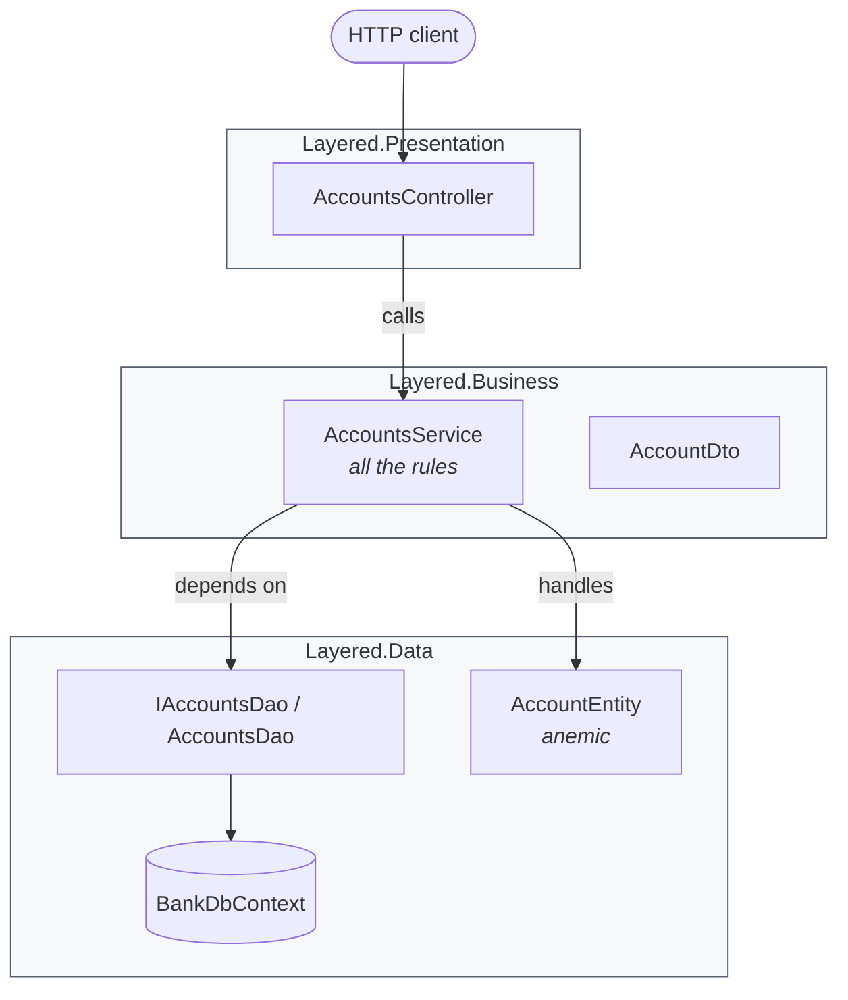
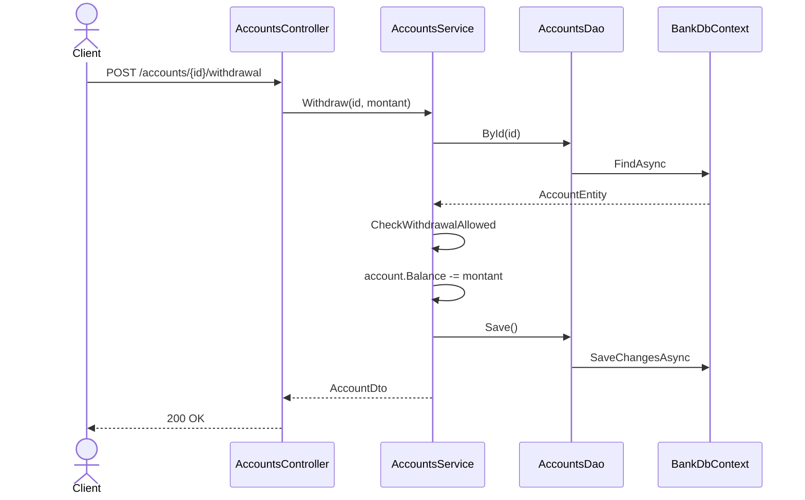
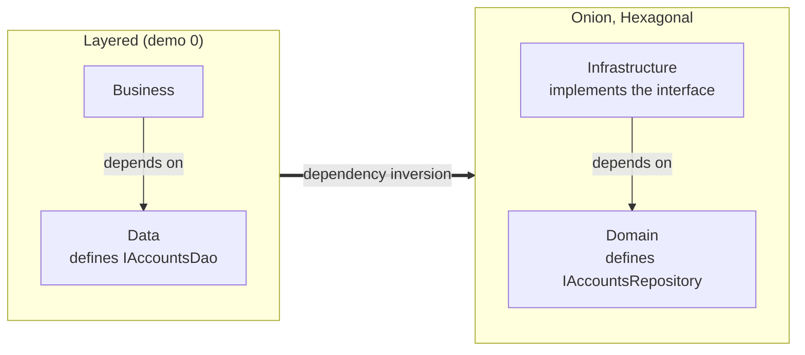

# 0. Layered Architecture (N-tier)

**French name**: *Architecture en couches (N-tiers)*

> **In one sentence**: technical layers are stacked — presentation, business, data — and each layer only calls the one
> below it.

📁 Code: [`00-Layered`](../../00-Layered) · ⬅️ [Contents](README.md) · ➡️ [Hexagonal](01-hexagonale.md) ·
🌐 [Français](../00-couches.md)

---

## The idea

It has been the "default" architecture of most business applications since the 1990s, and the baseline for all the
others. Its principle is simple: **separate the technical responsibilities**.



**The key point: dependencies flow down to the database.** The business layer *depends* on the data layer: it is the
data layer that defines the `IAccountsDao` interface and the `AccountEntity` entity, in its own vocabulary, and the
business layer adapts to them. This is exactly what the following architectures (Hexagonal, Onion, Clean) will **invert**.

---

## Solution layout

| Project | Role | References |
|---|---|---|
| `Layered.Data` | Entity, `DbContext`, DAO interface and implementation | nothing |
| `Layered.Business` | `AccountsService` (rules), DTOs, exceptions | `Layered.Data` |
| `Layered.Presentation` | MVC controllers, `Program.cs` | `Layered.Business` **only** |
| `Layered.Tests` | Tests of the service and of the architecture | — |

---

## The code, step by step

The code is quoted exactly as it is.

### 1. The data layer defines the model… and the contract

The entity is **anemic**: data only, with public setters.
([AccountEntity.cs](../../00-Layered/Layered.Data/AccountEntity.cs))

```csharp
public class AccountEntity
{
    public Guid Id { get; set; }
    public string Owner { get; set; } = "";
    public decimal Balance { get; set; }
}
```

The access interface is defined **by the data layer**, in **its** vocabulary (the comment says so, and points out that
in Onion/Hexagonal it is the business that defines the interface it needs).
([AccountsDao.cs](../../00-Layered/Layered.Data/AccountsDao.cs))

```csharp
// The interface is defined BY the data layer, in ITS vocabulary (AccountEntity).
// Key difference with Onion/Hexagonal: there, the business code defines the interface it needs.
public interface IAccountsDao
{
    Task<AccountEntity?> ById(Guid id);
    Task Add(AccountEntity account);
    Task<bool> IsEmpty();
    Task Save();
}
```

### 2. The business layer contains all the rules (*transaction script*)

One method = one use case, from start to finish. The comment notes that, the entity being anemic, nothing stops another
class from doing `account.Balance -= x` without this check: the rule is only protected by discipline.
([AccountsService.cs](../../00-Layered/Layered.Business/AccountsService.cs))

```csharp
public class AccountsService(IAccountsDao dao)
{
    public async Task<AccountDto> Withdraw(Guid id, decimal amount)
    {
        var account = await Load(id);
        CheckWithdrawalAllowed(account, amount);

        account.Balance -= amount;
        await dao.Save();
        return ToDto(account);
    }

    // Since the entity is anemic, nothing stops another class from doing "account.Balance -= x"
    // without going through this check: the rule is protected by discipline alone.
    private static void CheckWithdrawalAllowed(AccountEntity account, decimal amount)
    {
        if (amount <= 0)
            throw new BusinessRuleException("The amount must be strictly positive.");
        if (amount > account.Balance)
            throw new BusinessRuleException("Insufficient balance.");
    }
}
```

### 3. The presentation only sees the layer right below it

A classic MVC controller translates HTTP ⇄ business.
([AccountsController.cs](../../00-Layered/Layered.Presentation/Controllers/AccountsController.cs))

```csharp
[HttpPost("accounts/{id:guid}/withdrawal")]
public Task<IActionResult> Withdraw(Guid id, WithdrawalRequest request) =>
    Execute(async () => Ok(await accounts.Withdraw(id, request.Amount)));
```

**Strict layers** are enforced by the compiler: without this setting, the presentation could use `BankDbContext`
through the transitive reference via `Layered.Business`.
([Layered.Presentation.csproj](../../00-Layered/Layered.Presentation/Layered.Presentation.csproj))

```xml
<DisableTransitiveProjectReferences>true</DisableTransitiveProjectReferences>
```

Trying to inject `BankDbContext` into a controller then gives `CS0234: the name 'Data' does not exist`.
It is the business layer that plugs in the layer below it itself
([BusinessExtensions.cs](../../00-Layered/Layered.Business/BusinessExtensions.cs)):

```csharp
public static IServiceCollection AddBusinessLayer(this IServiceCollection services, string databaseName = "Bank")
{
    services.AddDataLayer(databaseName);
    services.AddScoped<AccountsService>();
    return services;
}
```

### The path of a withdrawal



---

## The tests

Testing the business layer forces you to handle the data layer: even the fake DAO returns `AccountEntity` objects.
**The business test is coupled to the persistence schema.**
([AccountsServiceTests.cs](../../00-Layered/Layered.Tests/AccountsServiceTests.cs))

```csharp
private readonly FakeDao _dao = new(
    new AccountEntity { Id = Alice, Owner = "Alice", Balance = 100m },
    new AccountEntity { Id = Bob, Owner = "Bob", Balance = 0m });
```

The architecture tests check the direction of dependencies
([ArchitectureTests.cs](../../00-Layered/Layered.Tests/ArchitectureTests.cs)):

```csharp
[Fact]
public void The_business_layer_depends_on_the_data_layer()
{
    Assert.Equal(["Layered.Data"], InternalDependencies(typeof(AccountsService).Assembly));
}

[Fact]
public void The_presentation_only_sees_the_layer_right_below()
{
    Assert.Equal(["Layered.Business"], InternalDependencies(typeof(AccountsController).Assembly));
}
```

---

## Layered vs Onion: the inversion in one diagram



---

## Summary

| 👍 Strengths | 👎 Limits |
|---|---|
| Simple, known by everyone, quick to start | The business depends on the database: changing persistence touches the business |
| Clear separation of technical responsibilities | Anemic entities: the rules are only protected by discipline |
| Strict layers checkable by the compiler | Business tests coupled to the persistence entities |
| Perfect for CRUD with thin business logic | One feature = changes in every layer |

**When to use it**: simple line-of-business applications, prototypes, beginner teams. **Signs it's time to evolve**:
business rules multiply, you want to test them without a database, or you plan to change storage technology
→ [Hexagonal](01-hexagonale.md) or [Onion](02-onion.md).
