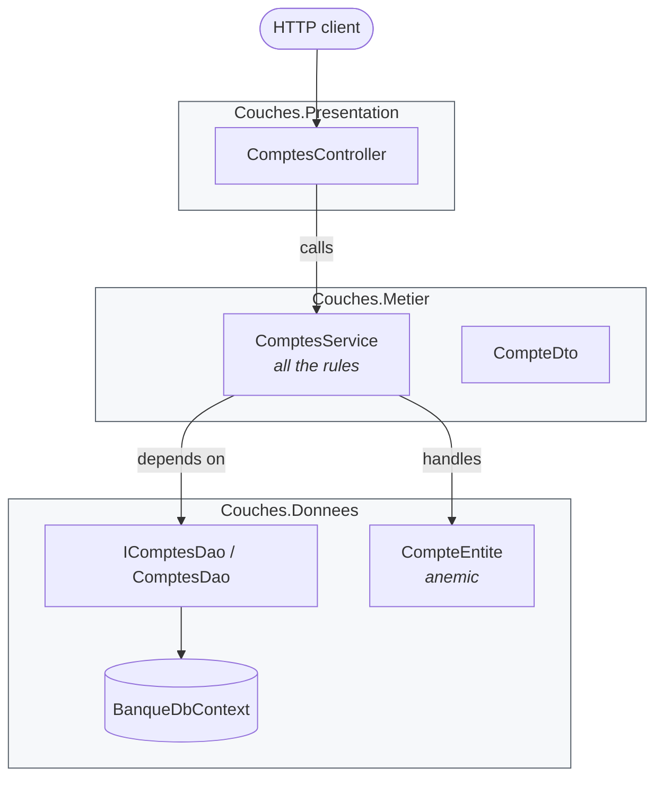
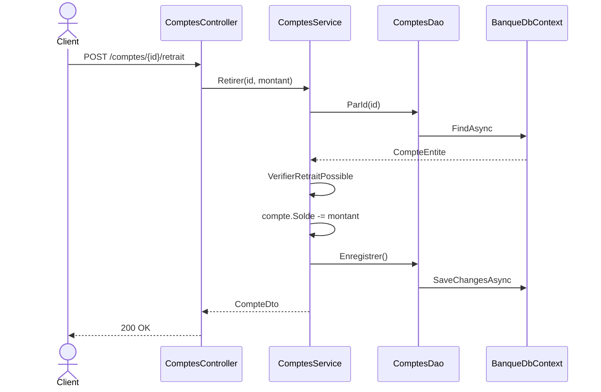

# 0. Layered Architecture (N-tier)

**French name**: *Architecture en couches (N-tiers)*

> **In one sentence**: technical layers are stacked — presentation, business, data — and each layer only calls the one
> below it.

📁 Code: [`00-Couches`](../../00-Couches) · ⬅️ [Contents](README.md) · ➡️ [Hexagonal](01-hexagonale.md) ·
🌐 [Français](../00-couches.md)

---

## The idea

It has been the "default" architecture of most business applications since the 1990s, and the baseline for all the
others. Its principle is simple: **separate the technical responsibilities**. (In the code: *Presentation*,
*Metier* = business, *Donnees* = data.)



**The key point: dependencies flow down to the database.** The business layer *depends* on the data layer: it is the
data layer that defines the `IComptesDao` interface and the `CompteEntite` entity, in its own vocabulary, and the
business layer adapts to them. This is exactly what the following architectures (Hexagonal, Onion, Clean) will **invert**.

---

## Solution layout

| Project | Role | References |
|---|---|---|
| `Couches.Donnees` | Entity, `DbContext`, DAO interface and implementation | nothing |
| `Couches.Metier` | `ComptesService` (rules), DTOs, exceptions | `Couches.Donnees` |
| `Couches.Presentation` | MVC controllers, `Program.cs` | `Couches.Metier` **only** |
| `Couches.Tests` | Tests of the service and of the architecture | — |

---

## The code, step by step

The code is quoted exactly as it is, French comments included.

### 1. The data layer defines the model… and the contract

The entity is **anemic**: data only, with public setters.
([CompteEntite.cs](../../00-Couches/Couches.Donnees/CompteEntite.cs))

```csharp
public class CompteEntite
{
    public Guid Id { get; set; }
    public string Titulaire { get; set; } = "";
    public decimal Solde { get; set; }
}
```

The access interface is defined **by the data layer**, in **its** vocabulary (the comment says so, and points out that
in Onion/Hexagonal it is the business that defines the interface it needs).
([ComptesDao.cs](../../00-Couches/Couches.Donnees/ComptesDao.cs))

```csharp
// L'interface est définie PAR la couche données, dans SON vocabulaire (CompteEntite).
// Différence clé avec Onion/Hexagonale : là-bas, c'est le métier qui définit l'interface dont il a besoin.
public interface IComptesDao
{
    Task<CompteEntite?> ParId(Guid id);
    Task Ajouter(CompteEntite compte);
    Task<bool> EstVide();
    Task Enregistrer();
}
```

### 2. The business layer contains all the rules (*transaction script*)

One method = one use case, from start to finish. The comment notes that, the entity being anemic, nothing stops another
class from doing `compte.Solde -= x` without this check: the rule is only protected by discipline.
([ComptesService.cs](../../00-Couches/Couches.Metier/ComptesService.cs))

```csharp
public class ComptesService(IComptesDao dao)
{
    public async Task<CompteDto> Retirer(Guid id, decimal montant)
    {
        var compte = await Charger(id);
        VerifierRetraitPossible(compte, montant);

        compte.Solde -= montant;
        await dao.Enregistrer();
        return VersDto(compte);
    }

    // L'entité étant anémique, rien n'empêche une autre classe de faire « compte.Solde -= x »
    // sans passer par cette vérification : la règle n'est protégée que par la discipline.
    private static void VerifierRetraitPossible(CompteEntite compte, decimal montant)
    {
        if (montant <= 0)
            throw new RegleMetierException("Le montant doit être strictement positif.");
        if (montant > compte.Solde)
            throw new RegleMetierException("Solde insuffisant.");
    }
}
```

### 3. The presentation only sees the layer right below it

A classic MVC controller translates HTTP ⇄ business.
([ComptesController.cs](../../00-Couches/Couches.Presentation/Controllers/ComptesController.cs))

```csharp
[HttpPost("comptes/{id:guid}/retrait")]
public Task<IActionResult> Retirer(Guid id, RetraitRequete requete) =>
    Executer(async () => Ok(await comptes.Retirer(id, requete.Montant)));
```

**Strict layers** are enforced by the compiler: without this setting, the presentation could use `BanqueDbContext`
through the transitive reference via `Couches.Metier`.
([Couches.Presentation.csproj](../../00-Couches/Couches.Presentation/Couches.Presentation.csproj))

```xml
<DisableTransitiveProjectReferences>true</DisableTransitiveProjectReferences>
```

Trying to inject `BanqueDbContext` into a controller then gives `CS0234: the name 'Donnees' does not exist`.
It is the business layer that plugs in the layer below it itself
([MetierExtensions.cs](../../00-Couches/Couches.Metier/MetierExtensions.cs)):

```csharp
public static IServiceCollection AddCoucheMetier(this IServiceCollection services, string nomBase = "Banque")
{
    services.AddCoucheDonnees(nomBase);
    services.AddScoped<ComptesService>();
    return services;
}
```

### The path of a withdrawal



---

## The tests

Testing the business layer forces you to handle the data layer: even the fake DAO returns `CompteEntite` objects.
**The business test is coupled to the persistence schema.**
([ComptesServiceTests.cs](../../00-Couches/Couches.Tests/ComptesServiceTests.cs))

```csharp
private readonly FauxDao _dao = new(
    new CompteEntite { Id = Alice, Titulaire = "Alice", Solde = 100m },
    new CompteEntite { Id = Bob, Titulaire = "Bob", Solde = 0m });
```

The architecture tests check the direction of dependencies
([ArchitectureTests.cs](../../00-Couches/Couches.Tests/ArchitectureTests.cs)):

```csharp
[Fact]
public void Le_metier_depend_de_la_couche_donnees()
{
    Assert.Equal(["Couches.Donnees"], DependancesInternes(typeof(ComptesService).Assembly));
}

[Fact]
public void La_presentation_ne_voit_que_la_couche_juste_en_dessous()
{
    Assert.Equal(["Couches.Metier"], DependancesInternes(typeof(ComptesController).Assembly));
}
```

---

## Layered vs Onion: the inversion in one diagram


---

## Summary

| 👍 Strengths | 👎 Limits |
|---|---|
| Simple, known by everyone, quick to start | The business depends on the database: changing persistence touches the business |
| Clear separation of technical responsibilities | Anemic entities: the rules are only protected by discipline |
| Strict layers checkable by the compiler | Business tests coupled to the persistence entities |
| Perfect for CRUD with thin business logic | One feature = changes in every layer |

**When to use it**: simple line-of-business applications, prototypes, beginner teams. **Signs it's time to evolve**:
business rules multiply, you want to test them without a database, or you plan to change storage technology
→ [Hexagonal](01-hexagonale.md) or [Onion](02-onion.md).
