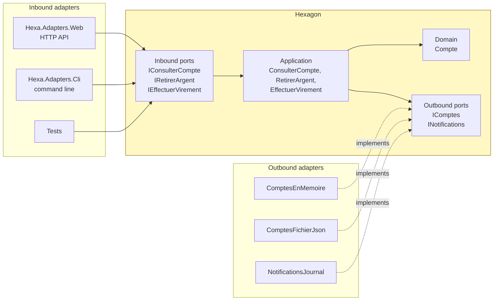
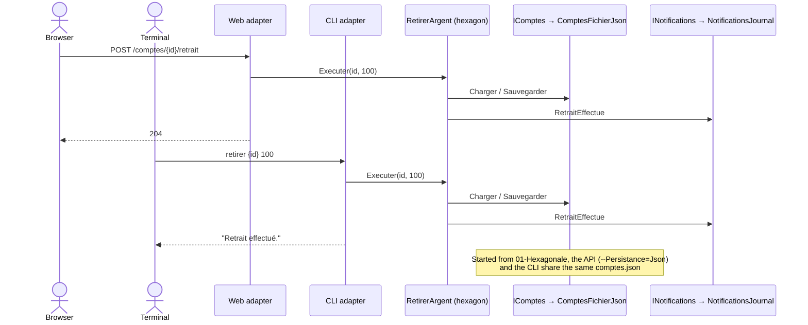
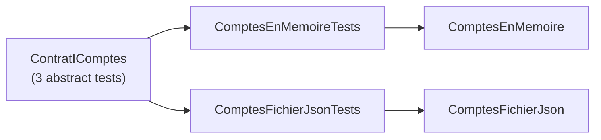

# 1. Hexagonal Architecture (Ports & Adapters)

**French name**: *Architecture hexagonale*

> **In one sentence**: the business is at the center and depends on nothing; the outside world plugs into it through
> **ports** (interfaces) and interchangeable **adapters** (implementations).

📁 Code: [`01-Hexagonale`](../../01-Hexagonale) · ⬅️ [Layered](00-couches.md) · ➡️ [Onion](02-onion.md) ·
🌐 [Français](../01-hexagonale.md)

---

## The idea

Proposed by **Alistair Cockburn** in 2005. The observation: in a layered architecture, the business ends up depending
on the database and on the user interface. Cockburn suggests reasoning in terms of **inside / outside** rather than
top / bottom. There is nothing magical about the hexagon: it is just a shape that leaves room to draw several ports.



Two kinds of ports:

| | **Inbound** port (*driving*, primary) | **Outbound** port (*driven*, secondary) |
|---|---|---|
| Role | What the application **offers** | What the application **needs** |
| Who calls it? | An inbound adapter (API, CLI, test) | The application itself |
| Who implements it? | The application (`RetirerArgent`) | An outbound adapter (`ComptesFichierJson`) |
| Example | `IRetirerArgent` (withdraw money) | `IComptes` (accounts), `INotifications` |

**Every dependency arrow points toward the hexagon**, which references no other project.

---

## Solution layout

| Project | Role |
|---|---|
| `Hexa.Hexagone` | Domain + ports + use cases. **No references**, neither project nor package. |
| `Hexa.Adapters.Persistance` | Two adapters of the **same** port `IComptes`: in memory and JSON file |
| `Hexa.Adapters.Notifications` | Adapter of the `INotifications` port (text log) |
| `Hexa.Adapters.Web` | Inbound HTTP adapter + *composition root* (wires everything) |
| `Hexa.Adapters.Cli` | Second inbound adapter: the command line |
| `Hexa.Tests` | Tests of the hexagon, adapter **contract tests**, architecture test |

---

## The code, step by step

The code is quoted exactly as it is, French comments included.

### 1. The ports: interfaces inside the hexagon

([PortsEntrants.cs](../../01-Hexagonale/Hexa.Hexagone/Ports/Entrants/PortsEntrants.cs),
[PortsSortants.cs](../../01-Hexagonale/Hexa.Hexagone/Ports/Sortants/PortsSortants.cs))

```csharp
// Ports entrants (« driving », primaires) : ce que l'application OFFRE au monde extérieur.
public interface IRetirerArgent
{
    Task Executer(Guid compteId, decimal montant);
}

// Ports sortants (« driven », secondaires) : ce dont l'application A BESOIN.
public interface IComptes
{
    Task<Compte?> Charger(Guid id);
    Task Sauvegarder(Compte compte);
}

public interface INotifications
{
    Task RetraitEffectue(Guid compteId, decimal montant);
    Task VirementEffectue(Guid sourceId, Guid cibleId, decimal montant);
}
```

### 2. A use case: an inbound port implemented with outbound ports

([CasUtilisation.cs](../../01-Hexagonale/Hexa.Hexagone/Application/CasUtilisation.cs))

```csharp
public class RetirerArgent(IComptes comptes, INotifications notifications) : IRetirerArgent
{
    public async Task Executer(Guid compteId, decimal montant)
    {
        var compte = await comptes.Charger(compteId) ?? throw new CompteIntrouvableException(compteId);
        compte.Retirer(montant);
        await comptes.Sauvegarder(compte);
        await notifications.RetraitEffectue(compteId, montant);
    }
}
```

The hexagon doesn't know whether it is called over HTTP or from the command line, nor whether the accounts are in
memory or in a file.

### 3. Two adapters for the same port

The storage format belongs to the adapter: the domain doesn't know it is serialized.
([ComptesFichierJson.cs](../../01-Hexagonale/Hexa.Adapters.Persistance/ComptesFichierJson.cs))

```csharp
public class ComptesFichierJson : IComptes
{
    // …
    // Format de stockage propre à l'adapter : le domaine ignore qu'il est sérialisé.
    private record Ligne(Guid Id, string Titulaire, decimal Solde)
    {
        public static Ligne Depuis(Compte compte) => new(compte.Id, compte.Titulaire, compte.Solde);
        public Compte VersCompte() => new(Id, Titulaire, Solde);
    }
}
```

### 4. The *composition root* picks the adapters

It is **the only place** that knows both the hexagon and the adapters. Outbound adapters can be swapped by
configuration: `--Persistance=Json` or `Memoire` (default).
([Program.cs](../../01-Hexagonale/Hexa.Adapters.Web/Program.cs))

```csharp
// Adapters sortants, interchangeables par configuration : --Persistance=Json ou Memoire (défaut).
builder.Services.AddSingleton<IComptes>(_ => builder.Configuration["Persistance"] switch
{
    "Json" => new ComptesFichierJson(builder.Configuration["FichierComptes"] ?? "comptes.json", DonneesDeDemo.Comptes()),
    _ => new ComptesEnMemoire(DonneesDeDemo.Comptes())
});
builder.Services.AddSingleton<INotifications>(new NotificationsJournal(Console.Out));

// Ports entrants → leur implémentation dans l'hexagone.
builder.Services.AddScoped<IRetirerArgent, RetirerArgent>();
```

The CLI does the same **without a dependency injection container**: the hexagon doesn't need one.
([Hexa.Adapters.Cli/Program.cs](../../01-Hexagonale/Hexa.Adapters.Cli/Program.cs))

```csharp
IComptes comptes = new ComptesFichierJson("comptes.json", DonneesDeDemo.Comptes());
INotifications notifications = new NotificationsJournal(Console.Out);
IRetirerArgent retirer = new RetirerArgent(comptes, notifications);
```

### 5. The HTTP adapter translates, without any rules

Translating business errors into HTTP status codes is the adapter's job, not the hexagon's.
([ComptesEndpoints.cs](../../01-Hexagonale/Hexa.Adapters.Web/ComptesEndpoints.cs))

```csharp
// Traduire les erreurs du métier en codes HTTP est le rôle de l'adapter, pas de l'hexagone.
private static async Task<IResult> Traduire(Func<Task<IResult>> action)
{
    try { return await action(); }
    catch (CompteIntrouvableException e) { return Results.NotFound(new { erreur = e.Message }); }
    catch (RegleMetierException e) { return Results.BadRequest(new { erreur = e.Message }); }
}
```

### Two entry points, one hexagon



---

## The tests

**Tests of the hexagon**: test adapters are plugged into the ports; no web server, no database.
([CasUtilisationTests.cs](../../01-Hexagonale/Hexa.Tests/Hexagone/CasUtilisationTests.cs))

```csharp
[Fact]
public async Task Un_retrait_valide_debite_le_compte_et_notifie()
{
    await new RetirerArgent(_comptes, _notifications).Executer(Alice, 30m);

    Assert.Equal(70m, (await _comptes.Charger(Alice))!.Solde);
    Assert.Equal([$"retrait 30 {Alice}"], _notifications.Envoyees);
}
```

**Contract tests**: the same tests run against **every** adapter of the `IComptes` port. This is what guarantees that
one can replace the other without surprises.
([ContratIComptesTests.cs](../../01-Hexagonale/Hexa.Tests/Adapters/ContratIComptesTests.cs))

```csharp
public abstract class ContratIComptes
{
    protected abstract IComptes Creer(params Compte[] comptesInitiaux);

    [Fact]
    public async Task Une_modification_non_sauvegardee_n_est_pas_persistee() { /* … */ }
}

public class ComptesEnMemoireTests : ContratIComptes
{
    protected override IComptes Creer(params Compte[] comptesInitiaux) => new ComptesEnMemoire(comptesInitiaux);
}

public class ComptesFichierJsonTests : ContratIComptes, IDisposable { /* même tests, sur un fichier temporaire */ }
```



---

## Summary

| 👍 Strengths | 👎 Limits |
|---|---|
| The business depends on nothing: testable without infrastructure | One interface per external need: more code |
| Interchangeable adapters (memory, file, SQL…) | Risk of pass-through ports that add nothing |
| Several entry points into the same business | The center is not structured: to be completed (Onion, DDD) |
| Adapter contract tests | |

**When to use it**: rich business logic, infrastructure likely to change, need for several channels (API, CLI,
messages). **Variants**: [Onion](02-onion.md) structures the center in layers; [Clean](03-clean.md) formalizes the
use cases. All three share the same rule: *dependencies point toward the business*.
