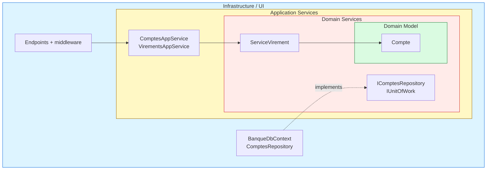
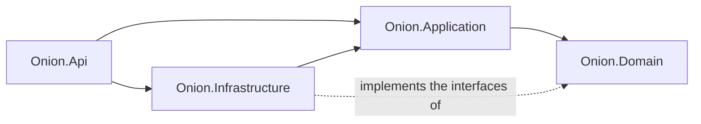
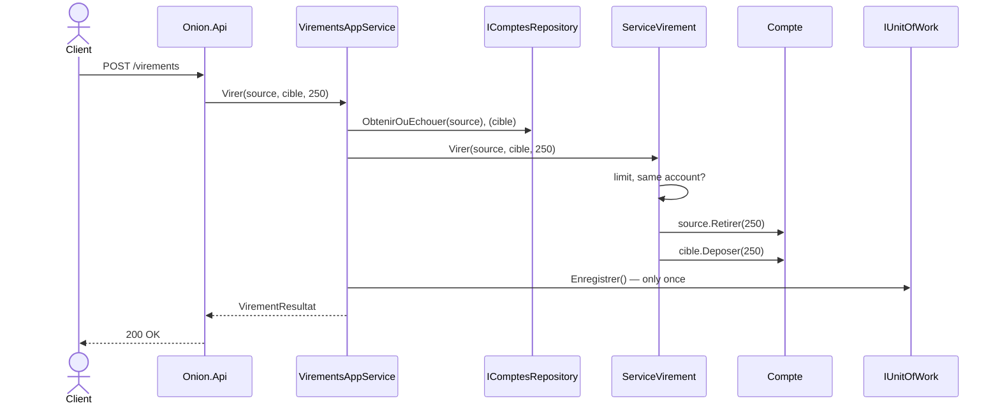

# 2. Onion Architecture

> **In one sentence**: concentric layers; the domain is at the center, and **every dependency points toward it**.

📁 Code: [`02-Onion`](../../02-Onion) · ⬅️ [Hexagonal](01-hexagonale.md) · ➡️ [Clean](03-clean.md) ·
🌐 [Français](../02-onion.md)

---

## The idea

Proposed by **Jeffrey Palermo** in 2008. Same rule as hexagonal (the business depends on nothing), but with a
**center split into layers**: the domain model, then the domain services, then the application services.



| Layer | Contents | Role |
|---|---|---|
| **Domain Model** | `Compte` (account), exceptions | The entities and their invariants |
| **Domain Services** | `ServiceVirement` (transfer service) + interfaces `IComptesRepository`, `IUnitOfWork` | Rules that span several entities; what the domain needs |
| **Application Services** | `ComptesAppService`, `VirementsAppService`, DTOs | Orchestration: load, delegate, save |
| **Infrastructure / UI** | EF Core, API, middleware | Implements the interfaces, exposes the application |

### Dependencies between projects



---

## The code, step by step

The code is quoted exactly as it is, French comments included.

### 1. The domain service

A rule that concerns **two** accounts naturally belongs to neither of them.
([ServiceVirement.cs](../../02-Onion/Onion.Domain/Services/ServiceVirement.cs))

```csharp
public class TransferService
{
    public const decimal TransferLimit = 5_000m;

    public void Transfer(Account source, Account target, decimal amount)
    {
        if (source.Id == target.Id)
            throw new BusinessRuleException("Cannot transfer to the same account.");
        if (amount > TransferLimit)
            throw new BusinessRuleException($"A transfer cannot exceed {TransferLimit:0} €.");

        source.Withdraw(amount);
        target.Deposit(amount);
    }
}
```

### 2. The interfaces are declared at the center

The infrastructure (outer layer) implements them: dependencies point inward.
([IComptesRepository.cs](../../02-Onion/Onion.Domain/Interfaces/IComptesRepository.cs))

```csharp
// The data access interfaces are declared at the center;
// the infrastructure (outer layer) implements them: dependencies point inwards.
public interface IAccountsRepository
{
    Task<Account?> ById(Guid id);
    Task Add(Account account);
    Task<bool> IsEmpty();
}

/// <summary>Commits at once all the changes made during a use case.</summary>
public interface IUnitOfWork
{
    Task Save();
}
```

### 3. The application service orchestrates, without deciding

The rule (limit, same account, balance…) lives in the domain service; a single save for both accounts: all or nothing.
([VirementsAppService.cs](../../02-Onion/Onion.Application/VirementsAppService.cs))

```csharp
public class TransfersAppService(IAccountsRepository accounts, IUnitOfWork unitOfWork, TransferService transferService)
{
    public async Task<TransferResult> Transfer(Guid sourceId, Guid targetId, decimal amount)
    {
        var source = await accounts.GetOrThrow(sourceId);
        var target = await accounts.GetOrThrow(targetId);

        // The rule (limit, same account, balance…) lives in the domain service.
        transferService.Transfer(source, target, amount);

        // A single commit for both accounts: all or nothing.
        await unitOfWork.Save();
        return new TransferResult(AccountDto.From(source), AccountDto.From(target));
    }
}
```

### 4. The infrastructure implements the domain's interfaces

The `DbContext` **is** the unit of work; the mapping is described here, never through attributes in the domain.
([BanqueDbContext.cs](../../02-Onion/Onion.Infrastructure/BanqueDbContext.cs))

```csharp
public class BankDbContext(DbContextOptions<BankDbContext> options) : DbContext(options), IUnitOfWork
{
    public DbSet<Account> Accounts => Set<Account>();

    public Task Save() => SaveChangesAsync();

    protected override void OnModelCreating(ModelBuilder modelBuilder)
    {
        // The mapping is described here, not by attributes in the domain: the domain knows nothing of EF Core.
        modelBuilder.Entity<Account>(account =>
        {
            account.HasKey(c => c.Id);
            account.Property(c => c.Owner).HasMaxLength(100);
        });
    }
}
```

### 5. Domain errors translated once

([Program.cs](../../02-Onion/Onion.Api/Program.cs))

```csharp
// Domain errors are translated into HTTP once, by a middleware.
app.Use(async (context, next) =>
{
    try { await next(context); }
    catch (AccountNotFoundException e) { context.Response.StatusCode = 404; /* … */ }
    catch (BusinessRuleException e) { context.Response.StatusCode = 400; /* … */ }
});
```

### The path of a transfer, from the outside to the center



---

## The tests

The central layers are tested **without any test double**; the application layer with a fake repository / unit of work.
([VirementsAppServiceTests.cs](../../02-Onion/Onion.Tests/Application/VirementsAppServiceTests.cs))

```csharp
[Fact]
public async Task A_refused_transfer_is_not_saved()
{
    await Assert.ThrowsAsync<BusinessRuleException>(() => Service.Transfer(Alice, Bob, 1_000m));

    Assert.Equal(0, _unitOfWork.SaveCount);
}
```

And the golden rule is checked on every build ([ArchitectureTests.cs](../../02-Onion/Onion.Tests/ArchitectureTests.cs)):
the domain depends on nothing, the application only depends on the domain.

---

## Summary

| 👍 Strengths | 👎 Limits |
|---|---|
| Pure, testable domain | Many projects and interfaces for a small application |
| Structured center: model / domain services / application | Sometimes blurry line between domain service and application service |
| Explicit unit of work (all or nothing) | Risk of an anemic model if the rules drift into the services |

**Hexagonal or Onion?** It is the same dependency rule. Hexagonal stresses the **ports and adapters** around the core,
Onion the **layers at the center**. In practice, many ".NET Clean" projects are actually Onion.
