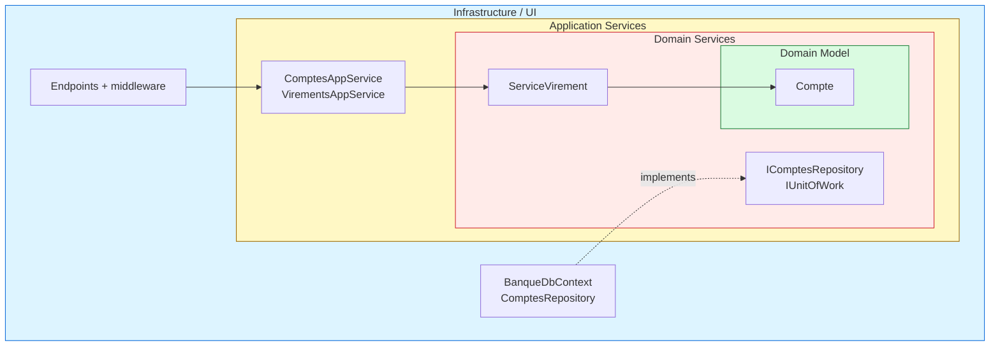
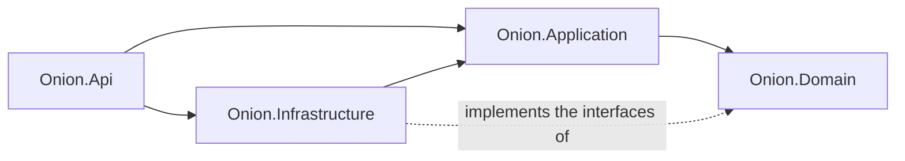
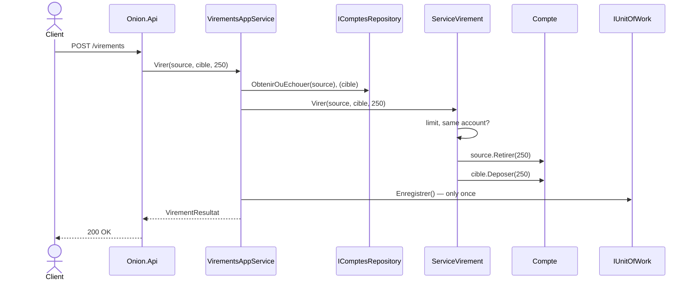

# 2. Onion Architecture

> **In one sentence**: concentric layers; the domain is at the center, and **every dependency points toward it**.

📁 Code: [`02-Onion`](../../02-Onion) · ⬅️ [Hexagonal](01-hexagonale.md) · ➡️ [Clean](03-clean.md) ·
🌐 [Français](../02-onion.md)

---

## The idea

Proposed by **Jeffrey Palermo** in 2008. Same rule as hexagonal (the business depends on nothing), but with a
**center split into layers**: the domain model, then the domain services, then the application services.



| Layer | Contents | Role |
|---|---|---|
| **Domain Model** | `Compte` (account), exceptions | The entities and their invariants |
| **Domain Services** | `ServiceVirement` (transfer service) + interfaces `IComptesRepository`, `IUnitOfWork` | Rules that span several entities; what the domain needs |
| **Application Services** | `ComptesAppService`, `VirementsAppService`, DTOs | Orchestration: load, delegate, save |
| **Infrastructure / UI** | EF Core, API, middleware | Implements the interfaces, exposes the application |

### Dependencies between projects



---

## The code, step by step

The code is quoted exactly as it is, French comments included.

### 1. The domain service

A rule that concerns **two** accounts naturally belongs to neither of them.
([ServiceVirement.cs](../../02-Onion/Onion.Domain/Services/ServiceVirement.cs))

```csharp
public class ServiceVirement
{
    public const decimal PlafondParVirement = 5_000m;

    public void Virer(Compte source, Compte cible, decimal montant)
    {
        if (source.Id == cible.Id)
            throw new RegleMetierException("Impossible de virer vers le même compte.");
        if (montant > PlafondParVirement)
            throw new RegleMetierException($"Un virement ne peut pas dépasser {PlafondParVirement:0} €.");

        source.Retirer(montant);
        cible.Deposer(montant);
    }
}
```

### 2. The interfaces are declared at the center

The infrastructure (outer layer) implements them: dependencies point inward.
([IComptesRepository.cs](../../02-Onion/Onion.Domain/Interfaces/IComptesRepository.cs))

```csharp
// Les interfaces d'accès aux données sont déclarées au centre ;
// l'infrastructure (couche externe) les implémente : les dépendances pointent vers l'intérieur.
public interface IComptesRepository
{
    Task<Compte?> ParId(Guid id);
    Task Ajouter(Compte compte);
    Task<bool> EstVide();
}

/// <summary>Valide en une fois toutes les modifications faites pendant un cas d'utilisation.</summary>
public interface IUnitOfWork
{
    Task Enregistrer();
}
```

### 3. The application service orchestrates, without deciding

The rule (limit, same account, balance…) lives in the domain service; a single save for both accounts: all or nothing.
([VirementsAppService.cs](../../02-Onion/Onion.Application/VirementsAppService.cs))

```csharp
public class VirementsAppService(IComptesRepository comptes, IUnitOfWork unitOfWork, ServiceVirement serviceVirement)
{
    public async Task<VirementResultat> Virer(Guid sourceId, Guid cibleId, decimal montant)
    {
        var source = await comptes.ObtenirOuEchouer(sourceId);
        var cible = await comptes.ObtenirOuEchouer(cibleId);

        // La règle (plafond, même compte, solde…) vit dans le service de domaine.
        serviceVirement.Virer(source, cible, montant);

        // Une seule validation pour les deux comptes : tout ou rien.
        await unitOfWork.Enregistrer();
        return new VirementResultat(CompteDto.Depuis(source), CompteDto.Depuis(cible));
    }
}
```

### 4. The infrastructure implements the domain's interfaces

The `DbContext` **is** the unit of work; the mapping is described here, never through attributes in the domain.
([BanqueDbContext.cs](../../02-Onion/Onion.Infrastructure/BanqueDbContext.cs))

```csharp
public class BanqueDbContext(DbContextOptions<BanqueDbContext> options) : DbContext(options), IUnitOfWork
{
    public DbSet<Compte> Comptes => Set<Compte>();

    public Task Enregistrer() => SaveChangesAsync();

    protected override void OnModelCreating(ModelBuilder modelBuilder)
    {
        // Le mapping est décrit ici, pas par des attributs dans le domaine : le domaine ignore EF Core.
        modelBuilder.Entity<Compte>(compte =>
        {
            compte.HasKey(c => c.Id);
            compte.Property(c => c.Titulaire).HasMaxLength(100);
        });
    }
}
```

### 5. Domain errors translated once

([Program.cs](../../02-Onion/Onion.Api/Program.cs))

```csharp
// Les erreurs du domaine sont traduites en HTTP une seule fois, par un middleware.
app.Use(async (contexte, suivant) =>
{
    try { await suivant(contexte); }
    catch (CompteIntrouvableException e) { contexte.Response.StatusCode = 404; /* … */ }
    catch (RegleMetierException e) { contexte.Response.StatusCode = 400; /* … */ }
});
```

### The path of a transfer, from the outside to the center



---

## The tests

The central layers are tested **without any test double**; the application layer with a fake repository / unit of work.
([VirementsAppServiceTests.cs](../../02-Onion/Onion.Tests/Application/VirementsAppServiceTests.cs))

```csharp
[Fact]
public async Task Un_virement_refuse_n_est_pas_enregistre()
{
    await Assert.ThrowsAsync<RegleMetierException>(() => Service.Virer(Alice, Bob, 1_000m));

    Assert.Equal(0, _unitOfWork.NombreEnregistrements);
}
```

And the golden rule is checked on every build ([ArchitectureTests.cs](../../02-Onion/Onion.Tests/ArchitectureTests.cs)):
the domain depends on nothing, the application only depends on the domain.

---

## Summary

| 👍 Strengths | 👎 Limits |
|---|---|
| Pure, testable domain | Many projects and interfaces for a small application |
| Structured center: model / domain services / application | Sometimes blurry line between domain service and application service |
| Explicit unit of work (all or nothing) | Risk of an anemic model if the rules drift into the services |

**Hexagonal or Onion?** It is the same dependency rule. Hexagonal stresses the **ports and adapters** around the core,
Onion the **layers at the center**. In practice, many ".NET Clean" projects are actually Onion.
