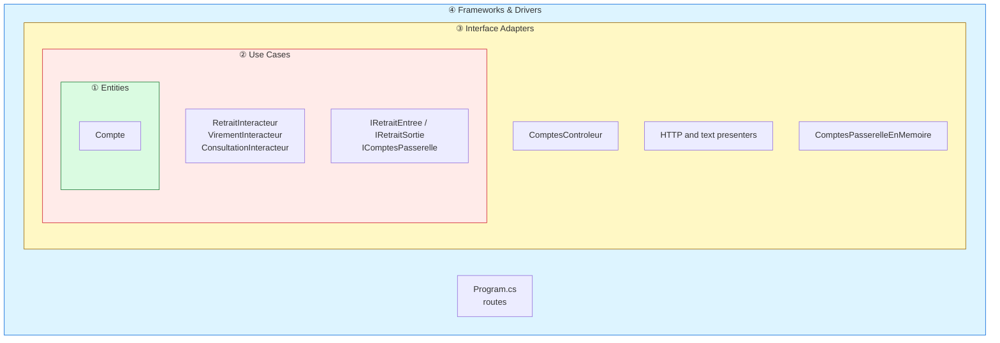
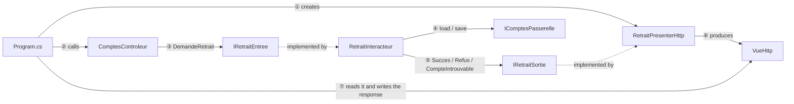
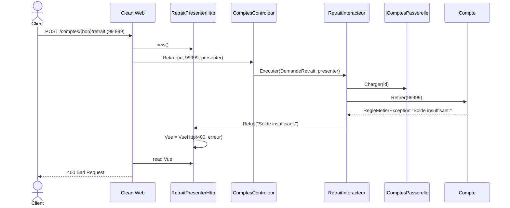

# 3. Clean Architecture

> **In one sentence**: each use case is a class (*interactor*) with explicit *boundaries*; it returns nothing and pushes
> its result to a *presenter*.

📁 Code: [`03-Clean`](../../03-Clean) · ⬅️ [Onion](02-onion.md) · ➡️ [Functional Core](04-coeur-fonctionnel.md) ·
🌐 [Français](../03-clean.md)

---

## The idea

Formalized by **Robert C. Martin (Uncle Bob)** in 2012, it is a synthesis of hexagonal and Onion with a precise
vocabulary. Four circles, and a single rule: **the dependency rule** — code in a circle only knows the circles further in.



| Circle | Project |
|---|---|
| ① Entities | `Clean.Entites` |
| ② Use Cases | `Clean.CasUtilisation` |
| ③ Interface Adapters | `Clean.AdaptateursInterface` |
| ④ Frameworks & Drivers | `Clean.Web` (ASP.NET Core) |

### The vocabulary

| Term | In the demo | Role |
|---|---|---|
| **Request model** | `DemandeRetrait` | The use case's input data, with nothing from the web |
| **Input boundary** | `IRetraitEntree` | What the controller calls |
| **Interactor** | `RetraitInteracteur` | The use case |
| **Output boundary** | `IRetraitSortie` | What the interactor calls to deliver its result |
| **Response model** | `ReponseRetrait` | Output data |
| **Presenter** | `RetraitPresenterHttp` | Implements the output boundary, builds a view |
| **Gateway** | `IComptesPasserelle` | Data access (= outbound port) |

### The flow of control crosses the circles… but the dependencies don't



The interactor calls the presenter **through an interface it defines itself** (`IRetraitSortie`): this is dependency
inversion applied to the **output**.

---

## The code, step by step

The code is quoted exactly as it is, French comments included.

### 1. A complete use case in one file

The interactor returns nothing: it pushes its result to the output boundary, so it has no idea whether the response
will end up as JSON, HTML or text.
([Retrait.cs](../../03-Clean/Clean.CasUtilisation/Retrait/Retrait.cs))

```csharp
public record DemandeRetrait(Guid CompteId, decimal Montant);
public record ReponseRetrait(Guid CompteId, decimal AncienSolde, decimal NouveauSolde);

public interface IRetraitEntree
{
    Task Executer(DemandeRetrait demande, IRetraitSortie sortie);
}

public interface IRetraitSortie
{
    void Succes(ReponseRetrait reponse);
    void CompteIntrouvable(Guid compteId);
    void Refus(string raison);
}

/// L'interacteur ne renvoie rien : il pousse son résultat vers l'output boundary.
/// Il ignore donc totalement si la réponse finira en JSON, en HTML ou en texte.
public class RetraitInteracteur(IComptesPasserelle comptes) : IRetraitEntree
{
    public async Task Executer(DemandeRetrait demande, IRetraitSortie sortie)
    {
        var compte = await comptes.Charger(demande.CompteId);
        if (compte is null)
        {
            sortie.CompteIntrouvable(demande.CompteId);
            return;
        }

        var ancienSolde = compte.Solde;
        try
        {
            compte.Retirer(demande.Montant);
        }
        catch (RegleMetierException e)
        {
            sortie.Refus(e.Message);
            return;
        }

        await comptes.Sauvegarder(compte);
        sortie.Succes(new ReponseRetrait(compte.Id, ancienSolde, compte.Solde));
    }
}
```

### 2. Presenters that decide the shape

([PresentersHttp.cs](../../03-Clean/Clean.AdaptateursInterface/Presenters/PresentersHttp.cs)) — the presenter produces
a *view model* (`VueHttp`), not an `IResult`: the adapters don't depend on ASP.NET Core.

```csharp
public class RetraitPresenterHttp : IRetraitSortie
{
    public VueHttp Vue { get; private set; } = VueHttp.Refus("Aucun résultat.");

    public void Succes(ReponseRetrait r) =>
        Vue = VueHttp.Ok(new
        {
            solde = r.NouveauSolde,
            message = $"Retrait de {r.AncienSolde - r.NouveauSolde:0.00} € effectué."
        });

    public void CompteIntrouvable(Guid compteId) => Vue = VueHttp.Introuvable(compteId);
    public void Refus(string raison) => Vue = VueHttp.Refus(raison);
}
```

**Two presenters for the same interactor**: JSON, or a text statement
([ConsultationPresenterTexte.cs](../../03-Clean/Clean.AdaptateursInterface/Presenters/ConsultationPresenterTexte.cs)).
Adding a format doesn't touch the use case.

```csharp
public void Succes(ReponseConsultation r) =>
    Texte = $"""
        RELEVÉ DE COMPTE
        Titulaire : {r.Titulaire}
        Solde     : {r.Solde.ToString("N2", Francais)} €
        """;
```

### 3. The outer circle is just plumbing

Each route: create the presenter → call the controller → write the view produced by the presenter.
([Program.cs](../../03-Clean/Clean.Web/Program.cs))

```csharp
// Chaque route : créer le presenter → appeler le contrôleur → écrire la vue produite par le presenter.
app.MapPost("/comptes/{id:guid}/retrait", async (Guid id, RetraitRequete requete, ComptesControleur controleur) =>
{
    var presenter = new RetraitPresenterHttp();
    await controleur.Retirer(id, requete.Montant, presenter);
    return EnHttp(presenter.Vue);
});
```

### The path of a refused withdrawal



---

## The tests

You test **what the interactor says**, with a spy on the output boundary, without any format.
([RetraitInteracteurTests.cs](../../03-Clean/Clean.Tests/CasUtilisation/RetraitInteracteurTests.cs))

```csharp
[Fact]
public async Task Un_retrait_trop_eleve_annonce_un_refus()
{
    await new RetraitInteracteur(_comptes).Executer(new DemandeRetrait(Alice, 500m), _sortie);

    Assert.Equal("Solde insuffisant.", _sortie.Refus);
    Assert.Null(_sortie.Succes);
}
```

The presenters are tested on their own, and a test checks that the adapters don't depend on ASP.NET Core
([ArchitectureTests.cs](../../03-Clean/Clean.Tests/ArchitectureTests.cs)).

---

## Summary

| 👍 Strengths | 👎 Limits |
|---|---|
| Explicit use cases, one per class | **Ceremony**: 6 types for one withdrawal |
| Several presentations for the same use case | A stateful presenter, unnatural with ASP.NET Core |
| Checkable dependency rule | Often applied dogmatically |

**In practice**, the popular ".NET Clean" templates (Jason Taylor, Ardalis) replace the presenter with a simple
return value (`Result<T>`) and MediatR handlers. They keep the circles and the dependency rule, without all the machinery.
Compare with [Vertical Slice](05-vertical-slice.md): the same withdrawal, a single file.
