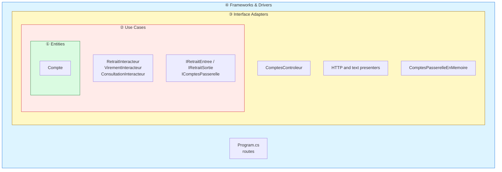
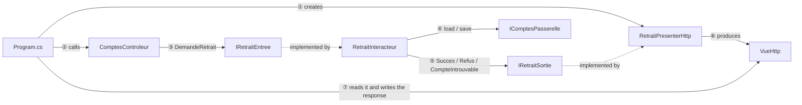
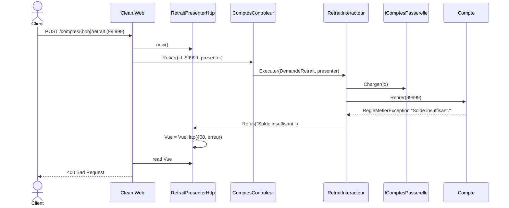

# 3. Clean Architecture

> **In one sentence**: each use case is a class (*interactor*) with explicit *boundaries*; it returns nothing and pushes
> its result to a *presenter*.

📁 Code: [`03-Clean`](../../03-Clean) · ⬅️ [Onion](02-onion.md) · ➡️ [Functional Core](04-coeur-fonctionnel.md) ·
🌐 [Français](../03-clean.md)

---

## The idea

Formalized by **Robert C. Martin (Uncle Bob)** in 2012, it is a synthesis of hexagonal and Onion with a precise
vocabulary. Four circles, and a single rule: **the dependency rule** — code in a circle only knows the circles further in.



| Circle | Project |
|---|---|
| ① Entities | `Clean.Entites` |
| ② Use Cases | `Clean.CasUtilisation` |
| ③ Interface Adapters | `Clean.AdaptateursInterface` |
| ④ Frameworks & Drivers | `Clean.Web` (ASP.NET Core) |

### The vocabulary

| Term | In the demo | Role |
|---|---|---|
| **Request model** | `DemandeRetrait` | The use case's input data, with nothing from the web |
| **Input boundary** | `IRetraitEntree` | What the controller calls |
| **Interactor** | `RetraitInteracteur` | The use case |
| **Output boundary** | `IRetraitSortie` | What the interactor calls to deliver its result |
| **Response model** | `ReponseRetrait` | Output data |
| **Presenter** | `RetraitPresenterHttp` | Implements the output boundary, builds a view |
| **Gateway** | `IComptesPasserelle` | Data access (= outbound port) |

### The flow of control crosses the circles… but the dependencies don't



The interactor calls the presenter **through an interface it defines itself** (`IRetraitSortie`): this is dependency
inversion applied to the **output**.

---

## The code, step by step

The code is quoted exactly as it is, French comments included.

### 1. A complete use case in one file

The interactor returns nothing: it pushes its result to the output boundary, so it has no idea whether the response
will end up as JSON, HTML or text.
([Retrait.cs](../../03-Clean/Clean.CasUtilisation/Retrait/Retrait.cs))

```csharp
public record WithdrawalRequest(Guid AccountId, decimal Amount);
public record WithdrawalResponse(Guid AccountId, decimal OldBalance, decimal NewBalance);

public interface IWithdrawalInput
{
    Task Execute(WithdrawalRequest request, IWithdrawalOutput output);
}

public interface IWithdrawalOutput
{
    void Success(WithdrawalResponse response);
    void AccountNotFound(Guid accountId);
    void Refused(string reason);
}

/// The interactor returns nothing: it pushes its result to the output boundary.
/// So it has no idea whether the response will end up as JSON, HTML or text.
public class WithdrawalInteractor(IAccountsGateway accounts) : IWithdrawalInput
{
    public async Task Execute(WithdrawalRequest request, IWithdrawalOutput output)
    {
        var account = await accounts.Load(request.AccountId);
        if (account is null)
        {
            output.AccountNotFound(request.AccountId);
            return;
        }

        var oldBalance = account.Balance;
        try
        {
            account.Withdraw(request.Amount);
        }
        catch (BusinessRuleException e)
        {
            output.Refused(e.Message);
            return;
        }

        await accounts.Save(account);
        output.Success(new WithdrawalResponse(account.Id, oldBalance, account.Balance));
    }
}
```

### 2. Presenters that decide the shape

([PresentersHttp.cs](../../03-Clean/Clean.AdaptateursInterface/Presenters/PresentersHttp.cs)) — the presenter produces
a *view model* (`VueHttp`), not an `IResult`: the adapters don't depend on ASP.NET Core.

```csharp
public class WithdrawalHttpPresenter : IWithdrawalOutput
{
    public HttpView View { get; private set; } = HttpView.Refused("No result.");

    public void Success(WithdrawalResponse r) =>
        View = HttpView.Ok(new
        {
            balance = r.NewBalance,
            message = $"Withdrawal of {r.OldBalance - r.NewBalance:0.00} € done."
        });

    public void AccountNotFound(Guid accountId) => View = HttpView.NotFound(accountId);
    public void Refused(string reason) => View = HttpView.Refused(reason);
}
```

**Two presenters for the same interactor**: JSON, or a text statement
([ConsultationPresenterTexte.cs](../../03-Clean/Clean.AdaptateursInterface/Presenters/ConsultationPresenterTexte.cs)).
Adding a format doesn't touch the use case.

```csharp
public void Success(LookupResponse r) =>
    Text = $"""
        ACCOUNT STATEMENT
        Owner   : {r.Owner}
        Balance : {r.Balance.ToString("N2", English)} €
        """;
```

### 3. The outer circle is just plumbing

Each route: create the presenter → call the controller → write the view produced by the presenter.
([Program.cs](../../03-Clean/Clean.Web/Program.cs))

```csharp
// Each route: create the presenter → call the controller → write the view produced by the presenter.
app.MapPost("/accounts/{id:guid}/withdrawal", async (Guid id, WithdrawalBody body, AccountsController controller) =>
{
    var presenter = new WithdrawalHttpPresenter();
    await controller.Withdraw(id, body.Amount, presenter);
    return ToHttp(presenter.View);
});
```

### The path of a refused withdrawal



---

## The tests

You test **what the interactor says**, with a spy on the output boundary, without any format.
([RetraitInteracteurTests.cs](../../03-Clean/Clean.Tests/CasUtilisation/RetraitInteracteurTests.cs))

```csharp
[Fact]
public async Task A_withdrawal_that_is_too_large_reports_a_refusal()
{
    await new WithdrawalInteractor(_accounts).Execute(new WithdrawalRequest(Alice, 500m), _output);

    Assert.Equal("Insufficient balance.", _output.Refused);
    Assert.Null(_output.Success);
}
```

The presenters are tested on their own, and a test checks that the adapters don't depend on ASP.NET Core
([ArchitectureTests.cs](../../03-Clean/Clean.Tests/ArchitectureTests.cs)).

---

## Summary

| 👍 Strengths | 👎 Limits |
|---|---|
| Explicit use cases, one per class | **Ceremony**: 6 types for one withdrawal |
| Several presentations for the same use case | A stateful presenter, unnatural with ASP.NET Core |
| Checkable dependency rule | Often applied dogmatically |

**In practice**, the popular ".NET Clean" templates (Jason Taylor, Ardalis) replace the presenter with a simple
return value (`Result<T>`) and MediatR handlers. They keep the circles and the dependency rule, without all the machinery.
Compare with [Vertical Slice](05-vertical-slice.md): the same withdrawal, a single file.
