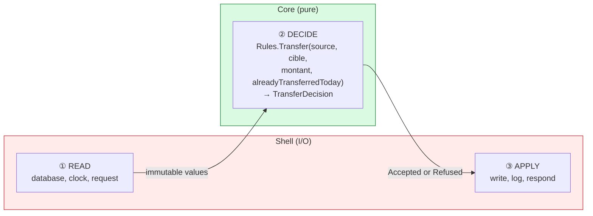
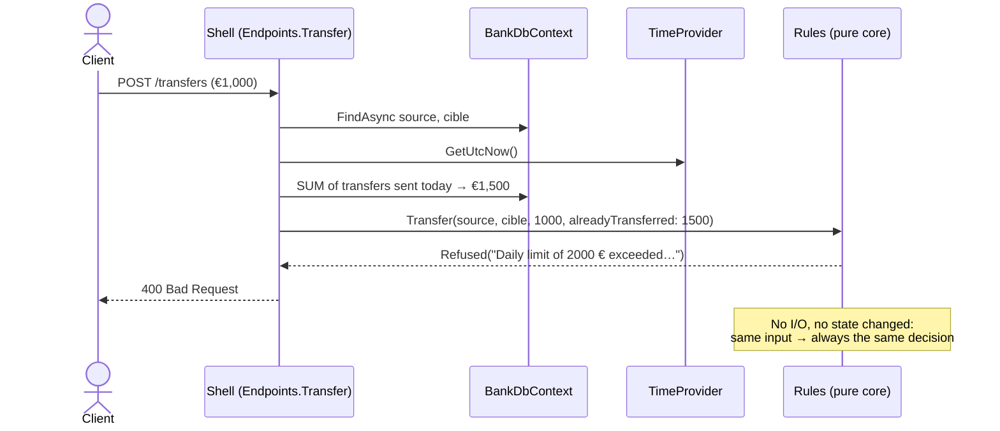

# 4. Functional Core, Imperative Shell

> **In one sentence**: the business rules are **pure functions** that return a decision; a thin **shell** around them
> does all the input/output.

📁 Code: [`04-FunctionalCore`](../../04-FunctionalCore) · ⬅️ [Clean](03-clean.md) · ➡️ [Vertical Slice](05-vertical-slice.md) ·
🌐 [Français](../04-coeur-fonctionnel.md)

---

## The idea

Formulated by **Gary Bernhardt** ("Boundaries", 2012). It is hexagonal taken to the extreme: the center doesn't even
need ports anymore, because **it never does any input/output**. No `async`, no interfaces, no database, no clock:
values in, a decision out.



| | Core | Shell |
|---|---|---|
| Contains | rules, decisions | I/O: HTTP, EF Core, clock, logs |
| Style | pure functions, immutable `record`s | imperative, `async` |
| Dependencies | none | the core + the infrastructure |
| Tests | values → value, **no mocks** | a few integration tests |
| Size | large (all the logic) | thin (no decisions) |

---

## The code, step by step

The code is quoted exactly as it is.

### 1. Immutable values and closed decisions

An account is never modified, a new version is produced; the rules don't *do* anything, they return a decision the
shell will apply.
([Account.cs](../../04-FunctionalCore/Functional.Core/Account.cs), [Decisions.cs](../../04-FunctionalCore/Functional.Core/Decisions.cs))

```csharp
/// <summary>Immutable value: an account is never modified, a new version of it is produced.</summary>
public sealed record Account(Guid Id, string Owner, decimal Balance);

// The rules DO nothing: they return a decision that the shell will apply.
public abstract record TransferDecision
{
    public sealed record Accepted(Account Source, Account Target, decimal Amount) : TransferDecision;
    public sealed record Refused(string Reason) : TransferDecision;
}
```

### 2. The rules: pure functions

**Time** is an input: the amount already transferred today is computed by the shell and passed as a parameter. And
the withdrawal rule is reused: pure functions compose naturally.
([Rules.cs](../../04-FunctionalCore/Functional.Core/Rules.cs))

```csharp
public static WithdrawalDecision Withdraw(Account account, decimal amount) => amount switch
{
    <= 0 => new WithdrawalDecision.Refused("The amount must be strictly positive."),
    _ when amount > account.Balance => new WithdrawalDecision.Refused("Insufficient balance."),
    _ => new WithdrawalDecision.Accepted(account with { Balance = account.Balance - amount }, amount)
};

public static TransferDecision Transfer(Account source, Account target, decimal amount, decimal alreadyTransferredToday)
{
    if (source.Id == target.Id)
        return new TransferDecision.Refused("Cannot transfer to the same account.");

    if (alreadyTransferredToday + amount > DailyTransferLimit)
        return new TransferDecision.Refused(
            $"Daily limit of {DailyTransferLimit:0} € exceeded (already transferred today: {alreadyTransferredToday:0.00} €).");

    // The withdrawal rule is reused: pure functions compose naturally.
    return Withdraw(source, amount) switch
    {
        WithdrawalDecision.Accepted withdrawal => new TransferDecision.Accepted(
            withdrawal.UpdatedAccount,
            target with { Balance = target.Balance + amount },
            amount),
        WithdrawalDecision.Refused refusal => new TransferDecision.Refused(refusal.Reason),
        _ => throw new UnreachableException()
    };
}
```

### 3. The shell: read → decide → apply

The three steps are marked in the code: 1. *READ* (the accounts AND everything the rule needs, here the day's
total), 2. *DECIDE* (pure), 3. *APPLY*.
([Endpoints.cs](../../04-FunctionalCore/Functional.Shell/Endpoints.cs))

```csharp
private static async Task<IResult> Transfer(
    TransferRequest request, BankDbContext db, TimeProvider clock, ILoggerFactory loggers)
{
    // 1. READ (I/O): the accounts AND everything the rule needs (here, the day's total).
    var source = await db.Accounts.FindAsync(request.Source);
    var target = await db.Accounts.FindAsync(request.Target);
    if (source is null || target is null)
        return Results.NotFound();

    var startOfDay = clock.GetUtcNow().UtcDateTime.Date;
    var alreadyTransferred = await db.Operations
        .Where(o => o.AccountId == source.Id && o.Type == "TransferSent" && o.DateUtc >= startOfDay)
        .SumAsync(o => o.Amount);

    // 2. DECIDE (pure)
    var decision = Rules.Transfer(source.ToCore(), target.ToCore(), request.Amount, alreadyTransferred);

    // 3. APPLY (I/O)
    switch (decision)
    {
        case TransferDecision.Accepted ok:
            source.Balance = ok.Source.Balance;
            target.Balance = ok.Target.Balance;
            db.Operations.Add(Operation(source.Id, "TransferSent", ok.Amount, clock));
            db.Operations.Add(Operation(target.Id, "TransferReceived", ok.Amount, clock));
            await db.SaveChangesAsync();
            return Results.Ok(new { source = ok.Source, target = ok.Target });

        case TransferDecision.Refused refusal:
            return Results.BadRequest(new { error = refusal.Reason });

        default:
            throw new UnreachableException();
    }
}
```

The shell has its **own mutable persistence model** (`AccountRow`), converted into a core value by `ToCore()`.



---

## The tests

Testing a pure function: values in, an expected value out. **Nothing else.** (The comment in the first test: "time" is
plain data, no need to fake a clock.)
([RulesTests.cs](../../04-FunctionalCore/Functional.Tests/RulesTests.cs))

```csharp
[Fact]
public void The_daily_limit_takes_into_account_what_was_already_transferred()
{
    // "Time" is a mere piece of data: no need to fake a clock.
    var decision = Rules.Transfer(Alice with { Balance = 10_000m }, Bob, 600m, alreadyTransferredToday: 1_500m);

    Assert.IsType<TransferDecision.Refused>(decision);
}

[Fact]
public void A_decision_never_modifies_the_original_account()
{
    Rules.Withdraw(Alice, 100m);

    Assert.Equal(1000m, Alice.Balance);
}
```

The test project references **only** the core: no EF Core, no ASP.NET Core, no mocks.

---

## Summary

| 👍 Strengths | 👎 Limits |
|---|---|
| Rules testable in milliseconds, without any test double | You have to load everything **before** deciding |
| Local reasoning: same input, same output | Hard if the decision needs cascading reads |
| Decisions are data (can be logged, replayed) | Requires familiarity with the functional style |

**When to use it**: complex rules (pricing, eligibility, calculations, limits), inside any other architecture. The same
principle — *deciding* separated from *applying* — is at the heart of [Event Sourcing](10-event-sourcing.md).
