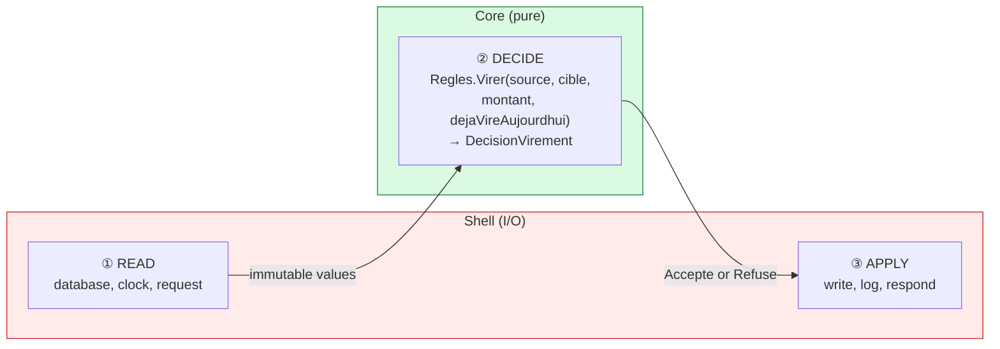
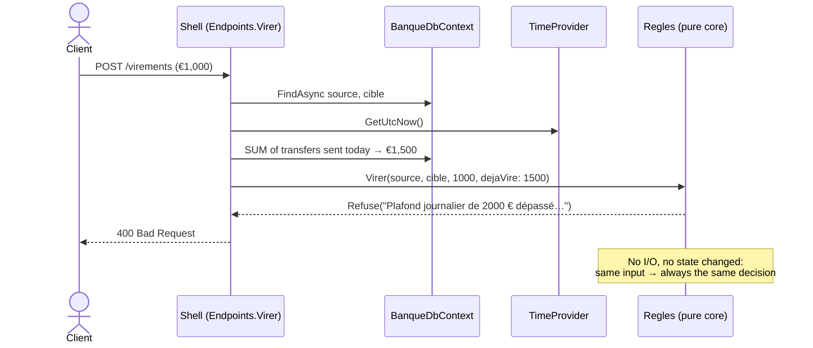

# 4. Functional Core, Imperative Shell

> **In one sentence**: the business rules are **pure functions** that return a decision; a thin **shell** around them
> does all the input/output.

📁 Code: [`04-CoeurFonctionnel`](../../04-CoeurFonctionnel) · ⬅️ [Clean](03-clean.md) · ➡️ [Vertical Slice](05-vertical-slice.md) ·
🌐 [Français](../04-coeur-fonctionnel.md)

---

## The idea

Formulated by **Gary Bernhardt** ("Boundaries", 2012). It is hexagonal taken to the extreme: the center doesn't even
need ports anymore, because **it never does any input/output**. No `async`, no interfaces, no database, no clock:
values in, a decision out. (In the code: *Coeur* = core, *Coquille* = shell, *Regles* = rules.)



| | Core | Shell |
|---|---|---|
| Contains | rules, decisions | I/O: HTTP, EF Core, clock, logs |
| Style | pure functions, immutable `record`s | imperative, `async` |
| Dependencies | none | the core + the infrastructure |
| Tests | values → value, **no mocks** | a few integration tests |
| Size | large (all the logic) | thin (no decisions) |

---

## The code, step by step

The code is quoted exactly as it is, French comments included.

### 1. Immutable values and closed decisions

An account is never modified, a new version is produced; the rules don't *do* anything, they return a decision the
shell will apply.
([Compte.cs](../../04-CoeurFonctionnel/Fonctionnel.Coeur/Compte.cs), [Decisions.cs](../../04-CoeurFonctionnel/Fonctionnel.Coeur/Decisions.cs))

```csharp
/// Valeur immuable : un compte n'est jamais modifié, on en produit une nouvelle version.
public sealed record Compte(Guid Id, string Titulaire, decimal Solde);

// Les règles ne FONT rien : elles renvoient une décision que la coquille appliquera.
public abstract record DecisionVirement
{
    public sealed record Accepte(Compte Source, Compte Cible, decimal Montant) : DecisionVirement;
    public sealed record Refuse(string Raison) : DecisionVirement;
}
```

### 2. The rules: pure functions

**Time** is an input: the amount already transferred today is computed by the shell and passed as a parameter. And
the withdrawal rule is reused: pure functions compose naturally.
([Regles.cs](../../04-CoeurFonctionnel/Fonctionnel.Coeur/Regles.cs))

```csharp
public static DecisionRetrait Retirer(Compte compte, decimal montant) => montant switch
{
    <= 0 => new DecisionRetrait.Refuse("Le montant doit être strictement positif."),
    _ when montant > compte.Solde => new DecisionRetrait.Refuse("Solde insuffisant."),
    _ => new DecisionRetrait.Accepte(compte with { Solde = compte.Solde - montant }, montant)
};

public static DecisionVirement Virer(Compte source, Compte cible, decimal montant, decimal dejaVireAujourdhui)
{
    if (source.Id == cible.Id)
        return new DecisionVirement.Refuse("Impossible de virer vers le même compte.");

    if (dejaVireAujourdhui + montant > PlafondVirementJournalier)
        return new DecisionVirement.Refuse(/* « Plafond journalier de 2000 € dépassé… » */);

    // On réutilise la règle de retrait : des fonctions pures se composent naturellement.
    return Retirer(source, montant) switch
    {
        DecisionRetrait.Accepte retrait => new DecisionVirement.Accepte(
            retrait.CompteMisAJour, cible with { Solde = cible.Solde + montant }, montant),
        DecisionRetrait.Refuse refus => new DecisionVirement.Refuse(refus.Raison),
        _ => throw new UnreachableException()
    };
}
```

### 3. The shell: read → decide → apply

The three steps are marked in the code: 1. *LIRE* (read: the accounts AND everything the rule needs, here the day's
total), 2. *DÉCIDER* (decide, pure), 3. *APPLIQUER* (apply).
([Endpoints.cs](../../04-CoeurFonctionnel/Fonctionnel.Coquille/Endpoints.cs))

```csharp
private static async Task<IResult> Virer(VirementRequete requete, BanqueDbContext db, TimeProvider horloge, ILoggerFactory journaux)
{
    // 1. LIRE (I/O) : les comptes ET tout ce dont la règle a besoin (ici, le cumul du jour).
    var source = await db.Comptes.FindAsync(requete.Source);
    var cible = await db.Comptes.FindAsync(requete.Cible);
    if (source is null || cible is null)
        return Results.NotFound();

    var debutDuJour = horloge.GetUtcNow().UtcDateTime.Date;
    var dejaVire = await db.Operations
        .Where(o => o.CompteId == source.Id && o.Type == "VirementEmis" && o.DateUtc >= debutDuJour)
        .SumAsync(o => o.Montant);

    // 2. DÉCIDER (pur)
    var decision = Regles.Virer(source.VersCoeur(), cible.VersCoeur(), requete.Montant, dejaVire);

    // 3. APPLIQUER (I/O)
    switch (decision)
    {
        case DecisionVirement.Accepte ok:
            source.Solde = ok.Source.Solde;
            cible.Solde = ok.Cible.Solde;
            db.Operations.Add(Operation(source.Id, "VirementEmis", ok.Montant, horloge));
            db.Operations.Add(Operation(cible.Id, "VirementRecu", ok.Montant, horloge));
            await db.SaveChangesAsync();
            return Results.Ok(new { source = ok.Source, cible = ok.Cible });

        case DecisionVirement.Refuse refus:
            return Results.BadRequest(new { erreur = refus.Raison });

        default:
            throw new UnreachableException();
    }
}
```

The shell has its **own mutable persistence model** (`CompteLigne`), converted into a core value by `VersCoeur()`.



---

## The tests

Testing a pure function: values in, an expected value out. **Nothing else.** (The comment in the first test: "time" is
plain data, no need to fake a clock.)
([ReglesTests.cs](../../04-CoeurFonctionnel/Fonctionnel.Tests/ReglesTests.cs))

```csharp
[Fact]
public void Le_plafond_journalier_tient_compte_de_ce_qui_a_deja_ete_vire()
{
    // Le « temps » est une simple donnée : pas besoin de simuler une horloge.
    var decision = Regles.Virer(Alice with { Solde = 10_000m }, Bob, 600m, dejaVireAujourdhui: 1_500m);

    Assert.IsType<DecisionVirement.Refuse>(decision);
}

[Fact]
public void Une_decision_ne_modifie_jamais_le_compte_d_origine()
{
    Regles.Retirer(Alice, 100m);

    Assert.Equal(1000m, Alice.Solde);
}
```

The test project references **only** the core: no EF Core, no ASP.NET Core, no mocks.

---

## Summary

| 👍 Strengths | 👎 Limits |
|---|---|
| Rules testable in milliseconds, without any test double | You have to load everything **before** deciding |
| Local reasoning: same input, same output | Hard if the decision needs cascading reads |
| Decisions are data (can be logged, replayed) | Requires familiarity with the functional style |

**When to use it**: complex rules (pricing, eligibility, calculations, limits), inside any other architecture. The same
principle — *deciding* separated from *applying* — is at the heart of [Event Sourcing](10-event-sourcing.md).
