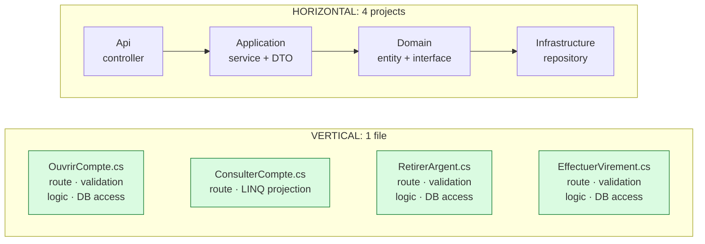
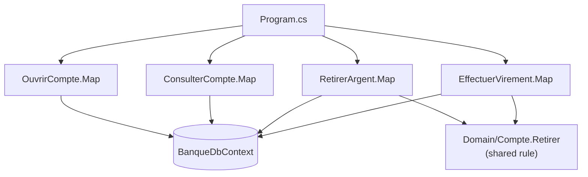

# 5. Vertical Slice Architecture

> **In one sentence**: code is organized **by feature** rather than by technical layer; each slice contains everything
> it needs, from the HTTP route down to the database.

📁 Code: [`05-VerticalSlice`](../../05-VerticalSlice) · ⬅️ [Functional Core](04-coeur-fonctionnel.md) · ➡️ [Package by Component](06-composants.md) ·
🌐 [Français](../05-vertical-slice.md)

---

## The idea

Popularized by **Jimmy Bogard** (author of MediatR and AutoMapper) around 2018. The observation: in a layered
architecture, adding "withdraw money" means changing a controller, a service, an interface, a repository, a DTO… across
four projects. Changes follow **features**, not layers: so let's organize the code that way.



**Principles**:
1. One slice = one query or one command.
2. **Tight coupling within** a slice, **loose coupling between** slices.
3. Each slice picks its own technique (LINQ projection, entity, SQL…).
4. No "just in case" abstractions: the `DbContext` already is a repository + unit of work.

---

## Solution layout

(*OuvrirCompte* = open account, *ConsulterCompte* = look up account, *RetirerArgent* = withdraw money,
*EffectuerVirement* = make a transfer.)

```
Vertical.Api/
├── Features/
│   ├── Comptes/
│   │   ├── OuvrirCompte.cs       ← transaction script: everything is in the file
│   │   ├── ConsulterCompte.cs    ← read: direct LINQ projection
│   │   └── RetirerArgent.cs      ← write: validation + rule + persistence
│   └── Virements/
│       └── EffectuerVirement.cs
├── Domain/Compte.cs              ← only the SHARED rule
├── Data/BanqueDbContext.cs       ← no repository on top
└── Program.cs
```



---

## The code, step by step

The code is quoted exactly as it is, French comments and messages included.

### 1. A complete write slice

To understand or change "withdraw money", you open **only this file**.
([RetirerArgent.cs](../../05-VerticalSlice/Vertical.Api/Features/Comptes/RetirerArgent.cs))

```csharp
public static class RetirerArgent
{
    public record Requete(decimal Montant);
    public record Reponse(Guid CompteId, decimal NouveauSolde);

    public static void Map(IEndpointRouteBuilder app) => app.MapPost("/comptes/{id:guid}/retrait", Executer);

    private static async Task<IResult> Executer(Guid id, Requete requete, BanqueDbContext db)
    {
        if (requete.Montant <= 0)
            return Results.ValidationProblem(new Dictionary<string, string[]>
            {
                [nameof(Requete.Montant)] = ["Le montant doit être strictement positif."]
            });

        var compte = await db.Comptes.FindAsync(id);
        if (compte is null)
            return Results.NotFound();

        if (compte.Retirer(requete.Montant) is { } refus)
            return Results.BadRequest(new { erreur = refus });

        db.Operations.Add(new Operation { CompteId = id, Libelle = "Retrait", Montant = -requete.Montant });
        await db.SaveChangesAsync();

        return Results.Ok(new Reponse(id, compte.Solde));
    }
}
```

### 2. A read slice, with its own technique

A direct projection into the response, read-only, without going through the domain.
([ConsulterCompte.cs](../../05-VerticalSlice/Vertical.Api/Features/Comptes/ConsulterCompte.cs))

```csharp
var compte = await db.Comptes
    .AsNoTracking()
    .Where(c => c.Id == id)
    .Select(c => new { c.Id, c.Titulaire, c.Solde })
    .FirstOrDefaultAsync();

var operations = await db.Operations
    .AsNoTracking()
    .Where(o => o.CompteId == id)
    .OrderByDescending(o => o.DateUtc)
    .Take(5)
    .Select(o => new OperationVue(o.Libelle, o.Montant, o.DateUtc))
    .ToListAsync();
```

### 3. The domain: only what is shared

The "sufficient balance" rule was first in `RetirerArgent`. When `EffectuerVirement` needed it, it was **moved up**
into the entity. Only what deserves it is extracted into the domain.
([Compte.cs](../../05-VerticalSlice/Vertical.Api/Domain/Compte.cs))

```csharp
/// <returns>null si le retrait est fait, sinon la raison du refus.</returns>
public string? Retirer(decimal montant)
{
    if (montant > Solde)
        return "Solde insuffisant.";
    Solde -= montant;
    return null;
}
```

### 4. Adding a feature = one file + one line

Each slice declares its own route.
([Program.cs](../../05-VerticalSlice/Vertical.Api/Program.cs))

```csharp
// Chaque tranche déclare elle-même sa route. Ajouter une fonctionnalité = un fichier + une ligne ici.
OuvrirCompte.Map(app);
ConsulterCompte.Map(app);
RetirerArgent.Map(app);
EffectuerVirement.Map(app);
```

---

## The tests

Mostly **integration tests per slice**, organized like the code (`Features/Comptes/RetirerArgentTests.cs`…), with the
API started in memory and a fresh database per test. (The comments: the slice's validation, the domain rule.)
([RetirerArgentTests.cs](../../05-VerticalSlice/Vertical.Tests/Features/Comptes/RetirerArgentTests.cs))

```csharp
[Theory]
[InlineData(0, HttpStatusCode.BadRequest)]       // validation de la tranche
[InlineData(99_999, HttpStatusCode.BadRequest)]  // règle du domaine (solde insuffisant)
public async Task Un_retrait_invalide_est_refuse(int montant, HttpStatusCode attendu)
{
    await using var app = new BanqueApplication();

    var reponse = await app.CreateClient()
        .PostAsJsonAsync($"/comptes/{BanqueDbContext.Alice}/retrait", new RetirerArgent.Requete(montant));

    Assert.Equal(attendu, reponse.StatusCode);
}
```

The tests reuse the slice's types (`RetirerArgent.Requete`, `RetirerArgent.Reponse`): the contract lives in the same
place as the code.

---

## Summary

| 👍 Strengths | 👎 Limits |
|---|---|
| One feature = one file: readable, easy to change | Duplication if shared rules are never moved up |
| Each slice picks the right technique | Bloated handlers if nothing is ever extracted |
| Very few abstractions, few projects | Changing database takes more work (the `DbContext` is everywhere) |
| Slices evolve independently | Requires discipline to recognize shared code |

**When to use it**: line-of-business APIs, teams delivering feature by feature. **Common combination**: vertical slices
*inside each module* of a [modular monolith](07-monolithe-modulaire.md), with hexagonal ports only around external
services. With MediatR, each slice contains a `Command`/`Query` and its `Handler` (note: MediatR has required a paid
license for companies since 2025).
