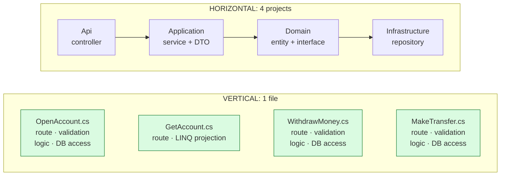
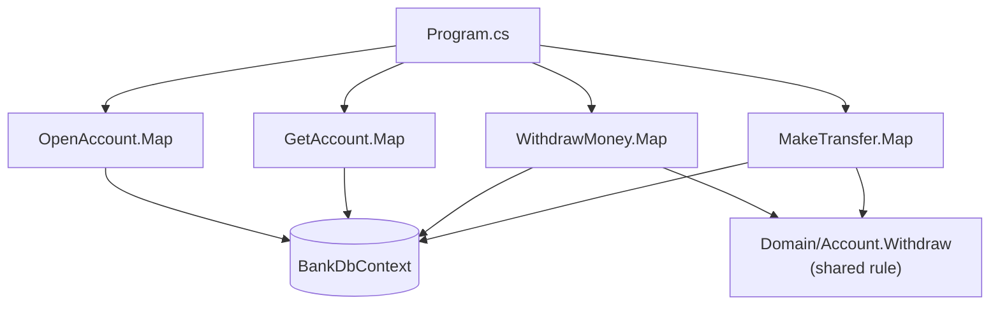

# 5. Vertical Slice Architecture

> **In one sentence**: code is organized **by feature** rather than by technical layer; each slice contains everything
> it needs, from the HTTP route down to the database.

📁 Code: [`05-VerticalSlice`](../../05-VerticalSlice) · ⬅️ [Functional Core](04-coeur-fonctionnel.md) · ➡️ [Package by Component](06-composants.md) ·
🌐 [Français](../05-vertical-slice.md)

---

## The idea

Popularized by **Jimmy Bogard** (author of MediatR and AutoMapper) around 2018. The observation: in a layered
architecture, adding "withdraw money" means changing a controller, a service, an interface, a repository, a DTO… across
four projects. Changes follow **features**, not layers: so let's organize the code that way.



**Principles**:
1. One slice = one query or one command.
2. **Tight coupling within** a slice, **loose coupling between** slices.
3. Each slice picks its own technique (LINQ projection, entity, SQL…).
4. No "just in case" abstractions: the `DbContext` already is a repository + unit of work.

---

## Solution layout

```
Vertical.Api/
├── Features/
│   ├── Accounts/
│   │   ├── OpenAccount.cs     ← transaction script: everything is in the file
│   │   ├── GetAccount.cs      ← read: direct LINQ projection
│   │   └── WithdrawMoney.cs   ← write: validation + rule + persistence
│   └── Transfers/
│       └── MakeTransfer.cs
├── Domain/Account.cs          ← only the SHARED rule
├── Data/BankDbContext.cs      ← no repository on top
└── Program.cs
```



---

## The code, step by step

The code is quoted exactly as it is, French comments and messages included.

### 1. A complete write slice

To understand or change "withdraw money", you open **only this file**.
([WithdrawMoney.cs](../../05-VerticalSlice/Vertical.Api/Features/Accounts/WithdrawMoney.cs))

```csharp
public static class WithdrawMoney
{
    public record Request(decimal Amount);
    public record Response(Guid AccountId, decimal NewBalance);

    public static void Map(IEndpointRouteBuilder app) => app.MapPost("/accounts/{id:guid}/withdrawal", Execute);

    private static async Task<IResult> Execute(Guid id, Request request, BankDbContext db)
    {
        if (request.Amount <= 0)
            return Results.ValidationProblem(new Dictionary<string, string[]>
            {
                [nameof(Request.Amount)] = ["The amount must be strictly positive."]
            });

        var account = await db.Accounts.FindAsync(id);
        if (account is null)
            return Results.NotFound();

        if (account.Withdraw(request.Amount) is { } refusal)
            return Results.BadRequest(new { error = refusal });

        db.Operations.Add(new Operation { AccountId = id, Label = "Withdrawal", Amount = -request.Amount });
        await db.SaveChangesAsync();

        return Results.Ok(new Response(id, account.Balance));
    }
}
```

### 2. A read slice, with its own technique

A direct projection into the response, read-only, without going through the domain.
([GetAccount.cs](../../05-VerticalSlice/Vertical.Api/Features/Accounts/GetAccount.cs))

```csharp
var account = await db.Accounts
    .AsNoTracking()
    .Where(c => c.Id == id)
    .Select(c => new { c.Id, c.Owner, c.Balance })
    .FirstOrDefaultAsync();

var operations = await db.Operations
    .AsNoTracking()
    .Where(o => o.AccountId == id)
    .OrderByDescending(o => o.DateUtc)
    .Take(5)
    .Select(o => new OperationView(o.Label, o.Amount, o.DateUtc))
    .ToListAsync();
```

### 3. The domain: only what is shared

The "sufficient balance" rule was first in `WithdrawMoney`. When `MakeTransfer` needed it, it was **moved up**
into the entity. Only what deserves it is extracted into the domain.
([Account.cs](../../05-VerticalSlice/Vertical.Api/Domain/Account.cs))

```csharp
/// <returns>null if the withdrawal is done, otherwise the reason for the refusal.</returns>
public string? Withdraw(decimal amount)
{
    if (amount > Balance)
        return "Insufficient balance.";
    Balance -= amount;
    return null;
}
```

### 4. Adding a feature = one file + one line

Each slice declares its own route.
([Program.cs](../../05-VerticalSlice/Vertical.Api/Program.cs))

```csharp
// Each slice declares its own route. Adding a feature = one file + one line here.
OpenAccount.Map(app);
GetAccount.Map(app);
WithdrawMoney.Map(app);
MakeTransfer.Map(app);
```

---

## The tests

Mostly **integration tests per slice**, organized like the code (`Features/Accounts/WithdrawMoneyTests.cs`…), with the
API started in memory and a fresh database per test. (The comments: the slice's validation, the domain rule.)
([WithdrawMoneyTests.cs](../../05-VerticalSlice/Vertical.Tests/Features/Accounts/WithdrawMoneyTests.cs))

```csharp
[Theory]
[InlineData(0, HttpStatusCode.BadRequest)]       // validation of the slice
[InlineData(99_999, HttpStatusCode.BadRequest)]  // domain rule (insufficient balance)
public async Task An_invalid_withdrawal_is_refused(int amount, HttpStatusCode expected)
{
    await using var app = new BankApplication();

    var response = await app.CreateClient()
        .PostAsJsonAsync($"/accounts/{BankDbContext.Alice}/withdrawal", new WithdrawMoney.Request(amount));

    Assert.Equal(expected, response.StatusCode);
}
```

The tests reuse the slice's types (`WithdrawMoney.Request`, `WithdrawMoney.Response`): the contract lives in the same
place as the code.

---

## Summary

| 👍 Strengths | 👎 Limits |
|---|---|
| One feature = one file: readable, easy to change | Duplication if shared rules are never moved up |
| Each slice picks the right technique | Bloated handlers if nothing is ever extracted |
| Very few abstractions, few projects | Changing database takes more work (the `DbContext` is everywhere) |
| Slices evolve independently | Requires discipline to recognize shared code |

**When to use it**: line-of-business APIs, teams delivering feature by feature. **Common combination**: vertical slices
*inside each module* of a [modular monolith](07-monolithe-modulaire.md), with hexagonal ports only around external
services. With MediatR, each slice contains a `Command`/`Query` and its `Handler` (note: MediatR has required a paid
license for companies since 2025).
