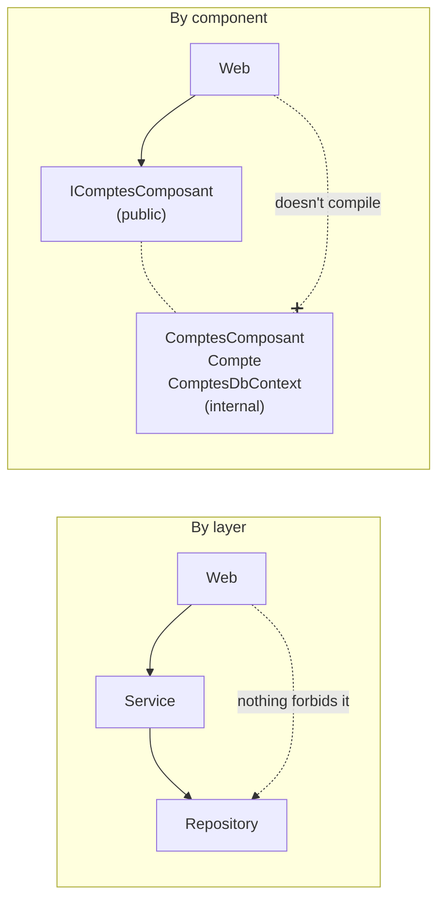
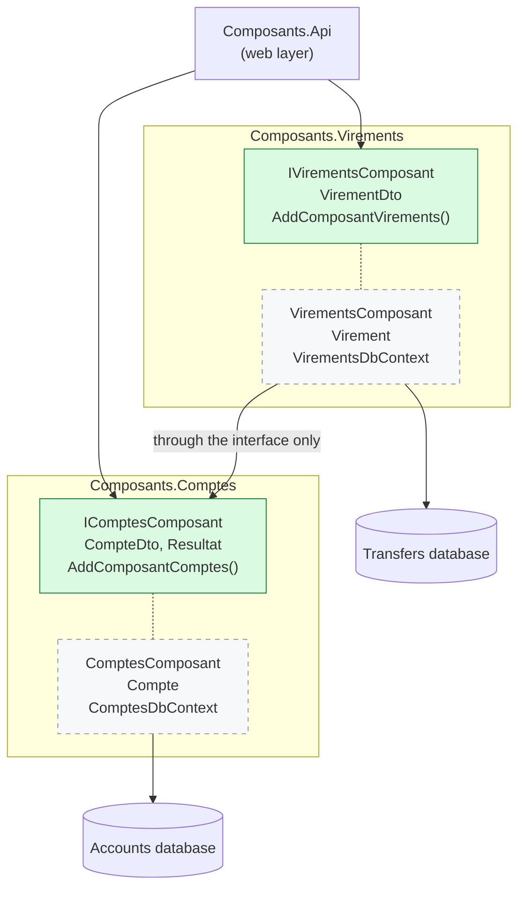
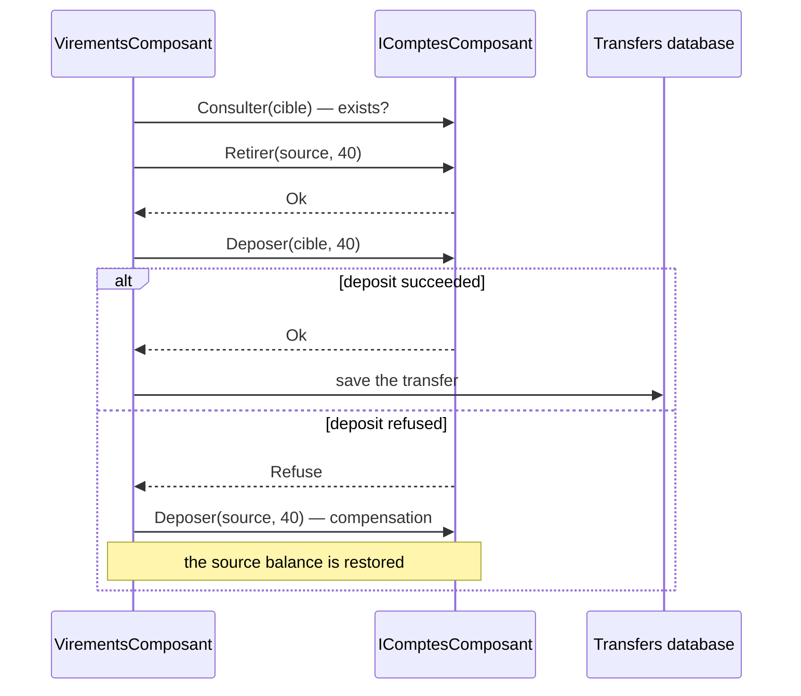

# 6. Package by Component

> **In one sentence**: each component groups business logic and data behind **a single public interface**;
> everything else is `internal`, and it is the compiler that enforces the architecture.

📁 Code: [`06-Composants`](../../06-Composants) · ⬅️ [Vertical Slice](05-vertical-slice.md) · ➡️ [Modular Monolith](07-monolithe-modulaire.md) ·
🌐 [Français](../06-composants.md)

---

## The idea

Proposed by **Simon Brown** (author of the C4 model) in *"The Missing Chapter"* of the book *Clean Architecture*.
His observation: **in the previous architectures, nothing stops a developer in a hurry from bypassing the design**.
If everything is `public`, a controller can call the repository directly. The architecture only exists on paper.



---

## Solution layout



In green: `public`. Dashed: `internal`, invisible outside the project. **Each component owns its database**:
Transfers (*Virements*) never reads the Accounts (*Comptes*) tables.

---

## The code, step by step

The code is quoted exactly as it is, French comments included.

### 1. A component's public surface

It is all the rest of the application can see.
([IComptesComposant.cs](../../06-Composants/Composants.Comptes/IComptesComposant.cs))

```csharp
// ─── Surface publique du composant : c'est tout ce que le reste de l'application peut voir. ───
public interface IComptesComposant
{
    Task<CompteDto> Ouvrir(string titulaire, decimal depotInitial, Guid? id = null);
    Task<CompteDto?> Consulter(Guid compteId);
    Task<Resultat> Retirer(Guid compteId, decimal montant);
    Task<Resultat> Deposer(Guid compteId, decimal montant);
}
```

### 2. Everything else is `internal`

Nobody can write `new Compte()` from the API; the implementation can only be obtained through the interface, via
dependency injection.
([Compte.cs](../../06-Composants/Composants.Comptes/Interne/Compte.cs), [ComptesComposant.cs](../../06-Composants/Composants.Comptes/Interne/ComptesComposant.cs))

```csharp
// internal : invisible hors du composant. Personne ne peut faire « new Compte() » depuis l'API.
internal class Compte { /* … */ }

// L'implémentation est internal : on ne l'obtient que par l'interface, via l'injection de dépendances.
internal class ComptesComposant(ComptesDbContext db) : IComptesComposant { /* … */ }
```

The only other public point: plugging it into dependency injection. The component owns ITS database: no other
component accesses it.
([ComptesExtensions.cs](../../06-Composants/Composants.Comptes/ComptesExtensions.cs))

```csharp
public static IServiceCollection AddComposantComptes(this IServiceCollection services, string nomBase = "Comptes")
{
    // Le composant possède SA base : aucun autre composant n'y accède.
    services.AddDbContext<ComptesDbContext>(options => options.UseInMemoryDatabase(nomBase));
    services.AddScoped<IComptesComposant, ComptesComposant>();
    return services;
}
```

### 3. One component uses another… through its interface

With no shared transaction between two databases, you have to **compensate** if the second step fails.
([VirementsComposant.cs](../../06-Composants/Composants.Virements/Interne/VirementsComposant.cs))

```csharp
var retrait = await comptes.Retirer(sourceId, montant);
if (!retrait.Succes)
    return retrait;

var depot = await comptes.Deposer(cibleId, montant);
if (!depot.Succes)
{
    // Pas de transaction commune entre deux composants qui ont chacun leur base :
    // si la 2e étape échoue, on compense la 1re.
    await comptes.Deposer(sourceId, montant);
    return depot;
}
```



### 4. The API can't cheat

Try writing `new ComptesDbContext(...)` or `new Compte(...)` there: it doesn't compile.
([Program.cs](../../06-Composants/Composants.Api/Program.cs))

```csharp
// Essayez d'écrire « new ComptesDbContext(...) » ou « new Compte(...) » ici : ça ne compile pas.
app.MapPost("/comptes/{id:guid}/retrait", async (Guid id, RetraitRequete requete, IComptesComposant comptes) =>
    EnHttp(await comptes.Retirer(id, requete.Montant)));
```

---

## The tests

- **Black box**: each component is tested through its public interface, with its real in-memory database.
- **Isolation**: the Transfers component is tested with a **fake** `IComptesComposant` whose deposit fails, to check
  the compensation ([VirementsComposantTests.cs](../../06-Composants/Composants.Tests/VirementsComposantTests.cs)):

```csharp
Assert.Equal(["retrait source 40", "dépôt cible 40 (refusé)", "dépôt source 40"], faux.Journal);
```

- **Safeguard**: the public surface is locked. Making an internal type `public` fails the test
  ([ArchitectureTests.cs](../../06-Composants/Composants.Tests/ArchitectureTests.cs)):

```csharp
var publics = typeof(IComptesComposant).Assembly.GetExportedTypes().Select(t => t.Name).Order();

Assert.Equal(
    ["CompteDto", "ComptesExtensions", "IComptesComposant", "Resultat", "StatutResultat"],
    publics);
```

- `InternalsVisibleTo` (in the `.csproj`) opens the internals to the test project only, to test the `Compte` entity directly.

---

## Summary

| 👍 Strengths | 👎 Limits |
|---|---|
| Architecture enforced by the compiler | Designing good public interfaces takes care |
| One database per component: real data independence | No more shared transaction: compensation needed |
| Natural path to the modular monolith, then microservices | One project per component |

**Simon Brown's key idea**: an architecture not protected by `internal` (or by architecture tests such as
NetArchTest / ArchUnitNET) always ends up bypassed. Next step: components that also own their API and their events
→ [Modular Monolith](07-monolithe-modulaire.md).
