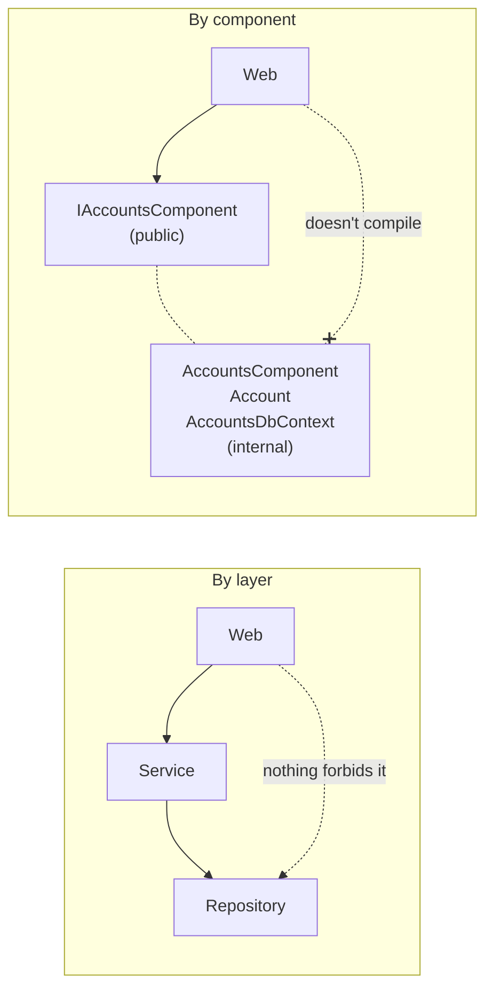
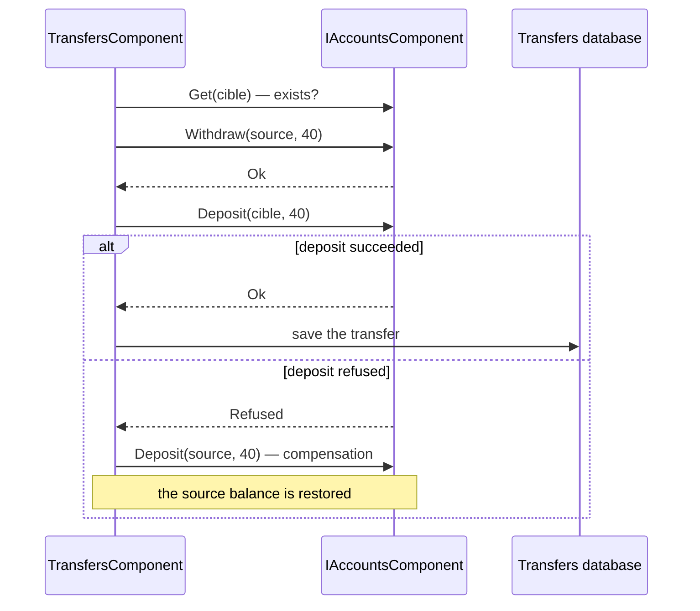

# 6. Package by Component

> **In one sentence**: each component groups business logic and data behind **a single public interface**;
> everything else is `internal`, and it is the compiler that enforces the architecture.

📁 Code: [`06-Components`](../../06-Components) · ⬅️ [Vertical Slice](05-vertical-slice.md) · ➡️ [Modular Monolith](07-monolithe-modulaire.md) ·
🌐 [Français](../06-composants.md)

---

## The idea

Proposed by **Simon Brown** (author of the C4 model) in *"The Missing Chapter"* of the book *Clean Architecture*.
His observation: **in the previous architectures, nothing stops a developer in a hurry from bypassing the design**.
If everything is `public`, a controller can call the repository directly. The architecture only exists on paper.



---

## Solution layout


In green: `public`. Dashed: `internal`, invisible outside the project. **Each component owns its database**:
Transfers never reads the Accounts tables.

---

## The code, step by step

The code is quoted exactly as it is.

### 1. A component's public surface

It is all the rest of the application can see.
([IAccountsComponent.cs](../../06-Components/Components.Accounts/IAccountsComponent.cs))

```csharp
// ─── Public surface of the component: this is all the rest of the application can see. ───
public interface IAccountsComponent
{
    Task<AccountDto> Open(string owner, decimal initialDeposit, Guid? id = null);
    Task<AccountDto?> Get(Guid accountId);
    Task<Result> Withdraw(Guid accountId, decimal amount);
    Task<Result> Deposit(Guid accountId, decimal amount);
}
```

### 2. Everything else is `internal`

Nobody can write `new Account()` from the API; the implementation can only be obtained through the interface, via
dependency injection.
([Account.cs](../../06-Components/Components.Accounts/Internal/Account.cs), [AccountsComponent.cs](../../06-Components/Components.Accounts/Internal/AccountsComponent.cs))

```csharp
// internal: invisible outside the component. Nobody can do "new Account()" from the API.
internal class Account
{
    // …
}

// The implementation is internal: it can only be obtained through the interface, via dependency injection.
internal class AccountsComponent(AccountsDbContext db) : IAccountsComponent
{
    // …
}
```

The only other public point: plugging it into dependency injection. The component owns ITS database: no other
component accesses it.
([AccountsExtensions.cs](../../06-Components/Components.Accounts/AccountsExtensions.cs))

```csharp
public static IServiceCollection AddAccountsComponent(this IServiceCollection services, string databaseName = "Accounts")
{
    // The component owns ITS database: no other component accesses it.
    services.AddDbContext<AccountsDbContext>(options => options.UseInMemoryDatabase(databaseName));
    services.AddScoped<IAccountsComponent, AccountsComponent>();
    return services;
}
```

### 3. One component uses another… through its interface

With no shared transaction between two databases, you have to **compensate** if the second step fails.
([TransfersComponent.cs](../../06-Components/Components.Transfers/Internal/TransfersComponent.cs))

```csharp
var withdrawal = await accounts.Withdraw(sourceId, amount);
if (!withdrawal.Success)
    return withdrawal;

var deposit = await accounts.Deposit(targetId, amount);
if (!deposit.Success)
{
    // No shared transaction between two components that each have their own database:
    // if the 2nd step fails, the 1st one is compensated.
    await accounts.Deposit(sourceId, amount);
    return deposit;
}
```



### 4. The API can't cheat

Try writing `new AccountsDbContext(...)` or `new Account(...)` there: it doesn't compile.
([Program.cs](../../06-Components/Components.Api/Program.cs))

```csharp
// Try writing "new AccountsDbContext(...)" or "new Account(...)" here: it does not compile.
app.MapPost("/accounts/{id:guid}/withdrawal", async (Guid id, WithdrawalRequest request, IAccountsComponent accounts) =>
    ToHttp(await accounts.Withdraw(id, request.Amount)));
```

---

## The tests

- **Black box**: each component is tested through its public interface, with its real in-memory database.
- **Isolation**: the Transfers component is tested with a **fake** `IAccountsComponent` whose deposit fails, to check
  the compensation ([TransfersComponentTests.cs](../../06-Components/Components.Tests/TransfersComponentTests.cs)):

```csharp
Assert.Equal(["withdrawal source 40", "deposit target 40 (refused)", "deposit source 40"], fake.Log);
```

- **Safeguard**: the public surface is locked. Making an internal type `public` fails the test
  ([ArchitectureTests.cs](../../06-Components/Components.Tests/ArchitectureTests.cs)):

```csharp
var publics = typeof(IAccountsComponent).Assembly.GetExportedTypes().Select(t => t.Name).Order();

Assert.Equal(
    ["AccountDto", "AccountsExtensions", "IAccountsComponent", "Result", "ResultStatus"],
    publics);
```

- `InternalsVisibleTo` (in the `.csproj`) opens the internals to the test project only, to test the `Account` entity directly.

---

## Summary

| 👍 Strengths | 👎 Limits |
|---|---|
| Architecture enforced by the compiler | Designing good public interfaces takes care |
| One database per component: real data independence | No more shared transaction: compensation needed |
| Natural path to the modular monolith, then microservices | One project per component |

**Simon Brown's key idea**: an architecture not protected by `internal` (or by architecture tests such as
NetArchTest / ArchUnitNET) always ends up bypassed. Next step: components that also own their API and their events
→ [Modular Monolith](07-monolithe-modulaire.md).
