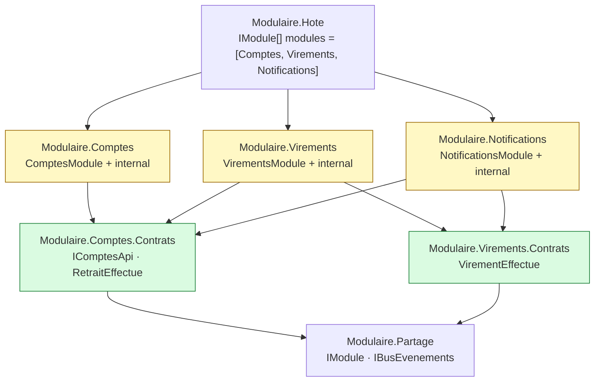
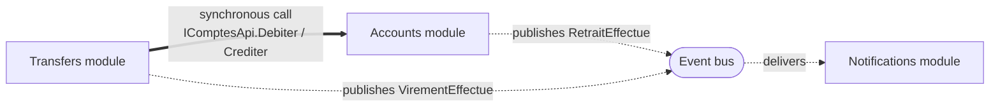
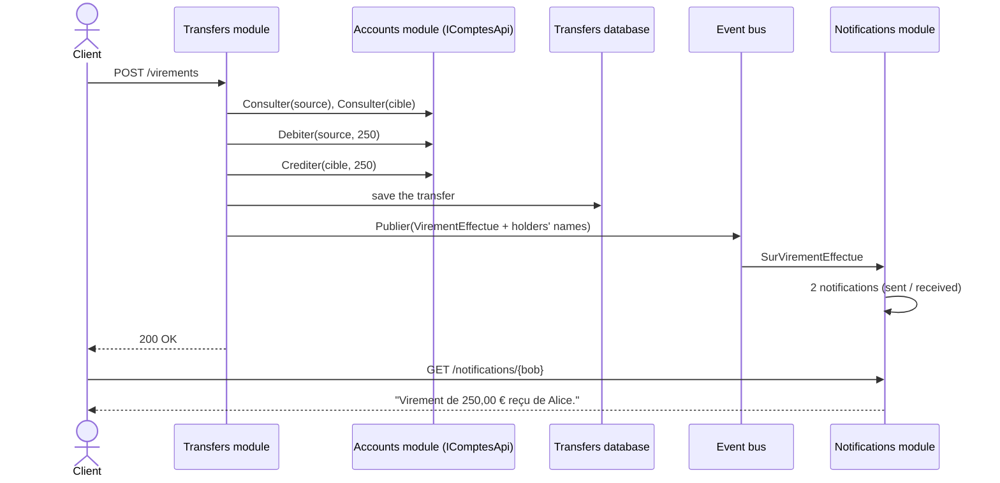

# 7. Modular Monolith

**French name**: *Monolithe modulaire*

> **In one sentence**: autonomous modules — each with its own API, database and events — connected only through
> **contracts**, and deployed together in a single process.

📁 Code: [`07-MonolitheModulaire`](../../07-MonolitheModulaire) · ⬅️ [Package by Component](06-composants.md) · ➡️ [Microservices](08-microservices.md) ·
🌐 [Français](../07-monolithe-modulaire.md)

---

## The idea

The modular monolith takes the best of both worlds: the **operational simplicity** of a monolith (one deployment, no
network between modules, easy debugging) and the **independence** of microservices (clear boundaries, one database per
module, communication through contracts). Shopify, among others, popularized it as an alternative to microservices.

Compared with [components](06-composants.md), a module is no longer just "business logic behind an interface": it is a
**mini-application** that owns its HTTP routes, its database and its subscriptions, and is plugged in with one line.
(In the code: *Comptes* = accounts, *Virements* = transfers, *Hote* = host, *Partage* = shared, *Contrats* = contracts.)

**Who references whom** (projects):



**Who talks to whom** (at runtime):



**Rules** (checked by architecture tests):
1. A module **never** references another module's implementation, only its **Contracts**.
2. A module publicly exposes **only** its `IModule` class.
3. Contracts depend on no module.
4. One database per module (`Banque-Comptes`, `Banque-Virements`, `Banque-Notifications`).

---

## Two communication modes

| | **Synchronous** (interface call) | **Asynchronous** (event) |
|---|---|---|
| Example | Transfers → `IComptesApi.Debiter/Crediter` | Accounts publishes `RetraitEffectue` |
| When | You need the answer **right away** | You **announce** a fact, without knowing who listens |
| Coupling | the caller knows the called module's interface | the publisher doesn't know the subscribers |
| Failure on the other side | the caller fails | the publisher is not affected |

---

## The code, step by step

The code is quoted exactly as it is, French comments included.

### 1. A module's contract

What each module implements to plug into the host; the host only knows this interface.
([IModule.cs](../../07-MonolitheModulaire/Modulaire.Partage/IModule.cs))

```csharp
/// Ce que chaque module implémente pour se brancher dans l'hôte.
/// L'hôte ne connaît que cette interface : il ignore tout du contenu des modules.
public interface IModule
{
    string Nom { get; }
    void Enregistrer(IServiceCollection services, IConfiguration configuration);
    void MapEndpoints(IEndpointRouteBuilder app);
    Task Initialiser(IServiceProvider services) => Task.CompletedTask;
}
```

### 2. The host assembles, without any business logic

The list of modules: removing a line removes a whole feature (routes, database, subscriptions).
([Program.cs](../../07-MonolitheModulaire/Modulaire.Hote/Program.cs))

```csharp
// La liste des modules : retirer une ligne retire une fonctionnalité entière (routes, base, abonnements).
IModule[] modules = [new ComptesModule(), new VirementsModule(), new NotificationsModule()];

builder.Services.AddBusEvenements();
foreach (var module in modules)
    module.Enregistrer(builder.Services, builder.Configuration);

var app = builder.Build();

foreach (var module in modules)
{
    await module.Initialiser(app.Services);
    module.MapEndpoints(app);
}
```

### 3. The contracts: what others are allowed to know

A synchronous API other modules can call, and the events the module publishes.
([Comptes.Contrats/Contrats.cs](../../07-MonolitheModulaire/Modulaire.Comptes.Contrats/Contrats.cs))

```csharp
// ─── Communication synchrone : une API que les autres modules peuvent appeler ───
public interface IComptesApi
{
    Task<CompteInfo?> Consulter(Guid compteId);
    Task<ResultatOperation> Debiter(Guid compteId, decimal montant);
    Task<ResultatOperation> Crediter(Guid compteId, decimal montant);
}

// ─── Communication asynchrone : les événements que le module publie ───
public record RetraitEffectue(Guid CompteId, decimal Montant, decimal NouveauSolde) : IEvenementIntegration;
```

### 4. One module uses another… and publishes an event

Synchronous call through the public contract only; each module has its own database, so no shared transaction: the
debit is compensated; then the transfer is announced to whoever wants to hear it.
([VirementsEndpoints.cs](../../07-MonolitheModulaire/Modulaire.Virements/Interne/VirementsEndpoints.cs))

```csharp
// Appel synchrone à un autre module, uniquement par son contrat public.
var debit = await comptes.Debiter(source.Id, requete.Montant);
if (!debit.Succes)
    return Results.BadRequest(new { erreur = debit.Erreur });

var credit = await comptes.Crediter(cible.Id, requete.Montant);
if (!credit.Succes)
{
    // Chaque module a sa base : pas de transaction commune, donc on compense le débit.
    await comptes.Crediter(source.Id, requete.Montant);
    return Results.BadRequest(new { erreur = credit.Erreur });
}

db.Virements.Add(new Virement { SourceId = source.Id, CibleId = cible.Id, Montant = requete.Montant });
await db.SaveChangesAsync();

// Communication asynchrone : on annonce le virement à qui veut l'entendre.
await bus.Publier(new VirementEffectue(source.Id, source.Titulaire, cible.Id, cible.Titulaire, requete.Montant));
```

### 5. A module added without touching the others

Notifications only **listens**. It was added without changing a single line of Accounts or Transfers.
([NotificationsModule.cs](../../07-MonolitheModulaire/Modulaire.Notifications/NotificationsModule.cs))

```csharp
// Abonnements aux événements des autres modules.
services.AddScoped<IGestionnaireEvenement<RetraitEffectue>, SurRetraitEffectue>();
services.AddScoped<IGestionnaireEvenement<VirementEffectue>, SurVirementEffectue>();
```

### 6. The bus isolates failures

([Evenements.cs](../../07-MonolitheModulaire/Modulaire.Partage/Evenements.cs)) — each handler runs in its own scope,
and an error in a subscriber doesn't make the publishing module fail.

```csharp
foreach (var gestionnaire in scope.ServiceProvider.GetServices<IGestionnaireEvenement<T>>())
{
    try
    {
        await gestionnaire.Traiter(evenement);
    }
    catch (Exception e)
    {
        journal.LogError(e, "Le gestionnaire {Gestionnaire} a échoué sur {Evenement}",
            gestionnaire.GetType().Name, typeof(T).Name);
    }
}
```

### The path of a transfer through the three modules



The event carries the **holders' names** (*event-carried state transfer*): Notifications doesn't need to call
Accounts back.

---

## The tests

- **Cross-module journeys** ([ParcoursTests.cs](../../07-MonolitheModulaire/Modulaire.Tests/ParcoursTests.cs)): a
  transfer goes through the three modules.
- **Isolation** ([IsolationTests.cs](../../07-MonolitheModulaire/Modulaire.Tests/IsolationTests.cs)): a module is
  replaced by a fake through its contract (`services.AddScoped<IComptesApi>(_ => faux)`), and we check that a failure
  in a subscriber doesn't break the publishing module.
- **Architecture** ([ArchitectureTests.cs](../../07-MonolitheModulaire/Modulaire.Tests/ArchitectureTests.cs)):

```csharp
[Theory]
[MemberData(nameof(Modules))]
public void Un_module_ne_reference_que_des_contrats_et_le_projet_partage(string module)
{
    var interdites = DependancesInternes(Assembly.Load(module))
        .Where(nom => nom != "Modulaire.Partage" && !nom.EndsWith(".Contrats"));

    Assert.Empty(interdites);
}
```

---

## Summary

| 👍 Strengths | 👎 Limits |
|---|---|
| A single deployment, simple debugging, no network latency | Modules can't be scaled independently |
| Clear boundaries, checked by tests | One database per module: no transactions or joins across modules |
| Add / remove a module with one line | The in-memory bus loses events on a crash (→ outbox) |
| Each module picks its internal architecture | A bad split is expensive to fix |

**The recommended starting point** for a growing system. The day a module must be deployed separately, its contracts
become a network API and its bus a real broker: that is [demo 8](08-microservices.md). In production, add an *outbox*
(see [cross-cutting concepts](concepts-transverses.md#outbox)).
