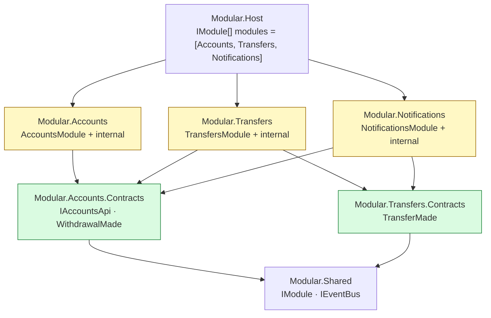
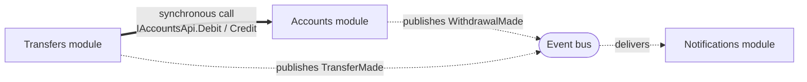
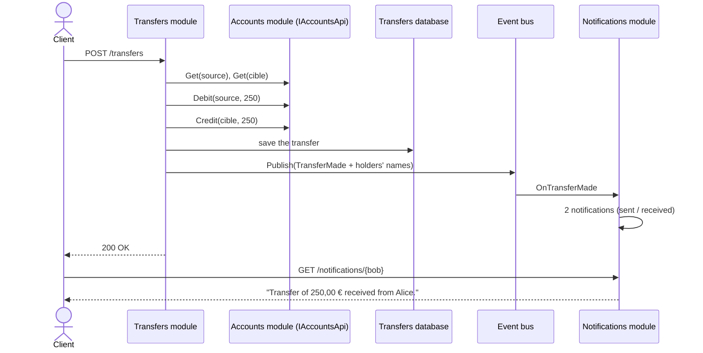

# 7. Modular Monolith

**French name**: *Monolithe modulaire*

> **In one sentence**: autonomous modules — each with its own API, database and events — connected only through
> **contracts**, and deployed together in a single process.

📁 Code: [`07-ModularMonolith`](../../07-ModularMonolith) · ⬅️ [Package by Component](06-composants.md) · ➡️ [Microservices](08-microservices.md) ·
🌐 [Français](../07-monolithe-modulaire.md)

---

## The idea

The modular monolith takes the best of both worlds: the **operational simplicity** of a monolith (one deployment, no
network between modules, easy debugging) and the **independence** of microservices (clear boundaries, one database per
module, communication through contracts). Shopify, among others, popularized it as an alternative to microservices.

Compared with [components](06-composants.md), a module is no longer just "business logic behind an interface": it is a
**mini-application** that owns its HTTP routes, its database and its subscriptions, and is plugged in with one line.

**Who references whom** (projects):



**Who talks to whom** (at runtime):



**Rules** (checked by architecture tests):
1. A module **never** references another module's implementation, only its **Contracts**.
2. A module publicly exposes **only** its `IModule` class.
3. Contracts depend on no module.
4. One database per module (`Bank-Accounts`, `Bank-Transfers`, `Bank-Notifications`).

---

## Two communication modes

| | **Synchronous** (interface call) | **Asynchronous** (event) |
|---|---|---|
| Example | Transfers → `IAccountsApi.Debit/Credit` | Accounts publishes `WithdrawalMade` |
| When | You need the answer **right away** | You **announce** a fact, without knowing who listens |
| Coupling | the caller knows the called module's interface | the publisher doesn't know the subscribers |
| Failure on the other side | the caller fails | the publisher is not affected |

---

## The code, step by step

The code is quoted exactly as it is, French comments included.

### 1. A module's contract

What each module implements to plug into the host; the host only knows this interface.
([IModule.cs](../../07-ModularMonolith/Modular.Shared/IModule.cs))

```csharp
/// What each module implements to plug itself into the host.
/// The host only knows this interface: it knows nothing about what the modules contain.
public interface IModule
{
    string Name { get; }
    void Register(IServiceCollection services, IConfiguration configuration);
    void MapEndpoints(IEndpointRouteBuilder app);
    Task Initialize(IServiceProvider services) => Task.CompletedTask;
}
```

### 2. The host assembles, without any business logic

The list of modules: removing a line removes a whole feature (routes, database, subscriptions).
([Program.cs](../../07-ModularMonolith/Modular.Host/Program.cs))

```csharp
// The list of modules: removing a line removes a whole feature (routes, database, subscriptions).
IModule[] modules = [new AccountsModule(), new TransfersModule(), new NotificationsModule()];

builder.Services.AddEventBus();
foreach (var module in modules)
    module.Register(builder.Services, builder.Configuration);

var app = builder.Build();

foreach (var module in modules)
{
    await module.Initialize(app.Services);
    module.MapEndpoints(app);
}
```

### 3. The contracts: what others are allowed to know

A synchronous API other modules can call, and the events the module publishes.
([Accounts.Contracts/Contracts.cs](../../07-ModularMonolith/Modular.Accounts.Contracts/Contracts.cs))

```csharp
// ─── Synchronous communication: an API the other modules can call ───
public interface IAccountsApi
{
    Task<AccountInfo?> Get(Guid accountId);
    Task<OperationResult> Debit(Guid accountId, decimal amount);
    Task<OperationResult> Credit(Guid accountId, decimal amount);
}

// ─── Asynchronous communication: the events the module publishes ───
public record WithdrawalMade(Guid AccountId, decimal Amount, decimal NewBalance) : IIntegrationEvent;
```

### 4. One module uses another… and publishes an event

Synchronous call through the public contract only; each module has its own database, so no shared transaction: the
debit is compensated; then the transfer is announced to whoever wants to hear it.
([TransfersEndpoints.cs](../../07-ModularMonolith/Modular.Transfers/Internal/TransfersEndpoints.cs))

```csharp
// Synchronous call to another module, only through its public contract.
var debit = await accounts.Debit(source.Id, request.Amount);
if (!debit.Success)
    return Results.BadRequest(new { error = debit.Error });

var credit = await accounts.Credit(target.Id, request.Amount);
if (!credit.Success)
{
    // Each module has its own database: no shared transaction, so the debit is compensated.
    await accounts.Credit(source.Id, request.Amount);
    return Results.BadRequest(new { error = credit.Error });
}

db.Transfers.Add(new Transfer { SourceId = source.Id, TargetId = target.Id, Amount = request.Amount });
await db.SaveChangesAsync();

// Asynchronous communication: the transfer is announced to whoever wants to hear it.
await bus.Publish(new TransferMade(source.Id, source.Owner, target.Id, target.Owner, request.Amount));
```

### 5. A module added without touching the others

Notifications only **listens**. It was added without changing a single line of Accounts or Transfers.
([NotificationsModule.cs](../../07-ModularMonolith/Modular.Notifications/NotificationsModule.cs))

```csharp
// Subscriptions to the other modules' events.
services.AddScoped<IEventHandler<WithdrawalMade>, OnWithdrawalMade>();
services.AddScoped<IEventHandler<TransferMade>, OnTransferMade>();
```

### 6. The bus isolates failures

([Events.cs](../../07-ModularMonolith/Modular.Shared/Events.cs)) — each handler runs in its own scope,
and an error in a subscriber doesn't make the publishing module fail.

```csharp
foreach (var handler in scope.ServiceProvider.GetServices<IEventHandler<T>>())
{
    try
    {
        await handler.Handle(@event);
    }
    catch (Exception e)
    {
        logger.LogError(e, "Handler {Handler} failed on {Event}",
            handler.GetType().Name, typeof(T).Name);
    }
}
```

### The path of a transfer through the three modules



The event carries the **holders' names** (*event-carried state transfer*): Notifications doesn't need to call
Accounts back.

---

## The tests

- **Cross-module journeys** ([JourneyTests.cs](../../07-ModularMonolith/Modular.Tests/JourneyTests.cs)): a
  transfer goes through the three modules.
- **Isolation** ([IsolationTests.cs](../../07-ModularMonolith/Modular.Tests/IsolationTests.cs)): a module is
  replaced by a fake through its contract (`services.AddScoped<IAccountsApi>(_ => fake)`), and we check that a failure
  in a subscriber doesn't break the publishing module.
- **Architecture** ([ArchitectureTests.cs](../../07-ModularMonolith/Modular.Tests/ArchitectureTests.cs)):

```csharp
[Theory]
[MemberData(nameof(Modules))]
public void A_module_only_references_contracts_and_the_shared_project(string module)
{
    var forbidden = InternalDependencies(Assembly.Load(module))
        .Where(name => name != "Modular.Shared" && !name.EndsWith(".Contracts"));

    Assert.Empty(forbidden);
}
```

---

## Summary

| 👍 Strengths | 👎 Limits |
|---|---|
| A single deployment, simple debugging, no network latency | Modules can't be scaled independently |
| Clear boundaries, checked by tests | One database per module: no transactions or joins across modules |
| Add / remove a module with one line | The in-memory bus loses events on a crash (→ outbox) |
| Each module picks its internal architecture | A bad split is expensive to fix |

**The recommended starting point** for a growing system. The day a module must be deployed separately, its contracts
become a network API and its bus a real broker: that is [demo 8](08-microservices.md). In production, add an *outbox*
(see [cross-cutting concepts](concepts-transverses.md#outbox)).
