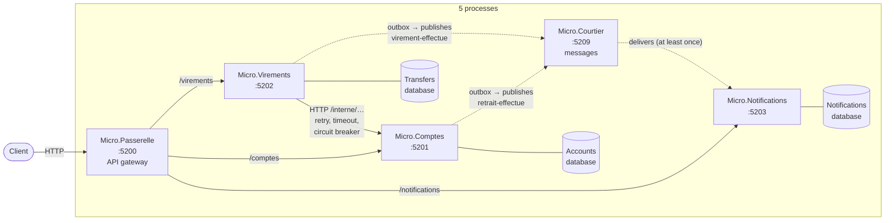
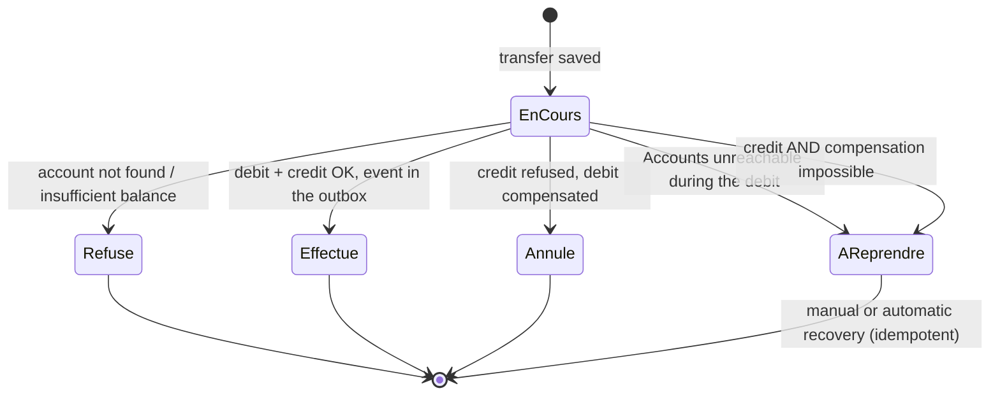
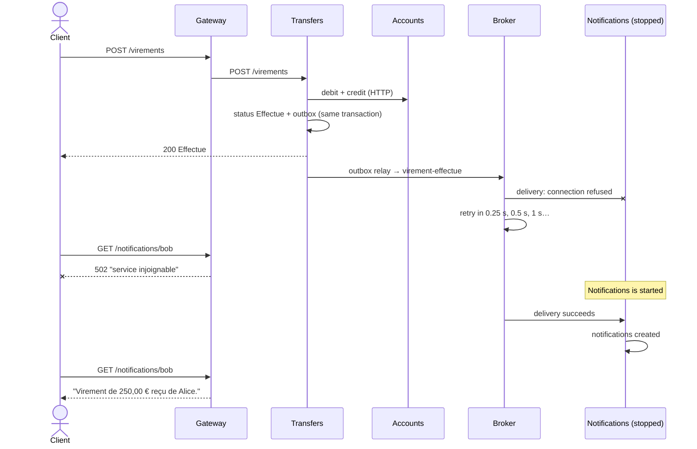

# 8. Microservices

> **In one sentence**: each service is a **separate process**, with its own database, deployable on its own; the
> services communicate only over the **network** (HTTP and messages) and share no code.

📁 Code: [`08-Microservices`](../../08-Microservices) · ⬅️ [Modular Monolith](07-monolithe-modulaire.md) · ➡️ [CQRS](09-cqrs.md) ·
🌐 [Français](../08-microservices.md)

---

## The idea

It is [demo 7](07-monolithe-modulaire.md) cut into processes. Everything that was free in the monolith — a method
call, a transaction, an in-memory event — now goes through the **network, which can fail**. Most of this demo's code
is there to handle those failures. (In the code: *Passerelle* = gateway, *Comptes* = accounts, *Virements* =
transfers, *Courtier* = broker, *Lanceur* = launcher.)



| Service | Role | Specifics |
|---|---|---|
| **Gateway** | Single entry point for clients | Only forwards the public routes; `/interne/…` answers 404; aggregated `GET /sante` (health) |
| **Accounts** | Account keeping | **Idempotent** internal API (`operationId`); **outbox** |
| **Transfers** | Orchestrates a transfer | **Resilient** HTTP client; **saga** with a status and **compensation**; outbox |
| **Notifications** | Sends the notifications | Knows no service; ignores **duplicates** (`Message-Id`) |
| **Broker** | Carries the messages | "At least once" delivery, retries, dead letters |
| *Launcher* | Demo tool | Starts the 5 processes (the role of docker compose / Kubernetes / Aspire) |

**No references between services**, and no shared project: the contract is the exchanged JSON. The outbox relay is
deliberately duplicated in Accounts and Transfers.

---

## The code, step by step

The code is quoted exactly as it is, French comments included.

### 1. Calling another service: preparing for failure

The network can fail, so the call is protected: retry (including on POST, safe because the calls carry an idempotent
`operationId`), a timeout per attempt, and a circuit breaker so as not to insist on a service that is down.
([Micro.Virements/Program.cs](../../08-Microservices/Micro.Virements/Program.cs))

```csharp
// Appels au service Comptes : le réseau peut échouer, on se protège.
// Retry (y compris sur POST : sans danger, car les appels portent un operationId idempotent),
// timeout par tentative et circuit breaker pour ne pas insister sur un service à terre.
builder.Services.AddHttpClient("comptes", (sp, client) =>
        client.BaseAddress = new Uri(sp.GetRequiredService<IConfiguration>()["Services:Comptes"]!))
    .AddStandardResilienceHandler(options =>
    {
        options.Retry.MaxRetryAttempts = 3;
        options.Retry.Delay = TimeSpan.FromMilliseconds(200);
    });
```

The client has its **own copy** of the remote model: no library shared with the Accounts service
([ClientComptes.cs](../../08-Microservices/Micro.Virements/ClientComptes.cs)):

```csharp
// Représentation LOCALE d'un compte : pas de bibliothèque partagée avec le service Comptes,
// le contrat entre les deux, c'est le JSON échangé.
internal record CompteDistant(Guid Id, string Titulaire, decimal Solde);
```

### 2. Making the call replayable: idempotency

If the response is lost, the retry sends the same debit again. Without precautions: a double debit. A call replayed
with the same `operationId` doesn't debit twice.
([Micro.Comptes/Endpoints.cs](../../08-Microservices/Micro.Comptes/Endpoints.cs))

```csharp
/// API interne, appelée par les autres services (la passerelle ne l'expose pas).
/// Idempotente : un appel rejoué avec le même operationId (retry après une coupure réseau) ne débite pas deux fois.
private static async Task<IResult> Appliquer(Guid id, MouvementRequete requete, ComptesDb db, Func<Compte, decimal, string?> mouvement)
{
    if (await db.OperationsTraitees.FindAsync(requete.OperationId) is { } dejaTraitee)
        return Repondre(dejaTraitee);
    // … appliquer le mouvement, mémoriser l'opération et sa réponse, enregistrer
}
```


### 3. The saga: a transfer with a status, and compensation

The transfer is saved **before** the calls; its status tells where it stands if something fails. Step 2: credit the
target; on failure, compensation (the source is credited back).
([Micro.Virements/Endpoints.cs](../../08-Microservices/Micro.Virements/Endpoints.cs))

```csharp
// Étape 2 : créditer la cible. En cas d'échec : compensation (on recrédite la source).
if (echecCredit is not null)
{
    try
    {
        await comptes.Crediter(source.Id, requete.Montant, $"{virement.Id}-compensation");
        return await Terminer(db, virement, StatutVirement.Annule, $"{echecCredit} Débit annulé.", 400);
    }
    catch (Exception e) when (EstUnePanneReseau(e))
    {
        return await Terminer(db, virement, StatutVirement.AReprendre,
            "Crédit et compensation impossibles : virement à reprendre.", 503);
    }
}
```

(Statuses: *EnCours* = in progress, *Refuse* = refused, *Effectue* = done, *Annule* = cancelled, *AReprendre* = to resume.)



### 4. The outbox: never lose an event

The data and the message are saved in **the same transaction** (both or neither); a relay then sends the message to
the broker.
([Micro.Comptes/Endpoints.cs](../../08-Microservices/Micro.Comptes/Endpoints.cs), [RelaisOutbox.cs](../../08-Microservices/Micro.Comptes/RelaisOutbox.cs))

```csharp
// Modification ET événement enregistrés ensemble : soit les deux, soit aucun.
db.Outbox.Add(MessageOutbox.Creer("retrait-effectue",
    new { compteId = id, montant = requete.Montant, nouveauSolde = compte.Solde }));
await db.SaveChangesAsync();
```

```csharp
// Dans RelaisOutbox, en boucle :
var enAttente = await db.Outbox.Where(m => m.EnvoyeLe == null).OrderBy(m => m.CreeLe).Take(20).ToListAsync(arret);
foreach (var message in enAttente)
{
    // … POST /sujets/{sujet} avec l'en-tête Message-Id
    (await courtier.SendAsync(requete, arret)).EnsureSuccessStatusCode();
    message.EnvoyeLe = DateTime.UtcNow;
    await db.SaveChangesAsync(arret);
}
```

### 5. The broker: retry, then give up cleanly

Exponential backoff: 0.25 s, 0.5 s, 1 s, 2 s… capped at 30 s; after the maximum number of attempts, the message goes
to the dead letters.
([Courtier.cs](../../08-Microservices/Micro.Courtier/Courtier.cs))

```csharp
// Attente exponentielle : 0,25 s, 0,5 s, 1 s, 2 s… plafonnée à 30 s.
var attente = Math.Min(0.25 * Math.Pow(2, livraison.Tentatives - 1), 30);
livraison.ProchainEssai = DateTime.UtcNow.AddSeconds(attente);

if (livraison.Tentatives >= TentativesMax)
{
    _enAttente.Remove(livraison);
    _lettresMortes.Add(livraison);
}
```

### 6. The subscriber ignores duplicates

The broker delivers "at least once": the same message can arrive twice, and is then ignored.
([Micro.Notifications/Program.cs](../../08-Microservices/Micro.Notifications/Program.cs))

```csharp
// Le courtier livre « au moins une fois » : un même message peut arriver deux fois. On l'ignore alors.
static async Task<IResult> Traiter(NotificationsDb db, Guid messageId, params Notification[] notifications)
{
    if (await db.MessagesTraites.FindAsync(messageId) is not null)
        return Results.Ok(new { doublon = true });
    // …
}
```

### Eventual consistency: Notifications down

A scenario checked by actually running the 5 processes:



---

## The tests

Each service is tested **alone**: the others are replaced by **fake HTTP servers** (`FauxHttp`). In this test, the
1st debit call fails (503) and the automatic retry succeeds; two debit calls… with the SAME `operationId`, so
Accounts debits only once.
([VirementsTests.cs](../../08-Microservices/Micro.Tests/VirementsTests.cs))

```csharp
[Fact]
public async Task Une_panne_passagere_est_absorbee_par_le_retry_sans_double_debit()
{
    // Le 1er appel de débit échoue (503), le retry automatique réussit.
    var comptes = FauxComptes(debits: numero => new HttpResponseMessage(
        numero == 1 ? HttpStatusCode.ServiceUnavailable : HttpStatusCode.OK));
    await using var service = new ServiceEnTest<Marqueur>(new() { ["comptes"] = comptes });

    var (_, statut) = await Virer(service);

    Assert.Equal("Effectue", statut);
    // Deux appels de débit… avec le MÊME operationId : Comptes ne débitera qu'une fois.
    var debits = comptes.Appels.Where(a => a.Chemin.EndsWith("/debits")).ToList();
    Assert.Equal(2, debits.Count);
    Assert.Single(debits.Select(a => JsonDocument.Parse(a.Corps!).RootElement.GetProperty("operationId").GetString()).Distinct());
}
```

Other tests: idempotency of the internal API, outbox when the broker is down, compensation, `AReprendre` when Accounts
is unreachable (1 call + 3 retries), a broker that redelivers, a gateway that hides `/interne/…`.
The full journey is checked by running the system (`dotnet run --project Micro.Lanceur`).

---

## Summary

| 👍 Strengths | 👎 Limits |
|---|---|
| **Independent** deployment and scaling per service | **Partial failures**: retry, timeout, circuit breaker everywhere |
| Total isolation: impossible to cheat (the network) | Mandatory **idempotency** of every call and message |
| Different technologies possible per service | **Eventual consistency**, sagas and compensations instead of transactions |
| Autonomous teams | Heavy operations: monitoring, distributed tracing, deployments |

**When to use it**: several teams, very different scaling needs, independent release cycles — and an organization able
to operate a distributed system. Otherwise, the [modular monolith](07-monolithe-modulaire.md) brings most of the
benefits at a fraction of the cost. In production: RabbitMQ / Azure Service Bus, YARP, .NET Aspire or Kubernetes,
OpenTelemetry. The mechanisms are detailed in the [cross-cutting concepts](concepts-transverses.md).
