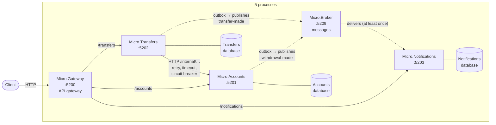
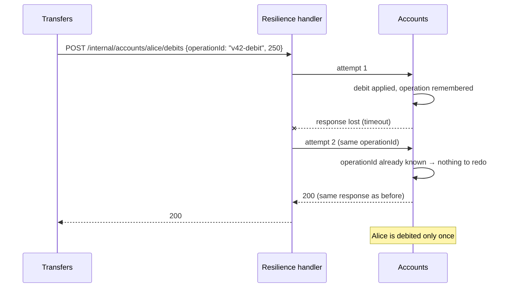
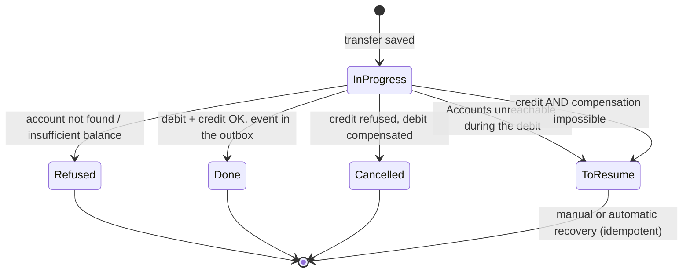
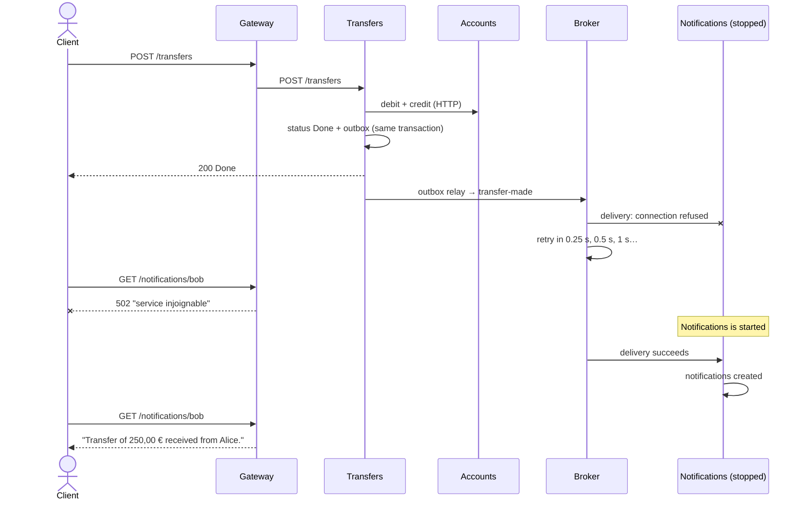

# 8. Microservices

> **In one sentence**: each service is a **separate process**, with its own database, deployable on its own; the
> services communicate only over the **network** (HTTP and messages) and share no code.

📁 Code: [`08-Microservices`](../../08-Microservices) · ⬅️ [Modular Monolith](07-monolithe-modulaire.md) · ➡️ [CQRS](09-cqrs.md) ·
🌐 [Français](../08-microservices.md)

---

## The idea

It is [demo 7](07-monolithe-modulaire.md) cut into processes. Everything that was free in the monolith — a method
call, a transaction, an in-memory event — now goes through the **network, which can fail**. Most of this demo's code
is there to handle those failures.



| Service | Role | Specifics |
|---|---|---|
| **Gateway** | Single entry point for clients | Only forwards the public routes; `/internal/…` answers 404; aggregated `GET /health` (health) |
| **Accounts** | Account keeping | **Idempotent** internal API (`operationId`); **outbox** |
| **Transfers** | Orchestrates a transfer | **Resilient** HTTP client; **saga** with a status and **compensation**; outbox |
| **Notifications** | Sends the notifications | Knows no service; ignores **duplicates** (`Message-Id`) |
| **Broker** | Carries the messages | "At least once" delivery, retries, dead letters |
| *Launcher* | Demo tool | Starts the 5 processes (the role of docker compose / Kubernetes / Aspire) |

**No references between services**, and no shared project: the contract is the exchanged JSON. The outbox relay is
deliberately duplicated in Accounts and Transfers.

---

## The code, step by step

The code is quoted exactly as it is.

### 1. Calling another service: preparing for failure

The network can fail, so the call is protected: retry (including on POST, safe because the calls carry an idempotent
`operationId`), a timeout per attempt, and a circuit breaker so as not to insist on a service that is down.
([Micro.Transfers/Program.cs](../../08-Microservices/Micro.Transfers/Program.cs))

```csharp
// Calls to the Accounts service: the network can fail, so we protect ourselves.
// Retry (including on POST: safe, because the calls carry an idempotent operationId),
// timeout per attempt and circuit breaker so as not to insist on a service that is down.
builder.Services.AddHttpClient("accounts", (sp, client) =>
        client.BaseAddress = new Uri(sp.GetRequiredService<IConfiguration>()["Services:Accounts"]!))
    .AddStandardResilienceHandler(options =>
    {
        options.Retry.MaxRetryAttempts = 3;
        options.Retry.Delay = TimeSpan.FromMilliseconds(200);
    });
```

The client has its **own copy** of the remote model: no library shared with the Accounts service
([AccountsClient.cs](../../08-Microservices/Micro.Transfers/AccountsClient.cs)):

```csharp
// LOCAL representation of an account: no library shared with the Accounts service,
// the contract between the two is the JSON they exchange.
internal record RemoteAccount(Guid Id, string Owner, decimal Balance);
```

### 2. Making the call replayable: idempotency

If the response is lost, the retry sends the same debit again. Without precautions: a double debit. A call replayed
with the same `operationId` doesn't debit twice.
([Micro.Accounts/Endpoints.cs](../../08-Microservices/Micro.Accounts/Endpoints.cs))

```csharp
/// <summary>
/// Internal API, called by the other services (the gateway does not expose it).
/// Idempotent: a call replayed with the same operationId (retry after a network cut) does not debit twice.
/// </summary>
public static void MapInternalEndpoints(this IEndpointRouteBuilder app)
{
    var @internal = app.MapGroup("/internal/accounts/{id:guid}");
    @internal.MapPost("/debits", (Guid id, MovementRequest r, AccountsDb db) => Apply(id, r, db, (c, m) => c.Debit(m)));
    @internal.MapPost("/credits", (Guid id, MovementRequest r, AccountsDb db) => Apply(id, r, db, (c, m) => c.Credit(m)));
}

private static async Task<IResult> Apply(
    Guid id, MovementRequest request, AccountsDb db, Func<Account, decimal, string?> movement)
{
    if (await db.ProcessedOperations.FindAsync(request.OperationId) is { } alreadyProcessed)
        return Respond(alreadyProcessed);

    var account = await db.Accounts.FindAsync(id);
    if (account is null)
        return Results.NotFound(new { error = $"Account {id} not found." });

    var refusal = movement(account, request.Amount);
    var operation = new ProcessedOperation
    {
        OperationId = request.OperationId,
        Accepted = refusal is null,
        Error = refusal,
        BalanceAfter = account.Balance
    };
    db.ProcessedOperations.Add(operation);
    await db.SaveChangesAsync();
    return Respond(operation);
}
```



### 3. The saga: a transfer with a status, and compensation

The transfer is saved **before** the calls; its status tells where it stands if something fails. Step 2: credit the
target; on failure, compensation (the source is credited back).
([Micro.Transfers/Endpoints.cs](../../08-Microservices/Micro.Transfers/Endpoints.cs))

```csharp
// Step 2: credit the target. On failure: compensation (the source is credited back).
if (creditFailure is not null)
{
    try
    {
        await accounts.Credit(source.Id, request.Amount, $"{transfer.Id}-compensation");
        return await Finish(db, transfer, TransferStatus.Cancelled, $"{creditFailure} Debit cancelled.", 400);
    }
    catch (Exception e) when (IsNetworkFailure(e))
    {
        return await Finish(db, transfer, TransferStatus.ToResume,
            "Credit and compensation impossible: transfer to resume.", 503);
    }
}
```



### 4. The outbox: never lose an event

The data and the message are saved in **the same transaction** (both or neither); a relay then sends the message to
the broker.
([Micro.Accounts/Endpoints.cs](../../08-Microservices/Micro.Accounts/Endpoints.cs), [OutboxRelay.cs](../../08-Microservices/Micro.Accounts/OutboxRelay.cs))

```csharp
// Change AND event saved together: either both, or neither.
db.Outbox.Add(OutboxMessage.Create("withdrawal-made",
    new { accountId = id, amount = request.Amount, newBalance = account.Balance }));
await db.SaveChangesAsync();
```

```csharp
private async Task SendPendingMessages(CancellationToken stopping)
{
    using var scope = scopes.CreateScope();
    var db = scope.ServiceProvider.GetRequiredService<AccountsDb>();
    var pending = await db.Outbox.Where(m => m.SentAt == null).OrderBy(m => m.CreatedAt).Take(20).ToListAsync(stopping);
    if (pending.Count == 0)
        return;

    var broker = http.CreateClient("broker");
    foreach (var message in pending)
    {
        using var request = new HttpRequestMessage(HttpMethod.Post, $"/topics/{message.Topic}")
        {
            Content = new StringContent(message.Body, Encoding.UTF8, "application/json")
        };
        // The identifier lets the subscribers ignore a message received twice.
        request.Headers.Add("Message-Id", message.Id.ToString());

        (await broker.SendAsync(request, stopping)).EnsureSuccessStatusCode();
        message.SentAt = DateTime.UtcNow;
        await db.SaveChangesAsync(stopping);
        logger.LogInformation("Event {Topic} published ({Id}).", message.Topic, message.Id);
    }
}
```

### 5. The broker: retry, then give up cleanly

Exponential backoff: 0.25 s, 0.5 s, 1 s, 2 s… capped at 30 s; after the maximum number of attempts, the message goes
to the dead letters.
([Broker.cs](../../08-Microservices/Micro.Broker/Broker.cs))

```csharp
// Exponential backoff: 0.25 s, 0.5 s, 1 s, 2 s… capped at 30 s.
var wait = Math.Min(0.25 * Math.Pow(2, delivery.Attempts - 1), 30);
delivery.NextAttempt = DateTime.UtcNow.AddSeconds(wait);

if (delivery.Attempts >= MaxAttempts)
{
    _pending.Remove(delivery);
    _deadLetters.Add(delivery);
}
```

### 6. The subscriber ignores duplicates

The broker delivers "at least once": the same message can arrive twice, and is then ignored.
([Micro.Notifications/Program.cs](../../08-Microservices/Micro.Notifications/Program.cs))

```csharp
// The broker delivers "at least once": the same message can arrive twice. It is then ignored.
static async Task<IResult> Handle(NotificationsDb db, Guid messageId, params Notification[] notifications)
{
    if (await db.ProcessedMessages.FindAsync(messageId) is not null)
        return Results.Ok(new { duplicate = true });
    // …
}
```

### Eventual consistency: Notifications down

A scenario checked by actually running the 5 processes:



---

## The tests

Each service is tested **alone**: the others are replaced by **fake HTTP servers** (`FakeHttp`). In this test, the
1st debit call fails (503) and the automatic retry succeeds; two debit calls… with the SAME `operationId`, so
Accounts debits only once.
([TransfersTests.cs](../../08-Microservices/Micro.Tests/TransfersTests.cs))

```csharp
[Fact]
public async Task A_transient_failure_is_absorbed_by_the_retry_without_double_debit()
{
    // The 1st debit call fails (503), the automatic retry succeeds.
    var accounts = FakeAccounts(debits: number => new HttpResponseMessage(
        number == 1 ? HttpStatusCode.ServiceUnavailable : HttpStatusCode.OK));
    await using var service = new ServiceUnderTest<Marker>(new() { ["accounts"] = accounts });

    var (_, status) = await Transfer(service);

    Assert.Equal("Done", status);
    // Two debit calls… with the SAME operationId: Accounts will debit only once.
    var debits = accounts.Calls.Where(a => a.Path.EndsWith("/debits")).ToList();
    Assert.Equal(2, debits.Count);
    Assert.Single(debits.Select(a => JsonDocument.Parse(a.Body!).RootElement.GetProperty("operationId").GetString()).Distinct());
}
```

Other tests: idempotency of the internal API, outbox when the broker is down, compensation, `ToResume` when Accounts
is unreachable (1 call + 3 retries), a broker that redelivers, a gateway that hides `/internal/…`.
The full journey is checked by running the system (`dotnet run --project Micro.Launcher`).

---

## Summary

| 👍 Strengths | 👎 Limits |
|---|---|
| **Independent** deployment and scaling per service | **Partial failures**: retry, timeout, circuit breaker everywhere |
| Total isolation: impossible to cheat (the network) | Mandatory **idempotency** of every call and message |
| Different technologies possible per service | **Eventual consistency**, sagas and compensations instead of transactions |
| Autonomous teams | Heavy operations: monitoring, distributed tracing, deployments |

**When to use it**: several teams, very different scaling needs, independent release cycles — and an organization able
to operate a distributed system. Otherwise, the [modular monolith](07-monolithe-modulaire.md) brings most of the
benefits at a fraction of the cost. In production: RabbitMQ / Azure Service Bus, YARP, .NET Aspire or Kubernetes,
OpenTelemetry. The mechanisms are detailed in the [cross-cutting concepts](concepts-transverses.md).
