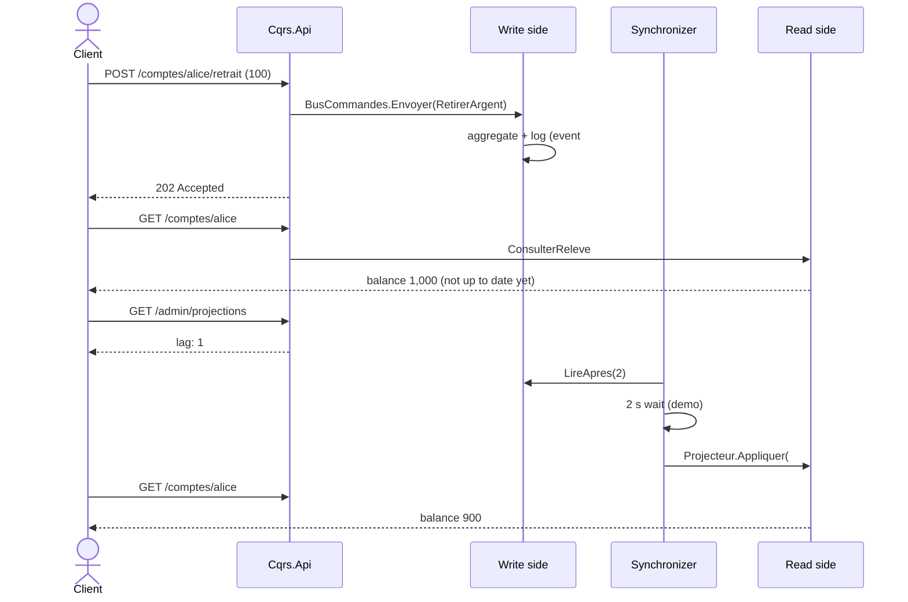

# 9. CQRS — Command Query Responsibility Segregation

> **In one sentence**: one model to **write** (enforces the rules), another to **read** (views ready to display),
> connected by events.

📁 Code: [`09-CQRS`](../../09-CQRS) · ⬅️ [Microservices](08-microservices.md) · ➡️ [Event Sourcing](10-event-sourcing.md) ·
🌐 [Français](../09-cqrs.md)

---

## The idea

Formalized by **Greg Young** around 2010, from Bertrand Meyer's CQS principle ("a method changes state *or* answers a
question, never both"). The observation: **writing and reading don't have the same needs**. (In the code: *Ecriture* =
write, *Lecture* = read, *Commandes* = commands, *Requetes* = queries.)

| | Write (Command) | Read (Query) |
|---|---|---|
| Goal | consistency, rules, invariants | speed, varied shapes for each screen |
| Model | rich aggregate | denormalized tables, duplicated data |
| Volume | few requests | often 10 to 100 times more |
| Returns | nothing (or an identifier) | data, without changing anything |


The two sides **don't reference each other**: their only link is `Cqrs.Evenements`.

---

## The code, step by step

The code is quoted exactly as it is, French comments and messages included.

### 1. A command: intent + validation + handler, in one file

The identifier is supplied by the caller: the command has nothing to return.
([OuvrirCompte.cs](../../09-CQRS/Cqrs.Ecriture/Commandes/OuvrirCompte.cs))

```csharp
public record OuvrirCompte(Guid CompteId, string Titulaire, decimal DepotInitial) : ICommande;

public class OuvrirCompteValidateur : IValidateur<OuvrirCompte>
{
    public IEnumerable<string> Valider(OuvrirCompte commande)
    {
        if (string.IsNullOrWhiteSpace(commande.Titulaire))
            yield return "Le titulaire est obligatoire.";
        if (commande.DepotInitial < 10)
            yield return "Le dépôt initial doit être d'au moins 10 €.";
    }
}

public class OuvrirCompteGestionnaire(EcritureDb db, TimeProvider horloge) : IGestionnaireCommande<OuvrirCompte>
{
    public async Task Traiter(OuvrirCompte commande)
    {
        if (await db.Comptes.FindAsync(commande.CompteId) is not null)
            throw new RegleMetierException("Ce compte existe déjà.");

        db.Comptes.Add(Compte.Ouvrir(commande.CompteId, commande.Titulaire.Trim(), commande.DepotInitial,
            horloge.GetUtcNow().UtcDateTime));
        await db.Enregistrer();
    }
}
```

### 2. A common pipeline for every command

This is the role often given to MediatR, written here in a few lines.
([BusCommandes.cs](../../09-CQRS/Cqrs.Ecriture/Commandes/BusCommandes.cs))

```csharp
public async Task Envoyer<TCommande>(TCommande commande) where TCommande : ICommande
{
    var erreurs = services.GetServices<IValidateur<TCommande>>()
        .SelectMany(validateur => validateur.Valider(commande))
        .ToList();
    if (erreurs.Count > 0)
        throw new CommandeInvalideException(erreurs);

    journal.LogInformation("Commande {Commande} : {Contenu}", typeof(TCommande).Name, commande);
    await services.GetRequiredService<IGestionnaireCommande<TCommande>>().Traiter(commande);
}
```

### 3. The write side saves the state AND the events, together

It saves the changes and appends the events produced by the aggregates to the log.
([EcritureDb.cs](../../09-CQRS/Cqrs.Ecriture/Persistance/EcritureDb.cs))

```csharp
/// Enregistre les modifications et ajoute au journal les événements produits par les agrégats.
public async Task Enregistrer(params IEvenementDomaine[] evenementsSupplementaires)
{
    var evenements = ChangeTracker.Entries<Compte>()
        .SelectMany(entree => entree.Entity.ExtraireEvenements())
        .Concat(evenementsSupplementaires)
        .ToList();

    foreach (var evenement in evenements)
        Evenements.Add(new EvenementStocke
        {
            Type = evenement.GetType().Name,
            Donnees = CatalogueEvenements.Serialiser(evenement),
            Date = evenement.Date
        });

    await SaveChangesAsync();
}
```

### 4. The projector builds the views

The only code that writes on the read side. The **checkpoint** makes it idempotent (an already projected event is
ignored), and the label is written once and for all, with the other holder's name.
([Projecteur.cs](../../09-CQRS/Cqrs.Lecture/Projections/Projecteur.cs))

```csharp
public async Task Appliquer(EvenementEnregistre enregistre)
{
    var point = await ObtenirPointDeReprise();
    if (enregistre.Sequence <= point.DerniereSequence)
        return;  // déjà projeté : rejouer un événement n'a pas d'effet

    switch (enregistre.Evenement)
    {
        case VirementEffectue e:
            var source = await MettreAJour(e.SourceId, e.SoldeSource, e.Date);
            var cible = await MettreAJour(e.CibleId, e.SoldeCible, e.Date);
            // Le libellé est rédigé une fois pour toutes, avec le nom de l'autre titulaire.
            AjouterLigne(e.SourceId, $"Virement vers {cible.Titulaire}", -e.Montant, e.SoldeSource, e.Date);
            AjouterLigne(e.CibleId, $"Virement reçu de {source.Titulaire}", e.Montant, e.SoldeCible, e.Date);
            stats.NombreVirements++;
            stats.MontantTotalVire += e.Montant;
            break;
        // … CompteOuvert, ArgentRetire
    }

    point.DerniereSequence = enregistre.Sequence;
    await db.SaveChangesAsync();
}
```

### 5. Queries only read

([Requetes.cs](../../09-CQRS/Cqrs.Lecture/Requetes/Requetes.cs))

```csharp
public class ConsulterTableauDeBordGestionnaire(LectureDb db) : IGestionnaireRequete<ConsulterTableauDeBord, TableauDeBordVue>
{
    public async Task<TableauDeBordVue> Traiter(ConsulterTableauDeBord requete)
    {
        var s = await db.Statistiques.AsNoTracking().FirstOrDefaultAsync() ?? new Statistiques();
        return new TableauDeBordVue(s.NombreComptes, s.EncoursTotal, s.NombreVirements, s.MontantTotalVire);
    }
}
```

The dashboard is **never recomputed**: it is maintained as the events come in.

### 6. Commands answer 202

([Program.cs](../../09-CQRS/Cqrs.Api/Program.cs))

```csharp
app.MapPost("/comptes/{id:guid}/retrait", async (Guid id, RetraitRequete r, BusCommandes bus) =>
{
    await bus.Envoyer(new RetirerArgent(id, r.Montant));
    return Results.Accepted($"/comptes/{id}");
});
```

### Eventual consistency, made visible

`appsettings.json` deliberately slows the projection down by 2 s (`Projections:DelaiMs`).



---

## The tests

- **Write side**: the events produced by the aggregate, the validation pipeline
  ([EcritureTests.cs](../../09-CQRS/Cqrs.Tests/EcritureTests.cs)).
- **Read side, without a single command**: you feed it events and query its views
  ([LectureTests.cs](../../09-CQRS/Cqrs.Tests/LectureTests.cs)):

```csharp
private static readonly EvenementEnregistre[] Historique =
[
    new(1, new CompteOuvert(Alice, "Alice", 1000m, T0)),
    new(2, new CompteOuvert(Bob, "Bob", 500m, T0.AddMinutes(1))),
    new(3, new ArgentRetire(Alice, 100m, 900m, T0.AddMinutes(2))),
    new(4, new VirementEffectue(Guid.NewGuid(), Alice, Bob, 250m, 650m, 750m, T0.AddMinutes(3)))
];

[Fact]
public async Task Le_releve_est_pret_a_afficher()
{
    var services = await ProjeterHistorique();

    var releve = await Demander(services, new ConsulterReleve(Alice));

    Assert.Equal(650m, releve!.Solde);
    Assert.Equal(3, releve.NombreOperations);
    Assert.Equal(["Virement vers Bob", "Retrait", "Ouverture du compte"], releve.DernieresOperations.Select(o => o.Libelle));
}
```

- **Eventual consistency** ([ApiTests.cs](../../09-CQRS/Cqrs.Tests/ApiTests.cs)): right after the command, the view is
  not up to date and the lag is 1; it becomes up to date afterwards.

---

## Summary

| 👍 Strengths | 👎 Limits |
|---|---|
| Each side optimized for its use | Duplicated data, projections to maintain |
| Very fast reads (precomputed views) | **Eventual consistency** to explain to users |
| The sides evolve and are tested independently | More code than CRUD |
| Views can be rebuilt from the events | |

**Not to be confused**:
- CQRS **doesn't require two databases**. You can separate only the models, over one database, with a synchronous
  read: it is the simplest variant, often sufficient.
- CQRS **is not** Event Sourcing: here, the state is stored normally and the events feed the read side. In
  [Event Sourcing](10-event-sourcing.md), the events **are** the source of truth.
