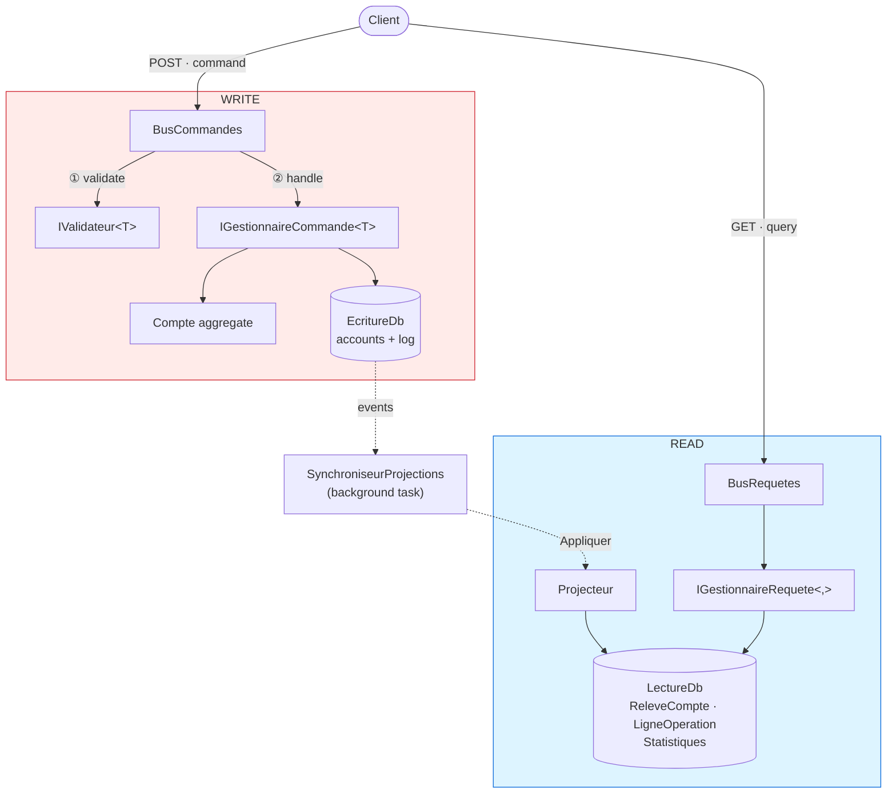
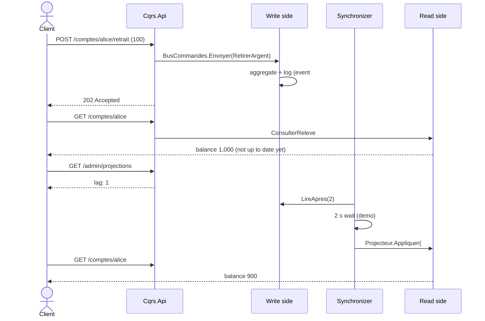

# 9. CQRS — Command Query Responsibility Segregation

> **In one sentence**: one model to **write** (enforces the rules), another to **read** (views ready to display),
> connected by events.

📁 Code: [`09-CQRS`](../../09-CQRS) · ⬅️ [Microservices](08-microservices.md) · ➡️ [Event Sourcing](10-event-sourcing.md) ·
🌐 [Français](../09-cqrs.md)

---

## The idea

Formalized by **Greg Young** around 2010, from Bertrand Meyer's CQS principle ("a method changes state *or* answers a
question, never both"). The observation: **writing and reading don't have the same needs**. (In the code: *Ecriture* =
write, *Lecture* = read, *Commandes* = commands, *Requetes* = queries.)

| | Write (Command) | Read (Query) |
|---|---|---|
| Goal | consistency, rules, invariants | speed, varied shapes for each screen |
| Model | rich aggregate | denormalized tables, duplicated data |
| Volume | few requests | often 10 to 100 times more |
| Returns | nothing (or an identifier) | data, without changing anything |



The two sides **don't reference each other**: their only link is `Cqrs.Evenements`.

---

## The code, step by step

The code is quoted exactly as it is, French comments and messages included.

### 1. A command: intent + validation + handler, in one file

The identifier is supplied by the caller: the command has nothing to return.
([OuvrirCompte.cs](../../09-CQRS/Cqrs.Ecriture/Commandes/OuvrirCompte.cs))

```csharp
public record OpenAccount(Guid AccountId, string Owner, decimal InitialDeposit) : ICommand;

public class OpenAccountValidator : IValidator<OpenAccount>
{
    public IEnumerable<string> Validate(OpenAccount command)
    {
        if (string.IsNullOrWhiteSpace(command.Owner))
            yield return "The owner is required.";
        if (command.InitialDeposit < 10)
            yield return "The initial deposit must be at least 10 €.";
    }
}

public class OpenAccountHandler(WriteDb db, TimeProvider clock) : ICommandHandler<OpenAccount>
{
    public async Task Handle(OpenAccount command)
    {
        if (await db.Accounts.FindAsync(command.AccountId) is not null)
            throw new BusinessRuleException("This account already exists.");

        db.Accounts.Add(Account.Open(command.AccountId, command.Owner.Trim(), command.InitialDeposit,
            clock.GetUtcNow().UtcDateTime));
        await db.Save();
    }
}
```

### 2. A common pipeline for every command

This is the role often given to MediatR, written here in a few lines.
([BusCommandes.cs](../../09-CQRS/Cqrs.Ecriture/Commandes/BusCommandes.cs))

```csharp
public async Task Send<TCommand>(TCommand command) where TCommand : ICommand
{
    var errors = services.GetServices<IValidator<TCommand>>()
        .SelectMany(validator => validator.Validate(command))
        .ToList();
    if (errors.Count > 0)
        throw new InvalidCommandException(errors);

    logger.LogInformation("Command {Command}: {Content}", typeof(TCommand).Name, command);
    await services.GetRequiredService<ICommandHandler<TCommand>>().Handle(command);
}
```

### 3. The write side saves the state AND the events, together

It saves the changes and appends the events produced by the aggregates to the log.
([EcritureDb.cs](../../09-CQRS/Cqrs.Ecriture/Persistance/EcritureDb.cs))

```csharp
/// Saves the changes and adds to the log the events produced by the aggregates.
public async Task Save(params IDomainEvent[] extraEvents)
{
    var events = ChangeTracker.Entries<Account>()
        .SelectMany(entry => entry.Entity.ExtractEvents())
        .Concat(extraEvents)
        .ToList();

    foreach (var @event in events)
        Events.Add(new StoredEvent
        {
            Type = @event.GetType().Name,
            Data = EventCatalog.Serialize(@event),
            Date = @event.Date
        });

    await SaveChangesAsync();
}
```

### 4. The projector builds the views

The only code that writes on the read side. The **checkpoint** makes it idempotent (an already projected event is
ignored), and the label is written once and for all, with the other holder's name.
([Projecteur.cs](../../09-CQRS/Cqrs.Lecture/Projections/Projecteur.cs))

```csharp
public async Task Apply(RecordedEvent recorded)
{
    var checkpoint = await GetCheckpoint();
    if (recorded.Sequence <= checkpoint.LastSequence)
        return;  // already projected: replaying an event has no effect

    switch (recorded.Event)
    {
        case TransferMade e:
            var source = await Update(e.SourceId, e.SourceBalance, e.Date);
            var target = await Update(e.TargetId, e.TargetBalance, e.Date);
            // The label is written once and for all, with the other owner's name.
            AddLine(e.SourceId, $"Transfer to {target.Owner}", -e.Amount, e.SourceBalance, e.Date);
            AddLine(e.TargetId, $"Transfer received from {source.Owner}", e.Amount, e.TargetBalance, e.Date);
            stats.TransferCount++;
            stats.TotalTransferredAmount += e.Amount;
            break;
        // … AccountOpened, MoneyWithdrawn
    }

    checkpoint.LastSequence = recorded.Sequence;
    await db.SaveChangesAsync();
}
```

### 5. Queries only read

([Requetes.cs](../../09-CQRS/Cqrs.Lecture/Requetes/Requetes.cs))

```csharp
public class GetDashboardHandler(ReadDb db) : IQueryHandler<GetDashboard, DashboardView>
{
    public async Task<DashboardView> Handle(GetDashboard query)
    {
        var s = await db.Statistics.AsNoTracking().FirstOrDefaultAsync() ?? new Statistics();
        return new DashboardView(s.AccountCount, s.TotalOutstanding, s.TransferCount, s.TotalTransferredAmount);
    }
}
```

The dashboard is **never recomputed**: it is maintained as the events come in.

### 6. Commands answer 202

([Program.cs](../../09-CQRS/Cqrs.Api/Program.cs))

```csharp
app.MapPost("/accounts/{id:guid}/withdrawal", async (Guid id, WithdrawalRequest r, CommandBus bus) =>
{
    await bus.Send(new WithdrawMoney(id, r.Amount));
    return Results.Accepted($"/accounts/{id}");
});
```

### Eventual consistency, made visible

`appsettings.json` deliberately slows the projection down by 2 s (`Projections:DelaiMs`).



---

## The tests

- **Write side**: the events produced by the aggregate, the validation pipeline
  ([EcritureTests.cs](../../09-CQRS/Cqrs.Tests/EcritureTests.cs)).
- **Read side, without a single command**: you feed it events and query its views
  ([LectureTests.cs](../../09-CQRS/Cqrs.Tests/LectureTests.cs)):

```csharp
private static readonly RecordedEvent[] History =
[
    new(1, new AccountOpened(Alice, "Alice", 1000m, T0)),
    new(2, new AccountOpened(Bob, "Bob", 500m, T0.AddMinutes(1))),
    new(3, new MoneyWithdrawn(Alice, 100m, 900m, T0.AddMinutes(2))),
    new(4, new TransferMade(Guid.NewGuid(), Alice, Bob, 250m, 650m, 750m, T0.AddMinutes(3)))
];

[Fact]
public async Task The_statement_is_ready_to_display()
{
    var services = await ProjectHistory();

    var statement = await Ask(services, new GetStatement(Alice));

    Assert.Equal(650m, statement!.Balance);
    Assert.Equal(3, statement.OperationCount);
    Assert.Equal(["Transfer to Bob", "Withdrawal", "Account opening"], statement.LatestOperations.Select(o => o.Label));
}
```

- **Eventual consistency** ([ApiTests.cs](../../09-CQRS/Cqrs.Tests/ApiTests.cs)): right after the command, the view is
  not up to date and the lag is 1; it becomes up to date afterwards.

---

## Summary

| 👍 Strengths | 👎 Limits |
|---|---|
| Each side optimized for its use | Duplicated data, projections to maintain |
| Very fast reads (precomputed views) | **Eventual consistency** to explain to users |
| The sides evolve and are tested independently | More code than CRUD |
| Views can be rebuilt from the events | |

**Not to be confused**:
- CQRS **doesn't require two databases**. You can separate only the models, over one database, with a synchronous
  read: it is the simplest variant, often sufficient.
- CQRS **is not** Event Sourcing: here, the state is stored normally and the events feed the read side. In
  [Event Sourcing](10-event-sourcing.md), the events **are** the source of truth.
