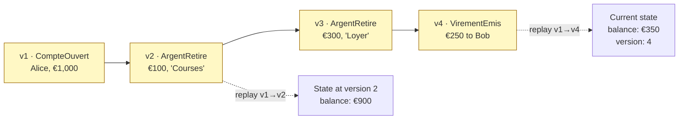
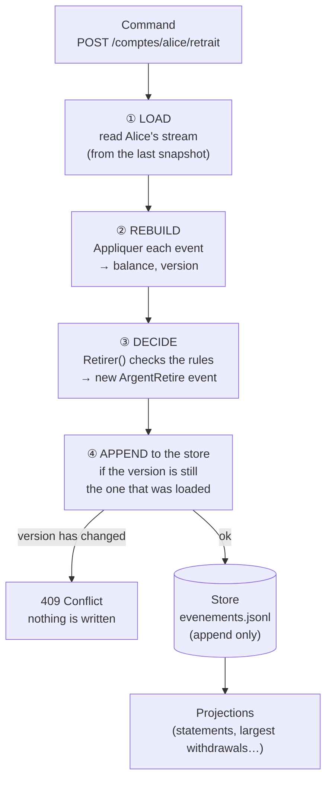
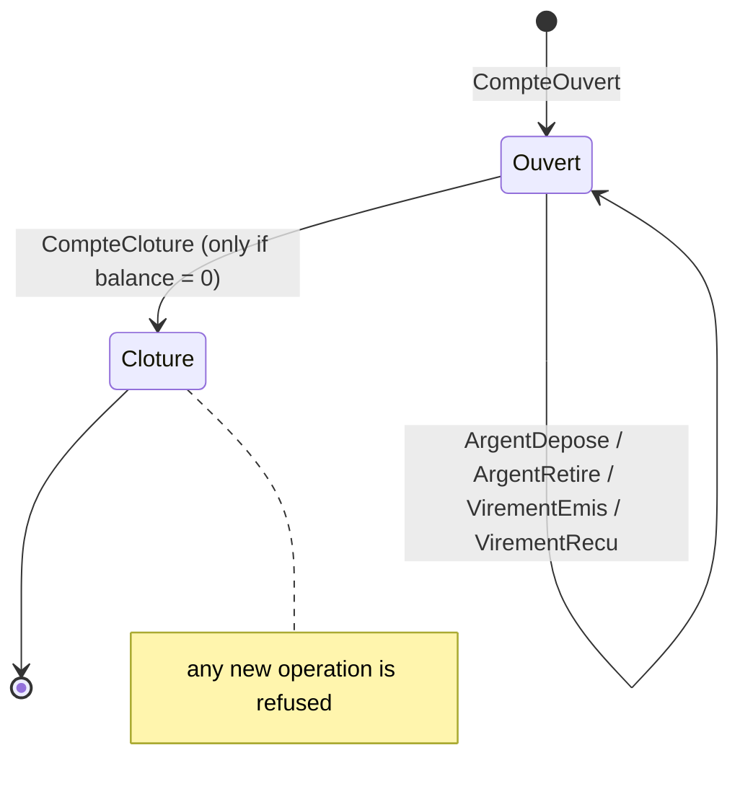
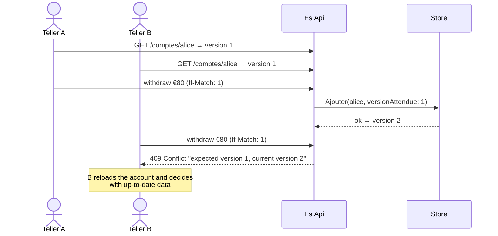

# 10. Event Sourcing

> **In one sentence**: you don't store the state, but **the sequence of events** that led to it; the state is
> recomputed by replaying them, and nothing is ever deleted.

📁 Code: [`10-EventSourcing`](../../10-EventSourcing) · ⬅️ [CQRS](09-cqrs.md) · ➡️ [DDD](11-ddd.md) ·
🌐 [Français](../10-event-sourcing.md)

---

## The idea

In every other demo, you store **the balance** and forget how you got there. Here, you store the **facts**: the account
was opened with €1,000, €100 was withdrawn, €250 was transferred… The balance is just a **calculation**. This is exactly
how accounting works: you never erase an entry, you add another one.



### The lifecycle of a command



---

## Solution layout

| Project | Contents |
|---|---|
| `Es.Domaine` | Events, `Compte` aggregate (decide / apply), `InstantaneCompte` (snapshot) |
| `Es.Stockage` | `MagasinEvenements` (append only, optimistic concurrency, `.jsonl` file), `SerialiseurEvenements` (+ upcasting), `DepotComptes` (snapshots, time travel) |
| `Es.Projections` | `ProjectionReleves`, `ProjectionPlusGrosRetraits`, `MoteurProjections` (tracking, rebuild) |
| `Es.Api` | Commands, audit, time travel, administration |

**The database is a readable file**: `Es.Api\evenements.jsonl`, one line per event.

```json
{"position":3,"flux":"1111…","version":2,"type":"ArgentRetire.v2","donnees":{"compteId":"1111…","montant":100,"motif":"Courses","date":"…"},"date":"…"}
```

---

## The code, step by step

The code is quoted exactly as it is, French comments and messages included.

### 1. Decide / apply: two kinds of methods, never to be mixed

The class comment says it: the DECISIONS (`Retirer`, `Cloturer`…) check the rules then record an event; `Appliquer`
evolves the state from an event, without any rule (a past fact cannot be refused). Loading an account = replaying
`Appliquer` over its whole history.
([Compte.cs](../../10-EventSourcing/Es.Domaine/Compte.cs))

```csharp
/// <summary>
/// Agrégat « event-sourcé ». Deux sortes de méthodes, à ne jamais mélanger :
/// - les DÉCISIONS (Retirer, Cloturer…) vérifient les règles puis enregistrent un événement ;
/// - Appliquer fait évoluer l'état à partir d'un événement, sans aucune règle (un fait passé ne se refuse pas).
/// Charger un compte = rejouer Appliquer sur tout son historique.
/// </summary>
public class Compte
{
    // …
    public void Retirer(decimal montant, string motif, DateTime date)
    {
        VerifierOuvert();
        VerifierMontant(montant);
        if (montant > Solde)
            throw new RegleMetierException("Solde insuffisant.");
        Enregistrer(new ArgentRetire(Id, montant, motif, date));
    }
    // …

    // ─── Évolution de l'état ───

    private void Enregistrer(IEvenement evenement)
    {
        Appliquer(evenement);
        _nouveaux.Add(evenement);
    }

    private void Appliquer(IEvenement evenement)
    {
        switch (evenement)
        {
            case CompteOuvert e:
                (Id, Titulaire, Solde) = (e.CompteId, e.Titulaire, e.DepotInitial);
                break;
            case ArgentDepose e:
                Solde += e.Montant;
                break;
            case ArgentRetire e:
                Solde -= e.Montant;
                break;
            case VirementEmis e:
                Solde -= e.Montant;
                break;
            case VirementRecu e:
                Solde += e.Montant;
                break;
            case CompteCloture:
                Cloture = true;
                break;
        }
        Version++;
    }
```

Loading an account means replaying `Appliquer` over its whole history:

```csharp
public static Compte Reconstituer(IEnumerable<IEvenement> historique) =>
    DepuisInstantane(null, historique);
```



### 2. The store: append only and optimistic concurrency

It appends the events of one or more streams, all or nothing; if a stream has moved since it was loaded, nothing is
written.
([MagasinEvenements.cs](../../10-EventSourcing/Es.Stockage/MagasinEvenements.cs))

```csharp
/// Ajoute les événements de un ou plusieurs flux, en tout ou rien.
/// Concurrence optimiste : si un flux a bougé depuis son chargement, rien n'est écrit.
public Task Ajouter(params AEcrire[] ecritures)
{
    lock (_verrou)
    {
        foreach (var ecriture in ecritures)
        {
            var actuelle = _evenements.Count(e => e.Flux == ecriture.Flux);
            if (actuelle != ecriture.VersionAttendue)
                throw new ConflitDeConcurrenceException(ecriture.Flux, ecriture.VersionAttendue, actuelle);
        }
        // … puis tout ajouter, en mémoire et dans le fichier .jsonl
    }
    return Task.CompletedTask;
}
```



### 3. Snapshots: not replaying everything

Every 5 events, a picture of the state is **cached**. It can be erased without losing anything.
([DepotComptes.cs](../../10-EventSourcing/Es.Stockage/DepotComptes.cs))

```csharp
public async Task<Compte> Charger(Guid id)
{
    var instantane = instantanes.Dernier(id);
    var suite = await magasin.LireFlux(id, apresVersion: instantane?.Version ?? 0);
    if (instantane is null && suite.Count == 0)
        throw new CompteIntrouvableException(id);
    return Compte.DepuisInstantane(instantane, suite.Select(e => e.Evenement()));
}
```

### 4. Time travel

The account's state as it was at a given version:

```csharp
/// <summary>Voyage dans le temps : l'état du compte tel qu'il était à une version donnée.</summary>
public async Task<Compte> ChargerALaVersion(Guid id, int version)
{
    var historique = await magasin.LireFlux(id);
    if (historique.Count == 0)
        throw new CompteIntrouvableException(id);
    return Compte.Reconstituer(historique.Where(e => e.Version <= version).Select(e => e.Evenement()));
}
```

`GET /comptes/{id}/etat?version=2` or `?date=…`; `GET /comptes/{id}/evenements` gives the full audit.

### 5. Evolving an event without rewriting history (*upcasting*)

`ArgentRetire` gained a `Motif` (reason) field in v2. The old v1 events stay untouched; they are converted **on read**
(reason "Non précisé", i.e. unspecified).
([SerialiseurEvenements.cs](../../10-EventSourcing/Es.Stockage/SerialiseurEvenements.cs))

```csharp
private static readonly Dictionary<string, Func<string, (string Type, string Json)>> Upcasters = new()
{
    // v1 : { compteId, montant, date }  →  v2 : + motif
    ["ArgentRetire"] = json =>
    {
        var noeud = JsonNode.Parse(json)!.AsObject();
        noeud["motif"] = "Non précisé";
        return ("ArgentRetire.v2", noeud.ToJsonString());
    }
};
```

### 6. A projection added after the fact knows the whole past

Since it is built by replaying the whole stream, it immediately knows every past withdrawal, including those made
before it existed — impossible with a classic database, which only kept the final state.
([Projections.cs](../../10-EventSourcing/Es.Projections/Projections.cs))

```csharp
// ─── Plus gros retraits : une projection ajoutée APRÈS coup ───
// Comme elle se construit en rejouant tout le flux, elle connaît d'emblée tous les retraits passés,
// y compris ceux faits avant qu'elle existe. Impossible avec une base classique, qui n'a gardé que l'état final.
public class ProjectionPlusGrosRetraits : IProjection { /* … */ }
```

`POST /admin/projections/reconstruire` erases all the views and replays the whole store.

---

## The tests: Given / When / Then

Event Sourcing's natural style: *given* some facts, *when* a command arrives, *then* these new facts are expected.
(In the code: *EtantDonne* = given, *Quand* = when, *Alors* = then.)
([CompteTests.cs](../../10-EventSourcing/Es.Tests/CompteTests.cs))

```csharp
private static IReadOnlyList<IEvenement> Quand(IEvenement[] etantDonne, Action<Compte> commande)
{
    var compte = Compte.Reconstituer(etantDonne);
    commande(compte);
    return compte.NouveauxEvenements;
}

[Fact]
public void Un_retrait_possible_produit_ArgentRetire()
{
    var alors = Quand(CompteAvec100Euros, c => c.Retirer(30m, "Courses", T));

    Assert.Equal([new ArgentRetire(Id, 30m, "Courses", T)], alors);
}
```

Other tests ([StockageTests.cs](../../10-EventSourcing/Es.Tests/StockageTests.cs), [ApiTests.cs](../../10-EventSourcing/Es.Tests/ApiTests.cs)):
concurrency conflict, all-or-nothing transfer across two streams, restart from the file, upcasting, snapshots
(same result, fewer events read), time travel, projection rebuild.

---

## Summary

| 👍 Strengths | 👎 Limits |
|---|---|
| **Full**, immutable **audit**, by construction | Nothing is changed or deleted: mistakes are corrected with a compensating event |
| **Time travel**: the state at any date | **GDPR**: plan for erasure (encrypt personal data, then destroy the key) |
| New **retroactive** views over the whole history | Events to **version** forever (upcasters) |
| Explicit concurrency (versions); Given/When/Then tests | Projections to maintain; a real learning curve |

**When to use it**: when history is itself business data (banking, accounting, logistics, insurance, regulatory
audit) — and **only in those modules**. For CRUD, it is overkill. In production: EventStoreDB, Marten (PostgreSQL),
Axon. Almost always combined with [CQRS](09-cqrs.md) for reads.
