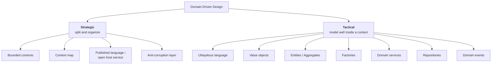
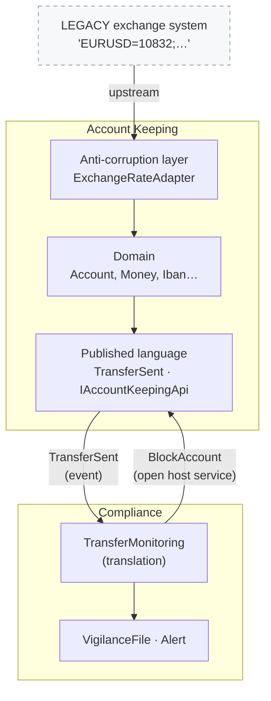
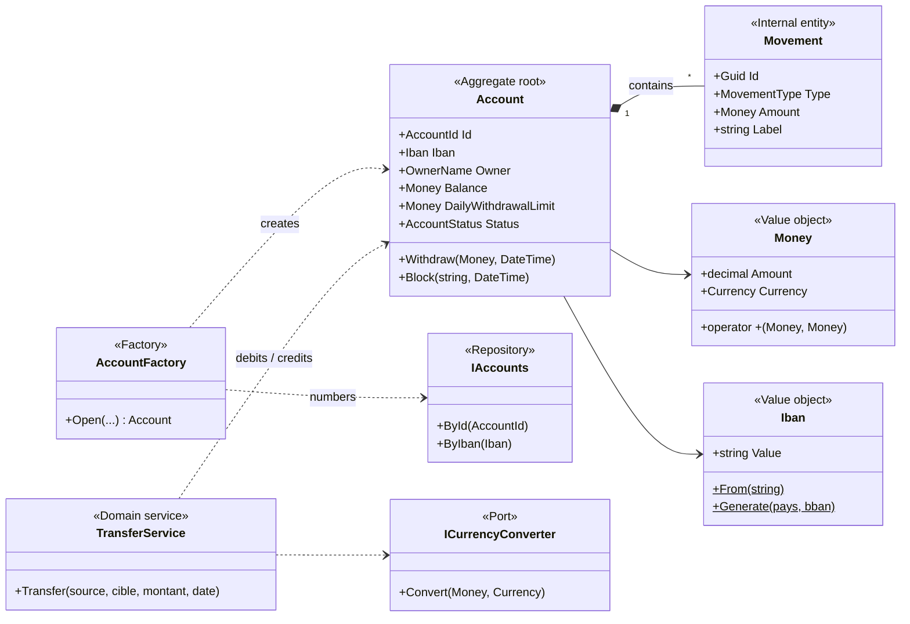
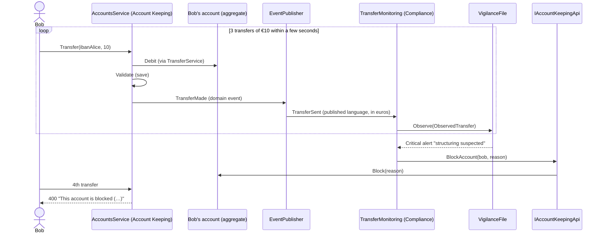

# 11. Domain-Driven Design (DDD)

> **In one sentence**: start from the business, speak **its** language, and let the model drive the code — inside a
> context (the **tactical** side) as well as between contexts (the **strategic** side).

📁 Code: [`11-DDD`](../../11-DDD) · ⬅️ [Event Sourcing](10-event-sourcing.md) · ➡️ [Serverless](12-serverless.md) ·
🌐 [Français](../11-ddd.md)

---

## The idea

Formalized by **Eric Evans** in *Domain-Driven Design* (2003), the "blue book". DDD is **not a folder layout** like the
previous demos: it is a **design approach**, usable with a hexagonal, Onion or Clean architecture (the demo uses an
Onion base). It has two sides:



---

## The strategic side: the context map

Two **bounded contexts** model **the same reality differently** (Account Keeping and Compliance):

| | "Account Keeping" context | "Compliance" context |
|---|---|---|
| An account is… | a balance, a limit, movements | a **due diligence case**: observed transfers and alerts |
| Currency | the account's currency (EUR, USD, CHF) | **always in euros** |
| Concern | executing operations correctly | detecting money laundering and structuring |
| Glossary | [LANGUAGE.md](../../11-DDD/Ddd.AccountKeeping.Domain/LANGUAGE.md) | [LANGUAGE.md](../../11-DDD/Ddd.Compliance/LANGUAGE.md) |

A single "Account" model for everyone would be **bloated**: each team would add its own fields.



| Relationship | In the demo | Why |
|---|---|---|
| **Anti-corruption layer** | `ExchangeRateAdapter` in front of the legacy exchange system | Its format (rate × 10,000, pairs from the euro, unknown currencies) must not pollute our model |
| **Published language** | `Ddd.AccountKeeping.Contracts`: `TransferSent` in simple types | The other contexts don't see `Money`, `Iban`…: the internal model can evolve |
| **Open host service** | `IAccountKeepingApi.BlockAccount` | Compliance **requests** a block; Account Keeping is the one that executes it |
| **Customer / supplier** | `AmountInEuros` added to `TransferSent` | The downstream context (Compliance) expressed a need to the upstream context |

---

## The tactical side: the Account Keeping model



The code is quoted exactly as it is.

### 1. The ubiquitous language

Each glossary term exists as is in the code: if an expert says *plafond de retrait journalier* (daily withdrawal limit),
you find `DailyWithdrawalLimit`, not `MaxDailyLimit`.

### 2. Always-valid value objects

An invalid `Iban` **cannot exist**: receiving an `Iban` is enough to know it is valid.
([Iban.cs](../../11-DDD/Ddd.AccountKeeping.Domain/ValueObjects/Iban.cs))

```csharp
public static Iban From(string input)
{
    var value = new string((input ?? "").Where(c => !char.IsWhiteSpace(c)).ToArray()).ToUpperInvariant();
    // … format check
    if (Modulo97(value[4..] + value[..4]) != 1)
        throw new BusinessRuleException($"Invalid IBAN (wrong check digits): \"{input}\".");
    return new Iban(value);
}
```

`Money` (money) carries its currency and **refuses to mix** euros and dollars — even in a comparison: it is a domain
rule, carried by the type itself.
([Money.cs](../../11-DDD/Ddd.AccountKeeping.Domain/ValueObjects/Money.cs))

```csharp
// The operations refuse to mix currencies: it is a domain rule, carried by the type itself.
public static Money operator +(Money a, Money b) => new(a.Amount + b.Amount, SameCurrency(a, b));
public static bool operator >(Money a, Money b) => SameCurrency(a, b) is not null && a.Amount > b.Amount;

private static Currency SameCurrency(Money a, Money b) =>
    a.Currency == b.Currency ? a.Currency
        : throw new BusinessRuleException($"Cannot combine {a.Currency} and {b.Currency} without conversion.");
```

Compare with the bare `decimal` and `string` of the other demos (*primitive obsession*).

### 3. An aggregate whose boundary is dictated by an invariant

To check the **daily** withdrawal limit, the account must know its movements of the day: it is this rule that sets the
aggregate's **boundary**. A movement is never loaded or saved alone.
([Account.cs](../../11-DDD/Ddd.AccountKeeping.Domain/Accounts/Account.cs))

```csharp
public void Withdraw(Money amount, DateTime date)
{
    CheckDebitPossible(amount);

    var alreadyWithdrawn = WithdrawalsOfTheDay(date);
    if (alreadyWithdrawn + amount > DailyWithdrawalLimit)
        throw new BusinessRuleException(
            $"Daily withdrawal limit of {DailyWithdrawalLimit} exceeded (already withdrawn today: {alreadyWithdrawn}).");

    Balance -= amount;
    _movements.Add(new Movement(date, MovementType.Withdrawal, amount, "Withdrawal"));
    Raise(new WithdrawalMade(Id, amount, date));
}
```

### 4. Factory and domain service

The **factory** computes the number and the IBAN ([Factory.cs](../../11-DDD/Ddd.AccountKeeping.Domain/Accounts/Factory.cs));
the **domain service** carries the transfer, which touches two aggregates and an exchange rate
([TransferService.cs](../../11-DDD/Ddd.AccountKeeping.Domain/Accounts/TransferService.cs)):

```csharp
var creditedAmount = target.Currency == amount.Currency ? amount : await converter.Convert(amount, target.Currency);

source.Debit(amount, $"Transfer to {target.Owner}", date);
target.Credit(creditedAmount, $"Transfer from {source.Owner}", date);

source.Report(new TransferMade(Guid.NewGuid(), source.Id, source.Iban, source.Owner,
    target.Iban, amount, creditedAmount, date));
```

### 5. The anti-corruption layer

It translates the legacy system's model into our language (`Money`, `Currency`); since the legacy system only quotes
from the euro, every cross rate (USD → CHF…) goes through the euro.
([AntiCorruptionLayer.cs](../../11-DDD/Ddd.AccountKeeping.Infrastructure/AntiCorruptionLayer.cs))

```csharp
public class LegacyQuoteSystem
{
    public virtual string TodaysQuotes() => "EURUSD=10832;EURCHF=9415;EURGBP=8571;EURJPY=1612300";
}

/// ANTI-CORRUPTION LAYER: it translates the model of the legacy system into our language (Money, Currency).
public class ExchangeRateAdapter(LegacyQuoteSystem legacySystem) : ICurrencyConverter
{
    public Task<Money> Convert(Money amount, Currency currency)
    {
        var ratesFromEuro = ReadQuotes(legacySystem.TodaysQuotes());

        // The legacy system only quotes from the euro: any cross rate goes through the euro (USD → CHF…).
        var amountInEuros = amount.Amount / ratesFromEuro[amount.Currency];
        var converted = decimal.Round(amountInEuros * ratesFromEuro[currency], 2, MidpointRounding.ToEven);
        return Task.FromResult(new Money(converted, currency));
    }
}
```

### 6. Translating domain events into the published language

([Integration.cs](../../11-DDD/Ddd.AccountKeeping.Application/Integration.cs))

```csharp
var integration = new TransferSent(
    v.TransferId, v.Source.Value, v.SourceIban.Value, v.SourceOwner.Value, v.TargetIban.Value,
    v.DebitedAmount.Amount, v.DebitedAmount.Currency.Code, inEuros.Amount, v.Date);

foreach (var subscriber in subscribers())
    await subscriber.OnTransferSent(integration);
```

### The structuring scenario: two contexts cooperate



---

## The tests

- **Value objects** ([ValueObjectsTests.cs](../../11-DDD/Ddd.Tests/ValueObjectsTests.cs)): equality by value,
  currencies that can't be mixed, invalid amounts and IBANs impossible to create.
- **Domain** ([DomainTests.cs](../../11-DDD/Ddd.Tests/DomainTests.cs)): daily limit, blocked account, conversion
  through the anti-corruption layer (€100 → $108.32; $108.32 → CHF 94.15 through a cross rate), Compliance rules.
- **Context boundaries** ([ApiTests.cs](../../11-DDD/Ddd.Tests/ApiTests.cs)):

```csharp
[Fact]
public void Compliance_only_knows_the_published_language_of_account_keeping()
{
    Assert.Equal(["Ddd.AccountKeeping.Contracts"], InternalDependencies(typeof(VigilanceFile).Assembly));
}
```

---

## Summary

| 👍 Strengths | 👎 Limits |
|---|---|
| Code readable by domain experts (same vocabulary) | Requires **available experts** to build the language |
| Value objects: errors impossible by construction | A lot of ceremony for CRUD |
| Bounded contexts: focused models, autonomous teams | Splitting contexts is hard, and expensive to fix |
| Tells **where to cut** modules and services | Often wrongly reduced to its tactical toolbox |

**DDD has no column in the comparison**: it is not a competing architecture, but the approach that says **where to
cut**. Its bounded contexts give the modules ([demo 7](07-monolithe-modulaire.md)) or the services
([demo 8](08-microservices.md)), and its aggregates give the event streams ([demo 10](10-event-sourcing.md)).
