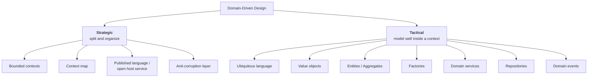
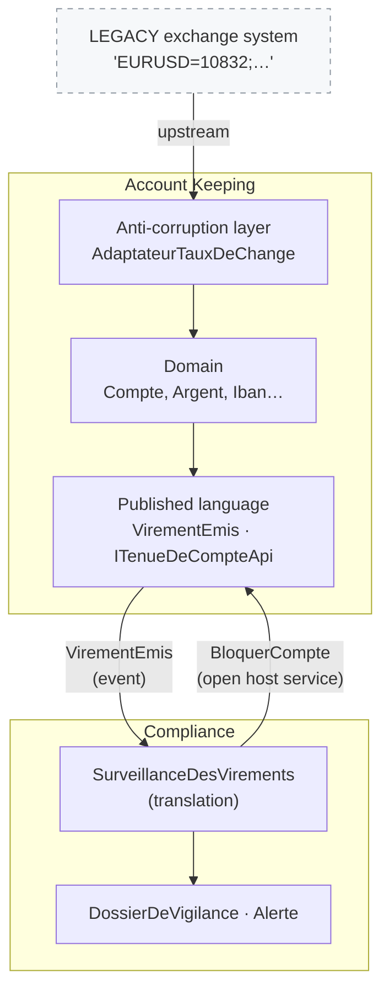
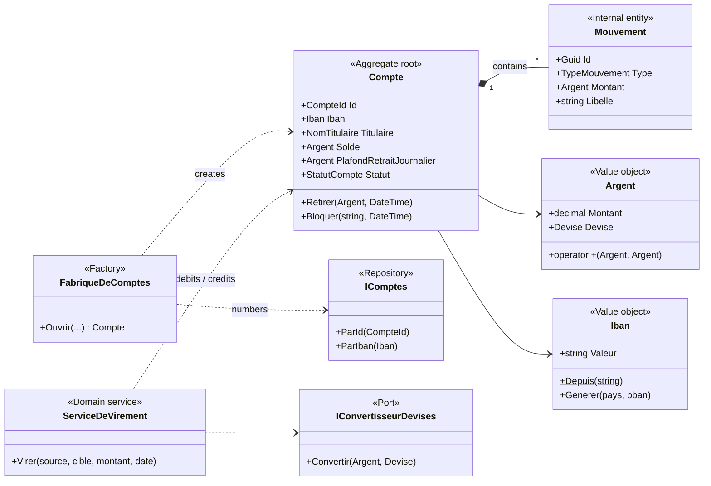
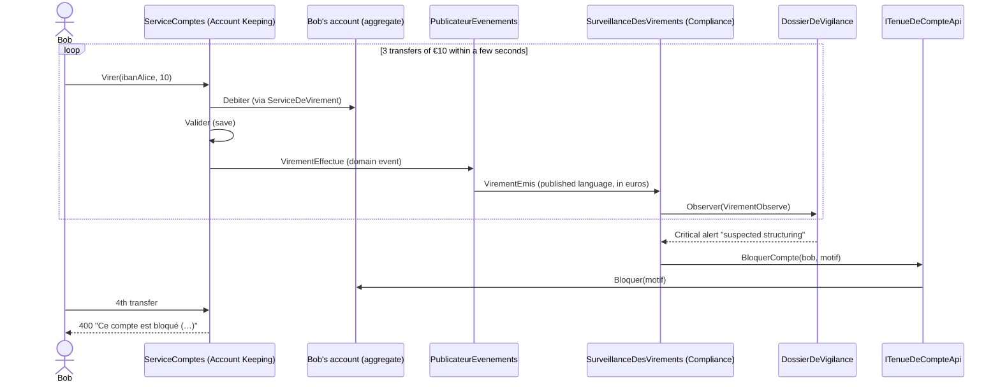

# 11. Domain-Driven Design (DDD)

> **In one sentence**: start from the business, speak **its** language, and let the model drive the code — inside a
> context (the **tactical** side) as well as between contexts (the **strategic** side).

📁 Code: [`11-DDD`](../../11-DDD) · ⬅️ [Event Sourcing](10-event-sourcing.md) · ➡️ [Serverless](12-serverless.md) ·
🌐 [Français](../11-ddd.md)

---

## The idea

Formalized by **Eric Evans** in *Domain-Driven Design* (2003), the "blue book". DDD is **not a folder layout** like the
previous demos: it is a **design approach**, usable with a hexagonal, Onion or Clean architecture (the demo uses an
Onion base). It has two sides:



---

## The strategic side: the context map

Two **bounded contexts** model **the same reality differently** (*Tenue de compte* = Account Keeping, *Conformité* =
Compliance):

| | "Account Keeping" context | "Compliance" context |
|---|---|---|
| An account is… | a balance, a limit, movements | a **due diligence case**: observed transfers and alerts |
| Currency | the account's currency (EUR, USD, CHF) | **always in euros** |
| Concern | executing operations correctly | detecting money laundering and structuring |
| Glossary | [LANGAGE.md](../../11-DDD/Ddd.TenueDeCompte.Domaine/LANGAGE.md) | [LANGAGE.md](../../11-DDD/Ddd.Conformite/LANGAGE.md) |

A single "Account" model for everyone would be **bloated**: each team would add its own fields.



| Relationship | In the demo | Why |
|---|---|---|
| **Anti-corruption layer** | `AdaptateurTauxDeChange` in front of the legacy exchange system | Its format (rate × 10,000, pairs from the euro, unknown currencies) must not pollute our model |
| **Published language** | `Ddd.TenueDeCompte.Contrats`: `VirementEmis` in simple types | The other contexts don't see `Argent`, `Iban`…: the internal model can evolve |
| **Open host service** | `ITenueDeCompteApi.BloquerCompte` | Compliance **requests** a block; Account Keeping is the one that executes it |
| **Customer / supplier** | `MontantEnEuros` added to `VirementEmis` | The downstream context (Compliance) expressed a need to the upstream context |

---

## The tactical side: the Account Keeping model



The code is quoted exactly as it is, French comments and messages included.

### 1. The ubiquitous language

Each glossary term exists as is in the code: if an expert says *plafond de retrait journalier* (daily withdrawal limit),
you find `PlafondRetraitJournalier`, not `MaxDailyLimit`. (Here the business language is French, so the code is too.)

### 2. Always-valid value objects

An invalid `Iban` **cannot exist**: receiving an `Iban` is enough to know it is valid.
([Iban.cs](../../11-DDD/Ddd.TenueDeCompte.Domaine/ObjetsValeurs/Iban.cs))

```csharp
public static Iban Depuis(string saisie)
{
    var valeur = new string((saisie ?? "").Where(c => !char.IsWhiteSpace(c)).ToArray()).ToUpperInvariant();
    // … contrôle de forme
    if (Modulo97(valeur[4..] + valeur[..4]) != 1)
        throw new RegleMetierException($"IBAN invalide (clé de contrôle incorrecte) : « {saisie} ».");
    return new Iban(valeur);
}
```

`Argent` (money) carries its currency and **refuses to mix** euros and dollars — even in a comparison: it is a domain
rule, carried by the type itself.
([Argent.cs](../../11-DDD/Ddd.TenueDeCompte.Domaine/ObjetsValeurs/Argent.cs))

```csharp
// Les opérations refusent de mélanger les devises : c'est une règle du domaine, portée par le type lui-même.
public static Argent operator +(Argent a, Argent b) => new(a.Montant + b.Montant, MemeDevise(a, b));
public static bool operator >(Argent a, Argent b) => MemeDevise(a, b) is not null && a.Montant > b.Montant;

private static Devise MemeDevise(Argent a, Argent b) =>
    a.Devise == b.Devise ? a.Devise
        : throw new RegleMetierException($"Impossible de combiner {a.Devise} et {b.Devise} sans conversion.");
```

Compare with the bare `decimal` and `string` of the other demos (*primitive obsession*).

### 3. An aggregate whose boundary is dictated by an invariant

To check the **daily** withdrawal limit, the account must know its movements of the day: it is this rule that sets the
aggregate's **boundary**. A movement is never loaded or saved alone.
([Compte.cs](../../11-DDD/Ddd.TenueDeCompte.Domaine/Comptes/Compte.cs))

```csharp
public void Retirer(Argent montant, DateTime date)
{
    VerifierDebitPossible(montant);

    var dejaRetire = RetraitsDuJour(date);
    if (dejaRetire + montant > PlafondRetraitJournalier)
        throw new RegleMetierException(
            $"Plafond de retrait journalier de {PlafondRetraitJournalier} dépassé (déjà retiré aujourd'hui : {dejaRetire}).");

    Solde -= montant;
    _mouvements.Add(new Mouvement(date, TypeMouvement.Retrait, montant, "Retrait"));
    Lever(new RetraitEffectue(Id, montant, date));
}
```

### 4. Factory and domain service

The **factory** computes the number and the IBAN ([Fabrique.cs](../../11-DDD/Ddd.TenueDeCompte.Domaine/Comptes/Fabrique.cs));
the **domain service** carries the transfer, which touches two aggregates and an exchange rate
([ServiceDeVirement.cs](../../11-DDD/Ddd.TenueDeCompte.Domaine/Comptes/ServiceDeVirement.cs)):

```csharp
var montantCredite = cible.Devise == montant.Devise ? montant : await convertisseur.Convertir(montant, cible.Devise);

source.Debiter(montant, $"Virement vers {cible.Titulaire}", date);
cible.Crediter(montantCredite, $"Virement de {source.Titulaire}", date);

source.Signaler(new VirementEffectue(Guid.NewGuid(), source.Id, source.Iban, source.Titulaire,
    cible.Iban, montant, montantCredite, date));
```

### 5. The anti-corruption layer

It translates the legacy system's model into our language (`Argent`, `Devise`); since the legacy system only quotes
from the euro, every cross rate (USD → CHF…) goes through the euro.
([CoucheAntiCorruption.cs](../../11-DDD/Ddd.TenueDeCompte.Infrastructure/CoucheAntiCorruption.cs))

```csharp
public class SystemeDeCotationsHerite
{
    public virtual string CotationsDuJour() => "EURUSD=10832;EURCHF=9415;EURGBP=8571;EURJPY=1612300";
}

/// COUCHE ANTI-CORRUPTION : elle traduit le modèle du système hérité vers notre langage (Argent, Devise).
public class AdaptateurTauxDeChange(SystemeDeCotationsHerite systemeHerite) : IConvertisseurDevises
{
    public Task<Argent> Convertir(Argent montant, Devise devise)
    {
        var tauxDepuisEuro = LireCotations(systemeHerite.CotationsDuJour());

        // Le système hérité ne cote que depuis l'euro : on passe par l'euro pour tout croisement (USD → CHF…).
        var montantEnEuros = montant.Montant / tauxDepuisEuro[montant.Devise];
        var converti = decimal.Round(montantEnEuros * tauxDepuisEuro[devise], 2, MidpointRounding.ToEven);
        return Task.FromResult(new Argent(converti, devise));
    }
}
```

### 6. Translating domain events into the published language

([Integration.cs](../../11-DDD/Ddd.TenueDeCompte.Application/Integration.cs))

```csharp
var integration = new VirementEmis(
    v.VirementId, v.Source.Valeur, v.IbanSource.Valeur, v.TitulaireSource.Valeur, v.IbanCible.Valeur,
    v.MontantDebite.Montant, v.MontantDebite.Devise.Code, enEuros.Montant, v.Date);

foreach (var abonne in abonnes())
    await abonne.SurVirementEmis(integration);
```

### The structuring scenario: two contexts cooperate



---

## The tests

- **Value objects** ([ObjetsValeursTests.cs](../../11-DDD/Ddd.Tests/ObjetsValeursTests.cs)): equality by value,
  currencies that can't be mixed, invalid amounts and IBANs impossible to create.
- **Domain** ([DomaineTests.cs](../../11-DDD/Ddd.Tests/DomaineTests.cs)): daily limit, blocked account, conversion
  through the anti-corruption layer (€100 → $108.32; $108.32 → CHF 94.15 through a cross rate), Compliance rules.
- **Context boundaries** ([ApiTests.cs](../../11-DDD/Ddd.Tests/ApiTests.cs)):

```csharp
[Fact]
public void La_conformite_ne_connait_que_le_langage_publie_de_la_tenue_de_compte()
{
    Assert.Equal(["Ddd.TenueDeCompte.Contrats"], DependancesInternes(typeof(DossierDeVigilance).Assembly));
}
```

---

## Summary

| 👍 Strengths | 👎 Limits |
|---|---|
| Code readable by domain experts (same vocabulary) | Requires **available experts** to build the language |
| Value objects: errors impossible by construction | A lot of ceremony for CRUD |
| Bounded contexts: focused models, autonomous teams | Splitting contexts is hard, and expensive to fix |
| Tells **where to cut** modules and services | Often wrongly reduced to its tactical toolbox |

**DDD has no column in the comparison**: it is not a competing architecture, but the approach that says **where to
cut**. Its bounded contexts give the modules ([demo 7](07-monolithe-modulaire.md)) or the services
([demo 8](08-microservices.md)), and its aggregates give the event streams ([demo 10](10-event-sourcing.md)).
