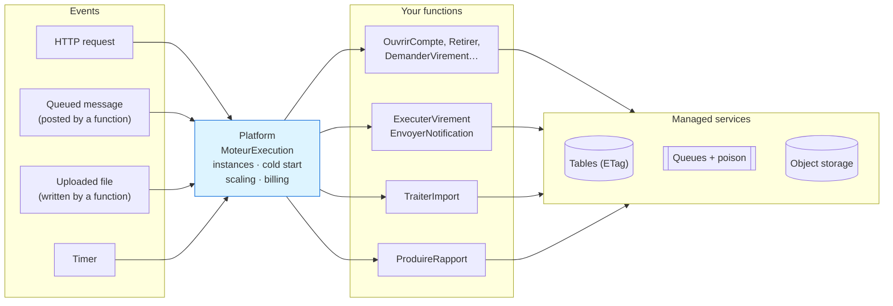
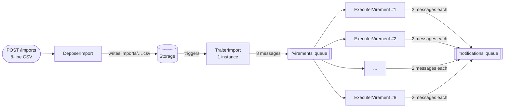
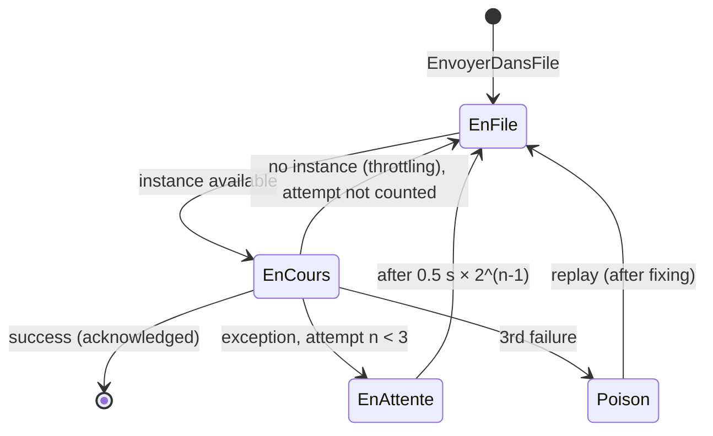

# 12. Serverless (Function as a Service)

> **In one sentence**: you no longer write an application that runs continuously, but **stateless functions** that the
> cloud provider runs on demand, when an **event** occurs, and bills per use.

📁 Code: [`12-Serverless`](../../12-Serverless) · ⬅️ [DDD](11-ddd.md) · ➡️ [Microkernel](13-microkernel.md) ·
🌐 [Français](../12-serverless.md)

---

## The idea

Popularized by **AWS Lambda** (2014), then Azure Functions and Google Cloud Functions. "Serverless" doesn't mean
"without servers", but **without servers to manage**: the provider starts, multiplies and stops instances according to
the traffic.

> **In this demo, the platform is simulated** (nothing to download) but it reproduces the behaviors that change the way
> you code. `Sls.Plateforme` plays the provider — **you never write it for real** —; `Sls.Fonctions` contains the only
> code you would actually write.



The loop is **event-driven**: a function writes to a queue or to storage, which triggers another function.

| The provider manages | You write |
|---|---|
| servers, OS, runtime, scaling, high availability | short, **stateless** functions |
| triggers (HTTP, queues, storage, clock) | a **manifest**: which functions, triggered by what |
| managed services (key-value stores, queues, storage) | the business code, **idempotent** |
| per-millisecond billing | nothing, when nobody calls |

---

## Solution layout

| Project | Role | For real |
|---|---|---|
| `Sls.Plateforme` | The simulated provider + its `/plateforme/…` "console" | AWS Lambda, Azure Functions |
| `Sls.Fonctions` | The manifest and the functions | your code |
| `Sls.Hote` | Runs the platform locally | `func start`, `sam local` |
| `Sls.Tests` | Platform, functions, full system | |

---

## The code, step by step

The code is quoted exactly as it is, French comments included.

### 1. The manifest: no server, no controller

The equivalent of `serverless.yml` or Azure's `[Function]` attributes: HTTP triggers (behind a managed API gateway),
queue triggers (asynchronous processing with automatic retries), a storage trigger (an uploaded file starts its
processing) and a scheduled trigger.
([Deploiement.cs](../../12-Serverless/Sls.Fonctions/Deploiement.cs))

```csharp
public static void Declarer(Manifeste manifeste) => manifeste
    // Déclencheurs HTTP (derrière une passerelle API gérée)
    .Http("OuvrirCompte", "POST", "/comptes", ComptesFonctions.Ouvrir)
    .Http("Retirer", "POST", "/comptes/{id}/retrait", ComptesFonctions.Retirer)
    .Http("DemanderVirement", "POST", "/virements", VirementsFonctions.Demander)
    // …
    // Déclencheurs de file : traitement asynchrone, avec nouveaux essais automatiques
    .File("ExecuterVirement", Files.Virements, VirementsFonctions.Executer, memoireMo: 256)
    .File("EnvoyerNotification", Files.Notifications, NotificationsFonctions.Envoyer)
    // Déclencheur de stockage : un fichier déposé lance son traitement
    .Stockage("TraiterImport", "imports/", ImportsFonctions.Traiter, memoireMo: 512)
    // Déclencheur planifié
    .Minuterie("ProduireRapport", TimeSpan.FromSeconds(30), RapportsFonctions.Produire);
```

### 2. A function: a static method

Input = the trigger + the context; output = a response. Everything that must last goes into a managed service. Here,
the transfer is NOT made in the HTTP function: it is accepted (202) and handed to a queue, for an immediate response.
([Fonctions.cs](../../12-Serverless/Sls.Fonctions/Fonctions.cs))

```csharp
/// <summary>HTTP : on ne fait PAS le virement ici. On l'accepte (202) et on le confie à une file : réponse immédiate.</summary>
public static async Task<ReponseHttp> Demander(RequeteHttp requete, ContexteFonction contexte)
{
    var demande = requete.Lire<VirementDemande>();
    if (await Valider(demande, contexte) is { } erreur)
        return ReponseHttp.Invalide(erreur);

    var virement = await Planifier(demande, contexte, Guid.NewGuid());
    return ReponseHttp.Accepte($"/virements/{virement.Id}", new { virementId = virement.Id, statut = virement.Statut });
}
```

### 3. Cold start, warm instances, scale to zero

Downloading the code, starting the .NET runtime, initializing: that is the "cold start".
([MoteurExecution.cs](../../12-Serverless/Sls.Plateforme/MoteurExecution.cs))

```csharp
lock (etat)
{
    instance = etat.Instances.FirstOrDefault(i => !i.Occupee);
    aFroid = instance is null;
    if (instance is null)
    {
        if (etat.Instances.Count >= _options.InstancesMaxParFonction)
            throw new EtranglementException(nom);
        instance = new Instance($"{++etat.NumeroInstance}");
        etat.Instances.Add(instance);
    }
    instance.Occupee = true;
}
// …
if (aFroid)
{
    // Téléchargement du code, démarrage du runtime .NET, initialisation : c'est le « cold start ».
    await Task.Delay(_options.DemarrageAFroidMs);
}
```


### 4. Automatic scaling: *fan-out*

An instance handles **only one call at a time**: 8 simultaneous messages = 8 instances.



Measured on the demo: `picInstances = 8` for `ExecuterVirement`.

### 5. Stateless: instance memory is misleading

✗ The instance's memory belongs to THAT instance and is reset on every cold start; ✓ a managed service is shared by
all instances and durable.
([Fonctions.cs](../../12-Serverless/Sls.Fonctions/Fonctions.cs))

```csharp
// ✗ Mémoire de l'instance : propre à CETTE instance, remise à zéro à chaque démarrage à froid.
var compteurDeLInstance = (contexte.MemoireInstance.TryGetValue("visites", out var v) ? (long)v : 0) + 1;
contexte.MemoireInstance["visites"] = compteurDeLInstance;

// ✓ Service géré : partagé par toutes les instances, durable.
var global = await Concurrence.ModifierOuCreer(contexte.Table(Tables.Compteurs), "visites",
    new Compteur(0), c => c with { Valeur = c.Valeur + 1 });
```

### 6. Concurrency: conditional writes (ETag)

Dozens of instances can modify the same account at the same time: read → modify → write "only if nobody wrote in
the meantime", and start again otherwise.
([Modele.cs](../../12-Serverless/Sls.Fonctions/Modele.cs))

```csharp
/// Lire → modifier → écrire « seulement si personne n'a écrit entre-temps », et recommencer sinon.
public static async Task<T> Modifier<T>(TableGeree table, string cle, Func<T, T> modification) where T : class
{
    for (var essai = 1; ; essai++)
    {
        var (valeur, etag) = await table.Lire<T>(cle);
        if (valeur is null)
            throw new KeyNotFoundException($"{table.Nom}/{cle}");
        try
        {
            var nouvelle = modification(valeur);
            await table.Ecrire(cle, nouvelle, etag);
            return nouvelle;
        }
        catch (ConflitEcritureException) when (essai < 20)
        {
            // Une autre instance a écrit avant nous : on relit et on recommence.
        }
    }
}
```

### 7. Retries, poison messages and idempotency

An exception gets the message redelivered (increasing delay); after 3 failures, it goes to the `-poison` queue.
([ServicesGeres.cs](../../12-Serverless/Sls.Plateforme/ServicesGeres.cs))

```csharp
internal void Echec(string file, MessageEnFile message, string erreur)
{
    var tentative = message.Tentative + 1;
    if (tentative >= options.TentativesMax)
        Ajouter($"{file}-poison", message with { Tentative = tentative, DerniereErreur = erreur });
    else
        Ajouter(file, message with
        {
            Tentative = tentative,
            DerniereErreur = erreur,
            VisibleApres = DateTime.UtcNow.AddMilliseconds(options.AttenteEntreTentativesMs * Math.Pow(2, tentative - 1))
        });
}
```



Since a message can be delivered several times, **all processing must be idempotent**: `Compte.Appliquer` ignores an
already known operation, notifications have a deterministic key, and a reprocessed import file creates no duplicates
(identifier derived from the file and the line number).

```csharp
public Compte Appliquer(Guid operation, decimal variation)
{
    if (Operations.Contains(operation))
        return this;
    if (Solde + variation < 0)
        throw new RegleMetierException("Solde insuffisant.");
    return this with { Solde = Solde + variation, Operations = [.. Operations.TakeLast(49), operation] };
}
```

### 8. The bill

`GET /plateforme/facture`: invocations × $0.20 / million + duration × memory (GB-s) × $0.0000166667 (AWS Lambda prices).
The complete demo (49 invocations, 2.6 GB-s) costs **$0.000054**. But constant, high traffic can cost more than a
dedicated server: serverless shines on **irregular** loads.

---

## The tests

Three levels:

| Level | File | Example |
|---|---|---|
| Platform alone | [PlateformeTests.cs](../../12-Serverless/Sls.Tests/PlateformeTests.cs) | cold then warm, scaling, throttling, recycling, timeout exceeded, GB-s |
| Functions, called like methods | [FonctionsTests.cs](../../12-Serverless/Sls.Tests/FonctionsTests.cs) | 30 simultaneous withdrawals → exactly 10 succeed; double delivery → a single debit |
| Full system | [SystemeTests.cs](../../12-Serverless/Sls.Tests/SystemeTests.cs) | HTTP transfer → queues; import → several instances; poison then replay |

In this test, 30 "instances" withdraw €100 at the same time from a €1,000 account: thanks to the ETags, exactly 10 succeed.

```csharp
[Fact]
public async Task Des_retraits_simultanes_ne_mettent_jamais_le_compte_a_decouvert()
{
    // 30 « instances » retirent 100 € en même temps sur un compte de 1 000 € : grâce aux ETag, exactement 10 réussissent.
    var reponses = await Task.WhenAll(Enumerable.Range(0, 30).Select(_ =>
        ComptesFonctions.Retirer(Requete(new { montant = 100m }, DonneesDeDemo.Alice.ToString()), Contexte)));

    Assert.Equal(10, reponses.Count(r => r.Statut == 200));
    Assert.Equal(0m, await Solde(DonneesDeDemo.Alice));
}
```

---

## Summary

| 👍 Strengths | 👎 Limits |
|---|---|
| No servers to manage, high availability included | **Cold starts** (unpredictable latency) |
| Automatic scaling, **down to zero** | **Statelessness** imposed: everything goes through managed services |
| Pay per use: ideal for irregular traffic | Mandatory **idempotency** (multiple deliveries) |
| Functions easy to test (they are methods) | **Provider lock-in**, limits (duration, memory) |
| Naturally event-driven | Distributed debugging and observability; high cost under heavy constant load |

**When to use it**: event-driven processing (files, messages, webhooks), scheduled jobs, APIs with irregular traffic,
"glue" between cloud services. Often **alongside** another architecture, not instead of it. Going real: Azure Functions
(isolated worker) or AWS Lambda, Azurite / LocalStack locally, and Durable Functions / Step Functions to orchestrate
long-running processing.
