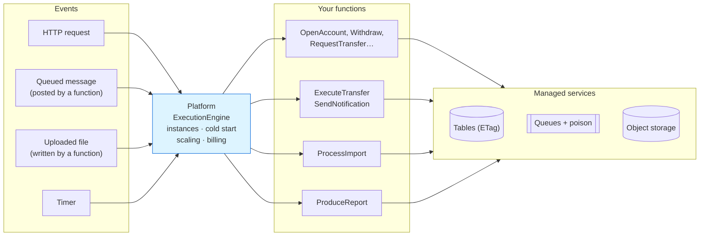
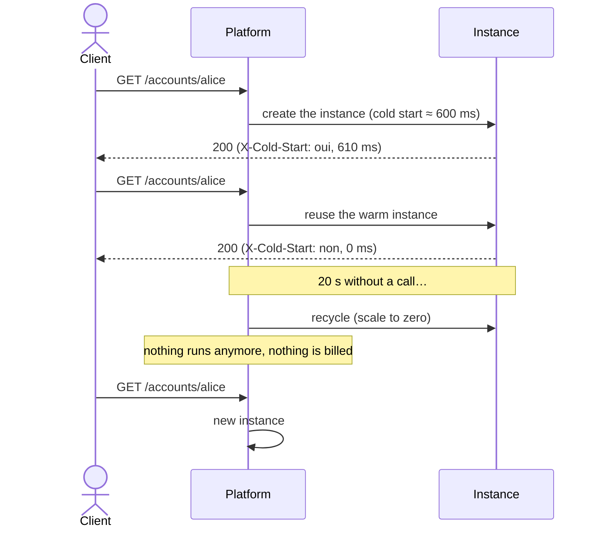
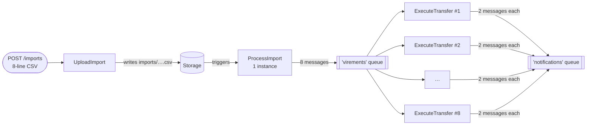
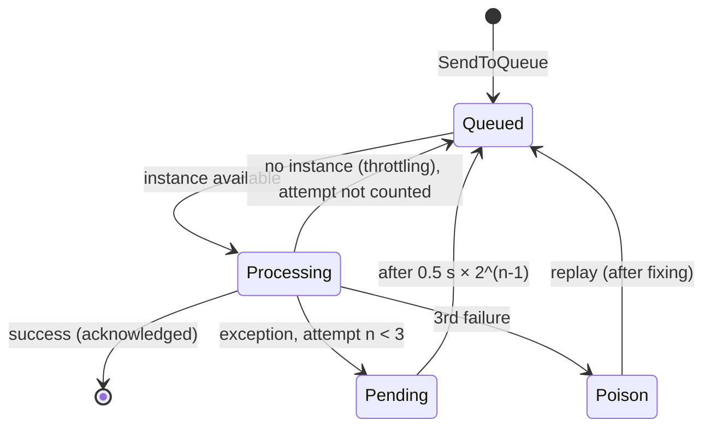

# 12. Serverless (Function as a Service)

> **In one sentence**: you no longer write an application that runs continuously, but **stateless functions** that the
> cloud provider runs on demand, when an **event** occurs, and bills per use.

📁 Code: [`12-Serverless`](../../12-Serverless) · ⬅️ [DDD](11-ddd.md) · ➡️ [Microkernel](13-microkernel.md) ·
🌐 [Français](../12-serverless.md)

---

## The idea

Popularized by **AWS Lambda** (2014), then Azure Functions and Google Cloud Functions. "Serverless" doesn't mean
"without servers", but **without servers to manage**: the provider starts, multiplies and stops instances according to
the traffic.

> **In this demo, the platform is simulated** (nothing to download) but it reproduces the behaviors that change the way
> you code. `Sls.Platform` plays the provider — **you never write it for real** —; `Sls.Functions` contains the only
> code you would actually write.



The loop is **event-driven**: a function writes to a queue or to storage, which triggers another function.

| The provider manages | You write |
|---|---|
| servers, OS, runtime, scaling, high availability | short, **stateless** functions |
| triggers (HTTP, queues, storage, clock) | a **manifest**: which functions, triggered by what |
| managed services (key-value stores, queues, storage) | the business code, **idempotent** |
| per-millisecond billing | nothing, when nobody calls |

---

## Solution layout

| Project | Role | For real |
|---|---|---|
| `Sls.Platform` | The simulated provider + its `/platform/…` "console" | AWS Lambda, Azure Functions |
| `Sls.Functions` | The manifest and the functions | your code |
| `Sls.Host` | Runs the platform locally | `func start`, `sam local` |
| `Sls.Tests` | Platform, functions, full system | |

---

## The code, step by step

The code is quoted exactly as it is, French comments included.

### 1. The manifest: no server, no controller

The equivalent of `serverless.yml` or Azure's `[Function]` attributes: HTTP triggers (behind a managed API gateway),
queue triggers (asynchronous processing with automatic retries), a storage trigger (an uploaded file starts its
processing) and a scheduled trigger.
([Deployment.cs](../../12-Serverless/Sls.Functions/Deployment.cs))

```csharp
public static void Declare(Manifest manifest) => manifest
    // HTTP triggers (behind a managed API gateway)
    .Http("OpenAccount", "POST", "/accounts", AccountsFunctions.Open)
    .Http("Withdraw", "POST", "/accounts/{id}/withdrawal", AccountsFunctions.Withdraw)
    .Http("RequestTransfer", "POST", "/transfers", TransfersFunctions.Request)
    // …
    // Queue triggers: asynchronous processing, with automatic retries
    .Queue("ExecuteTransfer", Queues.Transfers, TransfersFunctions.Execute, memoryMb: 256)
    .Queue("SendNotification", Queues.Notifications, NotificationsFunctions.Send)
    // Storage trigger: an uploaded file starts its processing
    .Storage("ProcessImport", "imports/", ImportsFunctions.Process, memoryMb: 512)
    // Scheduled trigger
    .Timer("ProduceReport", TimeSpan.FromSeconds(30), ReportsFunctions.Produce);
```

### 2. A function: a static method

Input = the trigger + the context; output = a response. Everything that must last goes into a managed service. Here,
the transfer is NOT made in the HTTP function: it is accepted (202) and handed to a queue, for an immediate response.
([Functions.cs](../../12-Serverless/Sls.Functions/Functions.cs))

```csharp
/// <summary>HTTP: the transfer is NOT made here. It is accepted (202) and handed to a queue: immediate response.</summary>
public static async Task<HttpResponseData> Request(HttpRequestData request, FunctionContext context)
{
    var demand = request.Read<TransferRequest>();
    if (await Validate(demand, context) is { } error)
        return HttpResponseData.Invalid(error);

    var transfer = await Schedule(demand, context, Guid.NewGuid());
    return HttpResponseData.Accepted($"/transfers/{transfer.Id}", new { transferId = transfer.Id, status = transfer.Status });
}
```

### 3. Cold start, warm instances, scale to zero

Downloading the code, starting the .NET runtime, initializing: that is the "cold start".
([ExecutionEngine.cs](../../12-Serverless/Sls.Platform/ExecutionEngine.cs))

```csharp
lock (state)
{
    instance = state.Instances.FirstOrDefault(i => !i.Busy);
    cold = instance is null;
    if (instance is null)
    {
        if (state.Instances.Count >= _options.MaxInstancesPerFunction)
            throw new ThrottlingException(name);
        instance = new Instance($"{++state.InstanceNumber}");
        state.Instances.Add(instance);
    }
    instance.Busy = true;
}
// …
if (cold)
{
    // Downloading the code, starting the .NET runtime, initializing: that is the "cold start".
    await Task.Delay(_options.ColdStartMs);
}
```



### 4. Automatic scaling: *fan-out*

An instance handles **only one call at a time**: 8 simultaneous messages = 8 instances.



Measured on the demo: `peakInstances = 8` for `ExecuteTransfer`.

### 5. Stateless: instance memory is misleading

✗ The instance's memory belongs to THAT instance and is reset on every cold start; ✓ a managed service is shared by
all instances and durable.
([Functions.cs](../../12-Serverless/Sls.Functions/Functions.cs))

```csharp
// ✗ Instance memory: specific to THIS instance, reset at each cold start.
var instanceCounter = (context.InstanceMemory.TryGetValue("visits", out var v) ? (long)v : 0) + 1;
context.InstanceMemory["visits"] = instanceCounter;

// ✓ Managed service: shared by all the instances, durable.
var global = await Concurrency.ModifyOrCreate(context.Table(Tables.Counters), "visits",
    new Counter(0), c => c with { Value = c.Value + 1 });
```

### 6. Concurrency: conditional writes (ETag)

Dozens of instances can modify the same account at the same time: read → modify → write "only if nobody wrote in
the meantime", and start again otherwise.
([Model.cs](../../12-Serverless/Sls.Functions/Model.cs))

```csharp
/// Read → modify → write "only if nobody wrote in the meantime", and start over otherwise.
public static async Task<T> Modify<T>(ManagedTable table, string key, Func<T, T> modification) where T : class
{
    for (var attempt = 1; ; attempt++)
    {
        var (value, etag) = await table.Read<T>(key);
        if (value is null)
            throw new KeyNotFoundException($"{table.Name}/{key}");
        try
        {
            var updated = modification(value);
            await table.Write(key, updated, etag);
            return updated;
        }
        catch (WriteConflictException) when (attempt < 20)
        {
            // Another instance wrote before us: read again and start over.
        }
    }
}
```

### 7. Retries, poison messages and idempotency

An exception gets the message redelivered (increasing delay); after 3 failures, it goes to the `-poison` queue.
([ManagedServices.cs](../../12-Serverless/Sls.Platform/ManagedServices.cs))

```csharp
internal void Failed(string queue, QueuedMessage message, string error)
{
    var attempt = message.Attempt + 1;
    if (attempt >= options.MaxAttempts)
        Add($"{queue}-poison", message with { Attempt = attempt, LastError = error });
    else
        Add(queue, message with
        {
            Attempt = attempt,
            LastError = error,
            VisibleAfter = DateTime.UtcNow.AddMilliseconds(options.DelayBetweenAttemptsMs * Math.Pow(2, attempt - 1))
        });
}
```



Since a message can be delivered several times, **all processing must be idempotent**: `Account.Apply` ignores an
already known operation, notifications have a deterministic key, and a reprocessed import file creates no duplicates
(identifier derived from the file and the line number).

```csharp
public Account Apply(Guid operation, decimal change)
{
    if (Operations.Contains(operation))
        return this;
    if (Balance + change < 0)
        throw new BusinessRuleException("Insufficient balance.");
    return this with { Balance = Balance + change, Operations = [.. Operations.TakeLast(49), operation] };
}
```

### 8. The bill

`GET /platform/bill`: invocations × $0.20 / million + duration × memory (GB-s) × $0.0000166667 (AWS Lambda prices).
The complete demo (49 invocations, 2.6 GB-s) costs **$0.000054**. But constant, high traffic can cost more than a
dedicated server: serverless shines on **irregular** loads.

---

## The tests

Three levels:

| Level | File | Example |
|---|---|---|
| Platform alone | [PlatformTests.cs](../../12-Serverless/Sls.Tests/PlatformTests.cs) | cold then warm, scaling, throttling, recycling, timeout exceeded, GB-s |
| Functions, called like methods | [FunctionsTests.cs](../../12-Serverless/Sls.Tests/FunctionsTests.cs) | 30 simultaneous withdrawals → exactly 10 succeed; double delivery → a single debit |
| Full system | [SystemTests.cs](../../12-Serverless/Sls.Tests/SystemTests.cs) | HTTP transfer → queues; import → several instances; poison then replay |

In this test, 30 "instances" withdraw €100 at the same time from a €1,000 account: thanks to the ETags, exactly 10 succeed.

```csharp
[Fact]
public async Task Simultaneous_withdrawals_never_overdraw_the_account()
{
    // 30 "instances" withdraw 100 € at the same time from an account of 1,000 €: thanks to the ETags, exactly 10 succeed.
    var responses = await Task.WhenAll(Enumerable.Range(0, 30).Select(_ =>
        AccountsFunctions.Withdraw(Request(new { amount = 100m }, DemoData.Alice.ToString()), Context)));

    Assert.Equal(10, responses.Count(r => r.Status == 200));
    Assert.Equal(0m, await Balance(DemoData.Alice));
}
```

---

## Summary

| 👍 Strengths | 👎 Limits |
|---|---|
| No servers to manage, high availability included | **Cold starts** (unpredictable latency) |
| Automatic scaling, **down to zero** | **Statelessness** imposed: everything goes through managed services |
| Pay per use: ideal for irregular traffic | Mandatory **idempotency** (multiple deliveries) |
| Functions easy to test (they are methods) | **Provider lock-in**, limits (duration, memory) |
| Naturally event-driven | Distributed debugging and observability; high cost under heavy constant load |

**When to use it**: event-driven processing (files, messages, webhooks), scheduled jobs, APIs with irregular traffic,
"glue" between cloud services. Often **alongside** another architecture, not instead of it. Going real: Azure Functions
(isolated worker) or AWS Lambda, Azurite / LocalStack locally, and Durable Functions / Step Functions to orchestrate
long-running processing.
