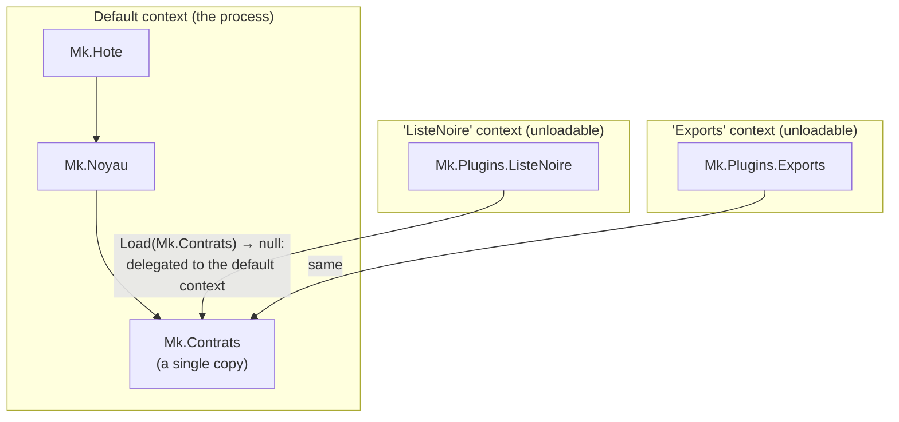
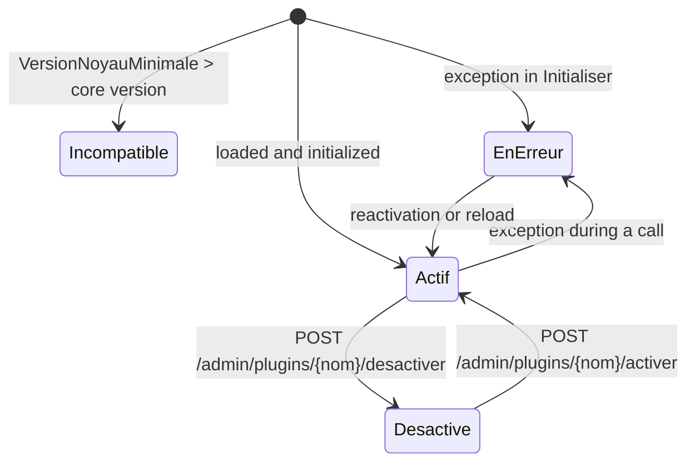
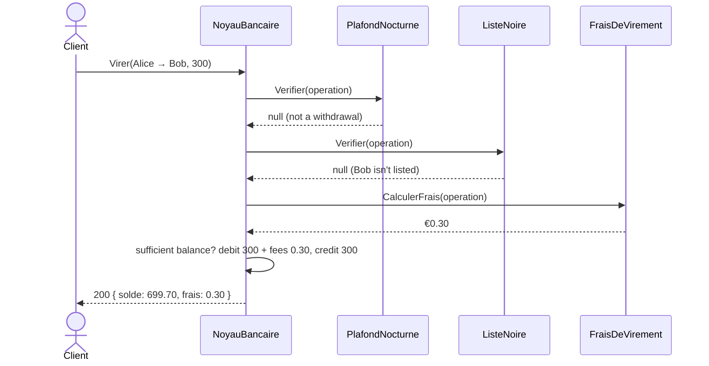
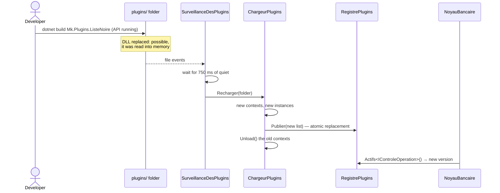

# 13. Microkernel (plug-in architecture)

> **In one sentence**: a **minimal core** that defines **extension points**; the variable features are **plug-ins**
> loaded at runtime, which you add, remove or update without recompiling or restarting the core.

📁 Code: [`13-Microkernel`](../../13-Microkernel) · ⬅️ [Serverless](12-serverless.md) · ➡️ [Orchestrated Saga](14-saga-orchestree.md) ·
🌐 [Français](../13-microkernel.md)

---

## The idea

The model of VS Code, Eclipse, web browsers, rule engines or payroll software: the core does few things but does them
well, and everything that **varies** (by customer, country, commercial offer) is plugged in around it. None of the
previous demos dealt with this axis: **extensibility**. (In the code: *Noyau* = core, *Contrats* = contracts.)


**The core references no plug-in**, and the plug-ins only see the SDK (`Mk.Contrats`) of the core. The two sides only
meet at runtime.

### The three extension points

| Extension point | Role | Demo plug-ins |
|---|---|---|
| `IControleOperation` | Can **refuse** an operation before it happens | `PlafondNocturne` (withdrawals limited at night), `ListeNoire` (blacklist: transfers to forbidden accounts) |
| `IRegleFrais` | Adds **fees** | `FraisDeVirement` (0.1%, between €0.20 and €5) |
| `IFormatReleve` | Produces a **statement** in a format | `ExportCsv`, `ExportQif` — **two extensions in a single DLL** |

---

## Solution layout

```
13-Microkernel/
├── Mk.Contrats/               the SDK: interfaces and exchanged data
├── Mk.Noyau/                  NoyauBancaire, RegistrePlugins, ChargeurPlugins
├── Mk.Hote/                   HTTP API + watching of the plug-in folder
├── Mk.Plugins.FraisVirement/  ┐
├── Mk.Plugins.PlafondNocturne/│  plug-in projects: built into plugins/{Name}/,
├── Mk.Plugins.ListeNoire/     │  each with its plugin.json settings
├── Mk.Plugins.Exports/        ┘
├── Plugins.props              settings shared by the plug-ins
└── plugins/                   ← build output (not versioned), read by the core
```

---

## The code, step by step

The code is quoted exactly as it is, French comments and messages included.

### 1. The SDK: what the core and the plug-ins share

The comments explain the minimum core version (a plug-in too recent is refused on load) and `Initialiser` (called once
on load, with the settings read from the plug-in's `plugin.json`).
([Contrats.cs](../../13-Microkernel/Mk.Contrats/Contrats.cs))

```csharp
public interface IPlugin
{
    string Nom { get; }
    string Description { get; }

    /// <summary>Version minimale du noyau dont le plugin a besoin. Un plugin trop récent est refusé au chargement.</summary>
    Version VersionNoyauMinimale => new(1, 0);

    /// <summary>Appelé une fois au chargement, avec les réglages lus dans le plugin.json du plugin.</summary>
    void Initialiser(ContextePlugin contexte) { }
}

/// <summary>Peut refuser une opération avant qu'elle ait lieu.</summary>
public interface IControleOperation : IPlugin
{
    /// <returns>null si l'opération est permise, sinon la raison du refus.</returns>
    string? Verifier(OperationProposee operation);
}
```

Plug-ins receive **values** (`OperationProposee`, `ReleveCompte`), never the core's internal objects.

### 2. A plug-in: a class that implements an extension point

([PlafondNocturne.cs](../../13-Microkernel/Mk.Plugins.PlafondNocturne/PlafondNocturne.cs))

```csharp
public sealed class PlafondNocturne : IControleOperation
{
    private decimal _plafond = 200m;
    private TimeOnly _debut = new(22, 0), _fin = new(6, 0);

    public string Nom => "PlafondNocturne";

    public string? Verifier(OperationProposee operation)
    {
        if (operation.Type != TypeOperation.Retrait || operation.Montant <= _plafond)
            return null;

        var heure = TimeOnly.FromDateTime(operation.Date);
        var laNuit = _debut <= _fin
            ? heure >= _debut && heure < _fin
            : heure >= _debut || heure < _fin;  // plage à cheval sur minuit
        return laNuit ? $"Retrait limité à {_plafond} € entre {_debut:HH\\:mm} et {_fin:HH\\:mm}." : null;
    }
}
```

Its settings come from its own `plugin.json`, next to its DLL:

```json
{ "plafond": "200", "debut": "22:00", "fin": "06:00" }
```

### 3. Building a plug-in… without bundling the SDK

([Plugins.props](../../13-Microkernel/Plugins.props))

```xml
<PropertyGroup>
  <EnableDynamicLoading>true</EnableDynamicLoading>
  <OutputPath>$(MSBuildThisFileDirectory)plugins\$(MSBuildProjectName)\</OutputPath>
</PropertyGroup>
<ItemGroup>
  <ProjectReference Include="$(MSBuildThisFileDirectory)Mk.Contrats\Mk.Contrats.csproj" Private="false" ExcludeAssets="runtime" />
</ItemGroup>
```

`Private="false"` avoids copying `Mk.Contrats.dll` into the plug-in folder. Why this is vital: see the next step.

### 4. Loading each plug-in in its own context

The DLL is loaded from MEMORY, not from the file, so it isn't locked and can be rebuilt, replaced or deleted while the
application runs. And the crucial point: the contracts must come from the CORE (default context). If the plug-in loaded
its own copy of `Mk.Contrats`, its `IPlugin` would be ANOTHER type than the core's `IPlugin` (same name, different
assemblies), and nothing would work.
([ChargeurPlugins.cs](../../13-Microkernel/Mk.Noyau/ChargeurPlugins.cs))

```csharp
internal sealed class ContexteChargement(string cheminDll)
    : AssemblyLoadContext(Path.GetFileNameWithoutExtension(cheminDll), isCollectible: true)
{
    private readonly AssemblyDependencyResolver _resolveur = new(cheminDll);

    /// Chargé depuis la MÉMOIRE et non depuis le fichier : la DLL n'est pas verrouillée,
    /// on peut la recompiler, la remplacer ou la supprimer pendant que l'application tourne.
    public Assembly Charger() => LoadFromStream(new MemoryStream(File.ReadAllBytes(cheminDll)));

    protected override Assembly? Load(AssemblyName nom)
    {
        // Point crucial : les contrats doivent venir du NOYAU (contexte par défaut).
        // Si le plugin chargeait sa propre copie de Mk.Contrats, son IPlugin serait un AUTRE type
        // que l'IPlugin du noyau (même nom, assemblies différentes), et rien ne fonctionnerait.
        if (nom.Name == typeof(IPlugin).Assembly.GetName().Name)
            return null;

        var chemin = _resolveur.ResolveAssemblyToPath(nom);
        return chemin is null ? null : LoadFromStream(new MemoryStream(File.ReadAllBytes(chemin)));
    }
}
```



A test checks it: after loading, `Mk.Contrats` is present **only once** in the process.

### 5. Discovering the extensions through reflection

```csharp
return assembly.GetExportedTypes()
    .Where(t => t is { IsClass: true, IsAbstract: false } && typeof(IPlugin).IsAssignableFrom(t))
    .Select(t => RegistrePlugins.Preparer((IPlugin)Activator.CreateInstance(t)!, nom, reglages, journal))
    .ToList();
```

`Preparer` checks the required core version, then calls `Initialiser` with the settings from `plugin.json`.



### 6. The core calls the extensions at the planned places

1. "Check" extension point: a single refusal is enough. 2. "Fees" extension point: each rule can add its own.
3. The heart of the business, which belongs to the core alone.
([NoyauBancaire.cs](../../13-Microkernel/Mk.Noyau/NoyauBancaire.cs))

```csharp
// 1. Point d'extension « contrôle » : un seul refus suffit.
foreach (var controle in plugins.Actifs<IControleOperation>())
{
    string? refus = null;
    if (!Proteger(controle, () => refus = controle.Verifier(operation)))
        return Resultat.Refus($"Le plugin {controle.Nom} est en erreur : opération refusée par sécurité.");
    if (refus is not null)
        return Resultat.Refus($"[{controle.Nom}] {refus}");
}

// 2. Point d'extension « frais » : chaque règle peut ajouter les siens.
// …

// 3. Le cœur du métier, qui n'appartient qu'au noyau.
var totalFrais = frais.Sum(f => f.Montant);
if (montant + totalFrais > compte.Solde)
    return Resultat.Refus($"Solde insuffisant (frais compris : {totalFrais:0.00} €).");
```



### 7. A faulty plug-in doesn't bring the core down

Its exception is caught, and the plug-in is put "in error" (so disabled) until it is reactivated or reloaded.

```csharp
/// Un plugin ne doit jamais faire tomber le noyau : son exception est capturée, et le plugin est mis « en erreur »
/// (donc désactivé) jusqu'à ce qu'on le réactive ou qu'on le recharge.
private bool Proteger(IPlugin plugin, Action appel)
{
    try
    {
        appel();
        return true;
    }
    catch (Exception e)
    {
        plugins.SignalerErreur(plugin, e);
        journal($"[{plugin.Nom}] exception, plugin désactivé : {e.Message}");
        return false;
    }
}
```

A safety choice (*fail-closed*): the current operation is **refused**, rather than executed without a check.

### 8. Hot reload

The registry is **replaced in one block**; the old contexts are then unloaded. `SurveillanceDesPlugins`
([Endpoints.cs](../../13-Microkernel/Mk.Hote/Endpoints.cs)) watches the folder and reloads 750 ms after the last change
(a build writes several files in a row).



---

## The tests

| File | What is checked |
|---|---|
| [NoyauTests.cs](../../13-Microkernel/Mk.Tests/NoyauTests.cs) | The core alone, with plug-ins **written in the test** (no DLL): fees, faulty plug-in isolated, incompatible plug-in refused, no export without a format plug-in |
| [ChargementTests.cs](../../13-Microkernel/Mk.Tests/ChargementTests.cs) | The real DLLs: discovery, settings, **a single** `Mk.Contrats`, plug-in deleted then **context actually unloaded** |
| [ApiTests.cs](../../13-Microkernel/Mk.Tests/ApiTests.cs) | End to end: fees, blacklist, night-time limit depending on the time (adjustable clock), formats, hot disabling |

Deleting the plug-in folder is possible while the plug-in is loaded, since the DLL was read into memory:

```csharp
[Fact]
public void Un_plugin_supprime_du_dossier_disparait_et_son_contexte_est_decharge()
{
    // …
    // Possible pendant que le plugin est chargé : la DLL a été lue en mémoire, le fichier n'est pas verrouillé.
    Directory.Delete(Path.Combine(dossier, "Mk.Plugins.ListeNoire"), recursive: true);
    var decharges = chargeur.Recharger(dossier);

    Assert.DoesNotContain("ListeNoire", Noms(registre));
    Assert.True(AttendreDechargement(decharges), "Les anciens contextes de chargement n'ont pas été libérés.");
}
```

The test project references the plug-ins with `ReferenceOutputAssembly="false"`: they are **built** before the tests,
but never linked as libraries.

---

## Summary

| 👍 Strengths | 👎 Limits |
|---|---|
| Features added **without touching the core** or redeploying it | Designing good extension points is hard; changing them breaks every plug-in |
| **Hot** enabling / disabling, per customer or per offer | The SDK becomes a public contract to **version** carefully |
| Isolation: a faulty plug-in is set aside | Plug-ins run **in-process**: no security isolation (a malicious plug-in can do anything) |
| Third parties and external teams can extend the product | Debugging and integration tests are trickier; unloading is fragile if a reference lingers |

**When to use it**: products configurable per customer, rule engines, tools extensible by third parties, software whose
core is stable but whose variants are many. **Pitfalls**: copying the SDK into the plug-in folder (incompatible types),
holding a reference to a plug-in (unloading impossible), loading untrusted plug-ins (a separate process is then
needed). In .NET, libraries such as *McMaster.NETCore.Plugins* wrap this mechanism.
