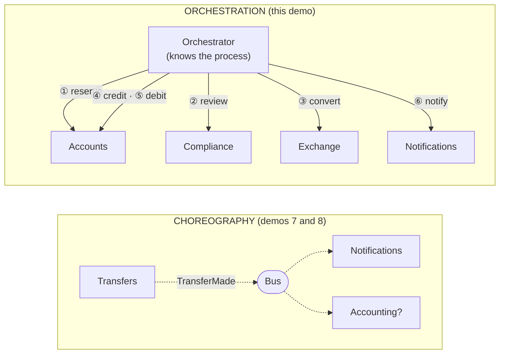
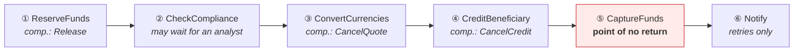
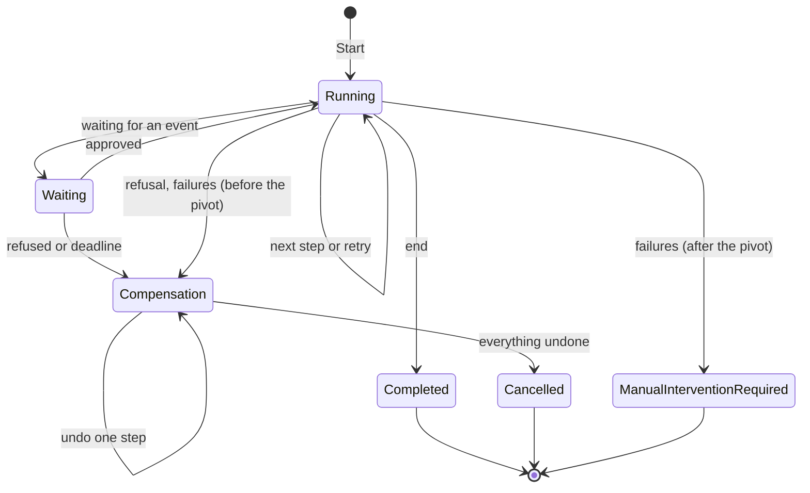

# 14. Orchestrated Saga

**French name**: *Saga orchestrée*

> **In one sentence**: an explicit **orchestrator** drives a process spread over several services, step by step; it
> remembers where it stands, retries, waits for external events, and **compensates** in reverse order when needed.

📁 Code: [`14-OrchestratedSaga`](../../14-OrchestratedSaga) · ⬅️ [Microkernel](13-microkernel.md) · ➡️ [Multi-tenant](15-multi-tenant.md) ·
🌐 [Français](../14-saga-orchestree.md)

---

## The idea: choreography or orchestration?

As soon as a process touches several services (or several databases), there is no single transaction anymore: local
steps are chained, with compensations in case of failure. That is a **saga** (Garcia-Molina and Salem, 1987).
There are two ways to coordinate it:



| | Choreography | Orchestration |
|---|---|---|
| Who knows the process? | **nobody**: it emerges from everyone's reactions | **the orchestrator**, in one place |
| Coupling | loose: the publisher doesn't know the subscribers | the orchestrator knows every participant |
| Readability | hard to tell "where transfer 42 stands" | state and history of each saga can be inspected |
| Adding a reaction | easy (subscribe) | change the definition |
| Waiting, timeouts, compensation | to be coded in each service | handled by the engine |
| Tools | message broker | Durable Functions, Temporal, Step Functions, MassTransit, NServiceBus |

**Rule of thumb**: choreography to **notify** ("this happened"), orchestration to **drive** a multi-step business
process with failure rules. [Demo 21](21-choregraphie.md) makes the **same transfer** through choreography, for a
side-by-side comparison.

---

## The process: a transfer in six steps



- The funds are first **reserved** (no longer available, but not gone yet), and only **captured** at step ⑤: a
  reservation is easy to release, which makes compensation simple.
- **⑤ is the point of no return** (*pivot transaction*): before it, every failure is compensated; after it, nothing can
  be undone anymore, the remaining steps are only **retried**.

The definition fits in a single file, readable at a glance: it is orchestration's main asset. (The code is quoted
exactly as it is.)
([TransferDefinition.cs](../../14-OrchestratedSaga/Saga.Orchestrator/TransferDefinition.cs))

```csharp
new("ReserveFunds",
    async s => { await accounts.Reserve(s.Id, s.Source, s.Amount); return Outcome.Success; },
    Compensate: s => accounts.Release(s.Id, s.Source)),

new("CheckCompliance", async s =>
    await compliance.Examine(s.Id, ExchangeService.InEuros(s.Amount, accounts.Currency(s.Source))) switch
    {
        ComplianceOpinion.Approved => Outcome.Success,
        ComplianceOpinion.AwaitingAnalyst => new Outcome.Waiting(
            TimeSpan.FromSeconds(options.ComplianceDecisionTimeoutSeconds), "awaiting an analyst's decision"),
        _ => new Outcome.Refused("Refused by compliance.")
    }),
// …
new("CaptureFunds",
    async s => { await accounts.Capture(s.Id, s.Source); return Outcome.Success; },
    PointOfNoReturn: true),
```

Each step returns an **outcome**: succeeded, waiting (with a timeout), or refused. An exception, on the other hand,
means a **transient failure**.

---

## The engine

### 1. The state is saved after every step

The orchestrator **keeps nothing in memory**: everything needed to resume is in `SagaState`, saved (serialized) after
each transition.
([SagaEngine.cs](../../14-OrchestratedSaga/Saga.Orchestrator/SagaEngine.cs))

```csharp
/// Moves all the ready sagas forward by one step. Returns the number of sagas handled.
public async Task<int> Process()
{
    // …
    var ready = store.All().Where(IsReady).ToList();
    foreach (var saga in ready)
    {
        await Advance(saga);
        store.Save(saga);  // the state is saved after EACH step
    }
    return ready.Count;
}
```

### 2. The states of a saga



### 3. Retry, then give up cleanly

After the point of no return, nothing can be undone anymore (the money has already been debited for good), so the
saga goes to manual handling; before it, compensation starts.

```csharp
private void TransientFailure(SagaState saga, Step step, string message)
{
    saga.Attempts++;
    if (saga.Attempts < options.MaxAttempts)
    {
        var delay = Delay(saga.Attempts);
        saga.NextAttempt = Now + delay;
        // … log "attempt n/4, new attempt in … ms"
    }
    else if (PointOfNoReturnPassed(saga))
    {
        // Nothing can be undone any more: the money has already been debited for good.
        RequireManualIntervention(saga, $"{step.Name} impossible after {options.MaxAttempts} attempts: {message}");
    }
    else
    {
        StartCompensation(saga, $"{step.Name} impossible after {options.MaxAttempts} attempts: {message}");
    }
}
```

### 4. Compensate in reverse order

A compensation **must eventually succeed**: on failure, it is retried indefinitely.

```csharp
/// Undoes the most recent of the successful steps. A compensation must end up succeeding: it is retried endlessly.
private async Task CompensateOneStep(SagaState saga)
{
    if (saga.CompletedSteps.Count == 0)
    {
        saga.Status = SagaStatus.Cancelled;
        Note(saga, "■ Transfer cancelled: all the steps were undone");
        return;
    }

    var step = Steps.Single(e => e.Name == saga.CompletedSteps[^1]);
    if (step.Compensate is not null)
    {
        // … await step.Compensate(saga), with a new attempt on failure
    }
    saga.CompletedSteps.RemoveAt(saga.CompletedSteps.Count - 1);
}
```

### 5. Waiting for an external event, with a deadline

Above €10,000, a **human analyst** must decide. The saga goes "waiting", the funds stay reserved, and the API receives
the decision (`POST /sagas/{id}/compliance`):

```csharp
/// External event: the compliance analyst's decision.
public async Task<bool> Signal(Guid id, bool approved, string? comment)
{
    // …
    if (approved)
    {
        Note(saga, $"✉ Decision received: approved{Comment(comment)}");
        CompleteStep(saga, Steps[saga.CurrentStep]);
    }
    else
    {
        StartCompensation(saga, $"Refused by the compliance analyst{Comment(comment)}");
    }
    // …
}
```

Without a decision before the deadline, the engine triggers the compensation itself.

---

## Three real runs

Logs taken from the running API (`GET /sagas/{id}`), quoted as the application writes them (in French).

**Transient failure of the exchange service** (2 failures, then success):

```
▶ Transfer of 100.00 requested
✔ ReserveFunds
✔ CheckCompliance
✖ ConvertCurrencies: Exchange service temporarily unavailable. — attempt 1/4, retrying in 200 ms
✖ ConvertCurrencies: Exchange service temporarily unavailable. — attempt 2/4, retrying in 400 ms
✔ ConvertCurrencies
✔ CreditBeneficiary
✔ CaptureFunds (point of no return crossed)
✔ Notify
■ Transfer completed
```

**Exchange service out of order** (compensation):

```
✔ ReserveFunds
✔ CheckCompliance
✖ ConvertCurrencies: Exchange service down. — attempt 1/4, retrying in 200 ms
✖ ConvertCurrencies: Exchange service down. — attempt 2/4, retrying in 400 ms
✖ ConvertCurrencies: Exchange service down. — attempt 3/4, retrying in 800 ms
↩ Compensation: ConvertCurrencies impossible after 4 attempts: Exchange service down.
↩ ReserveFunds undone
■ Transfer cancelled: all the steps were undone
```

**Large transfer, an analyst's decision**:


---

## The tests

A **manual clock** lets time move forward at will: retries and deadlines are tested instantly, without real waiting.
In this test, a first engine does two steps and then "crashes"; a second engine, sharing nothing with the first except
the store, finishes the saga.
([SagaEngineTests.cs](../../14-OrchestratedSaga/Saga.Tests/SagaEngineTests.cs))

```csharp
[Fact]
public async Task A_new_engine_resumes_the_sagas_where_the_old_one_left_them()
{
    var first = NewEngine();
    var id = first.Start(Alice, Carla, 100m).Id;
    await first.Process();
    await first.Process();  // ReserveFunds and CheckCompliance done… then "crash"

    var second = NewEngine();  // no state shared with the first one, except the store
    Assert.Equal(["ReserveFunds", "CheckCompliance"], _store.Load(id)!.CompletedSteps);
    var saga = await Run(second, id);

    Assert.Equal(SagaStatus.Completed, saga.Status);
    Assert.Equal(1_108.32m, Balance(Carla));
}
```

| Test | What is checked |
|---|---|
| `A_transfer_goes_through_the_six_steps_in_order` | nominal run, balances |
| `A_transient_failure_is_absorbed_by_retries` | 2 failures, then success |
| `A_lasting_failure_triggers_the_compensation_in_reverse_order` | gives up at the 4th failure, reservation released |
| `A_large_transfer_waits_for_an_analyst_decision` | waiting, then approval or refusal |
| `Without_a_decision_before_the_deadline_the_saga_is_compensated` | deadline exceeded |
| `After_the_point_of_no_return_there_is_no_more_compensation` | notifications down: `ManualInterventionRequired`, the money stays transferred |
| `Un_nouveau_moteur_reprend_les_sagas…` | recovery after a "crash" |
| `Replaying_a_step_already_done_at_a_participant_has_no_effect` | participants' idempotency |
| [ApiTests.cs](../../14-OrchestratedSaga/Saga.Tests/ApiTests.cs) | the real loop: end to end, decision over HTTP, orchestrator stopped then restarted |

---

## Summary

| 👍 Strengths | 👎 Limits |
|---|---|
| The process is **written in one place**, readable | The orchestrator knows every participant (coupling) |
| State and history of **each** saga can be inspected | One more component to operate, and to make highly available |
| Retries, waits, deadlines and compensation **handled by the engine** | Participants must be **idempotent** (a step can be replayed) |
| Recovery after a crash: the state is persistent | Risk of a "bloated conductor" absorbing the participants' business logic |

**When to use it**: long, multi-step business processes (order, international transfer, subscription, onboarding),
with human waits, timeouts and precise failure rules. In production, don't write your own engine: **Temporal**,
**Azure Durable Functions**, **AWS Step Functions**, or **MassTransit** / **NServiceBus** sagas do the same thing, with
persistence, monitoring and process versioning. See also
[compensation and saga](concepts-transverses.md#compensation-and-saga).
