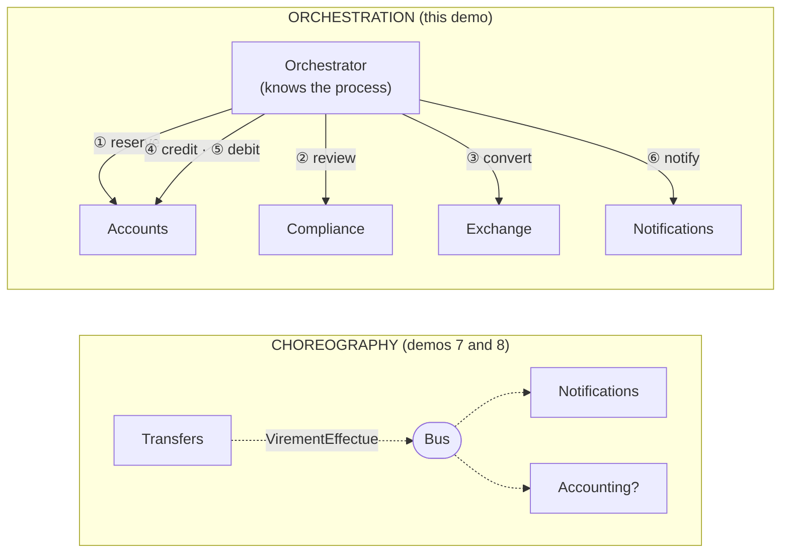
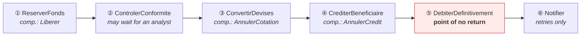
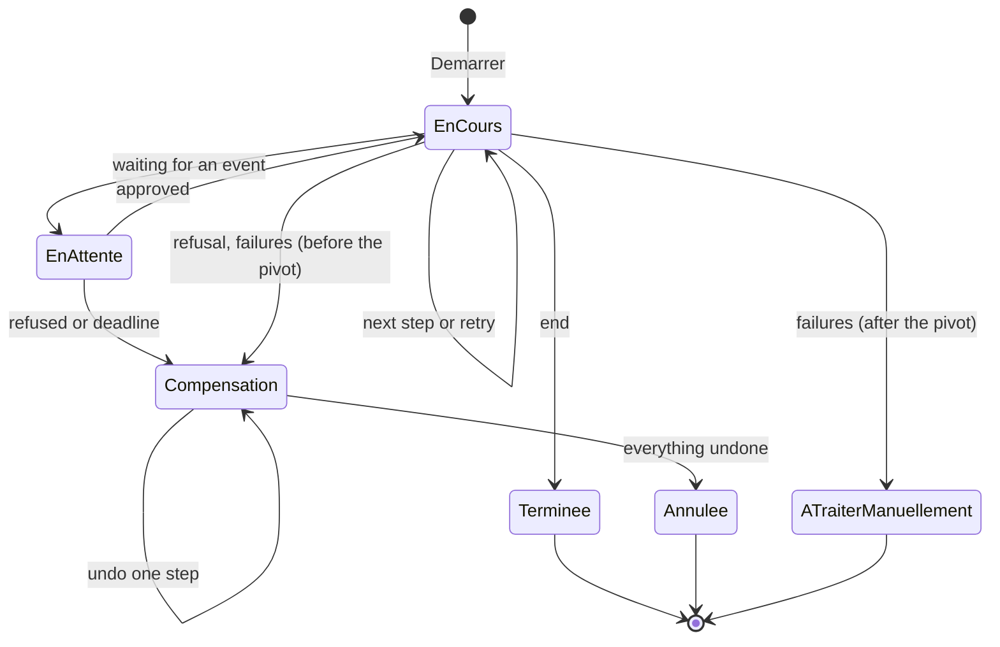
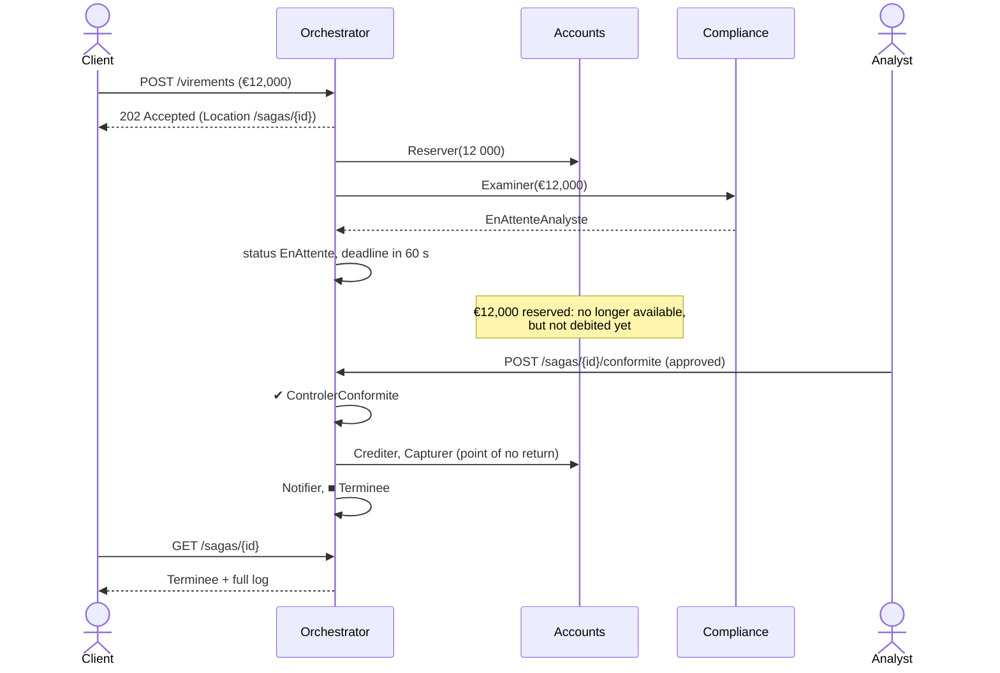

# 14. Orchestrated Saga

**French name**: *Saga orchestrée*

> **In one sentence**: an explicit **orchestrator** drives a process spread over several services, step by step; it
> remembers where it stands, retries, waits for external events, and **compensates** in reverse order when needed.

📁 Code: [`14-SagaOrchestree`](../../14-SagaOrchestree) · ⬅️ [Microkernel](13-microkernel.md) · ➡️ [Multi-tenant](15-multi-tenant.md) ·
🌐 [Français](../14-saga-orchestree.md)

---

## The idea: choreography or orchestration?

As soon as a process touches several services (or several databases), there is no single transaction anymore: local
steps are chained, with compensations in case of failure. That is a **saga** (Garcia-Molina and Salem, 1987).
There are two ways to coordinate it:



| | Choreography | Orchestration |
|---|---|---|
| Who knows the process? | **nobody**: it emerges from everyone's reactions | **the orchestrator**, in one place |
| Coupling | loose: the publisher doesn't know the subscribers | the orchestrator knows every participant |
| Readability | hard to tell "where transfer 42 stands" | state and history of each saga can be inspected |
| Adding a reaction | easy (subscribe) | change the definition |
| Waiting, timeouts, compensation | to be coded in each service | handled by the engine |
| Tools | message broker | Durable Functions, Temporal, Step Functions, MassTransit, NServiceBus |

**Rule of thumb**: choreography to **notify** ("this happened"), orchestration to **drive** a multi-step business
process with failure rules. [Demo 21](21-choregraphie.md) makes the **same transfer** through choreography, for a
side-by-side comparison.

---

## The process: a transfer in six steps



- The funds are first **reserved** (no longer available, but not gone yet), and only **captured** at step ⑤: a
  reservation is easy to release, which makes compensation simple.
- **⑤ is the point of no return** (*pivot transaction*): before it, every failure is compensated; after it, nothing can
  be undone anymore, the remaining steps are only **retried**.

The definition fits in a single file, readable at a glance: it is orchestration's main asset. (The code is quoted
exactly as it is.)
([DefinitionVirement.cs](../../14-SagaOrchestree/Saga.Orchestrateur/DefinitionVirement.cs))

```csharp
new("ReserverFonds",
    async s => { await comptes.Reserver(s.Id, s.Source, s.Montant); return Issue.Succes; },
    Compenser: s => comptes.Liberer(s.Id, s.Source)),

new("ControlerConformite", async s =>
    await conformite.Examiner(s.Id, ServiceChange.EnEuros(s.Montant, comptes.Devise(s.Source))) switch
    {
        AvisConformite.Approuve => Issue.Succes,
        AvisConformite.EnAttenteAnalyste => new Issue.EnAttente(
            TimeSpan.FromSeconds(options.DelaiDecisionConformiteSecondes), "en attente de la décision d'un analyste"),
        _ => new Issue.Refusee("Refusé par la conformité.")
    }),
// …
new("DebiterDefinitivement",
    async s => { await comptes.Capturer(s.Id, s.Source); return Issue.Succes; },
    PointDeNonRetour: true),
```

Each step returns an **outcome**: succeeded, waiting (with a timeout), or refused. An exception, on the other hand,
means a **transient failure**.

---

## The engine

### 1. The state is saved after every step

The orchestrator **keeps nothing in memory**: everything needed to resume is in `EtatSaga`, saved (serialized) after
each transition.
([MoteurSaga.cs](../../14-SagaOrchestree/Saga.Orchestrateur/MoteurSaga.cs))

```csharp
/// Fait avancer d'un pas toutes les sagas prêtes. Renvoie le nombre de sagas traitées.
public async Task<int> Traiter()
{
    // …
    var pretes = magasin.Toutes().Where(EstPrete).ToList();
    foreach (var saga in pretes)
    {
        await Avancer(saga);
        magasin.Enregistrer(saga);  // l'état est enregistré après CHAQUE pas
    }
    return pretes.Count;
}
```

### 2. The states of a saga



### 3. Retry, then give up cleanly

After the point of no return, nothing can be undone anymore (the money has already been debited for good), so the
saga goes to manual handling; before it, compensation starts.

```csharp
private void EchecPassager(EtatSaga saga, Etape etape, string message)
{
    saga.Tentatives++;
    if (saga.Tentatives < options.TentativesMax)
    {
        var attente = Attente(saga.Tentatives);
        saga.ProchainEssai = Maintenant + attente;
        // … journal « tentative n/4, nouvel essai dans … ms »
    }
    else if (PointDeNonRetourPasse(saga))
    {
        // On ne peut plus défaire : l'argent a déjà été débité définitivement.
        ATraiterManuellement(saga, $"{etape.Nom} impossible après {options.TentativesMax} tentatives : {message}");
    }
    else
    {
        DemarrerCompensation(saga, $"{etape.Nom} impossible après {options.TentativesMax} tentatives : {message}");
    }
}
```

### 4. Compensate in reverse order

A compensation **must eventually succeed**: on failure, it is retried indefinitely.

```csharp
/// Défait la plus récente des étapes réussies. Une compensation doit finir par réussir : on réessaie sans fin.
private async Task CompenserUnPas(EtatSaga saga)
{
    if (saga.EtapesFaites.Count == 0)
    {
        saga.Statut = StatutSaga.Annulee;
        Noter(saga, "■ Virement annulé : toutes les étapes ont été défaites");
        return;
    }

    var etape = Etapes.Single(e => e.Nom == saga.EtapesFaites[^1]);
    if (etape.Compenser is not null)
    {
        // … await etape.Compenser(saga), avec nouvel essai en cas d'échec
    }
    saga.EtapesFaites.RemoveAt(saga.EtapesFaites.Count - 1);
}
```

### 5. Waiting for an external event, with a deadline

Above €10,000, a **human analyst** must decide. The saga goes "waiting", the funds stay reserved, and the API receives
the decision (`POST /sagas/{id}/conformite`):

```csharp
/// Événement extérieur : la décision de l'analyste de conformité.
public async Task<bool> Signaler(Guid id, bool approuve, string? commentaire)
{
    // …
    if (approuve)
    {
        Noter(saga, $"✉ Décision reçue : approuvé{Commentaire(commentaire)}");
        TerminerEtape(saga, Etapes[saga.EtapeCourante]);
    }
    else
    {
        DemarrerCompensation(saga, $"Refusé par l'analyste de conformité{Commentaire(commentaire)}");
    }
    // …
}
```

Without a decision before the deadline, the engine triggers the compensation itself.

---

## Three real runs

Logs taken from the running API (`GET /sagas/{id}`), quoted as the application writes them (in French).

**Transient failure of the exchange service** (2 failures, then success):

```
▶ Virement de 100,00 demandé
✔ ReserverFonds
✔ ControlerConformite
✖ ConvertirDevises : Service de change momentanément indisponible. — tentative 1/4, nouvel essai dans 200 ms
✖ ConvertirDevises : Service de change momentanément indisponible. — tentative 2/4, nouvel essai dans 400 ms
✔ ConvertirDevises
✔ CrediterBeneficiaire
✔ DebiterDefinitivement (point de non-retour franchi)
✔ Notifier
■ Virement terminé
```

**Exchange service out of order** (compensation):

```
✔ ReserverFonds
✔ ControlerConformite
✖ ConvertirDevises : Service de change hors service. — tentative 1/4, nouvel essai dans 200 ms
✖ ConvertirDevises : Service de change hors service. — tentative 2/4, nouvel essai dans 400 ms
✖ ConvertirDevises : Service de change hors service. — tentative 3/4, nouvel essai dans 800 ms
↩ Compensation : ConvertirDevises impossible après 4 tentatives : Service de change hors service.
↩ ReserverFonds défaite
■ Virement annulé : toutes les étapes ont été défaites
```

**Large transfer, an analyst's decision**:



---

## The tests

A **manual clock** lets time move forward at will: retries and deadlines are tested instantly, without real waiting.
In this test, a first engine does two steps and then "crashes"; a second engine, sharing nothing with the first except
the store, finishes the saga.
([MoteurSagaTests.cs](../../14-SagaOrchestree/Saga.Tests/MoteurSagaTests.cs))

```csharp
[Fact]
public async Task Un_nouveau_moteur_reprend_les_sagas_la_ou_l_ancien_les_avait_laissees()
{
    var premier = NouveauMoteur();
    var id = premier.Demarrer(Alice, Carla, 100m).Id;
    await premier.Traiter();
    await premier.Traiter();  // ReserverFonds et ControlerConformite faites… puis « plantage »

    var second = NouveauMoteur();  // aucun état partagé avec le premier, sauf le magasin
    Assert.Equal(["ReserverFonds", "ControlerConformite"], _magasin.Charger(id)!.EtapesFaites);
    var saga = await Executer(second, id);

    Assert.Equal(StatutSaga.Terminee, saga.Statut);
    Assert.Equal(1_108.32m, Solde(Carla));
}
```

| Test | What is checked |
|---|---|
| `Un_virement_passe_par_les_six_etapes_dans_l_ordre` | nominal run, balances |
| `Une_panne_passagere_est_absorbee_par_de_nouveaux_essais` | 2 failures, then success |
| `Une_panne_durable_declenche_la_compensation_dans_l_ordre_inverse` | gives up at the 4th failure, reservation released |
| `Un_gros_virement_attend_la_decision_d_un_analyste` | waiting, then approval or refusal |
| `Sans_decision_avant_l_echeance_la_saga_est_compensee` | deadline exceeded |
| `Apres_le_point_de_non_retour_on_ne_compense_plus` | notifications down: `ATraiterManuellement`, the money stays transferred |
| `Un_nouveau_moteur_reprend_les_sagas…` | recovery after a "crash" |
| `Rejouer_une_etape_deja_faite_chez_un_participant_est_sans_effet` | participants' idempotency |
| [ApiTests.cs](../../14-SagaOrchestree/Saga.Tests/ApiTests.cs) | the real loop: end to end, decision over HTTP, orchestrator stopped then restarted |

---

## Summary

| 👍 Strengths | 👎 Limits |
|---|---|
| The process is **written in one place**, readable | The orchestrator knows every participant (coupling) |
| State and history of **each** saga can be inspected | One more component to operate, and to make highly available |
| Retries, waits, deadlines and compensation **handled by the engine** | Participants must be **idempotent** (a step can be replayed) |
| Recovery after a crash: the state is persistent | Risk of a "bloated conductor" absorbing the participants' business logic |

**When to use it**: long, multi-step business processes (order, international transfer, subscription, onboarding),
with human waits, timeouts and precise failure rules. In production, don't write your own engine: **Temporal**,
**Azure Durable Functions**, **AWS Step Functions**, or **MassTransit** / **NServiceBus** sagas do the same thing, with
persistence, monitoring and process versioning. See also
[compensation and saga](concepts-transverses.md#compensation-and-saga).
