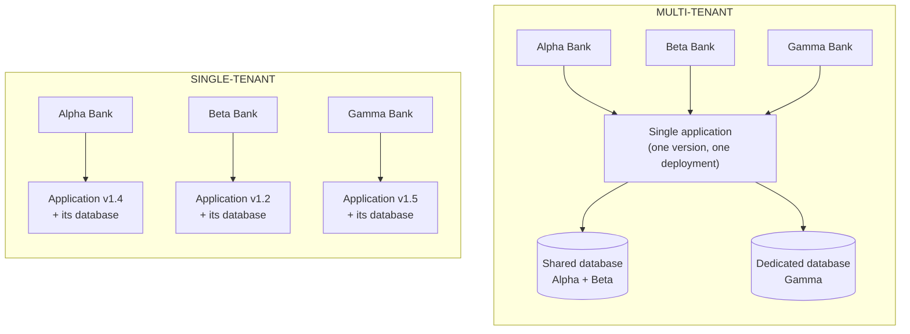
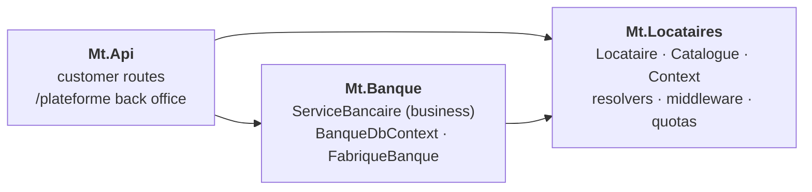
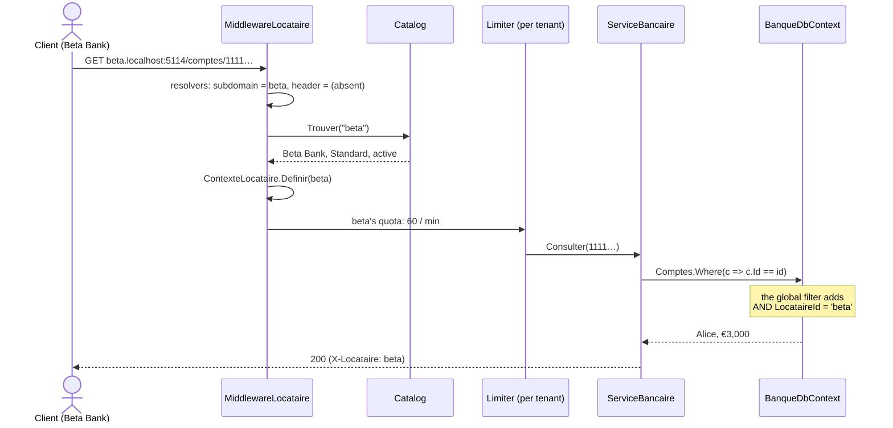
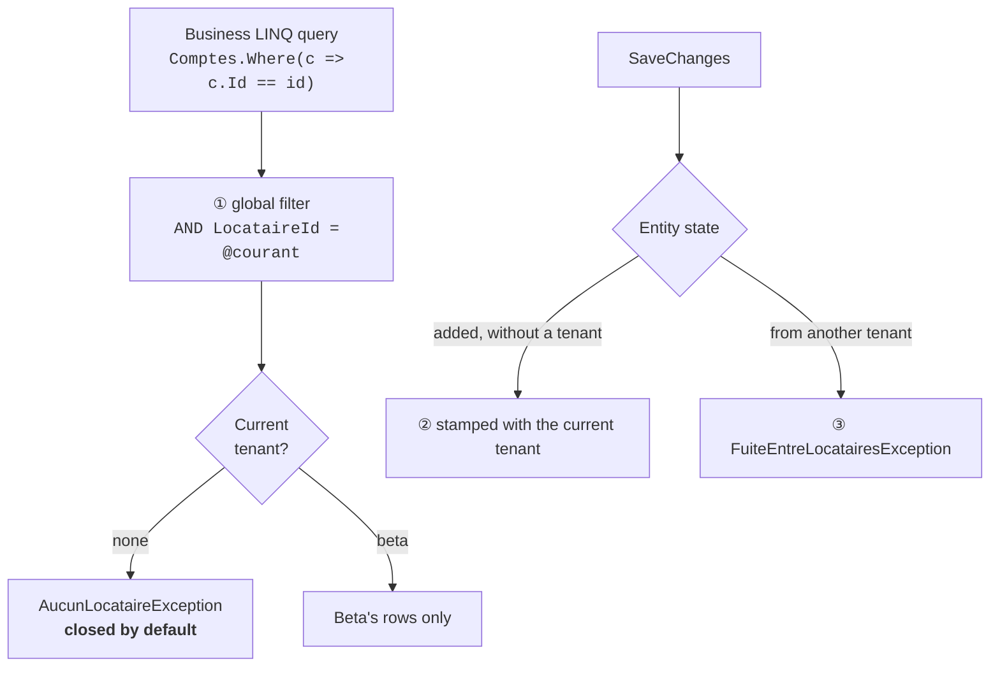
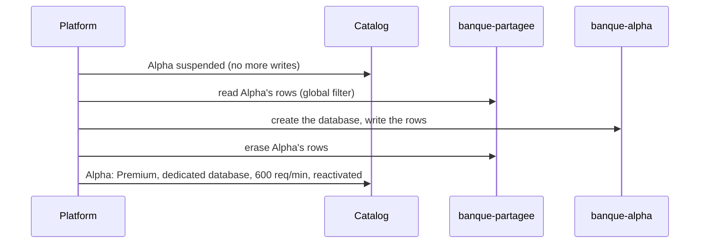

# 15. Multi-tenant (SaaS)

> **In one sentence**: a **single application**, a single deployment, serves **several customers** (the *tenants*);
> each one has its own data, rules and quotas, and none must ever see anyone else's.

📁 Code: [`15-MultiTenant`](../../15-MultiTenant) · ⬅️ [Orchestrated Saga](14-saga-orchestree.md) · ➡️ [BFF](16-bff.md) ·
🌐 [Français](../15-multi-tenant.md)

---

## The idea

Until now, each demo served **one** bank. A vendor selling its software to several banks has two options: install one
copy per customer (*single-tenant*), or run a single application for all of them (*multi-tenant*). (In the code:
*Locataire* = tenant, *Banque* = bank.)



| | Single-tenant (one installation per customer) | Multi-tenant |
|---|---|---|
| Update | N deployments, diverging versions | **one** deployment, everyone up to date |
| New customer | an installation to set up | one line in the catalog, **a few seconds** |
| Infrastructure cost | N times everything | pooled resources |
| Isolation | physical, natural | **to be built**: that is the whole subject of this demo |
| Demanding customer (performance, separate data) | natural | "dedicated database" plan, quotas |

The gain is economic and operational; the price is a **permanent risk**: a single badly filtered query, and one bank
sees another bank's accounts. All of the demo's code is there to make this mistake **impossible or noisy**.

---

## Where to store each customer's data?

| Model | Principle | Isolation | Cost per customer | In the demo |
|---|---|---|---|---|
| **Shared database** ("pool") | a `LocataireId` column in each table, a filter on every query | logical (the code) | almost zero | **Standard** plan (Alpha, Beta) |
| **Schema per tenant** | one database, one SQL schema per customer | intermediate | low | — (can't be simulated in memory) |
| **Dedicated database** ("silo") | one database (one connection string) per customer | physical | high | **Premium** plan (Gamma) |

Most SaaS products are **hybrid**, as here: the shared database for the many, a dedicated database for the customers who
pay for it (volume, regulatory requirements, separate backup and restore). The same code serves both, because a single
class knows the difference. ([FabriqueBanque.cs](../../15-MultiTenant/Mt.Banque/FabriqueBanque.cs))

```csharp
public static string NomBase(Locataire locataire) =>
    locataire.Isolation == Isolation.BaseDediee ? $"banque-{locataire.Id}" : BasePartagee;
```

---

## The projects



`Mt.Locataires` contains **no** banking logic: identifying the customer, knowing its plan, limiting its consumption —
it is the same code for any SaaS. `Mt.Banque` contains the business, written as if for a single bank.

---

## The path of a request



The code is quoted exactly as it is, French comments and messages included.

### 1. Identifying the tenant, once, before anything else

The tenant is recognized by the **subdomain** (`beta.localhost:5114`, the usual SaaS choice) or by the `X-Locataire`
header (handy between services). The middleware invents nothing: absent → 400, unknown → 404, suspended → 403, and
**contradictory → 400** (subdomain "alpha" and header "beta": no choice is made, the request is refused).
([MiddlewareLocataire.cs](../../15-MultiTenant/Mt.Locataires/MiddlewareLocataire.cs))

```csharp
if (identifiants.Count > 1)
{
    // Sous-domaine « alpha » et en-tête « beta » : on ne choisit pas, on refuse.
    await Refuser(http, StatusCodes.Status400BadRequest,
        "Locataire ambigu : " + string.Join(", ", trouves.Select(r => $"{r.Nom} = {r.Id}")));
    return;
}
// …
contexte.Definir(locataire);
```

> ⚠️ **In production**, a header is declarative: anyone can write `X-Locataire: gamma`. The tenant must come from the
> authenticated user's **token**, or be checked against it ("does this user belong to Gamma?"). The demo has no
> authentication, to stay focused on isolation.

### 2. The business never mentions the tenant

Not a single `where LocataireId = …` in the service. The tenant is only used there to read **its rules**: same code,
different parameters. The target is looked up in the current tenant only: a transfer to a customer of another bank on
the platform is impossible by construction (that would be an interbank transfer, another process).
([ServiceBancaire.cs](../../15-MultiTenant/Mt.Banque/ServiceBancaire.cs))

```csharp
// Même code pour toutes les banques, avec les paramètres de chacune.
if (montant > Regles.PlafondVirement)
    throw new RegleMetierException($"Plafond de virement de {Locataire.Nom} : {Regles.PlafondVirement:0.00} €.");

// La cible est cherchée chez le locataire courant seulement : un virement vers un client d'une autre banque
// de la plateforme est impossible par construction (ce serait un virement interbancaire, un autre processus).
var source = await Charger(sourceId);
var cible = await Charger(cibleId);
var frais = Regles.FraisVirement;
```

| Bank | Plan | Database | Transfer limit | Transfer fee | Monthly fee | Max accounts |
|---|---|---|---|---|---|---|
| Alpha | Standard | `banque-partagee` | €1,000 | — | €2 | 5 |
| Beta | Standard | `banque-partagee` | €5,000 | €0.50 | — | 5 |
| Gamma | Premium | `banque-gamma` | €50,000 | — | €10 | 1,000 |

The rules come from each bank's **contract**; the plan (Standard / Premium) only sets the isolation and the technical
quotas. When customers want different **behaviors**, and not just parameters, you move on to the extension points of
the [Microkernel](13-microkernel.md).

### 3. The safeguard: the DbContext

This is where isolation is won or lost. Three protections, applied automatically to every entity implementing
`IAppartientAUnLocataire`. The composite key lets two tenants have an account with the same identifier (here, Alice
and Bob exist everywhere) without conflict in the shared database.
([BanqueDbContext.cs](../../15-MultiTenant/Mt.Banque/BanqueDbContext.cs))

```csharp
private void Isoler<T>(ModelBuilder modele) where T : class, IAppartientAUnLocataire
{
    // Clé composite : deux locataires peuvent avoir un compte de même identifiant (ici, Alice et Bob existent partout)
    // sans conflit dans la base partagée.
    modele.Entity<T>().HasKey(nameof(IAppartientAUnLocataire.LocataireId), "Id");
    modele.Entity<T>().HasQueryFilter(e => e.LocataireId == LocataireCourant);
}
```



- **① Global filter**: `LocataireCourant` is a property of the DbContext. The EF model (and its filter) is built only
  once for the whole application, but EF rereads this property on **every** query: each DbContext filters on its own
  tenant.
- **Closed by default**: without a tenant, the query **fails** instead of returning every bank. The platform, which
  legitimately needs to see everything, has to write it explicitly (without `IgnoreQueryFilters()`, these queries would
  throw `AucunLocataireException`):

  ```csharp
  // Sans IgnoreQueryFilters(), ces requêtes lèveraient AucunLocataireException.
  var comptes = await db.Comptes.IgnoreQueryFilters().Select(c => c.LocataireId).ToListAsync();
  ```
- **② Stamping**: the business creates `new Compte(...)` without ever setting `LocataireId`.
- **③ Cross-tenant write**: an Alpha entity that mistakenly ended up in Beta's DbContext (shared cache, static
  variable…) makes `SaveChanges` fail. It is a bug, never a business case.
- **Composite key**: `(LocataireId, Id)`. Alice has the same `Guid` in all three banks without conflict; and one
  tenant's row cannot "overwrite" another's.

### 4. The noisy neighbor

All the banks share the same servers. If Alpha floods the API, the others must not slow down: rate limiting is done
**per tenant**, with its plan's quota (60 requests/min in Standard, 600 in Premium). The quota is part of the key: after
a plan change, a new partition is created with the new quota (otherwise the old, cached one would stay in force).
([Installation.cs](../../15-MultiTenant/Mt.Locataires/Installation.cs))

```csharp
// Le quota fait partie de la clé : après un changement de formule, une nouvelle partition
// est créée avec le nouveau quota (sinon l'ancienne, mise en cache, resterait en vigueur).
return RateLimitPartition.GetFixedWindowLimiter($"{locataire.Id}:{locataire.Quotas.RequetesParMinute}", _ =>
```

Hence the order of the middlewares in `Program.cs`: **first** know who is calling, **then** apply their quota.

```csharp
// L'ordre compte : d'abord savoir QUI appelle, ensuite appliquer SON quota.
app.UseLocataires("/plateforme");
app.UseRateLimiter();
```

---

## The platform back office

The `/plateforme/…` routes work **on** the tenants, not **for** one of them: they run without a tenant, and it is the
only code that handles several of them. ([Plateforme.cs](../../15-MultiTenant/Mt.Api/Plateforme.cs))

| Operation | Route | Shared database (Standard) | Dedicated database (Premium) |
|---|---|---|---|
| Customer arrival | `POST /plateforme/locataires` | nothing to create | create the database |
| Suspension (unpaid…) | `POST …/{id}/suspendre` | 403 on all its requests, data kept | same |
| Plan change | `POST …/{id}/formule` | copy its rows to the dedicated database, then erase them | the reverse |
| Departure (GDPR, end of contract) | `DELETE …/{id}` | delete **its** rows, table by table | delete **the database** |
| Inventory | `GET /plateforme/stockage` | rows per tenant, database by database | |

A customer's departure shows the value of the dedicated database: a simple `DROP DATABASE`, easy to prove. In the
shared database, no table must be forgotten.

### Changing plans: moving data



The old location is erased **only after** the copy has been saved, and the tenant is suspended during the operation:
no write can be lost between the two databases.

### A background job has no tenant

Outside an HTTP request, no middleware sets the tenant. The monthly fees job must do it itself, bank by bank, each in its
own injection scope (its DbContext, its rules):

```csharp
await using var scope = scopes.CreateAsyncScope();
scope.ServiceProvider.GetRequiredService<ContexteLocataire>().Definir(locataire);
var preleves = await scope.ServiceProvider.GetRequiredService<ServiceBancaire>().PreleverFraisMensuels(mois);
```

If it forgot, the DbContext would throw `AucunLocataireException`: better a job that crashes than a job that charges
Alpha's fees to Gamma's customers.

---

## The pitfalls of multi-tenancy

| Pitfall | Consequence | Countermeasure in the demo |
|---|---|---|
| Forgetting the filter in a query | one bank sees the others' accounts | **global** filter, on every entity, checked by an architecture test |
| Query without a tenant (job, script) | everything is returned | **closed by default**: `AucunLocataireException` |
| Identifiers unique per customer only | collision in the shared database | composite key `(LocataireId, Id)` |
| Trusting the header | impersonating another customer | in production: tenant taken from the token; here, contradictory values refused |
| Revealing that data exists | "this account exists at someone's" | 404, like a nonexistent account |
| Shared cache (`IMemoryCache`, Redis) | Alpha's response served to Beta | (not shown) prefix every key with the tenant |
| One customer consumes everything | the others slow down | **per-tenant** limiter, quotas per plan |
| Schema evolution | to be applied on **every** dedicated database | (not shown) migrations run tenant by tenant |

---

## The tests

| Test | What is checked |
|---|---|
| [IsolationTests.cs](../../15-MultiTenant/Mt.Tests/IsolationTests.cs) | |
| `Le_meme_identifiant_designe_un_compte_different_chez_chaque_locataire` | composite key, shared database |
| `Un_locataire_ne_voit_ni_ne_touche_les_comptes_d_un_autre` | cross-tenant read, list and withdrawal impossible |
| `Sans_locataire_une_requete_echoue_au_lieu_de_tout_renvoyer` | closed by default; explicit `IgnoreQueryFilters` |
| `Enregistrer_une_donnee_d_un_autre_locataire_est_refuse` | `FuiteEntreLocatairesException` |
| `Toute_donnee_d_un_locataire_est_filtree_et_porte_le_locataire_dans_sa_cle` | **architecture test**: every `IAppartientAUnLocataire` entity |
| `Les_regles_metier_sont_celles_du_locataire`, `Le_quota_de_comptes…`, `Les_frais_mensuels…` | per-customer rules, idempotency |
| [ApiTests.cs](../../15-MultiTenant/Mt.Tests/ApiTests.cs) | |
| `Une_requete_sans_locataire_clair_n_atteint_pas_le_metier` | absent, unknown, contradictory, consistent |
| `Un_voisin_bruyant_epuise_son_quota_sans_gener_les_autres` | Alpha's 61st request: 429; Beta: 200 |
| `Passer_en_premium_demenage_les_donnees_dans_une_base_dediee` | database migration, Premium quotas |
| `Le_depart_d_un_client_efface_ses_donnees_et_seulement_les_siennes` | offboarding in the shared database |
| `La_tache_de_frais_mensuels_travaille_locataire_par_locataire` | each bank's pricing, suspended one skipped, replay has no effect |

To make sure these tests really protect, you can remove the `HasQueryFilter` line from the DbContext: 11 tests fail.

---

## Summary

| 👍 Strengths | 👎 Limits |
|---|---|
| **One** deployment, **one** version for all customers | An isolation bug exposes **every** customer at once |
| A new customer in seconds, without installation | The "noisy neighbor": shared resources to throttle |
| Pooled costs; dedicated database reserved for those who pay | Schema migrations and backups to run on N dedicated databases |
| The business is still written for a single customer | Every request, job, cache, log must carry the tenant |

**When to use it**: as soon as you sell **the same software to several organizations** (B2B SaaS). Start with the
shared database and a global filter, and offer the dedicated database to the customers who need it. In production: the
tenant comes from authentication, the catalog is a separate database; **Finbuckle.MultiTenant** provides resolvers,
context and EF Core integration; on the database side, SQL Server's or PostgreSQL's *Row-Level Security* adds a second
barrier, below the application.
