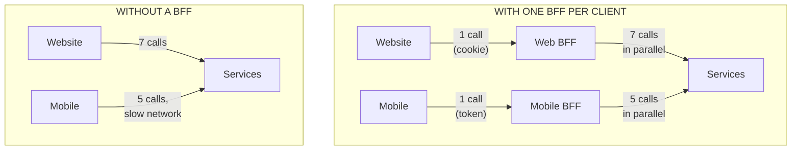
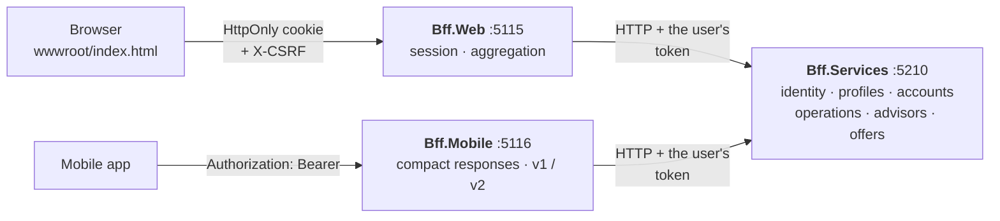
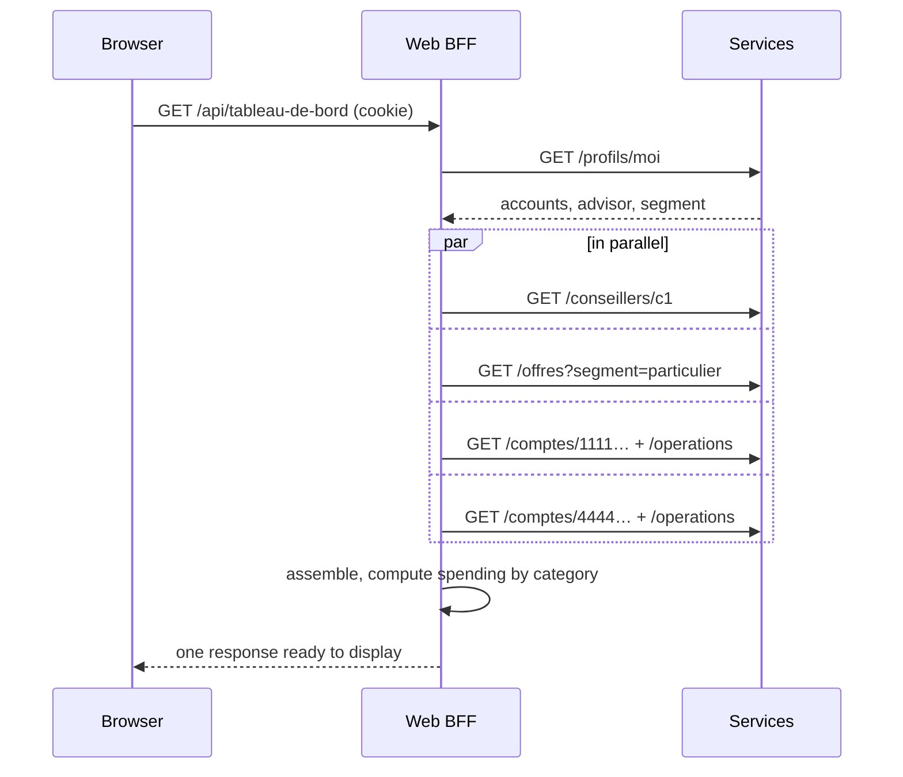
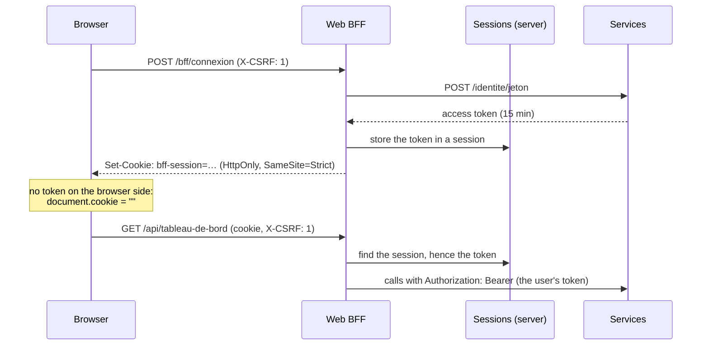

# 16. Backend for Frontend (BFF)

> **In one sentence**: each client application (website, mobile app…) has **its own backend**, written by its team,
> which assembles the generic services into responses tailored to its screens, and handles security its own way.

📁 Code: [`16-BFF`](../../16-BFF) · ⬅️ [Multi-tenant](15-multi-tenant.md) · ➡️ [Cell-Based Architecture](17-cell-based.md) ·
🌐 [Français](../16-bff.md)

---

## The idea

Business services are **generic**: a profile, an account, a list of operations, each at its own address, with all its
fields. That is what they need to be reusable, but no screen uses them as they are.



Without a BFF, two bad options:
- each application **chains the calls** and assembles everything itself: slow on mobile (every round trip costs),
  assembly code duplicated in each client, and an access token to handle in the browser;
- the services add routes **for each screen** (`/comptes/resume-pour-mobile`…): they become hostage to every interface,
  and each screen change requires modifying, testing and deploying a shared service.

The BFF (born at SoundCloud, popularized by Sam Newman) moves this adaptation into a component **owned by the screen's
team**: it evolves at that team's pace, without negotiating with the service teams.

---

## The projects



The two BFFs don't reference each other, nor the services: they only know them over HTTP. The contracts are **copied**
into each BFF, with only the fields its screens need (tolerant reader). A test checks it. The comment says so: a
deliberate copy, not a project shared with the web BFF, because each BFF belongs to the team of ITS application.
([ClientServices.cs](../../16-BFF/Bff.Mobile/ClientServices.cs))

```csharp
// Deliberate copy, and not a project shared with the web BFF: each BFF belongs to the team of ITS application
// and evolves at its own pace. Only the fields useful to the mobile application are read.
```

The code is quoted exactly as it is, French comments included.

---

## 1. Aggregating: one screen, one request

The website's dashboard shows the customer, their advisor, their accounts with the latest operations, their spending by
category and offers. It takes seven calls to the services; the browser makes only one. ① The profile first (it tells
which accounts to show, which advisor, which offer segment); ② then everything else IN PARALLEL: the total duration is
that of the slowest call, not the sum.
([TableauDeBord.cs](../../16-BFF/Bff.Web/TableauDeBord.cs))

```csharp
// ① The profile first: it says which accounts to display, which advisor, which offer segment.
var profile = await services.Profile(token);

// ② Then all the rest IN PARALLEL: the total duration is that of the slowest call, not the sum.
var advisor = services.Advisor(profile.AdvisorId, token);
var offers = Optional(cancellation => services.Offers(profile.Segment, token, cancellation), OffersBudget);
var accounts = profile.Accounts.Select(id => AccountWithOperations(id, token)).ToList();
Task[] calls = [advisor, offers, .. accounts];
await Task.WhenAll(calls);
```



Measured on the running demo (120 ms of simulated latency per call):

| Response header | Value | Meaning |
|---|---|---|
| `X-Appels-Aval` | 7 | calls to the services for one browser request |
| `X-Duree-Aval-Cumulee-Ms` | ≈ 900 | what those calls would have cost **chained** |
| `X-Duree-Totale-Ms` | ≈ 300 | the actual response: two "waves" of calls |

Calls from the BFF to the services go over the data center network, fast and reliable; the phone's calls go over the
mobile network. Replacing five mobile round trips with a single one is often the first visible gain.

---

## 2. One response per screen

The same need ("the home screen") gives two very different responses.

| | Web BFF: `/api/tableau-de-bord` | Mobile BFF: `/mobile/v1/accueil` |
|---|---|---|
| Contents | customer, advisor, accounts with IBAN, 10 operations per account, spending by category, offers | first name, total balance, balances, 3 latest operations |
| Labels | raw ("CB CARREFOUR 0910 PARIS 15") | shortened ("Carrefour") |
| Size (demo) | ≈ 2.8 KB | ≈ 0.4 KB |
| Null fields | present | omitted |
| Long list | 10 latest operations | pages of 10, **opaque cursor** |

Pagination clearly shows the adapter role: the services paginate by `page` and `taille` (size), the app only knows a
cursor. The BFF can change strategy without updating the app.
([Ecrans.cs](../../16-BFF/Bff.Mobile/Ecrans.cs))

```csharp
var page = ReadPage(cursor);
var result = await services.Operations(account, page, PageSize, token);
var next = page * PageSize < result.Total ? Cursor(page + 1) : null;
return new MobilePage(result.Operations.Select(View).ToList(), next);
```

### App versions

A web application updates on every deployment; a mobile app, whenever the user feels like it. Several versions
therefore live at the same time. Version 2 of the app shows an offer banner: the BFF exposes `/mobile/v2/accueil`, and
keeps serving `/mobile/v1/accueil` to phones not yet updated. **The services didn't change.**

```csharp
var offer = version >= 2 ? Optional(c => services.Offers(profile.Segment, token, c), OfferBudget) : Task.FromResult<DownstreamOffer[]?>(null);
```

---

## 3. Security: the token stays on the server

It is today the most cited reason for putting a BFF in front of a single-page web application. The IETF
recommendations (*OAuth 2.0 for Browser-Based Apps*) describe it as the safest option: an access token stored in the
browser (`localStorage`, JavaScript memory) can be stolen by any injected script (XSS).



The comments: unreadable from JavaScript (an XSS flaw cannot steal it); never sent from another site; in production,
`Always` and the `__Host-` prefix.
([Session.cs](../../16-BFF/Bff.Web/Session.cs))

```csharp
o.Cookie.HttpOnly = true;                                 // unreadable from JavaScript: an XSS flaw cannot steal it
o.Cookie.SameSite = SameSiteMode.Strict;                  // never sent from another site
o.Cookie.SecurePolicy = CookieSecurePolicy.SameAsRequest; // in production: Always, and the "__Host-" prefix
```

- **Server-side session** (`SessionsEnMemoire`, an `ITicketStore`): the cookie only contains an encrypted key. Logging
  out deletes the session: a cookie copied earlier no longer gives access to anything (test
  `Apres_deconnexion_un_cookie_vole_ne_vaut_plus_rien`). Without this store, ASP.NET Core would put the whole ticket
  (token included) in the encrypted cookie, valid until it expires even after logout.
- **CSRF**: since the browser sends the cookie automatically, another site could trigger a request. Two barriers:
  `SameSite=Strict`, and the mandatory `X-CSRF: 1` header, which a form cannot add and which a script from another
  origin can only send after a CORS preflight request, which the BFF refuses.
- **Same origin**: the BFF serves the application itself (`wwwroot`). No CORS to configure, and the cookie stays
  "first-party".
- **No special privileges**: the BFF calls the services with the user's token, never with an all-powerful technical
  identity. The services check themselves that the account belongs to the user; going through the BFF doesn't let
  Alice debit Bob.

Mobile doesn't have this problem in the same way: a native app keeps its token in the system's secure storage
(Keychain, Keystore), out of reach of web pages. Its BFF simply forwards it. That is another reason to have **one BFF per
type of client**: security is not the same.

---

## 4. Degrade rather than fail

A screen that aggregates seven calls has seven chances to fail. The BFF distinguishes the **essential** (profile,
accounts) from the **optional** (offers): an optional call has a time budget, and its failure is absorbed.

```csharp
private static async Task<T?> Optional<T>(Func<CancellationToken, Task<T>> call, TimeSpan budget) where T : class
{
    using var timeout = new CancellationTokenSource(budget);
    try
    {
        return await call(timeout.Token);
    }
    catch (Exception e) when (e is DownstreamServiceException or HttpRequestException or OperationCanceledException)
    {
        return null;
    }
}
```

With `PUT /chaos {"offresEnPanne": true}` on the services, the dashboard still answers 200, with `"offres": null` and
`"degrade": ["offres"]`; the page shows a "partial display" banner. The time budget keeps a **slow** (rather than
down) service from slowing the whole page.

---

## BFF, API gateway, GraphQL

| | API gateway (demo 8) | BFF | GraphQL |
|---|---|---|---|
| How many? | one, for all clients | **one per type of client** | one schema for all |
| Role | routing, security, quotas, cross-cutting | adapting the services to **one** client | the client describes what it wants |
| Who writes it? | the platform team | the client application's team | the API team (schema), the client (queries) |
| Contains… | no screen-specific logic | aggregation, formatting, session, versions | per-field resolvers |

They combine: a gateway at the entrance, BFFs behind it, and a BFF can perfectly well expose GraphQL to its application.

---

## The tests

The three processes run in memory; the BFFs call the **real** test services, with adjustable latency.
([Systeme.cs](../../16-BFF/Bff.Tests/Systeme.cs))

| Test | What is checked |
|---|---|
| `La_connexion_pose_un_cookie_HttpOnly_et_ne_renvoie_aucun_jeton` | `HttpOnly`, `SameSite=Strict`, no token in the response |
| `Apres_deconnexion_un_cookie_vole_ne_vaut_plus_rien` | session deleted on the server |
| `Sans_en_tete_anti_CSRF_une_requete_est_refusee_meme_avec_une_session` | CSRF protection |
| `Le_tableau_de_bord_agrege_sept_appels_faits_en_parallele` | 7 calls, duration < 4 latencies (chained: 7) |
| `Une_panne_des_offres_degrade…`, `Un_service_trop_lent_est_abandonne…` | degradation, time budget |
| `Un_virement_passe_par_la_session_et_les_droits_de_l_utilisateur` | the user's token, 403 on Bob's account |
| `L_accueil_mobile_tient_en_une_requete_et_une_reponse_compacte` | 5 calls, no IBAN, short labels, 5 times lighter |
| `La_v2_ajoute_un_bandeau_d_offre_sans_changer_la_v1`, `Le_curseur_parcourt…` | versions, pagination |
| `Chaque_BFF_ne_connait_les_services_et_l_autre_BFF_que_par_HTTP` | **architecture test**: no code references |

The security and parallelism tests were checked by mutation: chained calls, a cookie without `HttpOnly` or sessions
kept in the cookie each make the corresponding test fail.

---

## Summary

| 👍 Strengths | 👎 Limits |
|---|---|
| Each application gets **exactly** what it displays, in one request | One more component to deploy and operate **per application** |
| The screen's team moves without waiting for the service teams | Duplication between BFFs (contracts, calls): it is intended, but must be accepted |
| The token never goes to the browser; revocable sessions | Sessions to share between instances (distributed cache) |
| Versions and degradations handled in one place | Temptation to put **business rules** in it: they must stay in the services |

**When to use it**: several client applications with different needs on the same services, a single-page web
application that must not handle tokens, or screens that need many calls. For a single application served by a single
backend, that backend **already is** its BFF. In production: **Duende BFF** (sessions, CSRF, forwarding to the APIs),
**YARP** to forward routes without aggregation, and OpenID Connect for sign-in.
