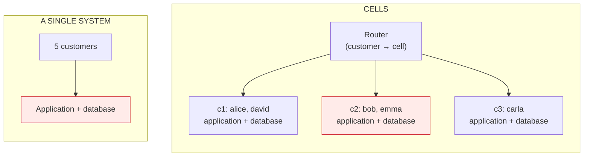
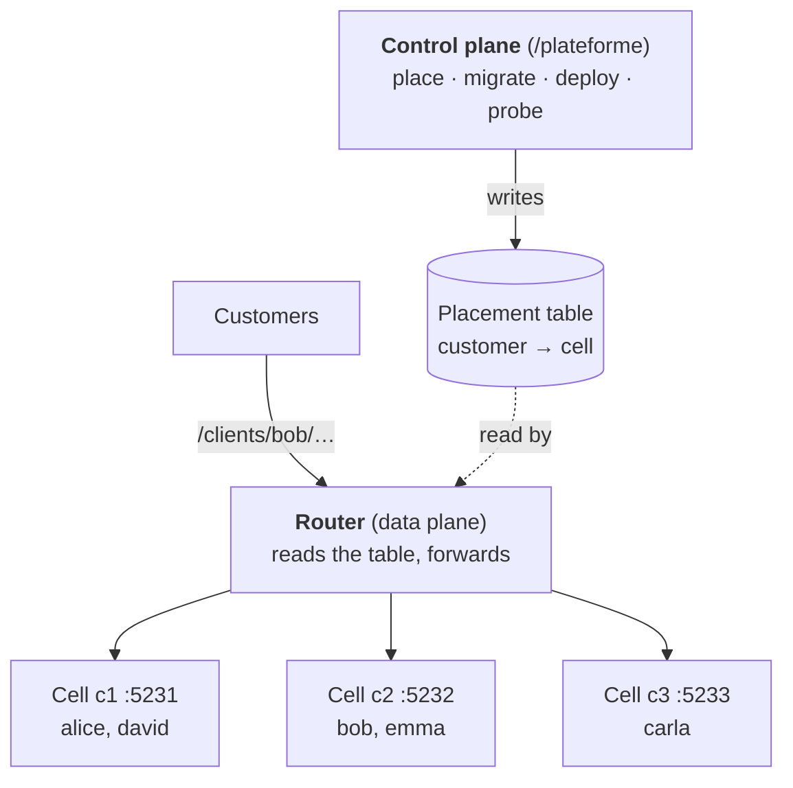
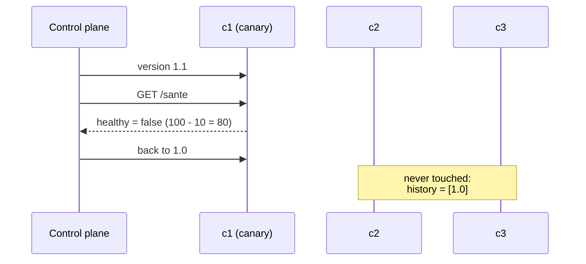
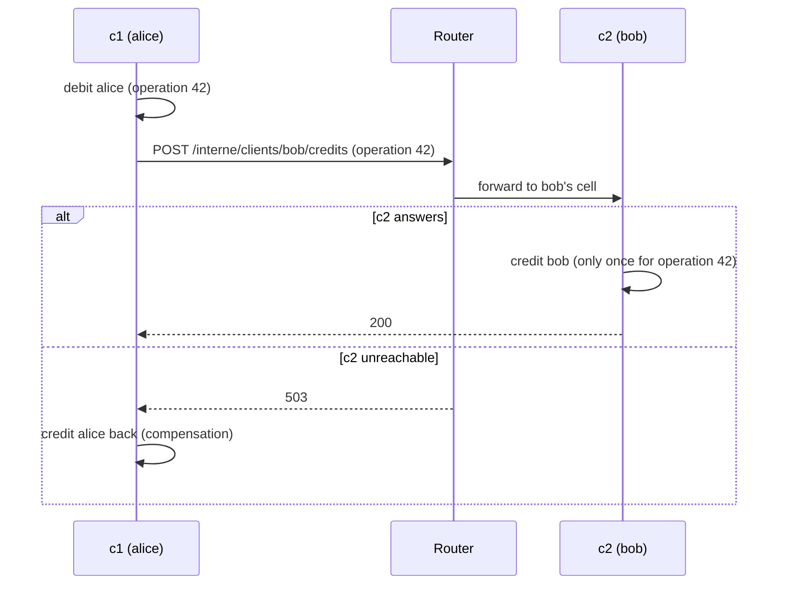

# 17. Cell-Based Architecture

**French name**: *Architecture cellulaire*

> **In one sentence**: instead of a single system that keeps growing, you run **several complete, independent copies**
> of the application, the *cells*, each for part of the customers; a failure, a bad deployment or a greedy customer
> stays **locked inside its cell**.

📁 Code: [`17-CellBased`](../../17-CellBased) · ⬅️ [BFF](16-bff.md) · ➡️ [Actor Model](18-modele-acteurs.md) ·
🌐 [Français](../17-cell-based.md)

---

## The idea: bounding the blast radius

All the previous demos, even the microservices, have one thing in common: **a single copy** of each component serves all
the customers. A saturated database, a wrong configuration or a deployed bug therefore hits everyone. You can replicate
to survive machine failures, but not "logical" failures: all the replicas make the same mistake. (In the code:
*Cellule* = cell, *Routeur* = router, *Lanceur* = launcher.)



On the left, a failure hits **5 customers out of 5**. On the right, a failure of c2 hits **2 out of 5** (bob and emma),
and cells are often far more numerous: with 50 cells, an incident only reaches 2% of the customers.

Each cell contains **everything**: the API, the rules, the data. It doesn't depend on the other cells to serve its
customers. That is what sets it apart from the other ways of splitting:

| | Splits… | A failure hits… |
|---|---|---|
| [Microservices](08-microservices.md) | by **function** (accounts, transfers…) | one function, for **all** customers |
| [Multi-tenant](15-multi-tenant.md) | nothing: one instance **shared** between customers | potentially all customers |
| **Cells** | by **group of customers**, each group having all the functions | all the functions, for **one group** of customers |

They combine: a cell can contain microservices, and it is usually multi-tenant inside.

---

## The components



- **The cells** ([Cell.Cellule](../../17-CellBased/Cell.Cellule)): a single program, run several times with a different
  identifier. Each one only has its own customers' data.
- **The router** (data plane, [Relais.cs](../../17-CellBased/Cell.Routeur/Relais.cs)): read the **partition key** (here
  the customer, in the URL), find its cell, forward. It is the **only shared component**: it must be as simple as
  possible, with no business logic and no database, so that it never becomes the global outage itself.
- **The control plane** ([PlanDeControle.cs](../../17-CellBased/Cell.Routeur/PlanDeControle.cs)): it decides (place,
  add a cell, migrate, deploy) and writes the placement table; to migrate, deploy or probe, it also talks directly to
  the cells (`/interne` and `/admin` APIs). It is **off the request path**: if it goes down, you can no longer place or
  deploy, but traffic continues. In the demo, it lives in the same process as the router for simplicity; in production,
  it is a separate service.

```csharp
if (placement.CellOf(customer) is not { } id || registry.Find(id) is not { } cell)
    return Results.NotFound(new { error = $"Unknown customer \"{customer}\"." });
```

(The code is quoted exactly as it is, French comments and messages included.)

---

## 1. Blast radius

Observed on the running demo, after **stopping the process** of cell c2:

| Customer | Cell | Response |
|---|---|---|
| alice | c1 | 200 |
| bob | c2 | **503** "Cellule c2 injoignable : seuls ses clients sont touchés." |
| carla | c3 | 200 |
| david | c1 | 200 |
| emma | c2 | **503** |

The comment in the router: blast radius, only the customers of THIS cell receive this error.

```csharp
catch (HttpRequestException)
{
    // Blast radius: only the customers of THIS cell get this error.
```

---

## 2. Growing by adding cells

A cell has a **maximum capacity** (here 3 customers; in reality, what the load tests validated). When all are full, you
don't grow a cell: you **add** one. All cells therefore have a known, tested size, and the system grows without hitting
an unknown limit ("we don't know how a database 3 times bigger than anything we have tested behaves").
The new customer goes into the least loaded open cell that still has room:

```csharp
/// <summary>The least loaded open cell that still has room.</summary>
public CellInfo? ChooseCell() => registry.All()
    .Where(c => c.Open && placement.Count(c.Id) < c.Capacity)
    .OrderBy(c => placement.Count(c.Id)).ThenBy(c => c.Id)
    .FirstOrDefault();
```

Walkthrough in the demo: 9 slots for 5 customers; 4 new customers fill the three cells; the next one gets 503 "Toutes
les cellules sont pleines : provisionner une nouvelle cellule" (all cells are full: provision a new one); you start c4
(`dotnet run --project Cell.Lanceur -- c4`), register it (`POST /plateforme/cellules`), and the next customer is placed
there. A cell can also be **closed** to new customers (`POST /plateforme/cellules/c1/fermer`) while still serving its own.

---

## 3. Deploying in waves

All cells run the same code, but not necessarily **the same version at the same time**. A deployment moves cell by
cell: first **one** cell (the *canary*), then the next ones, checking health after each wave. At the first warning sign,
you roll back and stop.



Version 1.1 contains a bug (a withdrawal debited twice) that only shows up at runtime. Each cell's **health probe**
replays a control withdrawal ([Version.cs](../../17-CellBased/Cell.Cellule/Version.cs)):

```csharp
public (bool Healthy, string Detail) Probe()
{
    var result = Withdraw(100m, 10m);
    return result == 90m
        ? (true, "check withdrawal correct")
        : (false, $"check withdrawal incorrect: 100 - 10 = {result}");
}
```

Actual result of `POST /plateforme/deploiements {"version":"1.1"}`:

```json
{"version":"1.1","status":"Cancelled","waves":[{"wave":1,"cells":["c1"],
 "result":"rollback: c1: check withdrawal incorrect: 100 - 10 = 80"}]}
```

During the few moments when c1 ran version 1.1, its customers (alice, david) may have suffered the bug: that is the
**bounded** price of the canary. With an all-at-once deployment, every customer would have suffered it. An unreachable
or sick cell in a wave also stops the deployment; the previous, healthy waves are kept.

---

## 4. Moving a customer

A customer grows, a cell must be emptied, the load is badly spread: the control plane **migrates** the customer.
① no more writes during the copy, ② copy, ③ switch the routing, ④ clean up.

```csharp
placement.StartMigration(customerId);   // ① no more writes during the copy
try
{
    var export = await Client(source).GetFromJsonAsync<CustomerExport>(Url(source, $"/internal/customers/{customerId}/export"));
    await Check(await Client(target).PostAsJsonAsync(Url(target, "/internal/customers"), export), target);   // ② copy
    placement.Place(customerId, target.Id);                                                                 // ③ switch the routing
    await Client(source).DeleteAsync(Url(source, $"/internal/customers/{customerId}"));                       // ④ clean up
```

During the copy, the router answers `503` with `Retry-After: 2` for **this** customer only. The identifiers of already
processed operations travel with the customer's data: a credit replayed after the migration is not applied twice (test
`Les_operations_deja_traitees_suivent_le_client_dans_sa_nouvelle_cellule`).

---

## 5. The price: what crosses cells

As long as both customers of a transfer are in the same cell, it is a local transaction. Otherwise, there is no shared
transaction anymore: the source cell debits, then asks the target cell for the credit **through the router** (it doesn't
know the other cells), with an operation identifier for idempotency, and **compensates** if the target doesn't answer.



Hence the most important decision of this architecture: **the partition key**. It must keep the vast majority of
operations within a single cell (a customer and their accounts, a company and its employees, a shop and its orders).
If exchanges between cells become frequent, you have rebuilt a fragile distributed system, with the drawbacks of both
cells and microservices.

---

## The tests

The four cells and the router run in memory, connected through their test servers
([Systeme.cs](../../17-CellBased/Cell.Tests/Systeme.cs)).

| Test | What is checked |
|---|---|
| `Les_clients_de_demo_sont_repartis_entre_les_cellules` | initial placement |
| `Le_routeur_envoie_chaque_client_vers_sa_cellule`, `Une_cellule_ne_contient_que_ses_clients` | routing, partitioning |
| `Une_panne_de_cellule_ne_touche_que_ses_clients` | blast radius: 2 customers out of 5 |
| `Un_virement_dans_une_meme_cellule_reste_local` | local transaction |
| `Un_virement_entre_cellules_passe_par_le_routeur_et_ne_credite_qu_une_fois` | idempotent credit |
| `Si_la_cellule_du_beneficiaire_est_en_panne_le_virement_est_compense` | compensation |
| `Quand_les_cellules_sont_pleines_on_en_ajoute_une_au_lieu_de_les_agrandir` | capacity, registration of c4 |
| `Migrer_un_client…`, `Les_operations_deja_traitees_suivent…` | migration, idempotency preserved |
| `Un_deploiement_defectueux_s_arrete_a_la_cellule_canari` | canary, rollback, version history |
| `Un_deploiement_sain_passe_vague_par_vague`, `Une_cellule_malade_arrete_le_deploiement_a_sa_vague` | waves |
| `Le_routeur_et_les_cellules_ne_partagent_aucun_code` | **architecture test** |

Checked by mutation: a single-wave deployment, removing idempotency, compensation, or the processed operations from the
export each make the corresponding tests fail.

---

## Summary

| 👍 Strengths | 👎 Limits |
|---|---|
| **Bounded blast radius**: failure, bug, greedy customer stay in one cell | N copies of the infrastructure: cost, and tooling to operate them |
| Grow by adding cells of known size, with no unknown limit | Cross-cell operations are slow, rare, to be compensated |
| Natural progressive deployments (canary = one cell) | Choosing the partition key commits you for a long time |
| A cell is load-tested once and for all | Customer migrations, rebalancing, a router to make highly available |

**When to use it**: at large scale, when a global outage costs more than duplication (large SaaS products, payment
platforms, messaging), and when a natural partition key exists. For most systems, several availability zones and
progressive deployments are enough. To go further: AWS's guide *Reducing the Scope of Impact with Cell-Based
Architecture*, and Slack's write-ups on its migration to cells.
