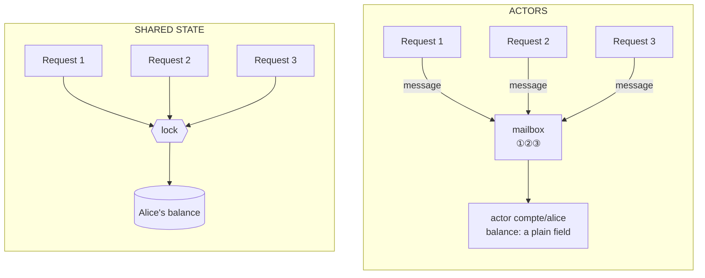
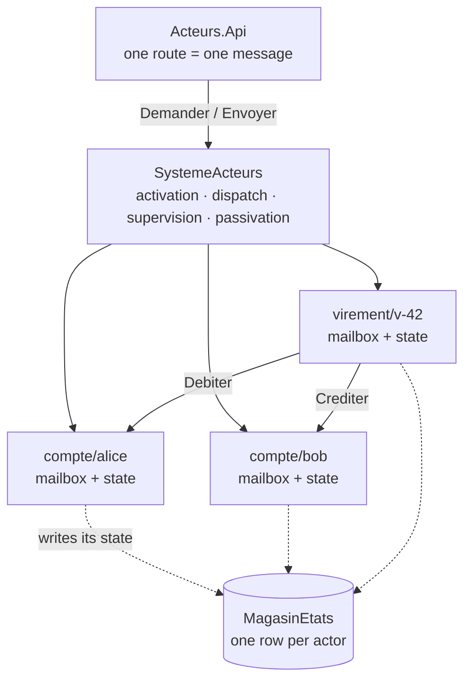
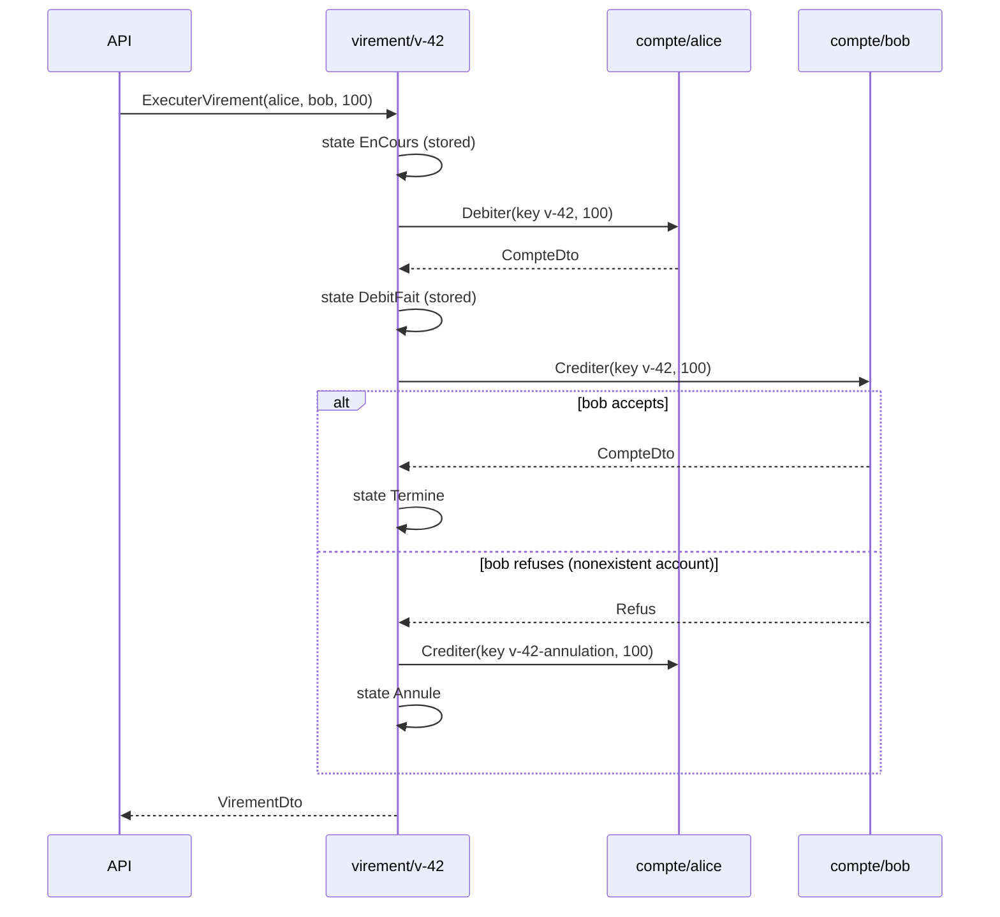
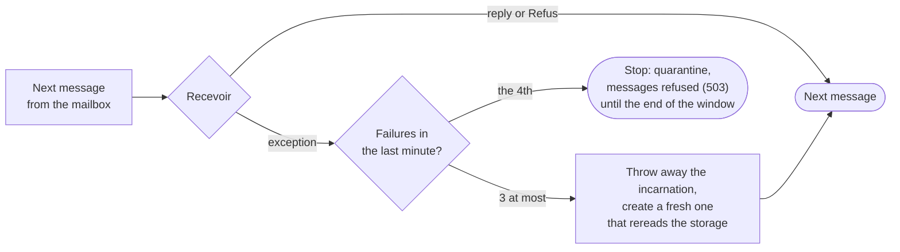

# 18. Actor Model

**French name**: *Modèle d'acteurs*

> **In one sentence**: the system is made of thousands of small objects, the *actors*, each with **its own state**,
> **sharing nothing** and communicating only **through messages**, handled **one at a time**; concurrency no longer
> needs any lock, and a failure is repaired by **replacing** the faulty actor.

📁 Code: [`18-ModeleActeurs`](../../18-ModeleActeurs) · ⬅️ [Cell-Based Architecture](17-cell-based.md) · ➡️ [Space-Based Architecture](19-space-based.md) ·
🌐 [Français](../18-modele-acteurs.md)

---

## The idea: no more shared state

In all the previous demos, the state is **shared**: several simultaneous requests read and modify the same accounts,
and it is the database (transactions, locks, concurrency control) that keeps them from stepping on each other. The actor
model (Carl Hewitt, 1973; popularized by Erlang) takes the problem the other way around: **each piece of data has a
single owner**, and you only talk to it by dropping a message into its mailbox. (In the code: *Acteur* = actor,
*Noyau* = core/runtime, *boîte aux lettres* = mailbox.)



On the left, safety depends on **every** piece of code that touches the balance: one forgotten lock, and updates are
lost. On the right, it is **structural**: only the actor touches its field, and it handles only one message at a time.
Its messages pile up in its mailbox, but **different** actors work in parallel, on all cores.

Three rules define an actor. In response to a message, it can:

1. **change its own state** (and only its own);
2. **send messages** to other actors whose address it knows;
3. **create** other actors (here they are *virtual*: you address them, the runtime creates them).

| | State sharing | A failure… |
|---|---|---|
| Demos 00 to 17 | shared data, protected by the database (transactions) | rolls back the transaction; the process continues |
| **Actors** | **nothing**: each state has a single owner | **replaces the faulty actor**, which reloads its durable state |

---

## The components



- **The runtime** ([Acteurs.Noyau](../../18-ModeleActeurs/Acteurs.Noyau), ≈ 300 lines written for the demo, no package):
  - [`Acteur`](../../18-ModeleActeurs/Acteurs.Noyau/Acteur.cs): the base class, with `Demarrer` (reload the state),
    `Recevoir` (handle a message) and `Arreter` (stop);
  - [`ReferenceActeur`](../../18-ModeleActeurs/Acteurs.Noyau/ReferenceActeur.cs): an actor's **address**
    (`compte/1111…`), never the object itself; you `Envoyer` (send) it a message (*tell*, no reply) or `Demander` (ask)
    it (*ask*, with a reply and a timeout);
  - [`SystemeActeurs`](../../18-ModeleActeurs/Acteurs.Noyau/SystemeActeurs.cs): one mailbox
    (`System.Threading.Channels`) and one loop per active actor, supervision, passivation.
- **The business** ([Acteurs.Banque](../../18-ModeleActeurs/Acteurs.Banque)): [`CompteActeur`](../../18-ModeleActeurs/Acteurs.Banque/CompteActeur.cs)
  (one per account), [`VirementActeur`](../../18-ModeleActeurs/Acteurs.Banque/VirementActeur.cs) (one per transfer),
  immutable [messages](../../18-ModeleActeurs/Acteurs.Banque/Messages.cs) (`record`), durable storage and a failure injector.
- **The API** ([Endpoints.cs](../../18-ModeleActeurs/Acteurs.Api/Endpoints.cs)) neither reads nor writes any state:
  each route sends **one** message to **one** actor and translates its reply into an HTTP status code.

```csharp
app.MapPost("/accounts/{id:guid}/withdrawal", async (Guid id, AmountRequest r, ActorSystem system) =>
    Http(await system.Account(id).Ask(new Withdraw(r.Amount))));
```

In production, you don't write this runtime: **Orleans** (Microsoft, *virtual* actors, the model followed here),
**Akka.NET** (a port of Akka, Erlang-style supervision hierarchies) or **Proto.Actor** do the same thing, **spread over
several machines**: the address `compte/alice` stays the same, whether the actor lives on server 1 or 7.

---

The code is quoted exactly as it is, French comments and messages included.

## 1. One message at a time: concurrency without locks

The whole model fits in this loop: a single reader per mailbox, which **waits for the end** of each message before
taking the next one — "THE key point of the model", as the comment says
([SystemeActeurs.cs](../../18-ModeleActeurs/Acteurs.Noyau/SystemeActeurs.cs)).

```csharp
await foreach (var envelope in activation.Mailbox.Reader.ReadAllAsync())
{
    ...
        // THE key point of the model: only one message at a time, each handled to the end before the next one.
        response = await activation.Instance!.Receive(envelope.Message);
```

The account can then write the most naive code there is: read the balance, check, modify. No `lock`, no transaction,
no optimistic version ([CompteActeur.cs](../../18-ModeleActeurs/Acteurs.Banque/CompteActeur.cs)):

```csharp
if (debit && amount > state.Balance)
    return new Refusal($"Insufficient balance ({state.Balance:0.00} €).");

var signed = debit ? -amount : amount;
state.Balance += signed;
```

**Real run**: 1,000 €3 withdrawals fired **at the same time** on Alice's account (€1,000):

```json
POST /demo/simultaneous-withdrawals  { "account": "1111…", "count": 1000, "amount": 3 }
{ "balanceBefore": 1000, "requests": 1000, "accepted": 333, "refused": 667, "finalBalance": 1, "minimumObservedBalance": 1, "durationMs": 231 }
```

Exactly 333 withdrawals accepted (333 × 3 = €999), none twice, never a negative balance. The same code without an actor,
called by 1,000 threads, would lose updates.

A business refusal (insufficient balance) is a **reply** like any other (`Refus`), not an exception: the actor carries
on. Exceptions are reserved for **failures** (see § 3).

---

## 2. Converse rather than lock: the transfer

A transfer touches two accounts, so two actors with separate states: there is **no shared transaction**. A third actor,
`virement/{id}`, leads the conversation and records where it stands, like the [saga](14-saga-orchestree.md)'s
orchestrator, but at the scale of a single transfer.



Three properties follow from the model, with no dedicated code:

- **No deadlock.** The accounts never ask anyone for anything; only the transfer waits for their replies. With locks,
  simultaneous A→B and B→A deadlock unless you always lock in the same order. Real run: 500 transfers in each
  direction, at the same time.

  ```json
  POST /demo/crossed-transfers  { "count": 500, "amount": 1 }
  { "transfers": 1000, "completed": 572, "refused": 428, "totalBefore": 501, "totalAfter": 501, "durationMs": 518 }
  ```

  (Alice only had €1 left after the previous run, hence the refusals; the total, however, is preserved.)
- **Identity provides idempotency.** Replaying `virement/facture-42` wakes up the **same** actor, which already knows the
  answer; a finished transfer (done, refused or cancelled) never starts again — the comment: already finished, same
  reply, no effect:

  ```csharp
  if (_state is { Status: TransferStatus.Completed or TransferStatus.Refused or TransferStatus.Cancelled })
      return View();  // already finished: same response, no effect
  ```

- **Recovery without a double debit.** If the transfer crashes after the debit, its stored state says `DebitFait`:
  replayed, it skips the debit and resumes at the credit. And even if redone, the debit carries the key
  `virement-v-42`, which the account recognizes:

  ```csharp
  if (key is not null && state.Operations.Any(o => o.Key == key))
      return View();
  ```

⚠ The model's trap: an actor that **waits** for a reply handles nothing else meanwhile. If account A asked account B
for something while B asked A for something, they would wait for each other (until the request's timeout). Hence the
rule followed here: **requests go in one direction only** (transfer → accounts), never in a cycle; when an actor doesn't
need the reply, it `Envoyer`s without waiting.

---

## 3. "Let it crash": supervision

Rather than anticipating every error in the business code, you let the actor crash and its **supervisor** **replaces**
it: the faulty incarnation, with a possibly inconsistent in-memory state, is thrown away; a fresh one reloads the last
**written** state and picks up the following messages, which were waiting in the mailbox.



```csharp
if (activation.Failures.Count > strategy.MaxRestarts)
{
    await StopActivation(activation, $"{activation.Failures.Count} failures in {strategy.Window.TotalSeconds:0} s ({failure.Message})");
    return false;
}

await Deincarnate(activation);
if (!await Incarnate(activation))
```

The most telling case: a failure **at the worst moment**, after the balance was changed in memory but before it was
written (`Etape.AvantSauvegarde`, armed with `POST /systeme/pannes`). Real run (the API's messages, in French):

```text
POST /comptes/1111…/retrait { "montant": 1 }  → 500 « compte/1111… a planté en traitant ce message : panne simulée (AvantSauvegarde) »
GET  /comptes/1111…                           → 200, solde inchangé : le retrait n'a pas eu lieu
GET  /comptes/2222… (piégé 4 fois)            → 500 500 500 500 503
```

No half-modified balance, no cleanup code: the new incarnation starts again from the durable state. Beyond 3 restarts
per minute, restarting is pointless: the actor is **stopped** and its messages refused (`503`) until the end of the
window. The other actors notice nothing (Alice answers while Bob is in quarantine).

A failure **propagates along requests**: if Bob's account crashes during a transfer, the transfer's request fails, and
the transfer crashes in turn. Both are restarted, and replaying the transfer finishes it (test
`La_panne_d_un_compte_remonte_au_virement_qui_peut_etre_rejoue`).

The demo's runtime applies **one strategy per actor type** (Orleans' model, where the runtime supervises everyone).
Akka and Erlang go further: actors form a **tree**, each parent supervises its children and can **escalate** the
failure to its own parent.

Finally, a slow actor only blocks its own callers: `Demander` has a timeout (5 s), beyond which the API answers `504`.
The message itself stays in the mailbox and will be handled.

---

## 4. Virtual actors: activation and passivation

In Orleans, an actor (a *grain*) **always exists** in principle: you neither create nor destroy it. The first message
**activates** it (an in-memory *incarnation*), inactivity **passivates** it (its memory is freed, its stored state
stays), the next message reactivates it. You can therefore have millions of accounts and keep in memory only those in use.

```text
POST /systeme/passivation         → { "passives": 1004 }      Alice, 9999… (touché par la compensation), 1 002 virements
GET  /systeme                     → { "actifs": 0, ... }
GET  /systeme/stockage?type=compte → ["compte/1111…", "compte/2222…"]   9999… n'a jamais été ouvert : rien de stocké
GET  /comptes/1111…               → 200, solde retrouvé
GET  /systeme                     → { "actifs": 1, ... }      seule Alice a été réveillée
```

(1,004 actors put to sleep: Alice, the nonexistent account 9999… touched by the compensation, and 1,002 transfers;
9999… was never opened, so nothing is stored for it; only Alice is woken up again.)

Automatic passivation runs every 5 s and puts to sleep the actors idle for 30 s
([PassivationAutomatique.cs](../../18-ModeleActeurs/Acteurs.Api/PassivationAutomatique.cs)). An actor with pending
or in-progress messages is never passivated.

The central guarantee of a virtual actor runtime: **at most one incarnation per actor at a time**. The tricky case is a
message arriving while a passivation is stopping the old incarnation: the new one waits for it before starting — never
two incarnations of the same actor at once, even for a split second.

```csharp
// If a previous incarnation is still finishing stopping (passivation), the new one waits for it before starting:
// never two incarnations of the same actor at the same time, not even for a fraction of a second.
_finishingIncarnations.Remove(path, out var previous);
activation.Loop = Task.Run(() => Run(activation, previous));
```

(Across several machines, guaranteeing this uniqueness is Orleans' real work: a distributed directory says which
server hosts which actor.)

---

## 5. The price: what actors make hard

- **Cross-cutting reads.** "List all accounts", "total deposits": you would have to wake up and query every actor. The
  API has no `GET /comptes`, for that matter. You build a **read view** alongside, fed by the actors' events: that is
  [CQRS](09-cqrs.md), often paired with actors.
- **No transactions between actors**: a process involving several actors is written step by step, with stored states,
  idempotency and compensation (§ 2).
- **Request cycles** deadlock (§ 2); mailboxes can **overflow** if an actor receives more than it handles (a heavily
  solicited account is a bottleneck: one message at a time is also a throughput limit).
- **Delivery**: an `Envoyer` to a quarantined actor is lost ("dead letter", counted in `/systeme`); between machines, a
  message can be lost or duplicated. Hence the idempotency keys.
- **Debugging**: a request's flow is scattered across asynchronous messages between actors; you need a log (here
  `/systeme/journal`) and, in production, distributed tracing.

---

## The tests

Two levels: the runtime alone, with an instrumented toy actor
([NoyauTests.cs](../../18-ModeleActeurs/Acteurs.Tests/NoyauTests.cs)), then the business
([BanqueTests.cs](../../18-ModeleActeurs/Acteurs.Tests/BanqueTests.cs)) and the API
([ApiTests.cs](../../18-ModeleActeurs/Acteurs.Tests/ApiTests.cs)). A manual clock moves time forward for passivation
and quarantine. The toy actor increments its counter in the most dangerous way possible:

```csharp
case Increment:
    var read = _counter;
    await Task.Yield();
    _counter = read + 1;
    return _counter;
```

| Test | What is checked |
|---|---|
| `Un_acteur_traite_un_seul_message_a_la_fois` | 1,000 simultaneous increments: none lost, never two messages in progress |
| `Des_acteurs_differents_travaillent_en_parallele` | two actors, two messages at the same time |
| `Les_messages_d_un_expediteur_sont_traites_dans_l_ordre_d_envoi` | mailbox order |
| `Le_premier_message_active_l_acteur_et_l_inactivite_le_passive`, `Un_acteur_occupe_n_est_jamais_passive` | virtual actors |
| `Jamais_deux_incarnations_du_meme_acteur_en_meme_temps` | messages and passivations colliding, slow stops |
| `Une_panne_remplace_l_incarnation_sans_perdre_les_messages_suivants`, `Une_panne_ne_touche_pas_les_autres_acteurs` | supervision |
| `Trop_de_pannes_arretent_l_acteur_jusqu_a_la_fin_de_la_fenetre` | quarantine, dead letters |
| `Une_demande_trop_longue_expire_sans_que_le_message_soit_perdu` | a request's timeout |
| `Mille_retraits_simultanes_ne_rendent_jamais_le_solde_negatif` | 333 accepted out of 1,000, balance €1 |
| `Des_virements_croises_simultanes_ne_s_interbloquent_pas` | 200 + 200 transfers, total preserved |
| `Une_panne_avant_la_sauvegarde_annule_le_retrait_en_cours` | the state reread from storage |
| `Un_virement_interrompu_apres_le_debit_se_termine_quand_on_le_rejoue`, `La_panne_d_un_compte_remonte_au_virement…` | recovery without a double debit |
| `Un_virement_vers_un_compte_inexistant_est_compense`, `Rejouer_un_virement_refuse_ne_credite_jamais_la_cible` | compensation, final refusal |
| `Rejouer_un_virement_termine_renvoie_le_meme_resultat_sans_effet`, `Un_debit_rejoue_avec_la_meme_cle_n_est_applique_qu_une_fois` | idempotency: actor identity, operation key |
| `Les_refus_metier_sont_des_reponses_pas_des_pannes` | a refusal restarts nothing |
| `Un_compte_passive_retrouve_son_solde_dans_le_stockage` | passivation, waking up a single actor |
| `Des_pannes_repetees_mettent_l_acteur_en_quarantaine`, `Une_lenteur_repond_504_sans_bloquer_les_autres_comptes` | `500`, `503`, `504` over HTTP |

Checked by mutation: creating one incarnation per message, not waiting for the previous incarnation, keeping the faulty
incarnation after a failure, passivating a busy actor, removing the quarantine, the idempotency of debits, the
compensation or the "transfer already finished" check each make at least one test fail.

---

## Summary

| 👍 Strengths | 👎 Limits |
|---|---|
| **Concurrency without locks**: each state has a single owner | No transactions between actors: steps, idempotency, compensation |
| Simple, sequential business code inside each actor | Cross-cutting reads are hard (a separate view is needed) |
| **Local failures**: the actor is replaced, the durable state is authoritative | Request cycles = deadlocks; a heavily solicited actor = bottleneck |
| Scales: millions of actors, spread over machines | Harder debugging and tracing (everything is asynchronous) |

**When to use it**: many independent entities, each with a state that changes often and concurrent access: players
and games in an online game (Halo uses Orleans), connected objects, sessions, carts, accounts, messaging (WhatsApp on
Erlang), telecom systems. Less suited when most of the work is cross-cutting queries over relational data. In .NET:
**Orleans** for virtual actors without lifecycle management, **Akka.NET** or **Proto.Actor** for fine-grained control
(supervision hierarchies, streams).
