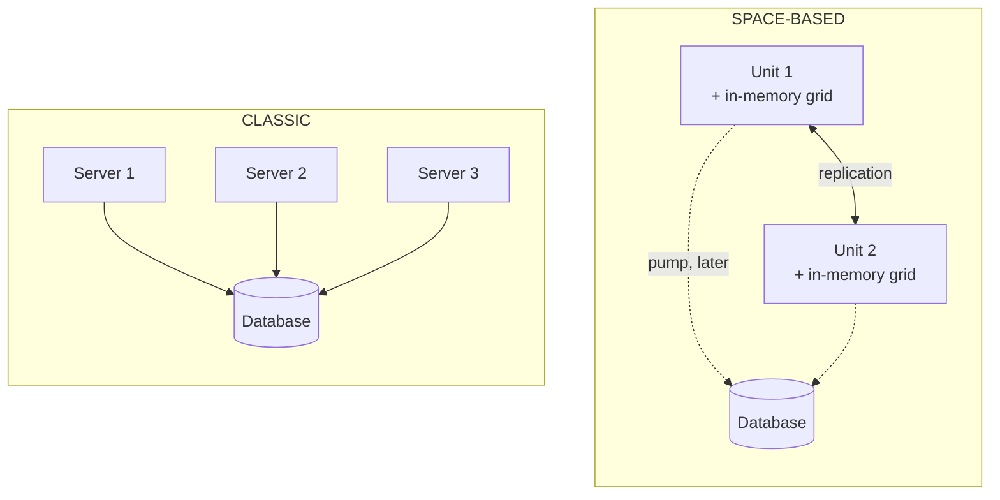
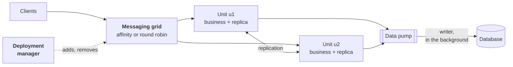
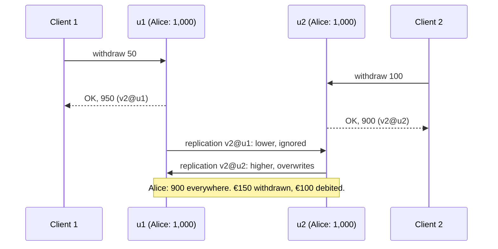

# 19. Space-Based Architecture

**French name**: *Architecture spatiale*

> **In one sentence**: the database is taken off the request path; each **processing unit** keeps **all the data in
> memory**, in a grid replicated between the units, and the database is only updated in the background. Units can then
> be added and removed at will to absorb the load.

📁 Code: [`19-SpaceBased`](../../19-SpaceBased) · ⬅️ [Actor Model](18-modele-acteurs.md) · ➡️ [Pipeline](20-pipeline.md) ·
🌐 [Français](../19-space-based.md)

---

## The idea: the database is the bottleneck

All the previous demos end up the same way: each request reads from or writes to a database. You can multiply the
application servers, the database stays **single** and ends up limiting throughput (locks, connections, disk). The name
comes from the idea of a *tuple space*: a shared data space in memory. The space-based architecture (described notably
by Mark Richards) removes the database from the request path. (In the code: *Espace* = space, *Grille* = grid,
*Unité* = unit, *Pompe* = pump.)



A request only waits for memory now: reading an account is a dictionary lookup, writing it too. The database becomes a
**backup** updated later, and is only used to reload the grid when all the units have gone down.

| | The reference data is… | To handle more load… |
|---|---|---|
| Demos 00 to 18 | in the database | you add servers, the database stays single |
| [Cells](17-cell-based.md) | in each cell's database | you add cells, each with its database |
| **Space-based** | **in memory**, in each unit | you add units; the database follows at its own pace |

---

## The components



On a cold start (no unit left), the **data reader** reloads the grid from the database. What is called the
**virtualized middleware** ([Espace.Grille](../../19-SpaceBased/Espace.Grille), simulated in-process for the demo, no package):

- the **data grid** ([GrilleDeDonnees.cs](../../19-SpaceBased/Espace.Grille/GrilleDeDonnees.cs),
  [Replique.cs](../../19-SpaceBased/Espace.Grille/Replique.cs)): a full replica per unit, and asynchronous replication of
  each write to the others (100 ms of latency, adjustable);
- the **messaging grid** ([GrilleDeMessages.cs](../../19-SpaceBased/Espace.Grille/GrilleDeMessages.cs)): the entry
  point, which picks the unit for each request;
- the **data pump** and its **writer**, the **data reader** ([Base.cs](../../19-SpaceBased/Espace.Grille/Base.cs));
- the **deployment manager** ([GestionnaireDeDeploiement.cs](../../19-SpaceBased/Espace.Grille/GestionnaireDeDeploiement.cs)).

The **processing units** ([UniteDeTraitement.cs](../../19-SpaceBased/Espace.Grille/UniteDeTraitement.cs)) contain the
business ([Banque.cs](../../19-SpaceBased/Espace.Banque/Banque.cs)), which only sees its own unit's replica (the code
is quoted exactly as it is, French messages included):

```csharp
private static object Mouvement(ContexteUnite unite, Guid id, decimal montant, bool debit, string libelle) =>
    unite.Modifier<Compte>(id.ToString(), compte =>
        compte is null ? (null, Introuvable(id))
        : montant <= 0 ? (null, new Refus("Le montant doit être positif."))
        : debit && montant > compte.Solde ? (null, new Refus($"Solde insuffisant ({compte.Solde:0.00} €)."))
```

In production: **Hazelcast**, **Apache Ignite**, **GigaSpaces** (which popularized the model), **Oracle Coherence** or
**Infinispan** provide the grid and its replication, across several machines; the pump is a durable queue (Kafka,
RabbitMQ). This model is found in ticketing, online auctions, trading.

---

## 1. Reading and writing without the database

Each write is applied in the unit's replica, then **published**: to the other replicas, and to the pump. The request
waits for neither — the database is not on the request path.

```csharp
private void Publier(string origine, Modification modification)
{
    Interlocked.Increment(ref _enVol);
    _file.Writer.TryWrite((origine, modification, DateTimeOffset.UtcNow + LatenceReplication));
    // La base n'est pas sur le chemin de la requête : l'écriture part dans la pompe, on n'attend pas.
    _versLaPompe(modification);
}
```

The consequence is spectacular: **the database can go down, requests carry on**. Writes pile up in the pump and are
written when the database comes back (test `Les_requetes_n_attendent_jamais_la_base`). Meanwhile, the database lags
behind: a report reading it would see stale data.

`GET /grille/comparaison/{id}`, right after a withdrawal, shows the **replication window** (real run; u9 hasn't received
the write yet, 300 ms later it is everywhere):

```text
{ "repliques": [ { "ou": "u8", "version": "v2@u8", "solde": 495 },
                 { "ou": "u9", "version": "v1@base", "solde": 500 } ],     ← u9 n'a pas encore reçu l'écriture
  "base": { "version": "v2@u8", "solde": 495 } }
300 ms plus tard : v2@u8 et 495 partout.
```

Each entry carries a **version** (a counter and the unit that wrote it). Replicas and database apply the same rule: the
highest version wins. They therefore all end up identical, whatever the order in which writes arrive.

---

## 2. The price: collisions

Two units can modify **the same data at the same time**, each in its own replica, before receiving the other's write.
On replication, the highest version wins and **the other write is lost**, even though its client received "OK".



The replica detects the collision when a modification doesn't start from the version it holds:

```csharp
var concurrente = locale != m.Precedente && locale.Unite != "" && locale.Unite != m.Version.Unite;
if (m.Version > locale)
{
    _entrees[m.Cle] = new Entree(m.Cle, m.Valeur, m.Version);
    return new ResultatFusion(true, concurrente ? locale : null);
}
```

The countermeasure lies in the **messaging grid**: **affinity routing** always sends the same key to the same unit,
which is then the only one writing it. "Rendezvous" hashing limits movements when the number of units changes:

```csharp
: _unites.MaxBy(u => Hachage($"{cle}/{u.Id}"))!;
```

**Real run**: 200 €1 withdrawals fired at the same time on Alice's account, depending on the routing.

```json
POST /demo/retraits-concurrents  (affinité)
{ "unitesSollicitees": ["u2"], "acceptes": 200, "soldeAttendu": 800, "soldeDansLaGrille": [800], "soldeDansLaBase": 800, "misesAJourPerdues": 0 }

POST /demo/retraits-concurrents  (tourniquet)
{ "unitesSollicitees": ["u5","u6"], "acceptes": 200, "soldeAttendu": 600, "soldeDansLaGrille": [700], "soldeDansLaBase": 700, "misesAJourPerdues": 199 }
```

With round robin (*tourniquet*), 200 withdrawals accepted but only €100 debited: the bank lost €100. Grid and database
are nevertheless consistent with each other: nothing flags the error, except the collision counter.

⚠ **Affinity isn't always enough.** When a unit arrives or leaves, some keys change owner; during the replication
window, the old and the new unit can write the same key. The real run showed it: right after a load peak, while the
manager was removing units, one of Bob's withdrawals was lost (test
`En_affinite_un_changement_d_unites_ouvre_une_fenetre_de_collision`). Real products reduce this risk by migrating
partitions one by one, or by keeping a single master copy per item (a **distributed** rather than **replicated** cache,
at the cost of a network call when the data is elsewhere).

Mark Richards gives an estimate of the collision rate: it grows with the **number of units**, the **square** of the
update rate, and the **replication latency**, and shrinks with the cache size. This model therefore suits data that is
**read often, written rarely**, or well partitioned.

---

## 3. Elasticity

The deployment manager assesses the load every 250 ms (requests in progress or waiting, relative to a capacity of 4 per
unit): above 75%, it adds a unit; below 25%, it removes one (2 minimum, 6 maximum).

```csharp
if (charge >= options.SeuilHaut && unites.Count < options.UnitesMax)
{
    var unite = await Demarrer();
    return $"charge {charge:P0} : {unite.Id} ajoutée";
}
```

A new unit receives a **copy of the grid from an existing unit**, without touching the database. **Real run**: 600
simultaneous account openings.

```json
POST /demo/charge  { "nombre": 600 }
{ "dureeMs": 2373, "unitesAvant": 2, "unitesMax": 6, ... }
```

```text
08:23:43.612 u10 démarrée : grille copiée depuis u8 (46 entrées)
08:23:43.858 u11 démarrée : grille copiée depuis u8 (106 entrées)
...
08:23:46.099 u9 arrêtée (292 requêtes traitées)
```

Starting a unit only costs a memory copy: that is what makes elasticity fast. Queued requests stay on their unit; only
new ones benefit from the added units.

---

## 4. Failures: one unit, all the units

- **One unit goes down**: its data is also in the other replicas. The messaging grid takes its requests away from it,
  including those waiting in its queue, and hands them to another (test
  `Les_requetes_d_une_unite_tombee_sont_confiees_a_une_autre`). Hence the minimum of **2 units**: a single failure must
  never empty the grid.
- **All the units go down**: the in-memory grid is gone. The next request triggers a **cold start**: the data reader
  reloads the grid from the database. But only **after the pump has written everything** — otherwise stale values would
  be loaded, and the late writes would then overwrite the new unit's ones in the database:

  ```csharp
  // LECTEUR DE DONNÉES. Attendre d'abord que la pompe ait tout écrit : sinon on chargerait des valeurs périmées,
  // et les écritures en retard viendraient ensuite écraser dans la base celles de la nouvelle unité.
  ```

  If the database is down too, there is no way to restart: `503`. Real run: database down, 3 withdrawals accepted
  (`200`), total failure → `503`; database restored → the next request waits 6.8 s for the pump to write its 444
  pending writes, then answers with the right balance.

---

## The tests

Platform tests with the real business ([PlateformeTests.cs](../../19-SpaceBased/Espace.Tests/PlateformeTests.cs)),
where replication can be **held back by hand** to make a collision certain (each unit writes before seeing the
other's write), and API tests ([ApiTests.cs](../../19-SpaceBased/Espace.Tests/ApiTests.cs)).

```csharp
_p.Messages.Mode = ModeRoutage.Tourniquet;
_p.Donnees.Suspendre();  // chaque unité écrit avant d'avoir vu l'écriture de l'autre

var premier = await Envoyer(new Retirer(Alice, 100m));  // u2
var second = await Envoyer(new Retirer(Alice, 50m));    // u1
```

| Test | What is checked |
|---|---|
| `Une_ecriture_est_repliquee_dans_toutes_les_unites_puis_dans_la_base` | replication, pump |
| `Les_requetes_n_attendent_jamais_la_base` | database down: requests go through, the pump catches up |
| `En_affinite_une_meme_cle_va_toujours_a_la_meme_unite`, `En_affinite_des_retraits_simultanes_ne_perdent_rien` | affinity |
| `Au_tourniquet_deux_unites_qui_ecrivent_la_meme_donnee_entrent_en_collision` | collision, lost write, database identical to the grid |
| `En_affinite_un_changement_d_unites_ouvre_une_fenetre_de_collision` | the limit of affinity |
| `La_charge_ajoute_des_unites_et_le_calme_les_retire` | elasticity, ceiling, floor |
| `Une_nouvelle_unite_recoit_une_copie_de_la_grille_sans_lire_la_base` | copy between units |
| `La_panne_d_une_unite_ne_perd_aucune_donnee`, `Les_requetes_d_une_unite_tombee_sont_confiees_a_une_autre` | failure of one unit |
| `Apres_une_panne_totale_le_demarrage_a_froid_recharge_la_grille_depuis_la_base`, `Le_demarrage_a_froid_attend_que_la_pompe_ait_tout_ecrit` | cold start |
| `Un_virement_debite_dans_l_unite_de_la_source_et_credite_dans_celle_de_la_cible`, `Un_credit_refuse_par_l_unite_de_la_cible_est_compense` | transfer between units, compensation |
| `Des_virements_croises_entre_deux_unites_pleines_ne_se_bloquent_pas` | internal requests take no queue slot |
| `Base_en_panne_les_requetes_passent_mais_un_demarrage_a_froid_est_impossible` | `200`, then `503`, then recovery, over HTTP |
| `Chaque_reponse_dit_quelle_unite_l_a_traitee`, `On_peut_ajouter_arreter_et_faire_tomber_des_unites`, `La_comparaison_montre_la_meme_version_partout_au_repos` | the API: `X-Unite` header, unit management, convergence |

Checked by mutation: always round-robin routing, no collision detection, a database or replicas ignoring versions, a
cold start that doesn't wait for the pump, a new unit loaded from the database, a pump without retries, queued internal
requests, no rerouting after a unit failure, no compensation, no unit added under load: each makes at least one test fail.

---

## Summary

| 👍 Strengths | 👎 Limits |
|---|---|
| **The database is no longer the bottleneck**: reads and writes in memory | **Collisions**: accepted writes can be lost |
| Fast **elasticity**: a unit starts with a memory copy | All the data must fit in memory, in every unit |
| The database can go down without interrupting the service | The database lags: reports and other systems see stale data |
| Load peaks absorbed (ticketing, auctions, sales) | Complex to test and operate; grid products are expensive |

**When to use it**: very variable, very high load with unpredictable peaks (ticketing when sales open, auctions,
bookings, games), when the database can't keep up, and for data that fits in memory and is mostly written by key. Avoid
it for large data volumes, frequent concurrent writes to the same data, or when the database must be up to date at all
times (accounting, real-time reports). For a real bank, it would be a poor choice for balances; the demo uses them
precisely because the collisions show.
