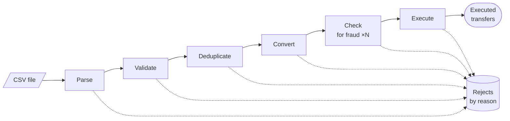

# 20. Pipeline (pipes & filters)

> **In one sentence**: a processing job is split into independent **filters**, each doing a single thing, connected by
> **pipes**; data flows from one to the next, each filter working **at the same time** as the others on a different
> item, like an assembly line.

📁 Code: [`20-Pipeline`](../../20-Pipeline) · ⬅️ [Space-Based Architecture](19-space-based.md) · ➡️ [Choreography](21-choregraphie.md) ·
🌐 [Français](../20-pipeline.md)

---

## The idea: an assembly line

It is the oldest of the architectures in this repository: that of the Unix shell
(`cat virements.csv | grep EUR | sort | uniq`), of compilers (lexical → syntactic → semantic analysis → generation), of
ETL and stream processing. It doesn't apply to a whole application, but to a **data processing job**: here, importing a
file of transfers sent by a company (thousands of lines to check, then execute). (In the code: *Filtre* = filter,
*Étage* = stage, *Tuyau* = pipe.)



Three rules make the architecture:

- a **filter** knows neither its source, nor its destination, nor the other filters: it receives an item, produces
  another one, or **rejects** it;
- a **pipe** connects two filters, and it is **bounded**: when it is full, the previous filter waits;
- all the filters work **at the same time**: while *Execute* handles line 1, *Check for fraud* handles line 2, *Convert*
  line 3…

| | A processing job is… | To speed it up… |
|---|---|---|
| A classic service | a method that does everything, line after line | optimize the method |
| **Pipeline** | a sequence of filters working in parallel | find the **bottleneck** and parallelize **that** stage |

---

## The components

- **The engine** ([Pipeline.Noyau](../../20-Pipeline/Pipeline.Noyau), generic, no package, on `System.Threading.Channels`):
  [`IFiltre`](../../20-Pipeline/Pipeline.Noyau/Filtre.cs), the stages and their bounded pipes
  ([Etage.cs](../../20-Pipeline/Pipeline.Noyau/Etage.cs)), assembly and execution ([Pipeline.cs](../../20-Pipeline/Pipeline.Noyau/Pipeline.cs)).
- **The banking filters** ([Filtres.cs](../../20-Pipeline/Pipeline.Banque/Filtres.cs)) and their assembly
  ([Imports.cs](../../20-Pipeline/Pipeline.Banque/Imports.cs)).
- **The API** ([Endpoints.cs](../../20-Pipeline/Pipeline.Api/Endpoints.cs)): the body of `POST /imports` *is* the
  file, read line by line as it arrives.

A filter boils down to one method — a rejection is a normal result (the line is set aside, the stream continues); an
exception stops the whole pipeline (the code is quoted exactly as it is, French comments included):

```csharp
public interface IFilter<in TInput, TOutput>
{
    string Name { get; }

    /// <summary>A rejection is a normal result (the line is discarded, the flow goes on); an exception stops the whole pipeline.</summary>
    ValueTask<Outcome<TOutput>> Process(TInput input, CancellationToken cancellation);
}
```

The assembly reads like the diagram, and the compiler checks that each filter's output is the next one's input:

```csharp
Core.Pipeline.From<string>()
    .Then(new Parse())
    .Then(new Validate())
    .Then(new Deduplicate(ledger))
    .Then(new ConvertCurrency())
    .Then(new CheckFraud(options.ScoringCost), options.FraudParallelism, options.Ordered);
```

In production: **TPL Dataflow** or **Channels** directly within a process, **Akka Streams**; at system scale, filters
become services and pipes become queues or streams (**Kafka Streams**, **Apache Beam**, **Azure Data Factory**, ETL and
CI pipelines).

---

## 1. Rejects: setting a line aside without stopping the file

A faulty line doesn't interrupt the import: the filter that detects it **rejects** it with a reason, and the stream
continues. The report counts the rejects by reason and keeps the first ones, with their line and the filter that set
them aside. **Real run** with [Virements-exemple.csv](../../20-Pipeline/Pipeline.Api/Virements-exemple.csv) (11 lines;
the report is in French: malformed line, invalid IBAN, identical accounts, duplicate, unknown currency, blacklisted
beneficiary, limit exceeded, insufficient balance):

```text
ligne 3   Analyser              ligne mal formée              montant « douze » illisible
ligne 4   Valider               IBAN invalide                 FR7630006000011234567890188
ligne 5   Valider               comptes identiques
ligne 6   Dédupliquer           doublon                       dans le fichier
ligne 7   Convertir             devise inconnue               JPY
ligne 8   Contrôler la fraude   bénéficiaire sur liste noire
ligne 9   Contrôler la fraude   plafond dépassé               10530,00 €
ligne 10  Exécuter              solde insuffisant             VIR-009
→ 3 virements exécutés : Alice 842,80 €, Bob 657,20 €
```

An **exception**, on the other hand, signals a failure: the whole pipeline stops (the first failing stage cancels the
others).

```csharp
// The first stage that fails stops all the others.
foreach (var task in tasks)
    _ = task.ContinueWith(_ => stopping.Cancel(), TaskContinuationOptions.OnlyOnFaulted);
```

---

## 2. Recomposing: the same filters, another pipeline

Since the filters don't know each other, they can be reassembled at will. The **dry-run import**
(`POST /imports?aBlanc=true`) is the same pipeline **without the last filter**: it tells what would be rejected, without
touching a single account.

```csharp
public static Pipeline<string, Transfer> DryRun(Ledger ledger, ImportOptions options) => Checks(ledger, options).Build();
```

Likewise, the demo's simulated failure is a filter inserted before *Execute*, and the tests assemble their own pipelines
with test filters. Two assembly tips:

- **cheap filters first**: whatever *Parse* or *Deduplicate* rejects never reaches the expensive fraud check;
- the filters are independent, but the pipeline has a **logical order**: *Execute* assumes *Convert* has run (amount in
  euros). It therefore checks its precondition rather than trusting the assembly (test
  `Executer_refuse_un_virement_qui_n_est_pas_passe_par_la_conversion`, written after this trap showed up).

---

## 3. Back-pressure: a file of any size, bounded memory

Pipes hold at most 64 items. When a stage is slower than the previous one, its input pipe fills up, and the previous
stage **waits** to write; the wait propagates all the way back to the file reading. Writing to a full pipe BLOCKS: that
is back-pressure.

```csharp
/// <summary>Writing into a full pipe BLOCKS: the stage waits for the next one to have room. That is the back-pressure.</summary>
private async Task Write(ChannelWriter<Element<TOutput>> output, Element<TOutput> element, RunContext context)
{
    var start = Stopwatch.GetTimestamp();
    await output.WriteAsync(element, context.Cancellation);
```

Result: the file is never loaded in full. **Real run**, 100,000 lines generated on the fly: at most **330 to 375 lines
in memory** at a time depending on parallelism (`maxEnTransit`), and it would be the same for 10 million.

---

## 4. The bottleneck, and a stage's parallelism

A pipeline's throughput is that of its **slowest stage**. The report measures, for each stage, its processing time and
its time waiting on the next pipe. **Real run**, 100,000 lines (1 copy of the fraud check: 4,117 ms, 24,000 lines/s,
fraud check 94% busy; 8 copies: 763 ms, 131,000 lines/s, same result):

```text
1 copie du contrôle de fraude : 4 117 ms (24 000 lignes/s)
   Analyser               occupation 0,02   attente du suivant 3 976 ms
   Valider                occupation 0,05   attente du suivant 3 847 ms
   Contrôler la fraude    occupation 0,94   ← le goulot
   Exécuter               occupation 0,01
8 copies : 763 ms (131 000 lignes/s), même résultat
```

The fast stages spend their time waiting: only the bottleneck matters. A **stateless** filter (like the fraud check) can
run in **several copies**; a stateful filter (*Deduplicate*, *Execute*) stays single. And once the bottleneck is
widened, another takes its place: with a light fraud score, the bottleneck becomes *Validate* (IBAN computation), and
adding fraud copies no longer helps.

The trap: several copies finish out of order. Yet **file order matters**: if Alice transfers €600 to Bob on line 1, and
Bob €1,000 on line 2, line 2 is only possible after line 1. The parallel stage therefore numbers the items and releases
them in arrival order:

```csharp
while (early.Remove(expected, out var next))
{
    if (next is not null)
        await Write(output, next, context);
    expected++;
    window.Release();
}
```

Without this, line 2 reaches *Execute* first and is rejected (test
`L_ordre_du_fichier_compte_et_l_etage_parallele_ordonne_le_respecte`). Parallelizing therefore doesn't change the
result (test `Paralleliser_le_controle_de_fraude_ne_change_pas_le_resultat`).

---

## 5. Recovery after a failure

An import can stop halfway (failure, deployment, database unavailable). Some lines are executed, others not. The cure
is **idempotency**: *Deduplicate* drops any already executed reference, and the ledger refuses, as a last resort, to
execute the same one twice. You **simply replay the file**. Real run (VIR-001 had been executed despite the failure;
the replay executes 2, with 2 duplicates, and ends with the same balances as without a failure):

```text
POST /imports?panneALaReference=VIR-010   → 500, « Panne simulée en traitant VIR-010. », bilan : 0 exécuté
GET  /comptes/<Alice>                      → 880 € : VIR-001 avait pourtant été exécuté
POST /imports                              → 2 exécutés, doublons : 2 ; Alice 842,80 €, Bob 657,20 € (comme sans panne)
```

⚠ The report of a **failed** import tells what *came out* of the pipeline, not what was *done*: VIR-001 was executed,
but its output was still waiting in the last pipe when the stop cut everything. Only the ledger is authoritative: that
is why recovery relies on the executed references, not on the report.

---

## The tests

The engine with test filters ([NoyauTests.cs](../../20-Pipeline/Pipeline.Tests/NoyauTests.cs)), the banking filters
assembled as in the API ([ImportTests.cs](../../20-Pipeline/Pipeline.Tests/ImportTests.cs)), and the API
([ApiTests.cs](../../20-Pipeline/Pipeline.Tests/ApiTests.cs)).

| Test | What is checked |
|---|---|
| `Les_elements_traversent_les_filtres_dans_l_ordre`, `Un_rejet_ecarte_l_element_sans_arreter_le_flux` | the stream, rejects by reason |
| `Les_etages_travaillent_en_meme_temps_chacun_sur_un_element` | 3 stages busy at the same time |
| `La_contre_pression_borne_ce_qui_est_en_memoire` | 20,000 items, at most 37 in transit |
| `Un_etage_parallele_ordonne_rend_les_elements_dans_leur_ordre_d_arrivee` | ordered or not, with a very slow item |
| `Une_exception_dans_un_filtre_arrete_tout_le_pipeline`, `L_annulation_arrete_un_flux_sans_fin` | failure, cancellation |
| `Le_goulot_est_l_etage_le_plus_occupe_et_chaque_execution_a_ses_compteurs` | metrics |
| `Le_fichier_d_exemple_donne_trois_virements_et_un_rejet_par_motif` | each reject by the right filter, balances |
| `Rejouer_un_fichier_n_execute_rien_deux_fois`, `Le_registre_n_execute_jamais_deux_fois_la_meme_reference` | idempotency, at two levels |
| `Apres_une_panne_en_plein_import_le_rejeu_termine_sans_rien_executer_deux_fois` | recovery |
| `Un_import_a_blanc_dit_ce_qui_passerait_sans_rien_modifier` | recomposition |
| `L_ordre_du_fichier_compte_et_l_etage_parallele_ordonne_le_respecte`, `Paralleliser_le_controle_de_fraude_ne_change_pas_le_resultat` | order and determinism |
| `Executer_refuse_un_virement_qui_n_est_pas_passe_par_la_conversion` | a filter's precondition |
| `Un_gros_fichier_passe_en_flux_avec_une_memoire_bornee` | 20,000 lines, expected rejects, money preserved |
| `La_cle_d_un_iban_est_verifiee` | mod 97 |
| `Un_import_execute_le_fichier_et_garde_son_compte_rendu`, `Un_import_a_blanc_ne_touche_a_aucun_compte`, `Une_panne_repond_500_avec_le_compte_rendu`, `La_demo_de_l_import_massif_designe_le_goulot` | the API |

Checked by mutation: unbounded pipes, a parallel stage never ordered, a failure that doesn't stop the other stages, each
of the two duplicate protections, the conversion precondition, a reject that doesn't free its slot, counters shared
between runs, the file header not skipped, the blacklist, reject counting: each makes at least one test fail.

---

## Summary

| 👍 Strengths | 👎 Limits |
|---|---|
| **Simple** filters, testable one by one, **reusable** and reassemblable | For streaming jobs only, not for an interactive application |
| **Throughput**: all stages at the same time; parallelize the bottleneck, and only it | Throughput is that of the slowest; each pipe has a cost (copy, synchronization) |
| **Bounded memory** through back-pressure, whatever the data size | Stateful filters (deduplication, execution): single, and order to preserve |
| Rejects by reason, metrics per stage: you see where it's stuck | A failure halfway leaves partial work: idempotency mandatory to replay |

**When to use it**: file imports and exports, ETL, batch processing (statements, payroll, invoicing), processing of
event, media or log streams, compilers. Anywhere data goes through a sequence of independent steps. It is not a
full-fledged application architecture: a pipeline lives inside a service or a module, itself organized according to
another demo.
