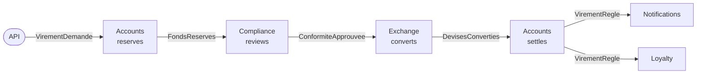

# 21. Event-Driven Choreography

**French name**: *Chorégraphie (événementiel pur)*

> **In one sentence**: no service drives the process; each one **reacts to the events** of the others and publishes its
> own, and the transfer moves forward from reaction to reaction, like dancers following the music without a conductor.

📁 Code: [`21-Choregraphie`](../../21-Choregraphie) · ⬅️ [Pipeline](20-pipeline.md) · ➡️ [Strangler Fig](22-strangler-fig.md) ·
🌐 [Français](../21-choregraphie.md)

---

## The idea: the same transfer as demo 14, without an orchestrator

The [orchestrated saga](14-saga-orchestree.md) hands the process to an orchestrator that calls each service in turn.
Here, the **same process**, with the same data (Alice €50,000, Bob €500, Carla $1,000) and the same rules (analyst above
€10,000, same exchange rates), is written… **nowhere**. It emerges from the subscriptions (*Comptes* = Accounts,
*Conformité* = Compliance, *Change* = Exchange, *Fidélité* = Loyalty):



Each arrow is an event published **without knowing who listens to it**. Demos 7 and 8 already used choreography, but
only to **notify** ("a transfer happened"); here, it **drives** a whole business process, with human waiting,
compensations and failures. That is where its strengths and limits show.

| | [Orchestration (demo 14)](14-saga-orchestree.md) | **Choreography (this demo)** |
|---|---|---|
| The process is written… | in one place (the saga definition) | **nowhere**: it emerges from the subscriptions |
| A service knows… | the orchestrator knows every participant | **nobody**; only the event contracts |
| Adding a reaction | change the definition | **subscribe**, without touching the others |
| "Where is transfer 42?" | the saga's state, stored | a **projection** to build (the Tracking) |
| Compensation | written next to each step, triggered by the engine | **scattered**: each service knows which events undo its work |
| A participant down | the engine retries, then compensates | **silence**: the process is left hanging until a timeout |
| Single point of failure | the orchestrator | the message broker |

---

## The components

- **The broker** ([Bus.cs](../../21-Choregraphie/Choreo.Bus/Bus.cs), simulated in-process, no package): one queue
  **per subscriber** (a slow subscriber doesn't delay the others), "at least once" delivery, retries, dead letters, and
  the log of all events.
- **The contracts** ([Contrats.cs](../../21-Choregraphie/Choreo.Services/Contrats.cs)): the shape of the events, the
  only shared code. Each event carries **all the transfer's data**, completed along the way (currencies, amount in
  euros, then converted amount): each service finds what it needs without calling anyone back.
- **The services** ([Comptes.cs](../../21-Choregraphie/Choreo.Services/Comptes.cs),
  [Autres.cs](../../21-Choregraphie/Choreo.Services/Autres.cs)): Accounts, Compliance, Exchange, Notifications,
  Loyalty, each in its own namespace, with its own data. An architecture test checks that none knows the others.
- **The Tracking** (*Suivi*, [Suivi.cs](../../21-Choregraphie/Choreo.Services/Suivi.cs)): it listens to everything and
  rebuilds the state of each transfer. It observes, it decides nothing.

A service is a list of subscriptions. Here is everything Accounts listens to (two of them are compensations; the code is
quoted exactly as it is):

```csharp
Bus.Abonner<VirementDemande>(Nom, Reserver);
Bus.Abonner<ConformiteRefusee>(Nom, e => Liberer(e, e.Motif));  // compensation
Bus.Abonner<ChangeEchoue>(Nom, e => Liberer(e, e.Motif));       // compensation
Bus.Abonner<DevisesConverties>(Nom, Regler);
```

In production: **RabbitMQ**, **Azure Service Bus** or **Kafka**, with **MassTransit**, **NServiceBus**, **Wolverine** or
**Dapr** for subscriptions, retries and inboxes.

---

## 1. The process only exists in the reactions

Each event carries the **correlation** (the transfer) and its **cause** (the event it responds to): a new event, in
reaction to this one, has the same correlation and this one as its cause.

```csharp
/// <summary>Un nouvel événement, en réaction à celui-ci : même corrélation, et celui-ci pour cause.</summary>
public T Suite<T>(T suivant, string emetteur) where T : Evenement =>
    suivant with { Correlation = Correlation, Cause = Id, Emetteur = emetteur };
```

It is the only thread that lets you tell what happened. **Real run**, `GET /virements/{id}` (each line: the event and
its publisher, in reaction to the line above):

```text
VirementDemande                                  ← API
  FondsReserves                                  ← Comptes, en réaction à VirementDemande
    ConformiteApprouvee                          ← Conformité
      DevisesConverties                          ← Change
        VirementRegle                            ← Comptes
          ClientNotifie                          ← Notifications : « Virement de 100,00 EUR effectué (108,32 USD reçus). »
```

To know **where a transfer stands**, you need one more service, the **Tracking**, which listens to all events (a
projection, as in [CQRS](09-cqrs.md)). Its downside: it must know every event type. Adding a step to the process also
means remembering it.

The system's only "map" is the list of subscriptions, and it only exists at runtime (`GET /bus`):

```text
Comptes        écoute ChangeEchoue, ConformiteRefusee, DevisesConverties, VirementDemande
Conformité     écoute FondsReserves, ReservationExpiree
Change         écoute ConformiteApprouvee
Notifications  écoute VirementRegle
Fidélité       écoute VirementRegle
Suivi          écoute les 13 types d'événements
```

---

## 2. Scattered compensations

No engine undoes the steps in reverse order: each service must know **which events from the others mean "undo what you
did"**. Accounts releases the reservation on `ConformiteRefusee` **and** on `ChangeEchoue`; if tomorrow a new service
can fail, it will have to be subscribed too. Real run (blacklisted beneficiary → cancelled; yen not quoted → cancelled;
insufficient balance → refused):

```text
Alice → Mallory (liste noire)    VirementDemande → FondsReserves → ConformiteRefusee → FondsLiberes      Annule
Alice → Yuki (yens, non cotés)   … → ConformiteApprouvee → ChangeEchoue → FondsLiberes                   Annule
Bob → Alice, 900 € (solde 500)   VirementDemande → FondsRefuses                                          Refuse
```

As in demo 14, the funds are first **reserved** (unavailable for another transfer, test
`L_argent_reserve_n_est_plus_disponible_pour_un_autre_virement`), and only debited at settlement: the point of no
return. After it (notification), you retry, you undo nothing.

---

## 3. When a service goes silent

With an orchestrator, a failed participant is retried then compensated: someone is waiting for its answer. Here,
**nobody waits for anybody**. The exchange service goes down: the broker retries 4 times, puts the event in the dead
letters… and that's it. Real run (status in progress, €200 reserved; then the dead letter; the transfer stuck; 30 s
later the reservation expires and the transfer is abandoned):

```text
POST /chaos { "changeEnPanne": true } ; POST /virements (200 €)   → statut EnCours, 200 € réservés sur le compte d'Alice
GET /bus/lettres-mortes          → Change, 4 tentatives, « Service de change indisponible. »
GET /virements/bloques           → le virement, sans activité récente
… 30 s plus tard                 → ReservationExpiree (émise par Comptes, sans cause) : Abandonne, 0 € réservé
```

The safety net is **local**: Accounts protects itself by giving its reservations a lifetime.

```csharp
expirees = _reservations.Where(r => r.Value.ExpireLe <= maintenant).ToList()
```

And the other services must take it into account: Compliance listens to `ReservationExpiree` so as not to have an
analyst decide on an abandoned transfer; Accounts refuses a settlement that arrives too late (`VirementAbandonne`); the
Tracking doesn't reopen a finished transfer. Each of these cases is a **test**, and each required a line of code in a
different service: that is the hidden cost of choreography.

---

## 4. Delivered twice, handled once

Real brokers deliver "at least once": after an outage, a message can arrive twice. Each service therefore keeps the
identifiers of the events already handled (its "inbox"), and changes its state **and** publishes the follow-up in a
single block:

```csharp
lock (Verrou)
{
    if (_traites.Contains(recu.Id))
        return;
    if (reagir() is { } suite)
        Bus.Publier(suite);
    _traites.Add(recu.Id);
}
```

Test `Des_evenements_livres_deux_fois_ne_produisent_leur_effet_qu_une_fois`: with a broker that delivers **every** event
twice, 20 €10 transfers give exactly €200 debited, 20 notifications, 20 loyalty points. (In a real service with a
database, "in a single block" requires the outbox of [demo 8](08-microservices.md).)

---

## 5. Adding a participant without touching the others

The Loyalty service (points on every settled transfer) was added **afterwards**. It subscribes, that's all:

```csharp
public void Inscrire() => Bus.Abonner<VirementRegle>(Nom, e => UneSeuleFois(e, () =>
```

No other service changed, none knows it exists: the test `Ajouter_un_abonne_ne_change_rien_pour_les_autres` runs the
system with and without it, and gets exactly the same events. It is choreography's major asset, and the reason it suits
**reactions** (notify, count, archive, feed a dashboard) so well rather than processes.

---

## The tests

The services and the bus without HTTP, with a manual clock for expiry
([ChoregraphieTests.cs](../../21-Choregraphie/Choreo.Tests/ChoregraphieTests.cs)), and the API
([ApiTests.cs](../../21-Choregraphie/Choreo.Tests/ApiTests.cs)).

| Test | What is checked |
|---|---|
| `Un_virement_avance_par_reactions_en_chaine_sans_que_personne_le_conduise` | the 6 events, their publishers, the chain of causes |
| `Un_refus_de_la_conformite_est_compense_par_le_service_comptes`, `Un_echec_du_change_est_compense_lui_aussi` | compensations |
| `Un_solde_insuffisant_arrete_tout_des_la_premiere_reaction`, `L_argent_reserve_n_est_plus_disponible_pour_un_autre_virement` | reservation |
| `Un_gros_virement_attend_la_decision_d_un_analyste` | human waiting, approval and refusal |
| `Un_service_en_panne_bloque_le_processus_jusqu_a_l_expiration_de_la_reservation` | dead letters, stuck transfer, expiry |
| `Apres_l_expiration_ni_l_analyste_ni_un_message_en_retard_ne_reglent_le_virement` | the late cases, in three services |
| `Des_evenements_livres_deux_fois_ne_produisent_leur_effet_qu_une_fois` | inbox |
| `Apres_le_point_de_non_retour_une_notification_en_echec_est_reessayee_jamais_compensee` | retries, dead letters |
| `Ajouter_un_abonne_ne_change_rien_pour_les_autres` | extensibility |
| `Aucun_service_ne_connait_les_autres` | **architecture test** (reflection) |
| `Demander_un_virement_repond_202_et_la_suite_se_fait_sans_l_appelant`, `L_analyste_decide_par_l_API`, `Un_service_en_panne_se_voit_aux_lettres_mortes_et_aux_virements_bloques`, `Le_bus_montre_qui_ecoute_quoi` | the API |

Checked by mutation: no inbox, each of the two compensations, an expiry that doesn't give the money back or doesn't
happen, Compliance deaf to the expiry, a silent late settlement, a Tracking that reopens a finished transfer, a broker
without retries, a service referencing another, a reservation that ignores already reserved money: each makes at least
one test fail.

---

## Summary

| 👍 Strengths | 👎 Limits |
|---|---|
| **Minimal coupling**: the services don't know each other | The process is written nowhere: hard to understand, to change |
| **Adding a reaction** = subscribing, without touching anything | Compensations and timeouts **scattered** across the services |
| No conductor to operate or make available | A failure shows up as **silence**: monitoring needed (dead letters, stuck transfers) |
| Each service moves at its own pace, independently | Following a process needs a projection, and tracing of causes |

**When to use it**: for **reactions** to a fact (notify, bill, archive, feed a data warehouse, synchronize another
system), and short, stable processes with few participants. As soon as a process has many steps, waits, timeouts and
failure rules, [orchestration](14-saga-orchestree.md) is safer. The two are often combined: an orchestrator drives the
process, and publishes events that other services, for their part, choreograph.
