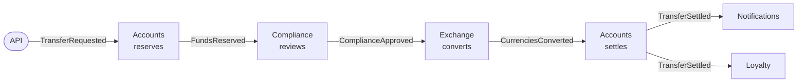

# 21. Event-Driven Choreography

**French name**: *Chorégraphie (événementiel pur)*

> **In one sentence**: no service drives the process; each one **reacts to the events** of the others and publishes its
> own, and the transfer moves forward from reaction to reaction, like dancers following the music without a conductor.

📁 Code: [`21-Choreography`](../../21-Choreography) · ⬅️ [Pipeline](20-pipeline.md) · ➡️ [Strangler Fig](22-strangler-fig.md) ·
🌐 [Français](../21-choregraphie.md)

---

## The idea: the same transfer as demo 14, without an orchestrator

The [orchestrated saga](14-saga-orchestree.md) hands the process to an orchestrator that calls each service in turn.
Here, the **same process**, with the same data (Alice €50,000, Bob €500, Carla $1,000) and the same rules (analyst above
€10,000, same exchange rates), is written… **nowhere**. It emerges from the subscriptions:



Each arrow is an event published **without knowing who listens to it**. Demos 7 and 8 already used choreography, but
only to **notify** ("a transfer happened"); here, it **drives** a whole business process, with human waiting,
compensations and failures. That is where its strengths and limits show.

| | [Orchestration (demo 14)](14-saga-orchestree.md) | **Choreography (this demo)** |
|---|---|---|
| The process is written… | in one place (the saga definition) | **nowhere**: it emerges from the subscriptions |
| A service knows… | the orchestrator knows every participant | **nobody**; only the event contracts |
| Adding a reaction | change the definition | **subscribe**, without touching the others |
| "Where is transfer 42?" | the saga's state, stored | a **projection** to build (the Tracking) |
| Compensation | written next to each step, triggered by the engine | **scattered**: each service knows which events undo its work |
| A participant down | the engine retries, then compensates | **silence**: the process is left hanging until a timeout |
| Single point of failure | the orchestrator | the message broker |

---

## The components

- **The broker** ([Bus.cs](../../21-Choreography/Choreo.Bus/Bus.cs), simulated in-process, no package): one queue
  **per subscriber** (a slow subscriber doesn't delay the others), "at least once" delivery, retries, dead letters, and
  the log of all events.
- **The contracts** ([Contracts.cs](../../21-Choreography/Choreo.Services/Contracts.cs)): the shape of the events, the
  only shared code. Each event carries **all the transfer's data**, completed along the way (currencies, amount in
  euros, then converted amount): each service finds what it needs without calling anyone back.
- **The services** ([Accounts.cs](../../21-Choreography/Choreo.Services/Accounts.cs),
  [Others.cs](../../21-Choreography/Choreo.Services/Others.cs)): Accounts, Compliance, Exchange, Notifications,
  Loyalty, each in its own namespace, with its own data. An architecture test checks that none knows the others.
- **The Tracking** (*Suivi*, [Tracking.cs](../../21-Choreography/Choreo.Services/Tracking.cs)): it listens to everything and
  rebuilds the state of each transfer. It observes, it decides nothing.

A service is a list of subscriptions. Here is everything Accounts listens to (two of them are compensations; the code is
quoted exactly as it is):

```csharp
Bus.Subscribe<TransferRequested>(Name, Reserve);
Bus.Subscribe<ComplianceRefused>(Name, e => Release(e, e.Reason));  // compensation
Bus.Subscribe<ExchangeFailed>(Name, e => Release(e, e.Reason));       // compensation
Bus.Subscribe<CurrenciesConverted>(Name, Settle);
```

In production: **RabbitMQ**, **Azure Service Bus** or **Kafka**, with **MassTransit**, **NServiceBus**, **Wolverine** or
**Dapr** for subscriptions, retries and inboxes.

---

## 1. The process only exists in the reactions

Each event carries the **correlation** (the transfer) and its **cause** (the event it responds to): a new event, in
reaction to this one, has the same correlation and this one as its cause.

```csharp
/// <summary>A new event, in reaction to this one: same correlation, and this one as cause.</summary>
public T Next<T>(T next, string emitter) where T : Event =>
    next with { Correlation = Correlation, Cause = Id, Emitter = emitter };
```

It is the only thread that lets you tell what happened. **Real run**, `GET /transfers/{id}` (each line: the event and
its publisher, in reaction to the line above):

```text
TransferRequested                      ← API
  FundsReserved                        ← Accounts, reacting to TransferRequested
    ComplianceApproved                 ← Compliance
      CurrenciesConverted              ← Exchange
        TransferSettled                ← Accounts
          CustomerNotified             ← Notifications: "Transfer of 100,00 EUR done (108,32 USD received)."
```

To know **where a transfer stands**, you need one more service, the **Tracking**, which listens to all events (a
projection, as in [CQRS](09-cqrs.md)). Its downside: it must know every event type. Adding a step to the process also
means remembering it.

The system's only "map" is the list of subscriptions, and it only exists at runtime (`GET /bus`):

```text
Accounts       listens to ComplianceRefused, CurrenciesConverted, ExchangeFailed, TransferRequested
Compliance     listens to FundsReserved, ReservationExpired
Exchange       listens to ComplianceApproved
Loyalty        listens to TransferSettled
Notifications  listens to TransferSettled
Tracking       listens to all 13 event types
```

---

## 2. Scattered compensations

No engine undoes the steps in reverse order: each service must know **which events from the others mean "undo what you
did"**. Accounts releases the reservation on `ComplianceRefused` **and** on `ExchangeFailed`; if tomorrow a new service
can fail, it will have to be subscribed too. Real run (blacklisted beneficiary → cancelled; yen not quoted → cancelled;
insufficient balance → refused):

```text
Alice → Mallory (blocklist)       TransferRequested → FundsReserved → ComplianceRefused → FundsReleased    Cancelled
Alice → Yuki (yen, not quoted)    … → ComplianceApproved → ExchangeFailed → FundsReleased                 Cancelled
Bob → Alice, 900 € (balance 500)  TransferRequested → FundsRefused                                        Refused
```

As in demo 14, the funds are first **reserved** (unavailable for another transfer, test
`Reserved_money_is_no_longer_available_for_another_transfer`), and only debited at settlement: the point of no
return. After it (notification), you retry, you undo nothing.

---

## 3. When a service goes silent

With an orchestrator, a failed participant is retried then compensated: someone is waiting for its answer. Here,
**nobody waits for anybody**. The exchange service goes down: the broker retries 4 times, puts the event in the dead
letters… and that's it. Real run (status in progress, €200 reserved; then the dead letter; the transfer stuck; 30 s
later the reservation expires and the transfer is abandoned):

```text
POST /chaos { "exchangeDown": true }; POST /transfers (200 €)   → status InProgress, 200 € reserved on Alice's account
GET /bus/dead-letters          → Exchange, 4 attempts, "Exchange service unavailable."
GET /transfers/stuck           → the transfer, with no recent activity
… 30 s later                   → ReservationExpired (emitted by Accounts, with no cause): Abandoned, 0 € reserved
```

The safety net is **local**: Accounts protects itself by giving its reservations a lifetime.

```csharp
expired = _reservations.Where(r => r.Value.ExpiresAt <= now).ToList()
```

And the other services must take it into account: Compliance listens to `ReservationExpired` so as not to have an
analyst decide on an abandoned transfer; Accounts refuses a settlement that arrives too late (`TransferAbandoned`); the
Tracking doesn't reopen a finished transfer. Each of these cases is a **test**, and each required a line of code in a
different service: that is the hidden cost of choreography.

---

## 4. Delivered twice, handled once

Real brokers deliver "at least once": after an outage, a message can arrive twice. Each service therefore keeps the
identifiers of the events already handled (its "inbox"), and changes its state **and** publishes the follow-up in a
single block:

```csharp
lock (Lock)
{
    if (_handled.Contains(received.Id))
        return;
    if (react() is { } next)
        Bus.Publish(next);
    _handled.Add(received.Id);
}
```

Test `Events_delivered_twice_produce_their_effect_only_once`: with a broker that delivers **every** event
twice, 20 €10 transfers give exactly €200 debited, 20 notifications, 20 loyalty points. (In a real service with a
database, "in a single block" requires the outbox of [demo 8](08-microservices.md).)

---

## 5. Adding a participant without touching the others

The Loyalty service (points on every settled transfer) was added **afterwards**. It subscribes, that's all:

```csharp
public void Register() => Bus.Subscribe<TransferSettled>(Name, e => Once(e, () =>
```

No other service changed, none knows it exists: the test `Adding_a_subscriber_changes_nothing_for_the_others` runs the
system with and without it, and gets exactly the same events. It is choreography's major asset, and the reason it suits
**reactions** (notify, count, archive, feed a dashboard) so well rather than processes.

---

## The tests

The services and the bus without HTTP, with a manual clock for expiry
([ChoreographyTests.cs](../../21-Choreography/Choreo.Tests/ChoreographyTests.cs)), and the API
([ApiTests.cs](../../21-Choreography/Choreo.Tests/ApiTests.cs)).

| Test | What is checked |
|---|---|
| `A_transfer_moves_forward_through_chain_reactions_without_anyone_driving_it` | the 6 events, their publishers, the chain of causes |
| `A_compliance_refusal_is_compensated_by_the_accounts_service`, `An_exchange_failure_is_compensated_too` | compensations |
| `An_insufficient_balance_stops_everything_from_the_first_reaction`, `Reserved_money_is_no_longer_available_for_another_transfer` | reservation |
| `A_big_transfer_waits_for_an_analyst_decision` | human waiting, approval and refusal |
| `A_failed_service_blocks_the_process_until_the_reservation_expires` | dead letters, stuck transfer, expiry |
| `After_the_expiry_neither_the_analyst_nor_a_late_message_settles_the_transfer` | the late cases, in three services |
| `Events_delivered_twice_produce_their_effect_only_once` | inbox |
| `After_the_point_of_no_return_a_failed_notification_is_retried_never_compensated` | retries, dead letters |
| `Adding_a_subscriber_changes_nothing_for_the_others` | extensibility |
| `No_service_knows_the_others` | **architecture test** (reflection) |
| `Requesting_a_transfer_answers_202_and_the_rest_happens_without_the_caller`, `The_analyst_decides_through_the_API`, `A_failed_service_shows_in_the_dead_letters_and_the_stuck_transfers`, `The_bus_shows_who_listens_to_what` | the API |

Checked by mutation: no inbox, each of the two compensations, an expiry that doesn't give the money back or doesn't
happen, Compliance deaf to the expiry, a silent late settlement, a Tracking that reopens a finished transfer, a broker
without retries, a service referencing another, a reservation that ignores already reserved money: each makes at least
one test fail.

---

## Summary

| 👍 Strengths | 👎 Limits |
|---|---|
| **Minimal coupling**: the services don't know each other | The process is written nowhere: hard to understand, to change |
| **Adding a reaction** = subscribing, without touching anything | Compensations and timeouts **scattered** across the services |
| No conductor to operate or make available | A failure shows up as **silence**: monitoring needed (dead letters, stuck transfers) |
| Each service moves at its own pace, independently | Following a process needs a projection, and tracing of causes |

**When to use it**: for **reactions** to a fact (notify, bill, archive, feed a data warehouse, synchronize another
system), and short, stable processes with few participants. As soon as a process has many steps, waits, timeouts and
failure rules, [orchestration](14-saga-orchestree.md) is safer. The two are often combined: an orchestrator drives the
process, and publishes events that other services, for their part, choreograph.
