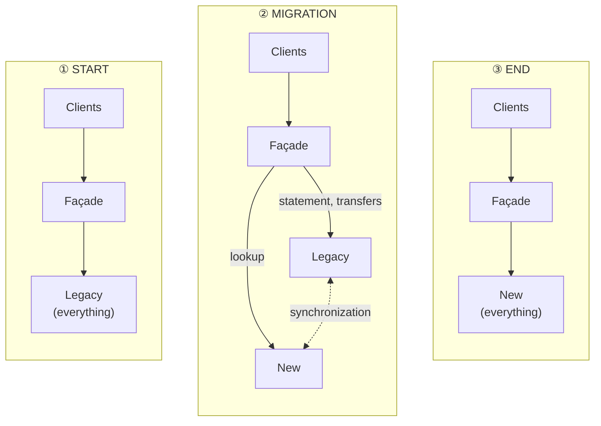
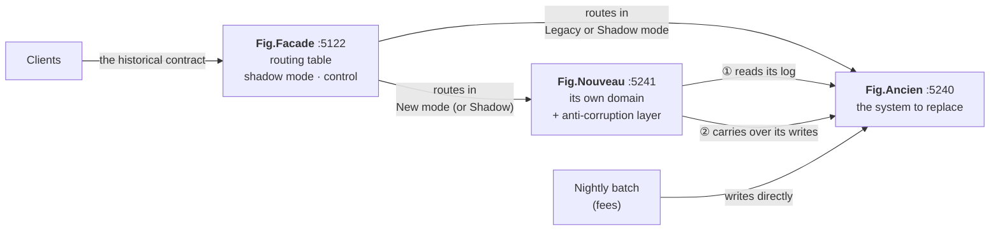
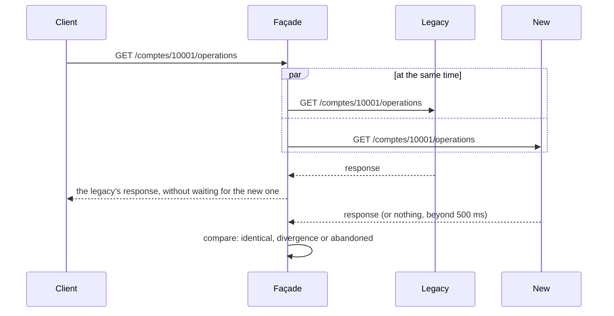
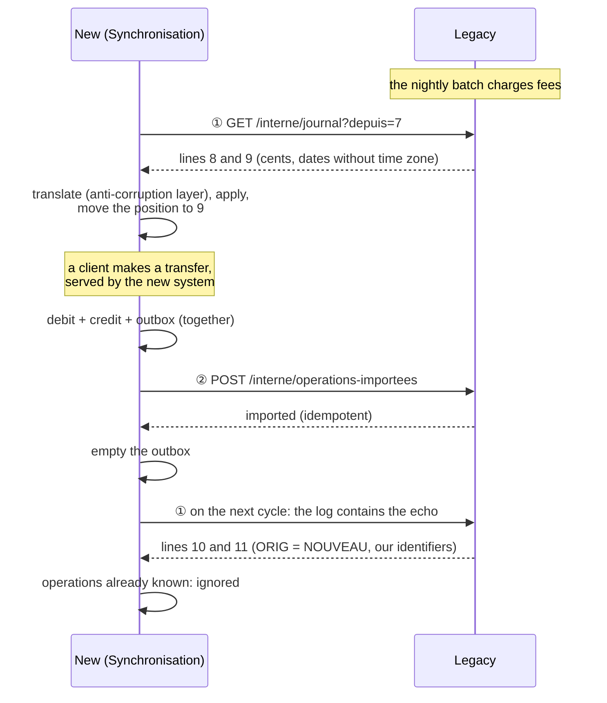

# 22. Strangler Fig (progressive migration)

> **In one sentence**: to replace an old system without rewriting everything at once, you put a **façade** in front of
> it, then take its features away **one route at a time** in favor of a new service, until the day it is no longer
> used and can be switched off.

📁 Code: [`22-StranglerFig`](../../22-StranglerFig) · ⬅️ [Choreography](21-choregraphie.md) · ➡️ [REST, gRPC, GraphQL](23-rest-grpc-graphql.md) ·
🌐 [Français](../22-strangler-fig.md)

---

## The idea

The strangler fig sprouts in a tree's branches, sends its roots down to the ground, gradually wraps its host and ends
up standing on its own once the tree is gone. Martin Fowler named this migration pattern after it (2004).

All the other demos build a **new** system. This one answers the question met far more often: **how do you move from an
existing system to one of these architectures?** The temptation is the complete rewrite, delivered in one go ("big
bang"): months without delivering anything, an old system that keeps evolving meanwhile, and a final switchover where
everything is decided in one night, with no way back. (In the code: *Ancien* = legacy, *Nouveau* = new,
*Façade* = façade, *Ombre* = shadow.)



The Strangler Fig replaces that leap with a series of small steps: each migrated feature is **in production** right
away, on real traffic, and each step can be **undone** with one request. Clients never see the difference: they only
talk to the façade, whose address doesn't change.

---

## The projects



| Project | Role |
|---|---|
| [Fig.Ancien](../../22-StranglerFig/Fig.Ancien) | The system to replace, written "the old way": one class that does everything, amounts in cents, dates without a time zone, uppercase labels truncated to 30 characters. It only received two internal routes for the migration (its change log, the import of the new system's operations) |
| [Fig.Nouveau](../../22-StranglerFig/Fig.Nouveau) | The replacement: its own model (euros as `decimal`, dates with a time zone), its own database, and the historical contract reproduced exactly |
| [Fig.Facade](../../22-StranglerFig/Fig.Facade) | The clients' only entry point: HTTP relay, routing table changeable live, shadow-mode comparisons, migration tracking. No business logic |

None of the three references the others: the façade and the new service only know the legacy over HTTP (architecture
test). The day the legacy is switched off, you delete its project and the anti-corruption layer; nothing else compiles
against it.

---

## 1. The façade: a routing table

Each route has a **mode**: who answers. It is changed live (`PUT /facade/routes/{nom}`), without redeploying or restarting.

| Mode | Who answers | The new service… |
|---|---|---|
| `Ancien` (legacy) | the legacy | is not called |
| `Ombre` (shadow) | the legacy | is called **at the same time**, its response is compared then discarded |
| `Nouveau` (new) | the new one | answers; the legacy is no longer called for this route |

And above all: **anything undeclared goes to the legacy**. That is the pattern's starting point (an empty façade that
forwards everything), and the protection against what was never inventoried — as the comment says, what nobody took
over stays with the legacy. ([Relais.cs](../../22-StranglerFig/Fig.Facade/Relais.cs)) (The code is quoted exactly as
it is.)

```csharp
var route = table.Trouver(http.Request.Method, chemin);
var mode = route?.Mode ?? Mode.Ancien;   // ce que personne n'a repris reste à l'ancien : c'est le point de départ
```

Each response carries the header `X-Servi-Par: ancien` or `nouveau` (served by), and the façade counts, route by route,
how many calls each system served (`GET /facade/routes`). The `/interne/*` routes of both systems are never forwarded:
a client cannot read the legacy's log or trigger its fees through the façade.

The initial table, in `appsettings.json`, shows a migration in progress:

| Route | Method and path | Mode |
|---|---|---|
| `consultation` (lookup) | `GET /comptes/{numero}` | Nouveau |
| `operations` | `GET /comptes/{numero}/operations` | Ombre |
| `releve` (statement) | `GET /comptes/{numero}/releve` | Ancien |
| `virements` (transfers) | `POST /virements` | Ancien |
| *(undeclared)* | `GET /agences`, and everything else | Ancien |

---

## 2. Shadow mode: prove before switching

The contract tests (section 4) check the cases someone thought of writing. Shadow mode checks **every case real traffic
produces**: the façade calls both systems, returns the legacy's response, and compares.



Both calls leave at the same time; the client only waits for the legacy:

```csharp
// Les deux appels partent en même temps ; le client n'attend que l'ancien.
var budget = new CancellationTokenSource(options.BudgetOmbreMs);
var ombre = Envoyer("nouveau", Message(http.Request, corps), budget.Token);
```

Compared AFTERWARDS, without being awaited: a slow or failing new service slows nobody down.

```csharp
// Comparée APRÈS coup, sans être attendue : un nouveau service lent ou en panne ne ralentit personne.
_ = comparateur.Comparer(route!.Nom, $"{http.Request.Method} {chemin}{http.Request.QueryString}", reponse, ombre, budget);
```

`GET /facade/comparaisons` gives the summary: identical responses, **divergences** (with both bodies, to investigate)
and **abandoned** calls (the new service exceeded its budget or didn't answer; not a divergence, but worth watching
before handing it the load). The JSON is compared structurally: property order and whitespace don't matter, values do.

**Only a read has a shadow mode.** Executing a transfer on both sides would debit twice: the façade refuses (`400`) to
put a write in shadow mode. ([TableDeRoutage.cs](../../22-StranglerFig/Fig.Facade/TableDeRoutage.cs))

```csharp
// Une écriture n'a pas de mode « ombre » : l'exécuter des deux côtés ferait deux virements.
private static void Verifier(Route route, Mode mode)
{
    if (mode == Mode.Ombre && route.Methode != "GET")
```

For writes, confidence comes from the contract tests, then a careful switchover, reversible at any moment.

---

## 3. Two databases, a single truth: synchronizing both ways

During the migration, both systems have their own data, and both write: the legacy for its routes not yet migrated
**and for its internal processing** (here, the fees charged at night, which never go through the façade); the new one
for its migrated routes. So synchronization must go **both ways**.



② Carrying over our writes: if the legacy doesn't answer, they stay in the outbox for the next cycle; since the import
is idempotent, a resent batch isn't counted twice.
([Synchronisation.cs](../../22-StranglerFig/Fig.Nouveau/Synchronisation.cs))

```csharp
// ② Reporter nos écritures. Si l'ancien ne répond pas, elles restent dans la boîte d'envoi pour le cycle
//    suivant ; l'import étant idempotent, un lot renvoyé n'est pas compté deux fois.
var aReporter = depot.AReporter();
if (aReporter.Count > 0)
{
    await ancien.Importer(aReporter.Select(TraducteurAncien.VersAncien).ToList(), annulation);
    depot.MarquerReportees(aReporter);
}
```

The pitfalls of this two-way flow are those of any distributed system, and each has its test:

| Pitfall | Countermeasure | Test |
|---|---|---|
| A write from the new system comes back through the legacy's log (**loop**) | the echo carries the new system's identifier, already known: ignored | `L_echo_d_un_virement_du_nouveau_ne_revient_pas_en_double` |
| The legacy is unreachable when carrying over | **outbox**: filled with the transfer, emptied only after confirmation | `Si_l_ancien_est_injoignable_les_operations_attendent_le_cycle_suivant` |
| The legacy imported, but the response was lost | **idempotent import**: the resent batch is counted only once | `Un_lot_renvoye_apres_une_reponse_perdue_n_est_importe_qu_une_fois` |
| An unknown log line | synchronization **stops** rather than ignoring the line: a visible lag is better than a silent gap | `Un_type_inconnu_arrete_la_traduction_au_lieu_d_etre_ignore` |

This change log is a simplified version of **Change Data Capture** (Debezium on the database's transaction log, for
example). The first cycle rereads everything from the start: that is the initial data load.

### The anti-corruption layer

The legacy's log speaks its own language: six-letter columns (`NUMCPT`, `MNTCTS`, `DATOPE`), cents, Paris time without
a time zone. A single class translates it, both ways, and the new system's model sees nothing of it (the same idea as
in the [DDD demo](11-ddd.md)). The legacy records Paris time without a time zone: this is where you decide which
instant it means. ([CoucheAntiCorruption.cs](../../22-StranglerFig/Fig.Nouveau/CoucheAntiCorruption.cs))

```csharp
/// <summary>L'ancien note l'heure de Paris sans fuseau : c'est ici qu'on décide de quel instant il s'agit.</summary>
public static DateTimeOffset DateDepuisAncien(string texte)
{
    var locale = DateTime.ParseExact(texte, FormatDate, CultureInfo.InvariantCulture);
    return new DateTimeOffset(locale, Paris.GetUtcOffset(locale));
}
```

---

## 4. Reproducing the legacy contract, habits included

Clients depend on the legacy's API **as it is**, quirks included. The new service has its own model, but it exposes the
historical contract exactly: that is what allows switching a route without telling anyone.
([Contrat.cs](../../22-StranglerFig/Fig.Nouveau/Contrat.cs))

| The legacy's habit | What the new system must do |
|---|---|
| Computes in cents, then divides by 100: `947.1` in the JSON | never write `947.10`, even if the client sent `70.10` |
| Dates in Paris time, without a time zone: `2026-10-12T10:05:00` | convert from its `DateTimeOffset`; an operation on October 31 at 11:30 pm UTC is on the **November** statement |
| Uppercase labels, truncated to 30 characters | keep the labels as they come from the legacy, write its own in the same format |
| Operations sorted by date, most recent first | sort by date, not by arrival order (a legacy operation can arrive after a more recent transfer) |
| Uppercase errors: `{"erreur":"SOLDE INSUFFISANT"}` | same statuses, same messages |
| Text statement, aligned columns, `\r\n` line endings, comma decimals ("1000,00") | the same text, character for character |

The comment: the legacy computes in cents then divides by 100 — 950 and not 950.00 in the JSON — and its representation
is reproduced.

```csharp
// L'ancien calcule en centimes puis divise par 100 : 950 et non 950.00 dans le JSON. On reproduit sa représentation.
private static decimal Euros(decimal montant) => TraducteurAncien.Centimes(montant) / 100m;
```

The **contract tests** ([EquivalenceTests.cs](../../22-StranglerFig/Fig.Tests/EquivalenceTests.cs)) build a varied
history (legacy fees, transfers on both sides, an operation at the turn of the month), then send the same requests to
both systems and demand responses **identical character for character**: 13 reads, 7 refused transfers. Three of the
gaps in the table above (amounts, time zone, sorting) were deliberately introduced into the new service to check that
these tests see them: they see them all.

The only accepted difference: a transfer's **reference** (`VIR-000001` for the legacy, `VIR-N00001` for the new one). It
is opaque to clients, and two distinct numberings avoid any collision when a route goes back and forth.

---

## 5. Rolling back

A problem in production on a migrated route? You give it back to the legacy, with the same request used to migrate it:

```http
PUT {{facade}}/facade/routes/virements
X-Cle-Admin: demo

{ "mode": "Ancien" }
```

It is the **return** synchronization that makes this safe: the legacy knows the transfers made by the new system. The
test `Revenir_en_arriere_sur_une_route_ne_perd_aucun_virement` proves it: after a €100 transfer served by the new
system, then a return to the legacy, the latter refuses a €950 transfer (it knows only €900 is left). Without the
carry-over, it would have accepted it.

---

## 6. Switching the legacy off

All declared routes in `Nouveau` mode are not enough: there may still be calls nobody inventoried.
`GET /facade/progression` measures both:

```json
{ "routesDeclarees": 4, "routesMigrees": 4, "pourcentage": 100,
  "appelsNonDeclares": 0, "appelsAncienDepuisDerniereBascule": 0, "ancienRetirable": true }
```

`ancienRetirable` (legacy removable) requires every route migrated **and** no call to the legacy since the last
switchover. In the demo, `GET /agences` is the forgotten feature: a single call is enough to set the flag back to
`false`. If you switch the legacy off anyway, the four migrated routes keep working, and `/agences` answers `502`: it
had to be migrated too (test `Une_fois_tout_migre_l_ancien_peut_etre_eteint`).

---

## The limits, shown rather than hidden

- **Reading on one side what was written on the other.** With the initial table, the lookup is served by the new system
  and transfers by the legacy. Right after a transfer, the lookup shows the **old balance**, until the next
  synchronization cycle (500 ms). Observed on the running demo, and pinned down in the test
  `Ecrire_chez_l_un_et_lire_chez_l_autre_montre_un_solde_en_retard_jusqu_a_la_synchronisation`. Countermeasure: switch
  the reads and writes of the same data **together**, or only open to the new system data it alone writes.
- **Two writers, one rule.** During the synchronization window, the legacy (its nightly fees) and the new system (its
  transfers) can debit the same account without seeing each other: an overdraft is possible. Every rule about a balance
  must be checked by **a single** system, or tolerate this lag.
- **The new system must be up to date before serving.** At startup, until the first cycle has run, it knows no account.
  In production: only send it traffic once the initial load is done (readiness probe).
- **The cost of coexistence**: two systems to operate, a synchronization to monitor, a translation layer to maintain,
  for as long as the migration lasts. A migration that drags on costs more than either system alone.

---

## Strangler Fig and the other demos

| | The façade's role | Lifetime |
|---|---|---|
| **Strangler Fig** | route each request to the legacy or the new system, for the duration of the migration | temporary: the table ends with everything in `Nouveau`, and the façade becomes a simple gateway |
| [API gateway](08-microservices.md) | single entry point, routing, security, quotas | permanent |
| [BFF](16-bff.md) | adapt the services to **one** client application | permanent |
| [Anti-corruption layer](11-ddd.md) | protect one model from another system's model | as long as the other system exists |

The pattern says nothing about the new system's shape: the new service can be organized according to any demo
(hexagonal, vertical slices…), and the target can be a [modular monolith](07-monolithe-modulaire.md) as well as
[microservices](08-microservices.md). You can also strangle **from the inside** ("branch by abstraction"): an interface
in front of part of the code, two implementations, a switch; the same principle without a network façade.

---

## The tests

The three processes run in memory, each with its real program; each link between them can be cut, slowed down, or lose
its responses, and an adjustable clock dates the operations on both sides.
([Systeme.cs](../../22-StranglerFig/Fig.Tests/Systeme.cs))

| Test | What is checked |
|---|---|
| `Une_lecture_donne_la_meme_reponse_des_deux_cotes` (13 cases), `Un_virement_refuse_l_est_avec_la_meme_erreur_des_deux_cotes` (7 cases) | **contract tests**: responses identical character for character |
| `Le_contrat_herite_garde_les_habitudes_de_l_ancien` | truncated label, Paris time without a time zone, `-2.5` and not `-2.50` |
| `Une_route_que_personne_n_a_reprise_va_a_l_ancien`, `Les_routes_internes_ne_sont_pas_exposees_aux_clients` | default routing, internal routes |
| `Basculer_une_route_change_qui_repond_sans_redemarrer_ni_rien_changer_pour_le_client` | live switch, `X-Servi-Par`, counters |
| `En_mode_ombre_le_client_recoit_la_reponse_de_l_ancien_et_les_deux_sont_comparees`, `Une_divergence_est_signalee_sans_que_le_client_la_voie` | shadow mode |
| `En_mode_ombre_un_nouveau_service_lent_ou_en_panne_ne_gene_pas_le_client` | response in under 1.5 s when the new system takes 5; abandoned calls |
| `Le_mode_ombre_est_refuse_pour_une_ecriture`, `Le_pilotage_de_la_migration_exige_la_cle_d_administration` | control safeguards |
| `Revenir_en_arriere_sur_une_route_ne_perd_aucun_virement` | safe rollback |
| `L_ancien_n_est_retirable_que_lorsque_plus_rien_ne_l_appelle`, `Une_fois_tout_migre_l_ancien_peut_etre_eteint` | the end of the migration |
| `Le_premier_cycle_recharge_tout_l_ancien`, `Ce_qu_ecrit_un_traitement_interne_de_l_ancien_arrive_dans_le_nouveau`, `Un_virement_fait_dans_le_nouveau_est_reporte_dans_l_ancien` + the three pitfalls in the table of section 3 | two-way synchronization |
| `Une_ligne_du_journal_devient_une_operation_en_euros_avec_son_fuseau`, `L_heure_de_Paris_n_a_pas_le_meme_decalage_en_hiver`… | anti-corruption layer (no server) |
| `La_facade_et_le_nouveau_service_ne_connaissent_l_ancien_que_par_HTTP` | **architecture test** |

Checked by mutation (17 attempts, all detected): echo counted twice, non-idempotent import, forgotten carry-over, outbox
emptied before confirmation, undeclared route sent to the new system, internal routes forwarded, shadow awaited by the
client, shadow allowed for a write, a comparison that compares nothing, contract amounts, time zone or sorting
falsified, label not truncated, unknown log type ignored, balance rule forgotten by the new system, a removal flag that
no longer measures calls.

---

## Summary

| 👍 Strengths | 👎 Limits |
|---|---|
| **Deliver right away**: each migrated route serves real traffic | Two systems to run together for as long as the migration lasts |
| **Reversible** at every step, with one request | Two-way synchronization: loops, failures, idempotency, lag |
| Shadow mode proves equivalence on real traffic, without risk | The legacy contract, quirks included, must be reproduced exactly |
| Clients change nothing: they only see the façade | Reading on one side what was written on the other: switch data in consistent blocks |
| You know when you're done: no more calls to the legacy | A migration that stops at 80% leaves the worst of both worlds |

**When to use it**: to replace a system **in production** whose service can't be stopped and whose evolution can't be
frozen for a rewrite, and whose features can be split into routes (or screens, messages). Less useful for a small
system rewritten in a few weeks, or when the legacy has no entry point that can be intercepted. In production: **YARP**
or the existing API gateway for the façade, **Debezium** (or database triggers) to capture changes, **Scientist**
(GitHub) or **Diffy** (Twitter) for shadow mode, and feature flags to switch by percentage of customers rather than all
at once.
